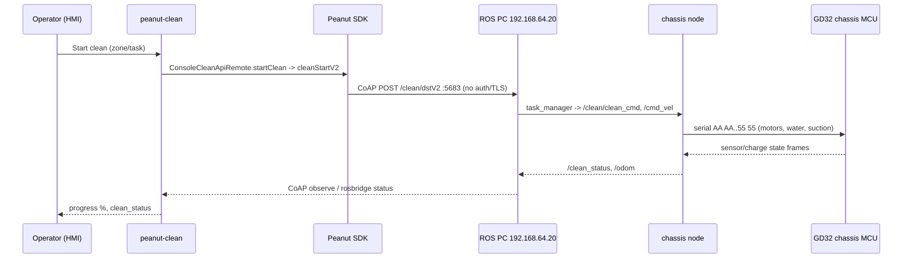

# Application Workflows - Keenon C40 (release V246)

Reconstructed from static analysis of the tablet apps + Peanut SDK + ROS graph. Each workflow: entry -> components -> SDK/API -> data -> robot -> result, with status/confidence. Full step detail in `partials/peanut_clean_app.md` (WF-1..14, findings PCL-034..047) and `partials/installation_assistant_app.md` (RIA-027..031). **A UI control is only labelled as actuating the robot where the call chain was traced; otherwise INFERRED.** Nothing is runtime-verified.

## Cleaning HMI (peanut-clean) workflows

| ID | Workflow | Entry -> path | Status / Conf |
|---|---|---|---|
| PCL-034 | Boot/init | `CleanApplication` -> initializers (Room `kc01.db`, SDK, MQTT, Sentry) | CONFIRMED / HIGH |
| PCL-035 | PIN login / admin | `PassWordActivity.isPasswordCorrect` vs MMKV `system_in_code`/`app_in_code` + native default PINs + **compiled-in backup PIN** | CONFIRMED / HIGH (see PCL-049) |
| PCL-036 | Start cleaning (manual/real-time/timer/cloud) | UI -> `ConsoleCleanApiRemote.startClean` -> `cleanStartV2` -> **CoAP `/clean/dstV2`** to `192.168.64.20:5683` | STRONGLY_SUPPORTED / MED |
| PCL-037 | Scheduled cleaning | `CLEAN_STRATEGY` table + alarm -> start-clean path | CONFIRMED / HIGH |
| PCL-038 | Auto recharge | UI -> SDK charge -> **CoAP `/charge/auto`**; state via `/charge_state_fromSTM32` | CONFIRMED / HIGH |
| PCL-039 | Self-clean / work-station supply | SDK clean/device -> dock (ESP32-S3) water/charge FSM | CONFIRMED / HIGH |
| PCL-040 | Map sync (IPC->tablet->cloud) | ROS `peanut.db`/maps -> SDK map transport (TFTP/CoAP) -> Room -> cloud | STRONGLY_SUPPORTED / MED |
| PCL-041 | Cloud remote command (MQTT) | `CleanServerServiceImpl.cleanRobotCommandHandle` <- MQTT broker | CONFIRMED / HIGH (see PCL-067) |
| PCL-042 | Software/firmware upgrade | `UpgradeHelper` checkUpdate -> download (MD5 only) -> install/`pm`/SDK `/update/*` | STRONGLY_SUPPORTED / MED |
| PCL-043 | Registration / token / MQTT bootstrap | device auth -> token -> MQTT creds | STRONGLY_SUPPORTED / MED |
| PCL-044 | H5 map/record UI <-> native <-> IPC | JsBridge -> native -> SDK/rosbridge | CONFIRMED / HIGH |
| PCL-045 | Teach (personal) path recording | H5 -> SDK; actuation INFERRED | INFERRED / MED |
| PCL-046 | Manual hand-push cleaning | mode switch; chain not fully traced | INFERRED / MED |
| PCL-047 | Re-localisation | SDK -> `/localization/set_pose`, `initialpose` | STRONGLY_SUPPORTED / MED |

## Installation / mapping (installation-assistant) workflows

| ID | Workflow | Path | Status / Conf |
|---|---|---|---|
| RIA-027 | Charge | SPA `operationAutoCharger`/`operationStopCharger` -> `:8888` WS -> `RobotManager` -> `PeanutSDK.battery/charge` | STRONGLY_SUPPORTED / HIGH |
| RIA-028 | Navigation | `operationNavigationDst/Action` -> `RobotManager.navigation/controlNavigation` -> `NavigationComponent` | STRONGLY_SUPPORTED / HIGH |
| RIA-029 | Map scan/edit | SPA -> `:8888` relay -> rosbridge `192.168.64.20:9090/9091` -> `scan_base_map`, gmapping/cartographer, `map_app_start` | STRONGLY_SUPPORTED / MED |
| RIA-030 | USB map import/export + map download | SPA requestTypes -> file/SMB/TFTP transfer | STRONGLY_SUPPORTED / MED |
| RIA-031 | Cloud sync | token -> robot info -> software/resource update -> mapping tasks over MQTT | STRONGLY_SUPPORTED / MED |

## Example sequence (clean start, representative)

(Steps from SDK to IPC are CONFIRMED_STATIC via decompiled call chain; IPC-internal ROS hops are STATIC_REFERENCE; MCU serial framing is from firmware. Live execution UNVERIFIED_RUNTIME.)

## Confidence
Boot/PIN/schedule/MQTT-handler/H5-bridge: CONFIRMED (decompiled). Robot-actuating chains (clean/charge/nav): STRONGLY_SUPPORTED where the SDK call is traced; the physical effect and the UI-click-to-SDK hop are INFERRED. Teach/hand-push: INFERRED. No workflow was executed.
