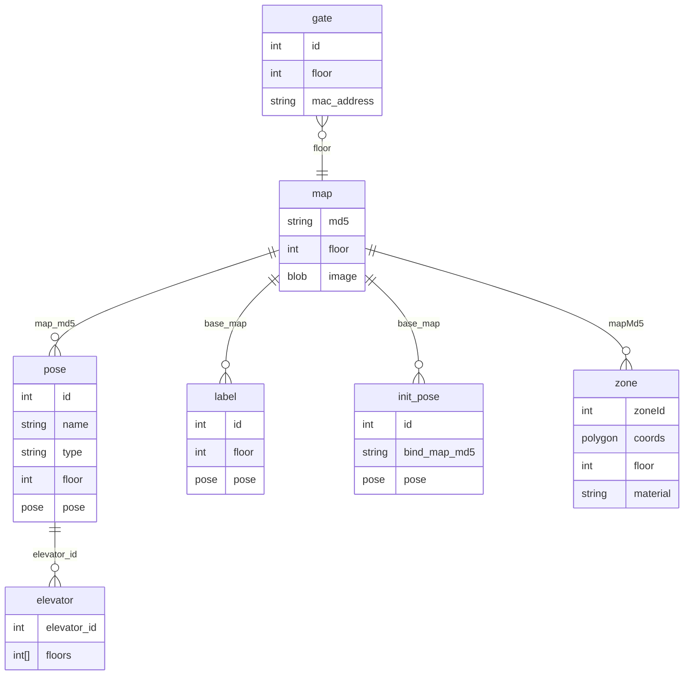

# Database & Local Storage Analysis - Keenon C40 (release V246)

Static only. Schemas recovered from `CREATE TABLE` strings in decompiled Room/greenDAO classes, from the ROS `database_node` binary, and by opening one shipped `.db`. **No populated production database was available**, so these are **schema/structure** findings, not row data. No passwords/PII/keys are reproduced. Detail: `partials/peanut_clean_app.md`, `partials/installation_assistant_app.md`, `partials/ros_packages.md`.

## 1. Databases discovered

| DB | Engine | Where | Owner | Status |
|---|---|---|---|---|
| `peanut.db` | SQLite3 (WAL) | `/etc/ros/runtime/database/peanut.db` on the ROS PC | `database_node` (ROS) | CONFIRMED_STATIC (schema from binary) |
| `peanut.db` (empty seed) | SQLite3, 1024-B pages, 1,282 pages (1,280 free) | `installation-assistant` `assets/ros/dist/empty-database.zip` | installation assistant | CONFIRMED_STATIC (opened; only `sqlite_sequence`, no rows) |
| `Mapping.db` | Room 2.3.0 (SQLite) | installation assistant | Room | CONFIRMED_STATIC (7 tables) |
| peanut-clean Room DB (`kc01`/`keenon`) | Room (SQLite) | `ExternalStorage/keenon/db/kc01.db` | Room `MyRoomDatabase` | CONFIRMED_STATIC (13 tables, migrations v24-v41) |
| `peanut_service.db`, `app.db` | greenDAO (SQLite) | installation assistant | greenDAO DaoMaster | CONFIRMED_STATIC (3 entities) |
| Library DBs | SQLite | logback SQLiteAppender, Umeng (`__er/__et/__sd`), AMap, Upgrade records | 3rd-party | STRONGLY_SUPPORTED |

## 2. ROS `peanut.db` (authoritative robot map/semantic store)
`database.launch: database_file_path=/etc/ros/runtime/database/peanut.db`; `database_node` uses `sqlite3_open_v2`, `PRAGMA journal_mode=WAL`, `wal_autocheckpoint=100`. `CREATE TABLE` for: **map, pose, init_pose, label, transform, gate, elevator, RobotPos, RobotSensorData** (+ others). Served over ROS via `keenon_database_msgs/*Config` services (`mapConfig`, `poseConfig`, `zoneConfig`, `pathConfig`, `labelConfig`, `elevatorConfig`, `gateConfig`, `initPoseConfig`, `robotPosConfig`, ...; full field-level `.srv` defs in `ros_packages.md` section 4). This is the on-robot source of truth for maps, poses, zones, paths, labels, elevators and gates; the tablet mirrors subsets into its own Room DBs.

(ER is INFERRED from `keenon_database_msgs` field relationships; join keys are the `*_md5`/`*_id` fields.)

## 3. Tablet Room schema - peanut-clean (`kc01.db`, 13 tables, migrations v24-v41)
Tables (from `MyRoomDatabase_Impl` `CREATE TABLE` strings): `ALARM_SESSION`, `CLEAN_STRATEGY`, `ELEVATOR`, `ELEVATOR_FLOOR`, `MAP_AREA`, `MAP_DATA_HISTORY`, `MAP_POINTS`, `MAP_VIRTUAL_WALL`, `RECHARGE_LOG`, `ROBOT_MAP`, `SYS_DICT`, `SYS_DICT_DETAIL`, `TASK_ATTACH_DETAIL`.
- `CLEAN_STRATEGY`: schedule/cleaning jobs (name, map ids, cycle type/detail, start/finish, state, clean area/duration, back point, config JSON blobs). This is the **cleaning schedule store**.
- `ROBOT_MAP` / `MAP_AREA` / `MAP_POINTS` / `MAP_VIRTUAL_WALL`: map, zones, points (incl. `IS_DEFAULT_CHARGE`), virtual walls.
- `RECHARGE_LOG`: charging history. `SYS_DICT*`: enums.
- Legacy (migration-referenced only): `ROBOT_EXCEPTION_LOG`, `BURIED_POINT`, `CLEAN_LOG*`, `CLEAN_DETAIL`, `TASK_IMAGE`. **Migration 29->30 deletes all task/map data** ("big version update, task data incompatible").
- Type converters store JSON blobs in TEXT columns (AreaPoint, CleanConfig, CleanMapConfig, TaskSnapshot, ...).
- **Location/at-rest:** `ExternalStorage/keenon/db/` (PCL-024) -> world-readable to apps with storage permission; `allowBackup=true` (PCL-058). Security: DB unencrypted on shared storage.

## 4. Tablet Room schema - installation assistant (`Mapping.db`, 7 tables, Room 2.3.0)
`dynamic_map_info`(_id,floor,resolution,width,height,position_xyz,orientation_xyzw), `elevator`(_id,elevator_id,robot_id,available_floor,transit_floor,opendoor_time), `gate`(_id,id,floor,mac_address), `init_pose`(init_id,base_map,init_method,angleRange,confidence,penetrate,pose), `label`(label_id,base_map,floor,pose), `pose`(target_id,name,type,floor,phone,map_md5,elevator_id,pose,floorInfo,buildingInfo,macAddress,disableOrientation,phoneStr), `map`(name,type,floor,value,map_md5,floorInfo,buildingInfo). Mirrors the ROS `peanut.db` map/pose/label/elevator/gate structure. Plus greenDAO `peanut_service.db`/`app.db`: `BuildMapEntity`, `CacheData`, `WorkTime`.

## 5. Key-value / other stores
- **MMKV** (encrypted, key from `CipherUtil`/`libcipher_pack.so`): id `encrypted_data`; holds PIN values (`system_in_code`/`app_in_code`, `modified_pin_code_*`), clean config, flags (PCL-025). Note secrets also land in plaintext SharedPreferences/MMKV per SYS-017.
- **Maps on disk:** `/etc/ros/runtime/maps`, `cfg/maps/*.zip` (PGM bitmaps: 4000x4000 P5 PGM = ~16 MB each; per-floor `mapN.pgm`, `mapNVirtualWall.pgm`, `mapNGateWall.pgm`); cartographer `.pbstream` (ROS-021).
- **Runtime/log dirs:** `/home/peanut/keenon/{core,log,bag,...}`, `/etc/ros/runtime/*`, `krlog` -> `/sdcard/krlog` (ROS-022, SYS-023).

## 6. Confidence & limits
Schemas: CONFIRMED_STATIC (from `CREATE TABLE`/`.srv`). Relationships/ER: INFERRED from field naming. **No row-level/production data** was present; the only openable DB (`empty-database.zip/peanut.db`) was an empty seed. Encrypted MMKV contents and BKS keystores were not decrypted (secrets not extracted). No DB was modified.
