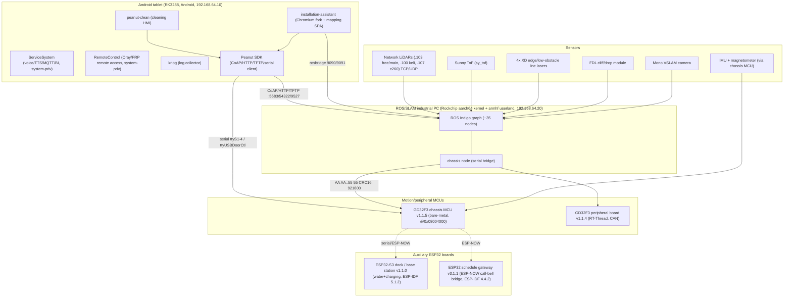

# Robotics System Architecture - Keenon C40 (release V246)

Evidence-based reconstruction from the shipped release. Labels: **CONFIRMED_STATIC** (in an artifact), **INFERRED**, **HISTORICAL**, **UNKNOWN**, **UNVERIFIED_RUNTIME**. No live robot observed. Detail: `partials/ros_packages.md`, `partials/firmware_and_scripts.md`, plus `ROS_*` docs in this folder.

## 1. Compute and board topology

| Component | Identity | Status |
|---|---|---|
| Android tablet | RK3288, system apps `rk3288-signed`, IP .10, also ROS PC's Internet gateway | CONFIRMED_STATIC (signing, IP, gateway); board=RK3288 CONFIRMED (APK name + Rockchip OTA in RemoteControl) |
| ROS/SLAM PC | ROS Indigo on Ubuntu 14.04 armhf userland; aarch64 kernel on a Rockchip SoC; IP .20 | CONFIRMED_STATIC (debs/arch); exact SoC model UNKNOWN |
| Chassis MCU | GD32F3 (C40 chassis app v1.1.5), bare-metal, 148-byte Keenon IAP tail | CONFIRMED_STATIC (firmware) |
| Peripheral board | GD32F3 (C40 periph v1.1.4), RT-Thread, CAN to cleaning actuators | STRONGLY_SUPPORTED (RT-Thread + CAN strings) |
| Dock / base station | ESP32-S3, ESP-IDF 5.1.2, water + charging FSM | CONFIRMED_STATIC (firmware). Note: despite `update_Stm32.sh` naming, it is ESP32-S3 not STM32 (FW-010/024) |
| Schedule gateway | ESP32, ESP-IDF 4.4.2, ESP-NOW call-bell bridge | CONFIRMED_STATIC (firmware) |

## 2. Hardware (sensors / actuators) - STATIC_REFERENCE

Derived from the C40 launch profile (`keenon_robot_C40.launch`) and message/driver evidence (ROS-005/006, FW-006/030). Presence in the package != installed on a given unit.

| Class | Evidence | Status |
|---|---|---|
| Main LiDAR | "free" network lidar, `libc200_lidar.so`, TCP `192.168.64.103:2111`; C40 `LIDAR_TYPE=free, LIDAR_NUM=1` | CONFIRMED_STATIC (interface); vendor model UNKNOWN |
| Back LiDAR | GS2/ydlidar (`USE_LASER_BACK=true`) | CONFIRMED_STATIC |
| Alt LiDARs (other models) | SDKELI LS1207DE (.100:2112), ldlidar LD06, YDLIDAR; free_c260 (.107) | CONFIRMED_STATIC (present) |
| Depth/ToF | Sunny ToF `sy_tof` (`USE_TOF=true`); FDL depth module | CONFIRMED_STATIC. **C40 does NOT use astra/berxel RGB-D cameras** (`USE_CAMERA=false`) though drivers are in the package |
| Edge lasers | 4x XD line lasers -> `micro_laser_node` x3 + auto_bind (`USE_EDGE_LASER=true`) | CONFIRMED_STATIC |
| Cliff/drop | FDL (`fdl_ros_node`, `USE_DROP_RESISTENT=true`) -> `/fdl/obs_low`, `/NoFallingRiskMap` | CONFIRMED_STATIC |
| Camera | Mono VSLAM camera (`MONO=true`, `VSLAM=false` standalone) | CONFIRMED_STATIC |
| IMU + magnetometer | `/imu_raw`, `/imu_low_rate`, `keenon_chassis_msgs/magnetometer_data` via chassis MCU | CONFIRMED_STATIC (topics) |
| Odometry/encoders | `/odom`, `/encoder_raw` via chassis MCU | CONFIRMED_STATIC |
| Ultrasonic / PSD / bump / pressure | `/sonar1-4`, `/psd1-4`, `/bump`, `/pressure` (chassis) | CONFIRMED_STATIC (topics) |
| Cleaning actuators | roll/disc/edge brushes, suction fan, water pump, dust box, rake rod, wash brush - via chassis MCU + periph CAN | CONFIRMED_STATIC (topics + FW-006) |
| Battery/charging | `/battery_state`, `/charge_cmd_toSTM32`, `/charge_state_fromSTM32`; BMS ASCII frames in chassis MCU (FW-008); dock charging FSM (FW-030) | CONFIRMED_STATIC |
| Water system | dock water system (FW-030); `/remaining_water/*` topics | CONFIRMED_STATIC |
| Docking/charging station | ESP32-S3 dock; `charger_station_version` | CONFIRMED_STATIC |
| Elevator/gate | LoRa driver + elevator_task + gate (`keenon_elevator_msgs`, `keenon_gate_msgs`) | CONFIRMED_STATIC |

## 3. ROS graph, topics, Master URI

Full detail in `ROS_TOPICS_INVENTORY.md`, `ROS_IP_IDENTIFICATION.md`, `ROS_COMMUNICATION_ARCHITECTURE.md`. Summary:
- **ROS Master:** `http://192.168.64.20:11311` (CONFIRMED_STATIC, not live).
- **~35 nodes** in the C40 launch profile (CONFIRMED_STATIC from launch XML; UNVERIFIED_RUNTIME).
- **Hundreds of topic names** harvested from node binaries; pub/sub direction UNKNOWN except the CoAP bridge; topic<->type pairing mostly INFERRED.
- **No live ROS graph was observed** - nothing is CONFIRMED_LIVE.

## 4. Telemetry, logging, data flow

- **Event tracking / rosbag:** `keenonrecorder` + `keenon_event_tracking`; `/event_tracking_report`; rosbag record controlled by `cfg_rosbag_sw_cmd` (ROS-017). Upload path UNKNOWN.
- **Diagnostics:** `/error_report`, `robot_monitor`, `keenon_diagnosis_msgs`, `/diastatus_report` (ROS-018).
- **Cloud:** firmware/app OTA from `cloud.robotkeenon.com` (upgradeConfig.json); tablet apps use MQTT to a cloud broker + REST to `*.keenonai.com` (see NETWORK_PROTOCOL_ANALYSIS.md). Data egress from the ROS PC is routed through the tablet (`net_gw.conf`).
- **Logs:** `krlog` collects logcat+dmesg to `/sdcard/krlog`; ROS core dumps to `/home/peanut/keenon/core` (ROS-054).

## 5. Confirmed vs inferred vs unknown (robotics)

- **CONFIRMED_STATIC:** board identities & firmware types; network layout & ROS Master URI; C40 sensor/actuator set from launch; message/service/action definitions; serial framing to MCU.
- **INFERRED:** exact pub/sub direction; which physical lidar vendor; that a UI command physically actuates a given motor (call chains traced only partially).
- **HISTORICAL:** `to_abandon/` scripts, legacy 4G/ppp, `rosenv` dual local/remote modes.
- **UNKNOWN/UNVERIFIED_RUNTIME:** which launch profile runs on a real unit; live node/topic graph; actual SoC models; runtime auth state of services.
