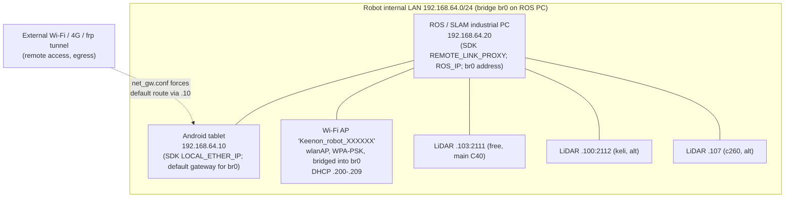
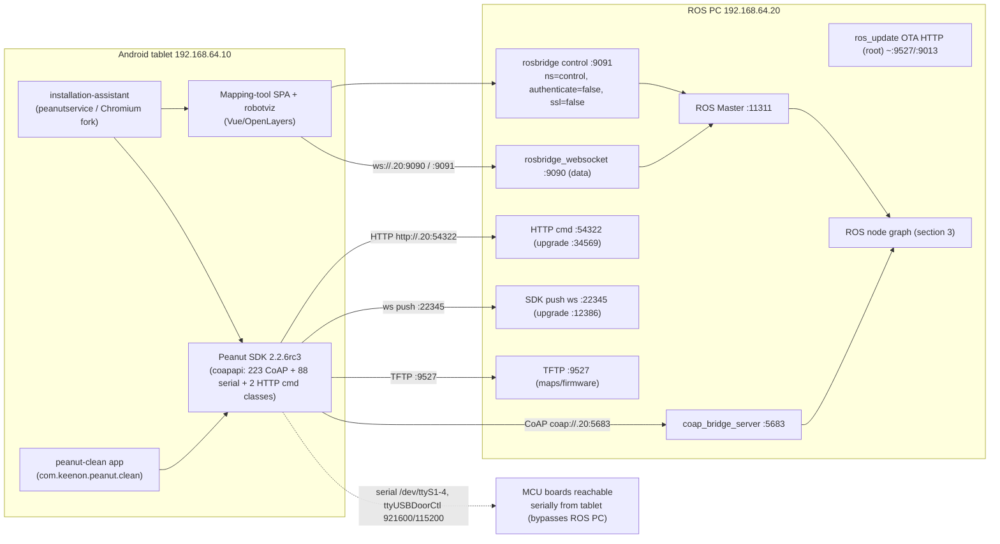
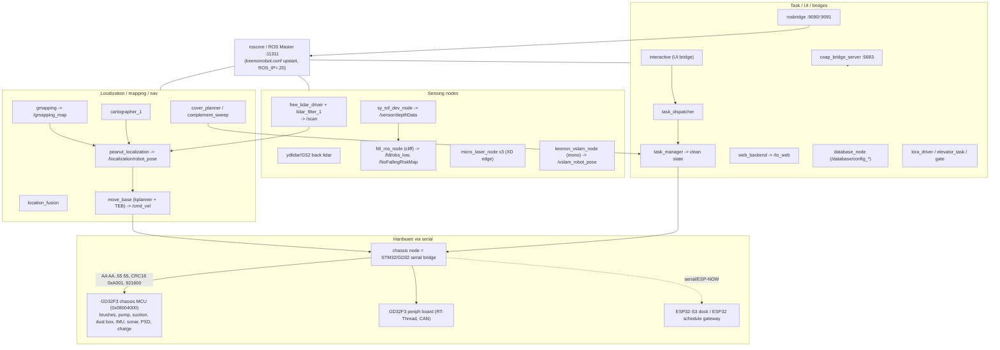

# ROS Communication Architecture - Keenon C40 (release V246)

All relationships below are `CONFIRMED_STATIC` (derived from shipped config, launch XML, decompiled APK code and firmware strings) or `INFERRED`, as labelled. **None is `CONFIRMED_LIVE`** - no running robot was observed. Secret values (Wi-Fi PSK, SSH/SMB passwords, keystore passwords, API keys) are redacted; their locations are documented in SECURITY_AUDIT / FINDINGS registers.

## 1. Network topology (CONFIRMED_STATIC)

Single flat Layer-2 segment `192.168.64.0/24`, built by the ROS computer bridging its two Ethernet ports and the Wi-Fi AP together (`etc/network/interfaces`: `br0` = `eth0`+`eth1`; `hostapd.conf`: `bridge=br0`).

Key facts:
- **ROS computer = `192.168.64.20`** (`br0` static address). ROS Master = `http://192.168.64.20:11311` (CONFIRMED_STATIC; see ROS_IP_IDENTIFICATION.md for the 8 corroborating sources).
- **Android tablet = `192.168.64.10`**, and it is the **default gateway** for the ROS PC (`net_gw.conf`: `ip route add default via 192.168.64.10 dev br0`). So outbound Internet/cloud traffic from the ROS computer egresses **through the Android tablet** (which holds the Wi-Fi/4G uplink). This is an unusual but clearly-evidenced design: the tablet is both an HMI and the robot's Internet gateway.
- The Wi-Fi AP, both Ethernet ports, the tablet, the ROS PC and the network LiDARs are all one broadcast domain. Anything that associates to the hotspot (PSK redacted; cross-ref ROS-042) is on the same L2 as the unauthenticated rosbridge control port.

## 2. Android tablet -> ROS computer (CONFIRMED_STATIC)

The tablet reaches the ROS computer **directly** (no separate gateway box); `REMOTE_LINK_PROXY` in the Peanut SDK literally equals the ROS PC address. Three parallel transport families terminate on `192.168.64.20`:

- **Path A - rosbridge (CONFIRMED_STATIC):** the on-robot SPA (robotviz / "Keenon Mapping Tool", also embedded in the installation-assistant APK) opens `ws://192.168.64.20:9090` (data) and `:9091` (control). The installation assistant additionally runs its **own** WebSocket relay on the tablet at `:8888` that forwards client messages to `192.168.64.20:9090/9091` (RIA-001/003). Control port 9091 is launched with `authenticate=false, ssl=false`.
- **Path B - Peanut SDK command transports (CONFIRMED_STATIC):** both APKs issue robot commands over CoAP `coap://192.168.64.20:5683` (e.g. `peanut-clean` `startClean -> /clean/dstV2`, `/charge/auto`, `/devices/reboot`), with HTTP `:54322`, push-WS `:22345`, and TFTP `:9527` as alternate channels auto-selected by `isUseHttpProtocol`/link-type logic. No auth/TLS on these transports (RIA-024).
- **Path C - direct serial (CONFIRMED_STATIC, INFERRED reach):** the SDK also drives `/dev/ttyS1-4` + `/dev/ttyUSBDoorCtl` directly from the tablet for some boards (`STM32`, `DOOR`, `SCHEDULE`, `PERIPHERAL_CONTROL_BOARD`). Whether a given board is reached via the tablet's serial port or via the ROS computer's `chassis` node depends on wiring not fully determinable statically (INFERRED).

## 3. ROS computer -> nodes -> hardware (CONFIRMED_STATIC launch graph)

- `chassis` is the ROS<->MCU serial bridge (ROS-006/007). It exchanges `/stm32_up`/`/stm32_down` (+schedule variants) with the GD32F3 chassis MCU and peripheral board; cross-ref firmware FW-001/002/006/016/017. Cleaning actuators (brushes `/motor_roll`,`/disc_brush`,`/roll_brush`; suction `/chassis/suction_switch`; water `/remaining_water/water_pump_value`; dust box `/BC_DustBox`) flow through this bridge.
- The ESP32-S3 dock and ESP32 schedule gateway (FW-010/011) are reached over serial/ESP-NOW, not ROS directly.

## 4. Confirmed vs inferred relationship summary

| Relationship | Status | Basis |
|---|---|---|
| ROS PC = 192.168.64.20, Master :11311 | CONFIRMED_STATIC | network config + launch + SDK, 8 sources |
| Tablet = 192.168.64.10, is ROS PC's gateway | CONFIRMED_STATIC | net_gw.conf, SDK LOCAL_ETHER_IP |
| Tablet<->ROS via rosbridge 9090/9091 (no auth on 9091) | CONFIRMED_STATIC | launch args + client URLs + APK relay |
| Tablet<->ROS via SDK CoAP/HTTP/TFTP/WS (no auth/TLS) | CONFIRMED_STATIC | decompiled SDK constants + call chains |
| No separate gateway computer between tablet and ROS PC | CONFIRMED_STATIC | REMOTE_LINK_PROXY == ROS PC addr |
| chassis node <-> GD32 MCU serial bridge | CONFIRMED_STATIC (ref) / INFERRED (framing tie-up) | chassis strings + firmware framing |
| Topic pub/sub directions | INFERRED (except CoAP bridge) | naming only; needs live/disasm |
| Any node/topic actually running | UNVERIFIED_RUNTIME | no live graph observed |
| LiDAR vendor/model per unit | INFERRED | endpoints known, model not in package |
| Which launch profile runs on a physical unit | UNKNOWN | package default is W3, not C40 |

## 5. Live verification - not performed
No read-only ROS inspector was run and no robot was network-reachable in this environment; no scanning/probing was done per constraints. All of section 1-4 is static/inferred. The single highest-value live check (read-only), if authorized access existed, is `ROS_MASTER_URI=http://192.168.64.20:11311 rostopic list -v && rosnode list` to upgrade the node/topic set to CONFIRMED_LIVE and resolve pub/sub direction via `rostopic info`.
