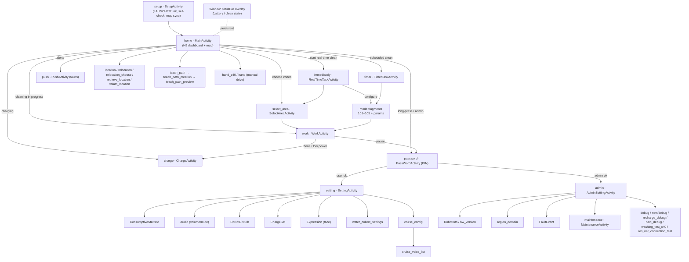
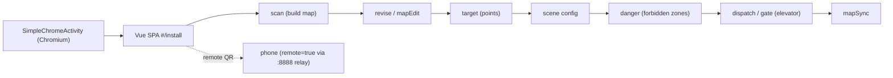

# C40 UI Navigation Flow

Navigation graph for the Keenon C40 cleaning HMI (`peanut-clean`) and the mapping tool.
Derived from `peanut-clean/assets/therouter/routeMap.json` (38 routes, **C-S**) and `../workers/peanut_clean_app.md` §3 (activity nav graph). Transitions are **STRONGLY_SUPPORTED** from route/purpose; exact triggers are **INFERRED** (H5 minified).

## peanut-clean route graph

## Key flows (S-S)

- **Clean now:** home → (select_area ↔ mode) → work → [pause→PIN] → charge-on-complete.
- **Scheduled clean:** home → timer → mode → saved to `CLEAN_STRATEGY`; fires later → work.
- **Auth gate:** any privileged action → password (PIN) → setting (user PIN) or admin (admin PIN). PIN-only; no account login.
- **Recovery:** home → location/relocation to re-establish pose before cleaning.
- **Maintenance:** PIN(admin) → admin → maintenance/debug (service-only screens).

## Mapping tool (installation-assistant) flow

Transport: SPA → WS `:8888` `{requestType}` → RobotManager → PeanutSDK; or rosbridge `ws://192.168.64.20:9090/9091`.

## Implications for the Sakar web UI

The Sakar app is **not** a tablet-on-robot HMI; it is a cloud console talking to the Sakar backend. The useful transferable structure is the **task/flow hierarchy** (home → configure (mode+area) → run → monitor → charge) and the **auth/role split** (operator vs admin), reproduced with Sakar's permission system — not the PIN gate. See `SAKAR_UI_IMPLEMENTATION_REPORT.md`.
