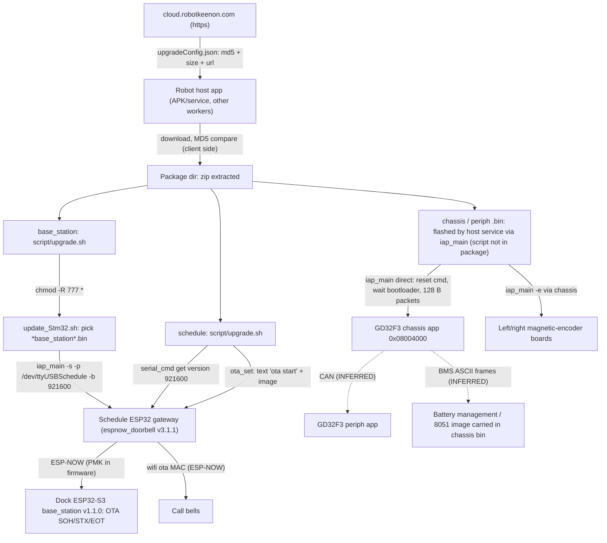

# C40 V246 - MCU firmware images, flashing tools and upgrade scripts (static, read-only analysis)

Scope: `gd32f3-c40-chassis-app-v1.1.5-0-g5bec8c6.bin`, `gd32f3-c40-periph-app-v1.1.4-0-g3df9e74.bin`, `base_station-app-v1.1.0-0-gf0ff236\*`, `schedule-v3.1.1-0-g11c2ad2\*`, `upgradeConfig.json`.
Method: Python 3.14 stdlib only (struct/hashlib/re), hand parsers (ESP image, ELF, minimal DWARF 4, Region$$Table scan). No disassembler was available. Where Thumb-2 was hand-decoded, it is stated explicitly and kept minimal (movw/movt/BL/immediate scans only). Nothing was executed, flashed or contacted; no network, no serial ports.
Status labels: CONFIRMED / STRONGLY_SUPPORTED / INFERRED / HISTORICAL / UNKNOWN / NOT_ANALYZED / BLOCKED. Confidence HIGH/MEDIUM/LOW.
Helper scripts (scratchpad `scripts\`): `fw_raw.py`, `hd.py`, `hist.py`, `strs.py`, `vt.py`, `findword.py`, `esp_img.py`, `mcs51_probe.py`, `elfdeep.py`, `dwarf_min.py`, `dbgstr.py`, `rodata_utf8.py`, `thumb_imm.py`, `movwt.py`, `callgraph_thumb.py`.

## 1. Executive summary

| Item | Result |
|---|---|
| Chassis + periph `.bin` | Raw Cortex-M apps (no ELF header), linked at **0x08004000** (a ~16 KB bootloader at 0x08000000 is implied but NOT in the package). Plaintext (not encrypted/compressed). Each ends with a **148-byte "IAP tail"**: `u32 payload_len, MD5(payload)[16], version[64], name+"bin"[64]`. MD5 in both tails verified = MD5 of payload (CONFIRMED). No signature. |
| `base_station-*.bin` | NOT an MCU-STM32/GD32 image: it is an **ESP-IDF v5.1.2 app image for ESP32-S3** (dual core, Xtensa), project `base_station`, built "Aug 12 2026 19:19:01". The ESP image checksum byte and appended SHA-256 verified (CONFIRMED). No secure-boot signature block in the file. |
| `Schedule-*.bin` | **ESP-IDF v4.4.2 app image for classic ESP32**, project **`espnow_doorbell`**, version v3.1.1, built Aug 24 2023. A UART<->ESP-NOW gateway for wireless call bells (also relays OTA to bells). SHA-256 appended and verified. No signature block. |
| Both ESP images | Contain the same hard-coded ESP-NOW PMK string (value redacted here). Same Keenon UART transport ("initTransportCRC for uart"). |
| `iap_main` | 32-bit ARM hard-float ELF (GCC 4.8.4, Ubuntu 14.04), **not stripped** (256 symbols, no DWARF). Chinese UI: "Keenon intelligent robot chassis firmware online programmer". 128-byte-packet, SOH/ACK(0x06)/NAK(0x15)-style serial IAP with `0xAA 0xAA ... 0x55 0x55` framing, 0xA5 escaping and CRC16 (poly 0xA001). Three modes: direct, `-e` (encoder boards through chassis), `-s` (work-station/dock). |
| `ota_set_*`, `serial_cmd_*` | ARM + x86-64 ELFs, **not stripped, with full DWARF** (build paths `/home/peanut/ota`, `/root/cmd`, `/home/litreily/workspace/esp/esp32_serial_tools/ota`). Text-command OTA/version tools for the ESP32 gateway. |
| Scripts | No signature/hash verification anywhere in the host-side flow; `chmod -R 777 *`; version check only in Schedule script and weak (substring grep). |
| Manifest | MD5 + size only, https URLs on cloud.robotkeenon.com, `isForced:false`, no signature field. |

Highest-severity items are Medium (no Critical/High confirmed). The most important unknown is whether the ESP-NOW OTA path of the dock accepts unauthenticated firmware (INFERRED only).

## 2. Artifact inventory

| Artifact | Size | SHA-256 | Type |
|---|---|---|---|
| gd32f3-c40-chassis-app-v1.1.5-0-g5bec8c6.bin | 77,540 | 5abbe15bcf8e3c9b66771c63f1405b6998e1f62a3ecaef2e5109c038d498c820 (md5 06aced7e...=manifest) | raw Cortex-M + tail |
| gd32f3-c40-periph-app-v1.1.4-0-g3df9e74.bin | 46,084 | 9b2105266afd8adba6e19404aa3897eafc13ad4969adf300fc9ce061dfcb343a (md5 f2bd47fc...=manifest) | raw Cortex-M + tail |
| base_station-app-v1.1.0-0-gf0ff236.bin | 780,080 | d194c799c5f88e0852a554bc939f29a909d1680c2754499076e58d81e3d55398 | ESP32-S3 app image |
| Schedule-v3.1.1-0-g11c2ad2.bin | 701,952 | 928a1f7080953bec08bfb39907fb483c5fb735b74e670c641472f35754a8bc7f | ESP32 app image |
| iap_main | 37,296 | 153c58e47e0f1e5cc7c06f5d77315bf95a274c699b8df12e2002f88c00fdc3bd | ELF ARM32 hf, build-id c23ca69e... |
| ota_set_arm / ota_set_x86 | 131,424 / 140,761 | 633c6a3b... / 359b0074... | ELF with DWARF |
| serial_cmd_arm / serial_cmd_x86 | 102,287 / 113,023 | 886b6fb8... / 9458f015... | ELF with DWARF |
| update_Stm32.sh / base upgrade.sh / schedule upgrade.sh | 1,403 / 85 / 1,012 | bda54f11... / 15e926f6... / 68874060... | bash, LF line endings |
| upgradeConfig.json | 4,682 | b4ea1dd0a31dd4dbf7aa01f78f08547411764afab8579430e1d23eb9eb8f04a1 | JSON, UTF-8 |

## 3. GD32F3 chassis image (`gd32f3-c40-chassis-app-v1.1.5-0-g5bec8c6.bin`)

### 3.1 Layout (all CONFIRMED unless noted)

| Offset | Content | Evidence |
|---|---|---|
| 0x000-0x12F | Cortex-M vector table, 76 entries (SP + 15 system + 60 IRQ) | `vt.py`; word0 = **0x200095F8** (initial SP, SRAM), word1 = **0x08004149** (Reset, Thumb) |
| 0x130-0xC54B | Thumb-2 code + rodata | handler addresses all in 0x08004xxx-0x0800Cxxx |
| 0xC54C-0xC56B | ARM Compiler `Region$$Table` (2 entries) | entry1 load 0x08016BB4 -> exec 0x20000000 size 0xA54 init-fn 0x08004B40; entry2 load 0x08016E50 -> exec 0x20000A54 size 0x8BA4 init-fn 0x080063E8 |
| 0xC57C-0x12BB3 | embedded **MCS-51 (8051) image**, 26,168 B (INFERRED, see 3.5) | `mcs51_probe.py`: LCALL targets land on RET boundaries 76% at base 0xC57C vs 35% at nearest alternative; reset LJMP 0x5A4B at 0xC57C |
| 0x12BB4-0x12E4F | compressed RW-data (scatter-load compression) | load address 0x08016BB4 + (0x08016E50-0x08016BB4)=0x29C bytes, ends exactly at tail |
| **0x12E50-0x12EE3** | 148-byte IAP tail | see 3.3 |

**Load/base address = 0x08004000** (CONFIRMED, HIGH): the Region$$Table sits at file offset 0xC54C and literals at 0x7B8/0x7BC hold 0x0801054C/0x0801056C (table base/limit), so base = 0x0801054C - 0xC54C = 0x08004000; reset vector offset 0x148 also consistent. Image end 0x08004000+0x12E50 = 0x08016E50 equals entry-2 load address (compressed data ends exactly where payload ends).

Memory regions: flash 0x08xxxxxx, SRAM 0x20000000 (RW 0xA54 + ZI 0x8BA4 -> SP 0x200095F8 = end of ZI, ~38 KB). `.data` is stored compressed (load size 0x29C vs exec 0xA54) -> ARM Compiler (Keil MDK / armclang) scatter-loading with RW compression (INFERRED, HIGH: unrelated to encryption; the plain strings in the compressed literal runs confirm no encryption).

### 3.2 Entropy / encryption

Total Shannon entropy 7.07 bits/byte, 4 KB blocks 6.0-7.3 (7.64 in the 2 KB lookup table at 0xB800-0xC440). Typical for dense Thumb-2 code plus tables; vector table, ASCII strings and JSON templates are in clear. No standard crypto/CRC constants found (CRC32 0x77073096, CRC16 0x1021/0xA001 tables, MD5 K, SHA-256 K, AES S-box: none). CONCLUSION: not encrypted, not compressed (apart from RW data), no on-image crypto (absence of constants is not proof the bootloader lacks crypto). Status CONFIRMED (plaintext) / INFERRED (no crypto in app).

### 3.3 IAP tail (148 bytes at 0x12E50) - CONFIRMED, HIGH

```
+0   u32 LE   payload length            = 0x00012E50 (== tail offset)
+4   16 B     MD5(payload[0:len])       = 7692ca461c339c7e6fa74113f1e0a202  (recomputed: match)
+20  64 B     version string, FF-padded = "v1.1.5-0-g5bec8c6"
+84  64 B     name, 0, "bin", 0, FF pad = "gd32f3-c40-chassis-app\0bin\0"
```
Periph tail at 0xB370: len 0xB370, MD5 5ad13df946287a8b527104824eb99843 (match), version `v1.1.4-0-g3df9e74`, name `gd32f3-c40-periph-app`. Matches the host tool: `iap_main` has a 148-byte global `app_tail` (symtab size 148), its help text says "--file: the app firmware WITHOUT bootloader but WITH tail", and it prints `firmware name=%s, firmware_size=%d`. The tail MD5 is only a self-integrity value; whoever builds the image creates it (no key) - see security findings.

### 3.4 Firmware behaviour (strings; INFERRED from names unless noted)

* Device identity JSON (CONFIRMED text): `{"status":0,"code":0,"msg":"success","data": {"property": ["name"],"property-name-en":{"name":"name"},"property-name-cn":{"name":"<UTF-8 Chinese 'name'>"},"devices":[{"id":2,"sw":"%s","hw":"v%d.%d","name":"%s"},{"id":21,"sw":"%s","name":"%s"}%s]}}` (0xC464-0xC548). Other templates: `{"id":"FN%d","status":%d ,"code":%d}` (0x6630), `{"id":"FN%d","parent":"FN%d","status":%d ,"info":"%s"}` (0x66BC), `"hw":{"uuid":"%s"}` (0x7580, hex of MCU UID via `%02X`), `{"data":{"id":%d,"name":"%s","sn":"%s",%s}}` (0x765C). Device name `gd32f3-c40-chassis` (0x72D4), version `v1.1.5-0-g5bec8c6` (0x7514, 0x7C88).
* Telemetry/fault strings: `Sys Start` (0x17C7), `$VERS*` (0x17D4, command-like token, purpose UNKNOWN), `IMU nodata`, `IMU freq: %dHz` (0x1BD7/0x1BE8), `%s encode nodata`, `%s magnetic sensor error:%x`, `encode not cali, offset:%d` (0x8E24-0x8E78), `Unlocked by key / Unlocked by cmd / Unlock by bump` (0x8EB0-0x8ED0), ` overcurrent`, ` hardware fault`, ` overheat`, ` body voltage risk`, ` block`, `Motor overload` (0x8EE4-0x8F38), `Left`/`Right` (0xC454/0xC45C). INFERRED: differential hub-motor drive with magnetic encoders, wheel lock/unlock, IMU.
* **Battery protocol frames** (CONFIRMED structure, HIGH; protocol family INFERRED MEDIUM): ASCII frames `~22004A45A00601070FFC49\r` (0x3DC4, ARM rodata) and `~22004A42E00201FD29\r` (0x12E33, inside compressed RW literals). Hand-verified: `~` + VER `22` + ADR `00` + CID1 `4A` + CID2 `45`/`42` + LENGTH (`A006`/`E002`; LCHKSUM nibble A/E correct for LENID 6/2) + INFO + 4-hex CHKSUM (`FC49` and `FD29` both equal two's-complement of the ASCII sum, computed). This is the YD/T 1363.3-style BMS (battery) ASCII protocol -> chassis polls a battery management system (INFERRED).
* Peripheral set from vector table (INFERRED, assumes GD32F30x-HD IRQ map; table has 60 IRQs = HD layout): non-default handlers for DMA0 ch0/2/5/6, ADC0_1, ADC2, CAN0_RX0 (IRQ20), TIMER0 BRK/UP, TIMER1, TIMER5, TIMER7 BRK/UP, USART0/1/2, UART3/4. No RTOS thread-name strings and NMI/SVC/PendSV/SysTick all point to tiny stub handlers at 0x08005BF8-0x08005C00 -> bare-metal super-loop (INFERRED, MEDIUM). SRAM implied >= 38 KB.

### 3.5 Embedded 8051 blob (INFERRED, LOW-MEDIUM)

26,168 bytes at 0xC57C-0x12BB3 are MCS-51 code (byte histogram dominated by 0x90 MOV DPTR, 0xE0 MOVX A,@DPTR, 0xF0, 0xA3 INC DPTR, 0x12 LCALL; LCALL targets <= 0x6522 = blob size; ISR LJMPs at +0/+3/+6). Strings inside: `BP-M07S001-APP-2420` (0x125E2), `BP01` (0x125F6), `HuaCLi` (0x125FB), `BP001` (0x12602). Likely firmware of a secondary 8051-class controller carried by the chassis (INFERRED guess: battery-pack/BMS MCU; "BP" meaning is speculation). No direct 4-byte pointer to the blob start was found in the ARM literal pools (UNKNOWN how it is addressed; may be via movw/movt). Not disassembled (NOT_ANALYZED).

## 4. GD32F3 peripheral image (`gd32f3-c40-periph-app-v1.1.4-0-g3df9e74.bin`)

| Item | Value / evidence |
|---|---|
| SP / Reset | 0x2000F6F0 / 0x08004149 (CONFIRMED); base 0x08004000 (Region$$Table at 0xB120, entries load 0x0800F140->0x20000000 size 0x79C fn 0x08004B9C; load 0x0800F370->0x2000079C size 0xEF54 fn 0x080055D4; 0xB120+0x20 -> 0xB140 = 0x0800F140 - 0x08004000) |
| Tail | at 0xB370, MD5 verified, version `v1.1.4-0-g3df9e74`, name `gd32f3-c40-periph-app` |
| SRAM | RW 0x79C + ZI 0xEF54 = 0xF6F0 (61.2 KB) -> device has >= 64 KB SRAM (INFERRED) |
| RTOS | **RT-Thread (STRONGLY_SUPPORTED)**: `tidle` (0x72B8) idle-thread name, RT-Thread-style object names `can_recv_sem`, `can_send_sem`, `i2c_mutex`, `*_tid`, `hb_timer`, `adc_timer`; PendSV/HardFault custom handlers at 0x0800419A/0x0800424C (typical RT-Thread context-switch asm placed first) |
| Names found | `adc_timer` 0x1D78, `can_rep` 0x2B58, `can_recv`/`can_send` 0x2E34/0x2E44, `cds_sem` 0x3068, `carpet_detection_sensor` 0x307C, `water_pump_task_tid` 0x35A4, `i2c_mutex` 0x3CC8, `press` 0x3CDC, `hb_timer` 0x4398, `io_deb` 0x4808, `magnetic` 0x525C, `press_mon` 0x5BE8, `scrb_act_tid`/`scrb_tid` 0x8224/0x8238, `side_brush`, `side_brush_self_detect` 0x8AA0/0x8AB0, `srb_act_tid`/`srb_tid` 0x9934/0x9944, `vacuum_motor` 0xAD3C, `watch_dog_tid` 0xAE78 |
| JSON | `,{"id":%d,"sw":"%s","hw":"%s","name":"%s"}` (0x2040) - sub-device entry that the chassis appends to its `devices` list (`%s` at end of chassis template); name `gd32f3-c40-periph` (0x2014), version at 0x202B and 0xB383 |
| Interpretation (INFERRED) | Cleaning-module controller: side brush, scrubber ("scrb") roller brush, "srb" brush/squeegee actuator, vacuum motor, water pump, carpet/cliff-like sensor ("cds"), pressure monitor, magnetic sensor, I2C + ADC; CAN bus (`can_*`) to the chassis. Non-default IRQs (HD map): EXTI2/3/4/5-9, ADC0_1, ADC2, CAN0_RX0, TIMER0_UP, TIMER7_UP, UART3, DMA1_Ch3_4 |
| Crypto | none found (same method as chassis) |

## 5. Work-station (dock) board: `base_station-app-v1.1.0-0-gf0ff236.bin`

### 5.1 Format (CONFIRMED, HIGH, `esp_img.py`)
* Header: magic 0xE9, 5 segments, SPI mode 2 (DIO), size/freq byte 0x2F (4 MB, 80 MHz), entry **0x40375030**, chip_id **9 = ESP32-S3**, max_chip_rev 99, `hash_appended=1`.
* Segments: 0x3C090020 len 115,884 (DROM); 0x3FC97200 len 15,172 (DRAM); 0x42000020 len 570,020 (IROM); 0x3FC9AD44 len 616; 0x40374000 len 78,280 (IRAM).
* `esp_app_desc_t` at 0x20: magic 0xABCD5432; version `v1.1.0-0-gf0ff236`; project `base_station`; time `19:19:01`; date `Aug 12 2026`; idf_ver `v5.1.2-dirty`; app ELF SHA-256 b46647d5d74f0e2e02422...; ("dirty" = built from a modified ESP-IDF tree).
* Image checksum byte at 0xBE70F = 0x2D equals recomputed XOR (seed 0xEF); appended SHA-256 at 0xBE710 = da7583997a39679d9ef61a0fbb5f6c0168dc25fb7845388ab91704e4b8655012 equals SHA-256 of bytes [0:0xBE710). **No bytes follow the digest** => no secure-boot-v2 signature block in this file (CONFIRMED for the file; eFuse secure boot/flash-encryption state is BLOCKED/UNKNOWN).
* Entropy 7.15; plaintext (strings readable). Two IRAM/Cache/Wi-Fi blobs inside are Espressif's.

### 5.2 Function (STRONGLY_SUPPORTED from strings)
* Water/charging dock for the cleaning robot: `clean_water_valve1/2_open|close`, `deter_water_pump_open|close` (detergent), `dirty_water_pump_open|close` (sewage), `water_level_print_open`, tasks `pump_monitor_task`, `flow_meter_task`, `detergent_flow_meter_task`, `led_task`, `charging_task`, `self_clean_task`, `StationMonitor`; log lines for clean-water/detergent flow (mL/min), sewage pump current (A), detergent ratio control (ratio 20-40 normal, 40-200 water only), self-clean state machine (drain init, fill, drain, `SC Error: Sewage pump fault / Drain Init Timeout / Filling Timeout / Drain Final Timeout`), drain pump protection (<0.1 A for 10 s -> "report error 18", <1 A for 3 s -> stop 5 s), charging FSM (`CHARGING_FSM`, standby/trickle/charging, `batt_PS`, `charge_mos_temp`, `charge_vol_status`), exceptions "Battery connector over heat! Sending code 26", "Charge MOS over heat! ... code 27", "Charge voltage over limit! ... code 28", robot-on-dock detection `ROBOT_DET`, hardware revisions "v1.0/v1.1 GPIO Level mode", `machine model: %d`.
* Host/UART console (`uart_cmd_task`, task `UART_CMD`): ASCII commands `channel set<N>` (valid 1~13, then reboot), `channel get`, `self clean <a> <b>`, valve/pump open/close, `water_level_print_open/close`; unauthenticated (INFERRED: no auth strings).
* ESP-NOW wireless: unicast/broadcast modes, NVS keys `is_unicast`, `paired_mac`, query/control/OTA/get frame types ("Recv control Frame", "Recv query Frame", "Recv OTA Frame", "Recv get Frame"), commands: station scan, search (paired/unpaired response), channel modify, **MAC pairing / unpairing**, diagnostic query, self-cleaning; "Allow management cmd(0x%02X) from <MAC>", "Frame MAC mismatch, ignored". Same hard-coded PMK string as the Schedule image (`pmk_door_...`, value redacted) at 0x4070.
* **OTA module** (`ota_module`): `OTA SOH: fw_name=%s`, `ota_process_stx`, `ota_process_eot: size mismatch, received %ld, expected %ld`, `OTA SUCCESS, rebooting...`, `ota_cmd=%02X ota_option=%02X data_len=%d`, `esp_ota_begin failed`, `No update partition found`. Only a size check string was found at application level (no MD5/signature strings; absence not conclusive).
* Same device-info JSON schema as the GD32 chassis (`status/code/msg/name/property/property-name-en/property-name-cn/base_station/devices`, version printed as `v1.0.%d`/`v%d.%d.%d`). Transport: `UART_TRANS_INIT`, `initTransportCRC for uart`, `Received Frame Data`, `Invalid frame or length`, `generateFrame` - the same lib as `iap_main`.

## 6. Schedule board: `Schedule-v3.1.1-0-g11c2ad2.bin`

### 6.1 Format (CONFIRMED, HIGH)
* ESP image magic 0xE9, 6 segments, DIO, size/freq 0x20, entry 0x400813B0, chip_id 0 = **ESP32 (classic)**; segments 0x3F400020 (DROM, 94,056), 0x3FFB0000 (14,404), 0x40080000 (22,588), 0x400D0020 (IROM 504,692), 0x4008583C (66,088), 0x50000000 (RTC slow, 16). Checksum byte 0xAB5DF=0x4A (match), SHA-256 01174bc64506476d42b8e791def19b822af8110b814ae290851821494d75de64 (match), nothing after it (no signature block).
* App descriptor: project **`espnow_doorbell`**, version `v3.1.1` (string `v3.1.1-0-g11c2ad2` at 0x6D30), built Aug 24 2023 13:39:11, IDF `v4.4.2-dirty`.

### 6.2 Function (STRONGLY_SUPPORTED)
* Gateway between the robot host UART (UART_NUM_0, `uart_param_config(UART_NUM_0,&uart_config)`; also IDF console UART0) and ESP-NOW call bells ("espnow_robot", "callbell", `register callbell`, `mac_list` stored in NVS, `[dev-%d]dev_type:%d dev_mac`). Robot-facing **text commands** (0x6D24-0x7000): `get version`, `get channel`, `get heart`, `channel <n>`, `reboot`, `toggle forward`, `ota start`, `wifi ota <mac>` (format `%hhx:%hhx:...`), `clear maclist`, `print maclist`; bell audio/LED control strings `play`, `pause`, `next song`, `prev song`, `volume up/down`, `standby`, `wake up`, `reset`, `stop`, `set volume/eq/loop/songid`, `check`, `led status`, `led effect`.
* OTA: (a) self-OTA over UART (`ota start`, `esp_ota_begin`, `esp_ota_write`, `esp_ota_set_boot_partition`, "OTA Writed %d, once length: %d", `doorbell_uart_ota_task`); (b) relay OTA to a call bell by MAC (`doorbell_wifi_ota_task`, `[wifi ota]: bell esp_ota_begin end`, `bell ota ack_id:%d`, `bell ota success/failed`, `wifi_ota_valid_check fail.`). The `uart_ota` frames use the same `UART_TRANS_INIT` / `initTransportCRC for uart` transport.
* ESP-NOW: `esp_now_set_pmk((uint8_t *)CONFIG_ESPNOW_PMK)` with literal `pmk_door_...` (0x67B8, redacted); channel sync across bells ("send cmd to bell to sync wifi channel %d"); no LMK/encrypt-peer evidence (UNKNOWN).
* Logging: ESP_LOG messages (with ANSI colour codes) share UART0 with the command protocol (INFERRED: `Send command: %s`, `recv(%d): %s`) - relevant for `get version` parsing.

## 7. Host-side flashing tools

### 7.1 `iap_main` (ARM EABI5 hard-float, PT_INTERP /lib/ld-linux-armhf.so.3, NEEDED libc.so.6)
* Not stripped: 256 symtab entries; no `.debug_*`; build-id c23ca69e4281b34afb8b8a34614ef98e952e7eb9; `.comment`: GCC (Ubuntu/Linaro 4.8.4-2ubuntu1~14.04.4) 4.8.4. Non-PIE EXEC at 0x8000, NX stack, stack-protector (`__stack_chk_fail` imported), GNU_RELRO present.
* Statically linked mbedtls MD5 only (`mbedtls_md5*`); libc imports: `open/read/write/close`, `tcgetattr/tcsetattr/tcflush/cfsetispeed/cfsetospeed`, `fopen/fread/__xstat`, `getopt_long`, `gettimeofday/usleep`, `malloc/free`, `sprintf/strncpy` (unbounded sprintf present).
* Symbols (CONFIRMED): `main, config_parse_cmdline_opts, config_get_{tty_name,buadrate,file_name}, config_is_{encoder,station}, serial_open, serial_transport_init, serial_transfer_proc, serial_transfer_station_proc, serial_receive_proc, cmd_bl_response, cmd_bl_dt_response, cmd_station_response, cmd_bl_error_print, send_cmd_with_prefix, generateFrame, getDataFromFrame, sendFrame, receiveByte, initTransportCRC, crc16_ibm, crc16_ibm_step, ringbuf_*, clock_time/timer_set/timer_expired`; globals `iap_info` (52 B), `PACK_LEN`, `app_tail` (148 B), `boot_status`, `serial_transport` (8,228 B), `frame` buffers 8,192 B each, `serail_rx_buf[2048]`. DWARF-derived `iap_info_t` (from `ota_set`/`serial_cmd` DWARF, same code lineage): `int status, ack_nack, reqpackseq, packseq; uint packlen, write_size, fw_size; int fd_s; char md5[16]; char* filebuf`.
* CLI (CONFIRMED, getopt "h:p:b:f:es"): `-h`, `-p <port>`, `-b <baud>`, `-f <file.bin>` (app WITHOUT bootloader but WITH tail), `-e` (flash the encoder boards indirectly through the chassis board), `-s` (work-station mode). Example in help: `iap -f app.bin -p /dev/ttyS0 -b 115200`. Banner: "**** Keenon intelligent robot chassis firmware online programmer ****".
* Serial setup: `serial_open(dev,nSpeed,nBits,nEvent,nStop)`; main passes 8 data bits, 'N' (0x4E) parity, 1 stop (hand-decoded `movs r2,#8; movs r3,#0x4e`, INFERRED); baud switch includes Linux speed codes 0x1002 (115200), 0x1004, 0x1005, 0x1007 (921600). Baud for the dock comes from the script: **921600**.
* Frame format (hand-decoded Thumb of `generateFrame` @0xCA70, INFERRED, MEDIUM-HIGH): `AA AA | payload ++ CRC16(lo,hi) with each byte equal to 0xAA/0x55/0xA5 preceded by 0xA5 | 55 55`; fails if len+6 exceeds buffer. CRC: `crc16_ibm` = bit-wise CRC-16 with constant 0xA001 (movw 0xA001, 8 iterations), i.e. CRC-16/IBM(ARC-style reflected). `initTransportCRC` stores function pointers {sendFrame 0xCCB9, generateFrame 0xCA71, receiveByte 0xCDBD} into the transport struct (movw/movt decoded). Max frame buffer 8 KiB.
* Transfer protocol (strings CONFIRMED; semantics INFERRED): `PACK_LEN` = 128 (.data 0x170A0 = 0x0080) -> "Downloading file size = %d, pack len = %d"; header packet `SOH:%03d` with firmware name+size, `Wait SOH ACK timeout!, retry`; per-packet `seq`/`reqseq` with retransmission ("target did not receive the correct packet", "target requests wrong packet", "duplicate packet"); progress `Downloading: %d%%`; end -> target MD5 verify (`MD5 verify fail!`, `MCU received data size = %d, not match fw size`) -> `APP successfully boot!` / `APP boot fail!`. Response codes: ACK 0x06 / NAK 0x15 compared in `cmd_*_response` (hand-decoded `cmp r3,#6 / #0x15`); bootloader response command range 0x20-0x23 in `cmd_bl_response`.
* Modes (call order decoded from BL/str refs in `main`): direct -> prints "Send reset cmd to control board!", sends a 6-byte payload `00 20 21 00 00 00` (rodata 0xD9A8, purpose INFERRED = reset into bootloader), then `serial_receive_proc` waits ("Waiting for bootloader start signal ... if the target has no auto-reset, keep this program waiting and power-cycle the target"; "missed the bootloader start window, re-download or re-power"); `-e` -> "Enter encoder IAP mode!" with 7-byte payload `00 62 51 00 01 00 03` (rodata 0xD9A0) then `serial_transfer_proc` ("left/right motor magnetic-encoder board"); `-s` -> `serial_transfer_station_proc` + `send_cmd_with_prefix` ("work-station OTA sending data packet", `seq:%03d`, "Send end!").
* Pre-checks on host: computes MD5 of the file buffer with mbedtls and compares with the tail (`Error: MD5 check fail!`); two `config_is_station` tests around that step suggest station mode bypasses the tail check (INFERRED, LOW; ESP images have no tail).
* Bootloader-side error messages the tool prints (translated; the bootloader itself is NOT in the package, so these describe the bootloader only INFERRED): bootloader boot message not caught; firmware write timeout, retry failed; encoder-board MD5 check failed; app boot failed; encoder bootloader got wrong sequence; received firmware MD5 check failed - invalid; **firmware initial main stack pointer (MSP) not in SRAM range**; **MD5 of firmware stored in FLASH failed**; **MD5 OK but firmware name does not match hardware** (name = tail name field; an anti-misflash check, not authentication); downloaded firmware does not match the board.
* IAP flow therefore = app receives "reset" request -> reboots into resident bootloader (0x08000000 region) -> host streams 128-byte packets -> bootloader checks MD5 of received data, MSP range, name, then flash MD5 -> boots app. Because the bootloader stays resident and only the app region is written (`-f` must not contain the bootloader), a failed transfer should leave the bootloader reachable (INFERRED).

### 7.2 `ota_set_arm` / `ota_set_x86` (Schedule gateway OTA)
* Usage string `%s <dev> <bin> [-w [mac_addr]]`, example `wifi ota 98:cd:ac:45:14:04` (a hard-coded sample/default MAC), messages "ota start", "esp_ota_begin end", "set flag_ota_begin=1", "ack_id", "hold on", "ota failed", "abort abnormal ota process before, waiting for restart.", "otas: PC total len: %d, send to serial len: %d", "mesh update end", "esp_image".
* Mode 1 (no -w): sends text `ota start` to the ESP32, streams the `.bin`, expects `esp_ota_begin end`/ack ids. Mode 2 (`-w [mac]`): sends `wifi ota <mac>` so the gateway relays the image to a bell over ESP-NOW.
* Globals (DWARF, CONFIRMED): `tmparr` **unsigned char[2,048,000]** (file buffer limit ~2 MB), `flag_ota_{begin,ack,fail,wait}`, `flag_wifi_ota`, `gain_map[8]` (uint16), `version_flag`, `debug_flag`, `threadEndFlg`, `iap_info`, `PACK_LEN`, functions `main, mesh_file_read, serial_open/send/read/read2, testThread`. A reader thread (`std::thread`, libstdc++/pthread) pulls the device replies.
* usleep/timing immediates in main (hand-decoded): 100,000 us, 500,000 us, 1,000,000 us, 5000, 7000. Baud not found as an immediate (UNKNOWN; presumably 921600 like `serial_cmd`).
* Build metadata (DWARF, CONFIRMED): ARM: CU `main.c`,`serial.c`, comp_dir `/home/peanut/ota`, `GNU C++ 4.8.4 -march=armv7-a -mfloat-abi=hard -mfpu=vfpv3-d16 -mthumb -g -O3 -std=c++11 -fstack-protector`. x86: `main.c` in `/home/peanut/ota` (GCC 4.8.4) and **`serial.c` in `/home/litreily/workspace/esp/esp32_serial_tools/ota` compiled with GCC 7.5.0 (Ubuntu 18.04)** - the serial helper is taken from a third-party-looking "esp32_serial_tools" tree.

### 7.3 `serial_cmd_arm` / `serial_cmd_x86`
* Usage `%s <dev> <baudrate>`; sends text `get version`, prints the reply (read thread). DWARF comp_dir `/root/cmd` (built as root). Same `iap_info_t`/`serial.c` lineage. Same flags/compilers as above.

## 8. Upgrade scripts

### 8.1 `base_station...\script\upgrade.sh` (85 B; no shebang)
```
script_dir=`dirname "$0"`
cd "$script_dir"/..
chmod -R 777 *
bash update_Stm32.sh
```
* No `#!` line (interpreter depends on caller). `chmod -R 777 *` makes the package (including `iap_main`, the `.bin`) world-writable/executable; `*` is unquoted (breaks on names with spaces/leading dashes). No error checks.

### 8.2 `update_Stm32.sh` (Chinese comments, translated)
* Flow: `path=$(pwd)`; counts `*.bin` in cwd ("number of bin files in current dir"); none -> "missing bin file, please import" exit 1; announces "embedded board upgrade script / target: work-station board (filename contains base_station)"; keyword `base_station`; `selected_files=($(find . -maxdepth 1 -name "*.bin" | grep -E "$keyword"))` (word-splitting array); 0 -> "no .bin related to work-station" exit 1; >1 -> "multiple files, ensure only one target file per board type" exit 1; then
  `"$path/./iap_main" -s -p /dev/ttyUSBSchedule -b 921600 -f "$stm32"`.
* Commented out: `#sudo service keenonrobot stop` / `#sudo service keenonrobot start` ("Stop ROS", "Restart ROS"). The robot's ROS service (name `keenonrobot`, INFERRED) is therefore NOT stopped by this version; if a ROS node holds `/dev/ttyUSBSchedule` the flash can collide (INFERRED).
* Not present: any md5/sha/signature verification, version comparison (always flashes), output status string, retry, backup/rollback, check that the file is an ESP32-S3 image, check that `iap_main` is runnable (ARM-only binary; no x86 fallback). Exit status = that of `iap_main`'s last command; whether `iap_main` returns non-zero on failure is UNKNOWN (not decoded). The filename `update_Stm32.sh` is a legacy name (the target is ESP32-S3).
* Run-as user: UNKNOWN (no `sudo` in active code; the commented `sudo` suggests the invoker is non-root, INFERRED, LOW).

### 8.3 `schedule...\script\upgrade.sh` (1,012 B, `#!/bin/bash`)
* `cd $(dirname $0)/../script` (unquoted); `DEV_PORT=/dev/ttyUSBSchedule`; arch via `uname -m`: x86_64/i686 -> `*_x86`; armv7l/aarch64 -> `*_arm` (32-bit armhf binary used on aarch64, needs 32-bit libs); else prints "Unknown architecture" and **continues** with empty tool names (falls into `./` errors).
* `CUR_V="$(./serial_cmd_* /dev/ttyUSBSchedule 921600)"` prints current version; `PACKAGE_NAME=$(basename ../bin/*.bin)` (literal glob if none); `./ota_set_* /dev/ttyUSBSchedule ../bin/<file>`; `sleep 2`; `NEW_V=$(echo $PACKAGE_NAME | awk -F- '{print $2}')` -> `v3.1.1`; re-reads version; success iff `grep ${NEW_V}` (unquoted, substring, unanchored) matches -> prints `updateSuccess` exit 0, else `updateFail` exit 1. The strings `updateSuccess/updateFail` look like the contract with the calling app (INFERRED; other workers should confirm in ServiceSystem/peanut-clean).
* Weaknesses: substring match (`v3.1.1` also matches `v3.1.10`); if the old version already equals the new one a failed OTA reports success; version reply may carry ESP log noise (same UART0 as console); no `set -e`; no integrity check of the `.bin` before sending; no authentication of device; both tools are unstripped.

## 9. `upgradeConfig.json`

Top level (CONFIRMED): `pkgId 506346527260704`, `pkgName "clean"`, `pkgType "1"`, `pkgVersionNum "V246"`, `robotModel "C40 S-LS-M014C00-RW-F00"`, `isForced false`, `esUpdateIntroduction "Fixed known issues."`, `zhUpdateIntroduction "<Chinese: fixed known issues>"`. Ten `subPkgInfo` records with keys `subPkgMd5, subPkgName, subPkgSize, subPkgUrl, subPkgVerColumnDetialId (sic), subPkgVerColumnName, subPkgVersionNum, subSoftwarePkgId`. Total declared 377,200,373 bytes.

| subSoftwarePkgId | Column name | Version | Size | MD5 | Local state |
|---|---|---|---|---|---|
| 962 | com.keenon.peanut.clean | v3.7.8-0-g153214a | 121,990,249 | 8af6aca2... | APK present, md5 OK |
| 971 | system_ros_version | v2.10.9-c2-0-g58a75a7 | 53,294,574 | d27deedb... | zip absent (extracted) |
| 938 | com.keenon.peanut.peanutservice | v4.11.0-0-gb7c7c7b | 114,327,216 | a1f24f50... | APK OK |
| **940** | stm32_main_c40_bottom_ctrl | v1.1.5-0-g5bec8c6 | 77,540 | 06aced7e... | **bin OK** (GD32F3 chassis; misnamed "stm32") |
| 758 | com.keenon.remote_control_oray | v3.3.1-0-gfe68b6d | 24,560,747 | 1db56175... | APK OK |
| 721 | com.keenon.systemservice | v2.0.11-0-g94566e5 | 58,089,610 | a53fe0ea... | APK OK |
| **926** | c40_peripheral_ctrl_board | v1.1.4-0-g3df9e74 | 46,084 | f2bd47fc... | **bin OK** |
| **435** | schedule_firmware_version | v3.1.1-0-g11c2ad2 | 625,515 | a5fe3462... | zip absent (extracted) |
| 789 | com.keenon.krlog | v1.2.6-0-g18a40d0 | 3,670,196 | 700a7202... | APK OK |
| **968** | work_station_ctl_board_version | v1.1.0-0-gf0ff236 | 518,642 | 8c939e42... | zip absent (extracted) |

* All URLs are `https://cloud.robotkeenon.com/filesResource/software/<column>/<version>/<file>` (HTTPS; none contacted). Embedded versions match the manifest versions for all four MCU packages (chassis/periph tail version strings, ESP app descriptors: v1.1.0-0-gf0ff236 and v3.1.1(-0-g11c2ad2)).
* Integrity = MD5 + size only; no signature, certificate, or hash algorithm agility field; `isForced:false` (optional update). Protection relies on TLS validation by the client and on trust in the cloud server. Release has no per-package dependency or minimum-version fields. `subPkgVerColumnDetialId` typo is a vendor field name.

## 10. Cross-relations and update/flash flow



Cross-relations:
* Same device-info JSON schema in chassis, periph (sub-entry) and base_station (CONFIRMED text similarity) - a common host query ("devices" list with ids 2 and 21 in chassis).
* Same Keenon UART transport library (AA AA .. 55 55, A5 escape, CRC16-IBM; `initTransportCRC`, `UART_TRANS_INIT`) in `iap_main` and in both ESP firmwares (names CONFIRMED; wire-format identity INFERRED).
* The ESP32-S3 dock and the ESP32 gateway share the ESP-NOW PMK literal and the "doorbell" naming, implying the dock is paired through the Schedule gateway (INFERRED); a dock OTA therefore travels host -> `/dev/ttyUSBSchedule` -> ESP-NOW (`iap_main -s`, "Recv OTA Frame" in dock) (INFERRED, MEDIUM).
* Baud 921600 appears only in the shell scripts (CONFIRMED); not found as an immediate in GD32 images (UNKNOWN for chassis/periph host baud). `/dev/ttyUSBSchedule` is a custom udev-style name (defined outside this package; other workers).

## 11. Security observations (summary; see findings JSON)

1. MCU integrity is MD5-only (tail + manifest); MD5 is not authentication and any party can rebuild image + tail. No signature on GD32 images nor on ESP images (no secure-boot block). Medium.
2. Hard-coded ESP-NOW PMK literal shared by gateway and dock firmware. Medium (value redacted).
3. Dock OTA over ESP-NOW with MAC-based filtering and an open "unpaired" state; app-level size check only (INFERRED). Medium, to be confirmed.
4. `chmod -R 777 *`, shebang-less script, no integrity/version checks, weak success detection. Medium/Low.
5. Release tools not stripped; ota_set/serial_cmd ship DWARF with developer paths; GCC 4.8.4 (Ubuntu 14.04, end-of-life toolchain) with `-O3`; unbounded `sprintf` in `iap_main`. Low.
6. Firmware images are plaintext with debug log strings (ESP_LOG colour, panic handler, ELF SHA-256 print); UART console on dock unauthenticated (physical access). Low.
7. Positives: HTTPS manifest URLs, NX stack + stack-protector in tools, ESP images carry integrity hashes, bootloader (per tool messages) checks MSP range/MD5/name, `iap_main` refuses firmware whose tail MD5 is wrong.

## 12. Gaps and limitations

* No disassembler: Thumb/Xtensa/8051 behaviour not decompiled; protocol codes beyond the listed constants are UNKNOWN. Xtensa code of both ESP images was only string-analysed.
* The resident GD32 bootloader (0x08000000-0x08003FFF) and the encoder-board firmware are not in the package: bootloader checks are known only from `iap_main` messages (INFERRED).
* The two zips and the slam/APK packages were not analysed here; the host app that invokes the scripts and parses `updateSuccess/updateFail` belongs to other workers.
* ESP eFuse state (secure boot, flash encryption), ESP-NOW LMK/encrypt-peer usage and the dock's MAC/pair check behaviour are BLOCKED/UNKNOWN from static strings alone.
* Chassis 8051 blob identity (BMS or other) and its transfer mechanism are UNKNOWN; GD32 part number (F303 HD family is only the best fit for the 60-IRQ vector table) is INFERRED.
* Absence of crypto constants / hash strings is not evidence that no verification exists.
* Redactions: ESP-NOW PMK value. Other values quoted (MACs in sample strings, hashes) are not secrets.
