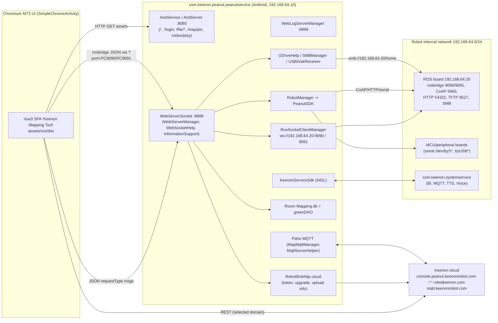
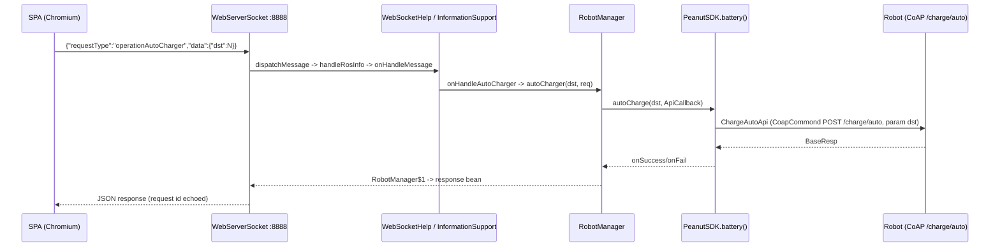

# Keenon C40 V246 - Robot Installation Assistant (Keenon Mapping Tool) v4.11.0 - Static Reverse-Engineering Report

Target: `robot-installation-assistant-v4.11.0-0-gb7c7c7b-prod-release-p.apk` (package `com.keenon.peanut.peanutservice`, 114,327,216 bytes, sha256 `b8449eda1fc18bf1bfc1640760f11687bcbe5fb5e3b5824125ed71a9970c3fb0`; MD5 previously verified by the coordinator against the vendor `upgradeConfig.json`).
Domain: robot installation / commissioning ("mapping tool") app. Companion report: `installation_assistant_sdk.md` (embedded Keenon peanut-sdk).
Evidence tags: CONFIRMED, STRONGLY_SUPPORTED, INFERRED, HISTORICAL, UNKNOWN, NOT_ANALYZED, BLOCKED. Confidence HIGH/MEDIUM/LOW.

## 0. Method, tooling and limits (read first)

| Item | State |
|---|---|
| JADX / REA (rea-agents) decompilation | **BLOCKED** - `JADX_BAD` marker present (JADX engine hash check failed); `JADX_READY` never appeared. No decompiled Java was produced. |
| What was actually done | Python-stdlib parsers written for this task (`scripts/ria/*.py` in the scratchpad): ZIP inventory, binary AndroidManifest decode (`axml.py`), DEX parser with class/method/field tables, const-string / invoke / field-reference traces per method, encoded static values, annotation decoding (`dexx.py`, `annot.py`, `tr.py`), ELF parser (`elfinfo.py`, `nat.py`), regex/brace-aware extraction on the minified Vue bundle, SQLite inspection of the bundled DB. |
| Consequence | Conclusions are DEX-level: strings, call targets, field accesses and annotation values. Register-level data flow, conditionals and loop bodies are NOT reconstructed; where polarity of a check matters it is marked UNKNOWN. No claim of decompilation is made. |
| Not done | No execution, no emulation, no network, no device/adb. Static ROS topic / URL / endpoint references are **not** live observations. |
| Secrets | Real secrets are not reproduced. Redacted: hotspot password, offline-code suffix, Sentry DSN key, AMap key, native-store values. |

## 1. Executive summary

* The "installation assistant" is a **Chromium 73 fork** (`ChromeApplication` subclass `SlamApplication`; launcher `SimpleChromeActivity`) that loads a **Vue 3 + Element-Plus single-page app ("Keenon Mapping Tool")** shipped in `assets/ros/dist` and served on `http://<ip>:8080/` by an embedded AndServer. The SPA does mapping/commissioning: scan map, edit map, create target points, bind charger/workstation, gate/elevator config, dispatch, cleaning partition, VSLAM boot points, large-map generation, offline mapping.
* The SPA talks to the robot ROS board (`192.168.64.20`) through **rosbridge** (ports 9090/9091), either directly or through a **WebSocket relay/command server (port 8888) inside the Android app**, and to Android services with ~55 `requestType` messages (charge, navigation, factory reset, app update, Wi-Fi, USB import, DB operation, file write...).
* The app embeds the **Keenon `peanut-sdk 2.2.6rc3-beta24`** (CoAP/HTTP/serial link to the robot, 223 CoAP + 88 serial command APIs), the Service SDK (AIDL to `com.keenon.systemservice`), Paho MQTT, Retrofit/okhttp cloud clients, Room + greenDAO, jcifs-SMB1 and Sentry.
* Main security observations (details Section 11 and `installation_assistant_findings.json`): unauthenticated wildcard-bound WebSocket control/relay server (RIA-001/003), traversal-prone file write and read endpoints (RIA-002/004), exported `APPReceiver` (RIA-006), hard-coded hotspot password (RIA-007), fleet-shared secrets in `libcipher_pack.so` and shipped BKS keystores (RIA-008/009), cleartext + user-CA trust and `allowBackup` (RIA-010), outdated Chromium M73 (RIA-012), root/`pm install` helpers (RIA-013), MD5-only OTA integrity (RIA-014).

## 2. Package, versions, manifest

| Field | Value (source) |
|---|---|
| package | `com.keenon.peanut.peanutservice` (manifest) |
| versionName / versionCode | `v4.11.0-0-gb7c7c7b` / 350 (manifest, `BuildConfig`) |
| minSdk / targetSdk / compileSdk | 21 / **22** / 28 (platformBuildVersion 9) |
| build | `BuildConfig.FLAVOR=prod`, `BUILD_TYPE=release`, `DEBUG=false`; Android Gradle 4.1.2 (`MANIFEST.MF`) |
| Application class | `com.keenon.peanut.peanutservice.app.SlamApplication` -> `base.MapBaseApplication` -> `org.chromium.chrome.browser.ChromeApplication`; `appComponentFactory=androidx.core.app.CoreComponentFactory` |
| Application flags | `allowBackup=true`, `hardwareAccelerated=true`, `largeHeap=true`, `networkSecurityConfig=@0x7f170019` (resource id unresolved; the only NSC is `res/xml/network_security_config.xml`) |
| Native ABI | `armeabi-v7a` only (12 ELF32 ARM libraries) |
| Signing | self-signed `CN=keenon`, sha256WithRSA, validity 2017-08-03 .. 2042-07-28; v1 (CERT.SF/RSA) + APK Signing Block magic present |
| Sizes | 6 dex (42,977 class defs), 12 .so, 342 asset entries (326 under `assets/ros`), 3,713 res files, `resources.arsc` 2.7 MB |
| Manifest meta-data | `com.amap.api.v2.apikey` (REDACTED), `io.sentry.dsn` (REDACTED key, host `sentry.keenonrobot.com`, project 14), `io.sentry.traces.sample-rate=1.0`, Samsung multi-window flags, `android.content.APP_RESTRICTIONS`, Cast `OPTIONS_PROVIDER_CLASS_NAME`, Glide `OkHttpGlideModule` |

### 2.1 Permissions (50 unique `uses-permission`, 62 entries) with risk comments

| Permission(s) | Risk / comment |
|---|---|
| `INTERNET`, `ACCESS_NETWORK_STATE`, `ACCESS_WIFI_STATE`, `CHANGE_WIFI_STATE`, `CHANGE_NETWORK_STATE` | Network + Wi-Fi/hotspot control (WifiHotpotService, WifiApUtils). Needed. |
| `READ/WRITE_EXTERNAL_STORAGE`, `MOUNT_UNMOUNT_FILESYSTEMS` | Maps, videos, DB under `/sdcard/...`; USB-drive handling. Data readable by other apps (RIA-019). |
| `INSTALL_PACKAGES`, `DELETE_PACKAGES`, `REQUEST_INSTALL_PACKAGES` | App install/uninstall (`pm install -r`, ACTION_VIEW). INSTALL/DELETE are signature|system - effective only if platform-signed/system (UNKNOWN). |
| `READ_PRIVILEGED_PHONE_STATE`, `READ_PHONE_STATE`, `GET_TASKS`, `REORDER_TASKS`, `WRITE_SETTINGS`, `SYSTEM_ALERT_WINDOW`, `SYSTEM_OVERLAY_WINDOW` | System-level; over-privileged for a mapping UI. |
| `ACCESS_FINE/COARSE/BACKGROUND_LOCATION`, `ACCESS_LOCATION_EXTRA_COMMANDS` | Used by `PeanutLocationManager` (region restriction check, Google geolocation proxy). |
| `CAMERA`, `RECORD_AUDIO`, `MODIFY_AUDIO_SETTINGS`, `VIBRATE`, `NFC`, `BLUETOOTH(_ADMIN)` | Mostly inherited from the Chromium base; audio volume manager uses MODIFY_AUDIO_SETTINGS. |
| `READ_CONTACTS`, `GET_ACCOUNTS`, `MANAGE_ACCOUNTS`, `USE_CREDENTIALS`, sync permissions | Chromium sign-in/sync leftovers - unnecessary attack surface. |
| `RECEIVE_BOOT_COMPLETED`, `WAKE_LOCK`, `FOREGROUND_SERVICE`, `DOWNLOAD_WITHOUT_NOTIFICATION` | Background/boot behaviour; downloads (map/video/APK). |
| `org.chromium.chrome.permission.*`, `com.google.android.c2dm.permission.RECEIVE`, `com.android.launcher.permission.*INSTALL/UNINSTALL_SHORTCUT`, `com.android.browser.permission.*HISTORY_BOOKMARKS` | Chromium defaults; custom permission `org.chromium.chrome.permission.DEBUG` (protection 0x2 = signature). |
| Declared permission `android.permission.INTERNET` (re-declared) | Odd redeclaration inherited from the merged manifest. |

### 2.2 Components (210) - exported / default-exported

Total components in decoded manifest: 210 ({'activity': 87, 'activity-alias': 15, 'service': 83, 'receiver': 18, 'provider': 7}). Components that are exported (explicit `android:exported="true"` or implicit via `<intent-filter>` with targetSdk 22 < 31): **29**.

| Kind | Component | exported attr | Effective | Permission | Intent-filter actions | Data | Note |
|---|---|---|---|---|---|---|---|
| activity | `org.chromium.chrome.browser.document.ChromeLauncherActivity` | None | yes |  | org.chromium.chrome.browser.dummy.action |  | Chromium (M73) component |
| activity-alias | `com.google.android.apps.chrome.IntentDispatcher` | true | yes |  | android.intent.action.MAIN, android.intent.action.MEDIA_SEARCH, android.intent.action.SEARCH, android.intent.action.VIEW, android.nfc.action | host=*; mimeType=*/*; mimeType=application/xhtml+xml; mimeType=message/rfc822; mimeType=multipart/related; mimeType=text | Chromium (M73) component |
| activity | `org.chromium.chrome.browser.media.MediaLauncherActivity` | true | yes |  | android.intent.action.VIEW | mimeType=audio/*; mimeType=image/*; mimeType=video/*; scheme=content; scheme=file | Chromium (M73) component |
| activity | `org.chromium.chrome.browser.ChromeTabbedActivity` | true | yes |  | org.chromium.chrome.browser.dummy.action |  | Chromium (M73) component |
| activity | `org.chromium.chrome.browser.keenon.SimpleChromeActivity` | true | yes |  | android.intent.action.MAIN, android.intent.action.VIEW | scheme=mapkeenon/host=mapandroid.com | LAUNCHER; deep link mapkeenon://mapandroid.com |
| activity | `org.chromium.chrome.browser.keenon.SimpleChromeActivity1` | true | yes |  |  |  | FIRST-PARTY dev/test launcher activity exported with no filter |
| activity | `org.chromium.chrome.browser.keenon.SimpleChromeActivity2` | true | yes |  |  |  | FIRST-PARTY dev/test launcher activity exported with no filter |
| activity | `org.chromium.chrome.browser.bookmarks.BookmarkAddActivity` | None | yes |  | org.chromium.chrome.ADDBOOKMARK |  | Chromium (M73) component |
| activity | `org.chromium.chrome.browser.webapps.WebappLauncherActivity` | None | yes |  | com.google.android.apps.chrome.webapps.WebappManager.ACTION_START_WEBAPP, org.webapk.ACTION_START_WEBAPK |  | Chromium (M73) component |
| activity | `org.chromium.chrome.browser.printing.PrintShareActivity` | true | yes |  | android.intent.action.SEND | mimeType=text/plain | Chromium (M73) component |
| activity | `org.chromium.chrome.browser.send_tab_to_self.SendTabToSelfShareActivity` | true | yes |  | android.intent.action.SEND | mimeType=text/plain | Chromium (M73) component |
| activity | `org.chromium.chrome.browser.browseractions.BrowserActionActivity` | true | yes |  | androidx.browser.browseractions.browser_action_open | scheme=http; scheme=https | Chromium (M73) component |
| receiver | `org.chromium.chrome.browser.browserservices.ClientAppBroadcastReceiver` | true | yes |  | android.intent.action.PACKAGE_DATA_CLEARED, android.intent.action.PACKAGE_FULLY_REMOVED | scheme=package | Chromium (M73) component |
| activity | `org.chromium.chrome.browser.browserservices.ManageTrustedWebActivityDataActivity` | true | yes |  | android.support.customtabs.action.ACTION_MANAGE_TRUSTED_WEB_ACTIVITY_DATA | scheme=https | Chromium (M73) component |
| provider | `org.chromium.chrome.browser.provider.ChromeBrowserProvider` | true | yes |  |  |  | Chromium (M73) component |
| receiver | `com.google.android.apps.chrome.appwidget.bookmarks.BookmarkThumbnailWidgetProvider` | None | yes |  | .BOOKMARK_APPWIDGET_UPDATE, android.appwidget.action.APPWIDGET_UPDATE |  | Chromium (M73) component |
| receiver | `org.chromium.chrome.browser.searchwidget.SearchWidgetProvider` | None | yes |  | android.appwidget.action.APPWIDGET_UPDATE, org.chromium.chrome.browser.searchwidget.START_TEXT_QUERY, org.chromium.chrome.browser.searchwidg |  | Chromium (M73) component |
| service | `com.google.ipc.invalidation.ticl.android2.channel.GcmRegistrationTaskService` | true | yes | com.google.android.gms.permission.BIND_NETWORK_TASK_SERVICE | com.google.android.gms.gcm.ACTION_TASK_READY |  |  |
| service | `org.chromium.chrome.browser.ChromeBackgroundService` | true | yes | com.google.android.gms.permission.BIND_NETWORK_TASK_SERVICE | com.google.android.gms.gcm.ACTION_TASK_READY |  | Chromium (M73) component |
| service | `org.chromium.chrome.browser.prerender.ChromePrerenderService` | true | yes |  |  |  | Chromium (M73) component |
| service | `org.chromium.chrome.browser.customtabs.CustomTabsConnectionService` | true | yes |  | android.support.customtabs.action.CustomTabsService |  | Chromium (M73) component |
| receiver | `org.chromium.chrome.browser.media.ui.MediaNotificationManager$PlaybackMediaButtonReceiver` | None | yes |  | android.intent.action.MEDIA_BUTTON |  | Chromium (M73) component |
| receiver | `org.chromium.chrome.browser.media.ui.MediaNotificationManager$PresentationMediaButtonReceiver` | None | yes |  | android.intent.action.MEDIA_BUTTON |  | Chromium (M73) component |
| receiver | `org.chromium.chrome.browser.media.ui.MediaNotificationManager$CastMediaButtonReceiver` | None | yes |  | android.intent.action.MEDIA_BUTTON |  | Chromium (M73) component |
| receiver | `com.keenon.peanut.peanutservice.receiver.APPReceiver` | true | yes |  | android.peanut.action.MAPPING_RESTART_ROS, android.peanut.action.MAPPING_RESTART_ROS_SUC, android.peanut.action.MAP_DOWNLOAD_START, com.keen |  | FIRST-PARTY exported receiver, no permission (see RIA-006) |
| service | `com.google.android.gms.auth.api.signin.RevocationBoundService` | true | yes | com.google.android.gms.auth.api.signin.permission.REVOCATION_NOTIFICATION |  |  |  |
| activity | `androidx.test.core.app.InstrumentationActivityInvoker$BootstrapActivity` | None | yes |  | android.intent.action.MAIN |  | androidx.test instrumentation helper activity bundled in release (MAIN filter, default-exported) |
| activity | `androidx.test.core.app.InstrumentationActivityInvoker$EmptyActivity` | None | yes |  | android.intent.action.MAIN |  | androidx.test instrumentation helper activity bundled in release (MAIN filter, default-exported) |
| activity | `androidx.test.core.app.InstrumentationActivityInvoker$EmptyFloatingActivity` | None | yes |  | android.intent.action.MAIN |  | androidx.test instrumentation helper activity bundled in release (MAIN filter, default-exported) |

First-party (`com.keenon.*`) components in the manifest are only four: `receiver.APPReceiver` (exported), `service.WifiHotpotService` (not exported), `server.http.Service.AndService` (not exported), `service.UploadService` (no filter, not exported). The launcher is the Chromium-side `org.chromium.chrome.browser.keenon.SimpleChromeActivity` (+ `SimpleChromeActivity1/2` test launchers). All other 200+ components are Chromium M73, GMS/Cast, AMap, Sentry, okdownload, Room (`MultiInstanceInvalidationService`, not exported), blankj-utilcode (`UtilsFileProvider` not exported but grantUriPermissions with root paths) and androidx.test.

Chromium process services: `SandboxedProcessService0..39` (`:sandboxed_processN`, 38 isolated), `PrivilegedProcessService0..4`. Intent-filter deep link: `mapkeenon://mapandroid.com` (VIEW/BROWSABLE/DEFAULT) on `SimpleChromeActivity` with query params `Language`, `cloud3d`, `modifyPoint` (parsed by `SimpleChromeActivity.handlerIntentData`; `isFromAPP` flag).

### 2.3 Network security config and storage config

* `res/xml/network_security_config.xml`: `base-config cleartextTrafficPermitted="true"`, trust anchors `system` + `user` (CONFIRMED). Presumed referenced by `@0x7f170019` (INFERRED).
* `res/xml/file_paths.xml` (Chromium FileProvider: files/images, cache/net-export|passwords|traces|webapks|Offline Pages/archives, external Download/) and `util_code_provider_paths.xml` (blankj `UtilsFileProvider`: whole files, cache, external, external-files, external-cache, external-media with path ".").
* Backup: `allowBackup=true`; no `fullBackupContent`/`dataExtractionRules` (targetSdk 22).

## 3. Architecture and module map

### 3.1 Code inventory (DEX class definitions, 42,977 total)

| Group | Classes | Notes |
|---|---:|---|
| `org.chromium` | 12,647 | Chromium 73.0.3683.93 Java layer (`libchrome.so`) + Keenon patches in `org.chromium.chrome.browser.keenon` (SimpleChromeActivity, 1, 2) |
| `com.google` | 6,218 | GMS, protobuf, gson, ARCore/GVR |
| `com.keenon` | 3,884 | first-party: 579 `peanutservice`, ~1,320 `sdk.*` (coapapi 566, embedded 376, robot 296, component 284, sensor 228...), 274 `peanut.core`, 229 widget, 211 `component.core`, 97 location, serviceSdk/voice/tts/bi AIDL... |
| `org.bouncycastle` 3,607 (v1.71) / `io.reactivex` 3,436 / `org.apache` 1,354 / `kotlinx.coroutines` 947 / `com.fasterxml` 776 (Jackson 2.9.0.pr3) / `com.bumptech` 557 (Glide 4.6.1) / `org.eclipse` 519 (Paho) / `ch.qos` 473 (logback+slf4j) / `androidx.*` / `freemarker` ~900 / `io.sentry` 394 (5.5.2) / `com.loc` 284 + `com.amap` 30 (AMap location) / `com.blankj` 278 (utilcode 1.30.6) / `com.alibaba` 252 (fastjson 1.2.68) / `jcifs.*` ~600 (SMB1+SMB2 classes) / `androidx.room` 209 (Room 2.3.0) / `com.yanzhenjie` 199 (AndServer) / `org.greenrobot` 178 (EventBus, greenDAO) / `com.liulishuo` 141 (okdownload 1.0.5) / `okhttp3` (3.14.9) / `retrofit2` / `org.java_websocket` 76 / `org.junit` 258 / `androidx.test` 110 | |

Jersey is **not** present as code (only META-INF service stubs for FastJson JAX-RS provider); the brief's "Jersey" assumption is NOT supported by the DEX.

### 3.2 First-party module map (Kotlin module names from META-INF)

`peanut-sdk`, `api-coap`, `api-ext`, `protocol-common|coap|http|proxy|serial|tftp`, `embedded`, `peanut-common`, `peanut-core`, `widget`, `cybersecurity-qrcode`, plus library `BuildConfig`s: logger 1.0.1, mqtt 1.1.6, net 1.1.6, security 1.1.13, storage 1.0.4, utils 1.0.044, component core 2.0.4-beta21, location 3.0.0-beta1-test27, serviceLoader 2.0.3, widget 2.0.0-beta66-test2, wifi-fun 1.2.3, serviceDefine 1.0.1beta11, serviceSdk 1.0.2beta15.

### 3.3 `com.keenon.peanut.peanutservice` package map

| Package | Role |
|---|---|
| `app` (SlamApplication), `base` (MapBaseApplication) | Application bootstrap: `SystemInitHelper.init` (reads `getprop robot.keenbot.ver` -> fusion-board flag), `PeanutProfile.calcRobotSn`, `registerReceiver`, `KlogConfig`, `initMqtt`, `init` (PeanutManager.init, RetrofitFactory.setContext, `PeanutServiceSQLiteManager.initDatabase`, `DataCleanUtils.cleanCache`, `initBi` -> `KeenonServiceSdk.init`, `initLocation` -> `PeanutLocationManager.initData(flavor "prod")`). |
| `server.http` (AndService, AndServerManager, controllers, CorsInterceptor, AppConfig) | Embedded HTTP server :8080 serving the SPA and file/media endpoints |
| `server.webSocket` (server/WebServerSocket, manager/{WebServerManager,WebLogServerManager,WorkStationManager}, client/{RosSocketClientManager,SocketClient}, help/{WebSocketHelp,InformationSupport,UDriveHelp}) | WebSocket server :8888 (UI command bus + rosbridge relay), log server :8899, rosbridge client to 192.168.64.20 |
| `robot` (RobotManager, CallBellManager) | Calls `PeanutSDK`: auto-charge, stop-charge, navigation (setTarget/stop/reset/pause/resume), schedule live, subscriptions `navi.status`, `battery.charge.status` |
| `api` (PeanutManager, bean/*) | SDK init + EventBus beans (ExitEvent, AppUrlEvent, Hedera* result beans) |
| `httprequest` (api/*, http/*, manager/*, bean/*) | Retrofit/okhttp cloud clients: token, software update check/download, upload robot info/upgrade status, map & video download (okdownload) |
| `manager` (MapMqttManager, BusinessSceneManager, NetWorkUsageManager, AudioVolumeManager, WifiManager) | MQTT map/dispatch topics, business scene (restaurant/hotel/medical/clean/supermarket/industry), traffic counters, volume |
| `mqtt` (ServerManager) | Cloud environment selection (prod/pre/eng/dev x CN/ES/JP) and base URL |
| `database` (Room), `gen` (greenDAO), `model.bean.sqlite` | Local persistence, see Section 8 |
| `receiver` (APPReceiver, ApReceiver, NetworkStateReceiver, USBDiskReceiver), `service` (UploadService, WifiHotpotService), `smb` (SMBManager), `utils` (40 classes incl. ShellUtil users, MapFileUtils, MapZipUtils, WifiApUtils, CommUtils, PreferencesUtil, VersionUtil...) | Platform integration |
| `mvp` (SlamContract/SlamPresenter), `view` (LoadingPopupWindow), `andserver.*generator` | Glue; generated AndServer registers |

### 3.4 Component map (Mermaid)

## 4. What this app does in the robot system

1. **Commissioning / mapping UI**: user scans the venue (robot drives manually from the UI via `/cmd_vel`/`/wheel_vel` or is driven by the operator), previews and edits the map, creates points (tables/"food outlet"/charging pile/boot points/elevators/gates), binds the charging pile or workstation (MAC, channel), configures dispatch, generates cleaning partitions and paths, saves/syncs the map to the cloud, and optionally runs a test run (`/app_cmd_test_run_start`, `/test_run/*`). (STRONGLY_SUPPORTED: SPA i18n sections + ROS constants.)
2. **ROS/SLAM interaction**: rosbridge JSON from the SPA to ROS topics/services (`/web_command`, `/map_app_start`, `/scan_base_map`, `/database/config_*`, cartographer messages `cartographer_ros_msgs/*`, VSLAM `keenon_vslam_msgs/*`). Section 9, `installation_assistant_ros_refs.json` (STATIC_REFERENCE).
3. **Robot configuration**: `/cfg_param_cmd`, `/robot_settings/cfg_launch_type_cmd` (robot type), `/robot_settings/cfg_origin_floor_cmd`, `/robot_settings/cfg_schedule_sw_cmd`, `/set_no_disturb_mode_srv`, `/cfg_side_drive`, `/cfg_rosbag_sw_cmd`.
4. **Firmware/MCU/ROS upgrade handling**: *this APK does not flash MCU firmware itself* in the traced code; it checks and installs **app (APK) updates and resource packs** from the Keenon cloud (`UpgradeHelper`, `/api/app/robot/checkNewSoftware`, `/getSoftware`, status upload). The SDK contains full firmware/OTA machinery (`com.keenon.sdk.sensor.ota.*`, `UpdateComponent`, `/upgrade/*` CoAP APIs, `libpatchutils` bspatch) - available but not shown to be driven by this app's UI (UNKNOWN).
5. **OTA download using upgradeConfig-style manifests**: not found. The cloud returns `UpgradeBean`/`AppUpgradeInfo`/`ResourceZip` JSON (fields in `httprequest.bean`); no `upgradeConfig.json` string reference exists in the APK (NOT_ANALYZED for bean field semantics).
6. **ADB / shell**: `su`/`sh` via `ShellUtil`, `pm install -r`, `pm uninstall`, `getprop robot.keenbot.ver`. No `adb` string use.
7. **Serial ports / peripherals**: through the SDK (`libkeenon_serial.so`), plus door, light, KC01 emotion, disinfection, plasma, UV lamp, call-bell and workstation sensors.
8. **Hardware calibration**: SDK `sdk.embedded.lidar.calibration` (16 classes) and `sdk.sensor.calibration`, CoAP `/calib/*`, camera calibration APIs (`CleanComponent.cameraCalibration`); the Installation Assistant UI itself does not obviously expose them (NOT_ANALYZED).

## 5. UI screens and navigation

* Native UI is minimal: `SimpleChromeActivity` (full-screen Chromium tab, `screenOrientation=landscape(0)`, `windowSoftInputMode=0x12`, `launchMode=singleTask(2)`), SweetAlert dialogs (network lost/changed, loading), `LoadingPopupWindow`, soft-keyboard height listener (`pushErrorCode(EVENT_KEYBOARD_VISIBLE/INVISIBLE)`), exit via `ExitEvent`.
* Entry URL: `http://<SERVER_IP|192.168.64.10|localhost>:8080/#/install?time=<ms>&env=production&rosVersion=<v>&isCloud3d=<b>&modifyPoint=<b>` (`showWebView`, `InternalIntentDelegate.processUrlViewIntent`). Routes in the SPA: `/` and `/install` (+ catch-all `/:currentPath(.*)*`).
* SPA UI sections (i18n namespaces, 33 in en): `common, errorMessage, header, scan, revise, scene, target, setting, map, mapEdit, danger, loading, settingModal, tipStep, http, dispatch, gate, busyArea, hotel, labelAndVSlam, closePoint, vslam, clean, rosDispatch, pointsModify, phone, mapSync, largeMap, robotList, welcomeMapping, bindCharge, offlinePage, lockPage`. Languages en/zh/zht/ja/ko/th (+de/fr element-plus locales). Tutorial assets: 9 videos, 139 audio prompts, 35 subtitle files, 35 animation JSON files.
* Remote control mode: QR code (`http://<localHost>/#/install?remote=true`) so a phone on the same network (hotspot "keenon robot") can open the same SPA; when `remote` or mobile, the SPA uses the 8888 relay instead of a direct rosbridge URL.

## 6. Services, background work and lifecycle

| Component | Behaviour (evidence) |
|---|---|
| `SlamApplication.onCreate` | `initMqtt` (DomainManager listener, `MqttManager.setMqttClientIdPrefix("mapping_")`, connect listener), then `init` (see 3.3). |
| `AndService` | `AndServer.serverBuilder().inetAddress(NetUtils.getLocalIPAddress()).port(8080)`; started by `AndServerManager.startServer()` from the activity; `onStartCommand` -> createHttpServer + startServer; posts `HttpServerData` via EventBus. |
| `WebServerManager.start(8888)` / `WebLogServerManager.start(8899)` | `WebServerSocket` (java-websocket) wildcard bind, `setReuseAddr(true)`. |
| `RosSocketClientManager` | Two `SocketClient`s to `ws://192.168.64.20:9090/9091`, reconnect handler "Ros WebSocked 重连", push of connect state codes 100201-100222. |
| `WifiHotpotService` | `startHotpot` SSID "keenon robot" + fixed password (RIA-007); `ApReceiver` listens `WIFI_AP_STATE_CHANGED`; `checkHotspotIP` timer in the activity stores `SERVER_IP`. |
| `UploadService` | Uploads robot data (`initRosData`); not exported. |
| Receivers | `APPReceiver` (exported), `USBDiskReceiver` (media mounted/unmounted, path -> `U_DRIVE_STATE`), `NetworkStateReceiver` (CONNECTIVITY_CHANGE, stores `netValid`), `ApReceiver`. |
| `HeartService` | `CommUtils.startAPPService` starts `com.keenon.peanut.peanutservice.service.HeartService` (class not defined in this APK's manifest: UNKNOWN) and `checkRemoteAPP` ensures `com.keenon.remote_control_oray` (+ `HeadService`) is running. |
| Lifecycle events | `onNewIntent` re-handles deep link; `onStop` -> `MAPPING_STOP` broadcast on exit; `exitAPPAndToDelivery` launches HOME/VIEW to the delivery app (`jumpflag=jump_back`). |

## 7. Network communication

Full list: `installation_assistant_endpoints.json` (102 records, STATIC_REFERENCE).

| Channel | Detail | Evidence |
|---|---|---|
| Local HTTP | AndServer `:8080` bound to `NetUtils.getLocalIPAddress()`; SPA at `/`, `GET /file/download?fileName=`, `GET /map/pic`, `GET /video/play?fileName=`, `GET /v3/test`, `POST /login`, `POST /file/upload` (only logs + returns "success"); CORS `*`; multipart temp dir `cache/_server_upload_cache_` | `ApiControllerAdapter`, `AppConfig`, `CorsInterceptor` |
| Local WebSocket | `:8888` tags `ALL8888/PC9090/PC9091/PC8888/APP8888`; JSON messages `{id, requestType, action, actionType, data, sessionId, messageId, code, status}` | `WebServerSocket.onOpen`, `WebServerManager.update` |
| Log WebSocket | `:8899` text lines "mapping-app [LEVEL] [SOURCE] [time] [id] [n/m] ..." from the SPA logger | SPA `NLe`/`$Le` classes, `WebLogServerManager` |
| rosbridge | `ws://192.168.64.20:9090` (ros) and `:9091` (rosCtrl) - roslib client in SPA and `RosSocketClientManager` in Android | `RosClass` in Home chunk |
| Cloud REST | `scheme://<domain>[:443/:80]` with header `token` (pref `ACCESS_TOKEN`) and `Connection: close`; paths: `/api/app/token/getSingleToken`, `/api/app/mqtt/secret/v1|v2`, `/api/app/robot/{checkNewSoftware,getSoftware,info/update,version/status,appResource/status,v1/geolocation,v2/restriction,v1/net/sec}`, `/api/app/v1/robot_iso_domain_name_link`, `/api/app/v2/healthz`, `/api/app/device/report/identity(+/check)`, `/api/app/v1/device/ssh/login-secret`; SPA: `/api/tool_support/mapping/v1..v4/*`, `/api/tool_support/robot/*`, `/api/tool_support/dispatch/*`, `/api/tool_support/token/{getHotP,getSingleToken}`, `/api/userservice/secret/{getkey,publickey}`, `/api/app/robot/file/v3/upload`, `/api/appservice/web/qly/event/tracking/v1/record` | Retrofit annotations (`annot.py`), SPA bundle |
| MQTT | Paho; `ssl://%s:%d` TLSv1.2 BKS (mTLS) default host `mqtt.keenonrobot.com`, alternative `tcp://%s:%d`; topics `/mapping/v1/cloud_msg`, `/mapping/v1/dev_msg`, `/tool_support/mapping_<id>`, `/device/%s/ioe_mqtt_conn/v1/cloud_client`; creds from native store and `/api/app/mqtt/secret/v2` | `DynamicMqttServer`, `MapMqttManager`, `MqttServerHelper` |
| Robot link (SDK) | HTTP `192.168.64.20:54322` (upgrade 34569), CoAP `:5683`, WS `:22345` (upgrade 12386), TFTP `:9527`, serial | `PeanutConstants` |
| SMB | `smb://192.168.64.20/home` via jcifs-smb1 for USB map import | `UDriveHelp.copyToRos` |
| Environments | `domain.json` prod CN `console.peanut.keenonrobot.com`, ES `es-cloud.robotkeenon.com`, JP `cloud.robotkeenon.com`; pre `p-cloud.ikeenon.com`; eng `t-*`; dev `d-*` | assets/domain, `PsvConstants`, `ServerManager` |
| Serialisation | JSON (fastjson, Gson, Jackson), protobuf (`Push.proto`, `RobotRestriction.proto`), CoAP payloads (JSON strings) | |

### 7.1 SPA cloud REST paths (from `index-32d09e94.js`)

- `/api/app/robot/file/v3/upload`
- `/api/appservice/web/qly/event/tracking/v1/record`
- `/api/tool_support/dispatch/v1/store_robot/list`
- `/api/tool_support/dispatch/v2/store_robot/list`
- `/api/tool_support/mapping/trial/v1/common/${e}/${r}`
- `/api/tool_support/mapping/trial/v1/common/${t}/${e}`
- `/api/tool_support/mapping/trial/v1/phone/${e}`
- `/api/tool_support/mapping/trial/v1/route/${e}`
- `/api/tool_support/mapping/trial/v1/route/${t}`
- `/api/tool_support/mapping/trial/v1/scheduling/${e}`
- `/api/tool_support/mapping/trial/v1/target/${e}`
- `/api/tool_support/mapping/v1/file`
- `/api/tool_support/mapping/v1/image/batch_process`
- `/api/tool_support/mapping/v1/trans/api/tileProcessor`
- `/api/tool_support/mapping/v2/scene/info`
- `/api/tool_support/mapping/v3/robot/sync`
- `/api/tool_support/mapping/v4/robot/dup/sync`
- `/api/tool_support/mapping/v4/robot/sync`
- `/api/tool_support/mapping/v4/scene/charge`
- `/api/tool_support/mapping/v4/scene/config/sync`
- `/api/tool_support/mapping/v4/scene/info`
- `/api/tool_support/robot/v1/online/list`
- `/api/tool_support/robot/v2/info/list`
- `/api/tool_support/robot/v3/info/list`
- `/api/tool_support/token/getHotP`
- `/api/tool_support/token/getSingleToken`
- `/api/tool_support/v1/mapping/scene/custom/area/${e}`
- `/api/tool_support/v1/trial_run_task`
- `/api/userservice/secret/getkey`
- `/api/userservice/secret/publickey`

## 8. Local storage and data

| Store | Detail | Evidence |
|---|---|---|
| Room `Mapping.db` (+ `-shm`, `-wal`) | `<ExternalStorage>/peanutservice/DBfile/Mapping.db` (INFERRED path concat). Tables: `dynamic_map_info`, `elevator`, `gate`, `init_pose`, `label`, `pose`, `map`; Room 2.3.0, identity hash `c5bf57984aa96dcc4a43daef37e90710` (+ legacy hash `d808ba96e00c5cc40442c8bf691d6b77`). Columns in RIA-DB finding and below. | `AppDatabase`, `AppDatabase_Impl$1.createAllTables` |
| greenDAO | `BuildMapEntity(id, uuid, name, MapJson, time)`, `CacheData(id, type, cache, description)`, `WorkTime(id, startTime, endTime, repeat, status)`; DaoMaster upgrade = drop all tables | `gen.*` |
| Legacy SQLite helper | `peanut_service.db` / `app.db`, `initDatabase("peanut_db")` | `PeanutServiceSQLiteHelper/Manager` |
| SharedPreferences (`PreferencesUtil`) | keys seen: `domain`, `LANGUAGE`, `distPath`, `robotVer`, `SERVER_IP`, `NewIp`, `ACCESS_TOKEN`, `U_DRIVE_STATE`, `path` (USB), `netValid`, `UPLOAD_SWITCH`, `versionCode/versionName`, `appVolume*`, `robot_state_limit_info`, `isFromAPP`, `scene`/business | strings next to `PreferencesUtil` calls |
| peanut-core storage | `StorageService` "peanut-memory"/"peanut-prefer", properties store (`keenon.intent.action.REFRESH_PROPERTIES`), MMKV (`libmmkv.so`, `mmkv_encrypt_key` from native store) | `peanut.core.storage.*` |
| Files | `/sdcard/MapSources/{map*,mapBig,map_video}`, `elevatorConfig.json` (`ELEVATOR_CONFIG_DIR`), `rosShare` mount of ROS home, `peanut_sources`, `vslamMap.zip`, domain list `peanut/domain/domainInternet.json`, logs `krlog` (backups to `keenon/maplog`) | `HubConstant`, `PsvConstants`, `MapFileUtils` |
| Bundled DB | `assets/ros/dist/empty-database.zip` -> `peanut.db` (empty template, 1,280 free pages) | sqlite3 inspection |

Room table columns (CONFIRMED from DDL strings): `pose(target_id,name,type,floor,phone,map_md5,elevator_id,position_x/y/z,orientation_x/y/z/w,floorInfo,buildingInfo,macAddress,disableOrientation,phoneStr)`, `map(name,type,floor,value,map_md5,floorInfo,buildingInfo)`, `label(label_id,base_map,floor,pose)`, `init_pose(init_id,base_map,init_method,angleRange,confidence,penetrate,pose)`, `elevator(elevator_id,robot_id,available_floor,transit_floor,opendoor_time)`, `gate(id,floor,mac_address)`, `dynamic_map_info(floor,resolution,width,height,pose)`; indexes on `floor`, `elevator_id`, `id`, `init_id`, `target_id`.

## 9. UI -> Android command API (WebSocket `requestType`) and ROS interface

### 9.1 `WebSocketHelp.onHandleMessage` dispatch table (CONFIRMED string switch; handler chains traced to the listed callee)

| requestType | Handler -> deeper call | Robot/System effect | Label |
|---|---|---|---|
| `operationAutoCharger` | `onHandleAutoCharger` -> `RobotManager.autoCharger(dst)` -> `PeanutSDK.battery().autoCharge` | start automatic docking/charging (CoAP `/charge/auto`) | traced to SDK; effect INFERRED |
| `operationStopCharger` | `RobotManager.stopCharger` -> `BatteryComponent.stopCharge` | stop charging | traced to SDK |
| `operationNavigationDst` | `onHandleNavigationDst(dst)` -> `RobotManager.navigation` -> `NavigationComponent.setTarget(id, ...)` | go to target | traced to SDK |
| `operationNavigationAction` | `controlNavigation(action)` -> `NavigationComponent.stop/reset/pause/resume` | motion control | traced to SDK |
| `subscribe/unSubscribe NavigationState|ChargerState|RuntimeCode` | `RobotManager.onSubscribe/unSubscribe` -> `PeanutSDK.subscribe("navi.status"/"battery.charge.status"/"diagnosis.error")` | state push to UI | traced |
| `getScheduleLive` | `RobotManager.scheduleLive` -> `RobotApiCompat.navigation().scheduleLive` | dispatch status | traced |
| `postFactoryReset` | `DataCleanUtils.clearAllCache`, `PreferencesUtil.clear`, broadcast `com.keenon.action.RESTORE_FACTORY_SETTINGS`, `ExitEvent` if `com.keenon.launcher` installed | wipes app data; triggers external reset handler | traced |
| `operationInstallApp` / `getNewVersion` | `UpgradeHelper.getAppVersion/checkUpdate/setIsInstallApp` | app update check/install | traced |
| `postWriteInFile` | `onWriteFile` -> `MapFileUtils.writeFile` | writes file under MapSources (RIA-002) | traced |
| `controlCopyFile`, `getUDriveState` | `UDriveHelp.copyToUDrive/copyToRos`, `SMBManager.onSmbPut` | USB <-> Android <-> ROS home | traced |
| `postMapDownload`, `postMapHandle`, `postMapState` | `MapDownloadManager.handleDownLoad/handleMapFile`, `onHandlePostMapPushState` | map zip download/unzip, state push | traced |
| `postVideoDownload`, `getVideoInfo`, `getVideoState` | `VideoDownloadManager` | tutorial videos into `map_video` | traced |
| `postDBOperation` | `DataBaseManager.OperationDB(WebRequestBean, json)` (actions incl. `deleteAll`, `all`, table/items) | Room CRUD | traced |
| `postElevatorConfig` | `onHandleSaveElevatorConfig` (writes `elevatorConfig.json`) | elevator config file | traced |
| `postWifiOperation` | `onHandleWifiOperation` (WIFI_OPEN/CLOSE/CONNECT/QUERY/START/STOP) | Wi-Fi and hotspot | traced (main looper Handler) |
| `getNetWorkState`, `pushNetworkUsage` | `getNetWorkInfo`, `onPushNetWorkUsage` | network info | traced |
| `getRobotInfo`, `getRosWebState`, `getRobotUiType`, `getBusinessScene`, `getBusinessAppPkg`, `getRobotLockState`, `getRobotOfllineCode` | info getters; lock state -> `PeanutLocationManager.queryRobotLimitInfo`; offline code -> `CommUtils.macTo6DigitCRC` | read-only | traced |
| `getEnvironmentConfiguration` / `operationEnvironmentConfiguration` | `AppHandleHelp.onChangeEnvironment(language, domain)` | switch cloud env/language (RIA-018) | traced |
| `PostDistPath` | pref `distPath` (selects `/ros/dist` vs `/ros/v2/dist`) + `AppHandleHelp.onReBoot` | restart UI with other SPA bundle | traced |
| `postWorkstation{Scan,Pair,BindState,Unbind,ChannelModify}`, `getCallBellDeviceList`, `pushCallBellID` | `WorkStationManager` (sensor `device.through.up`; events `_sensor.call.work.received.{update,unbind,can,unbind.state,bind}`), `CallBellManager` | pair charger/workstation/call-bell | traced to SDK sensors |
| `operationApp`, `operationJumpApp`, `operationJumpOther`, `operationBottomNavigation`, `operationExit` | `CommUtils.startAPPService/sendAPPBroadcast(DISCONNECT_ROBOT)`, EventBus -> `SimpleChromeActivity.onJumpApp/onJumpOther/onEventStatus`, exit | app navigation | traced |
| `getAudioVolume` / `setAudioVolume` | `AudioVolumeManager` | system volume | traced |
| `postDataCloud` | `KeenonServiceSdk.biApis().send(eventKey, data)` | BI analytics | traced |
| `postAppStorage` / `getAppStorage`, `getKeyboardHeight`, `postHeartBeat`, `postLoadState`, `pushMqttEvent`, `pushDownLoadPercent`, `getDoMainConfig` | misc storage/UI plumbing, MQTT bridge (`onHandleWebMQTTMsg`) | | traced |

### 9.2 ROS topics/services referenced by the SPA (STATIC_REFERENCE)

140 constants (name, type) extracted from the minified bundle (`ui={...}` table). Full machine-readable list incl. SDK resources: `installation_assistant_ros_refs.json`.

| Name | Type | Constant |
|---|---|---|
| `/BusyMap_App_AreaList` | `std_msgs/String` | BUSYAREALIST |
| `/BusyMap_App_Cmd` | `std_msgs/String` | BUSYAREAACTION |
| `/BusyMap_App_ColorMap` | `sensor_msgs/CompressedImage` | BUSYAREACOLORMAP |
| `/BusyMap_App_ImageTime` | `std_msgs/String` | BUSYIMAGETIME |
| `/BusyMap_App_Result` | `std_msgs/String` | BUSYMAPRESULT |
| `/Location/RealtimeStatus` | `std_msgs/Bool` | REALTIMESTATUS |
| `/TaskDispatcher/CurExecTaskInfo` | `keenon_task_msgs/TaskInfo` | CUREXECTASKINFO |
| `/ability/crud` | `keenon_ui_msgs/ability_data` | ABILITYDB |
| `/ability/sync/ability_table` | `keenon_ui_msgs/ability_data` | ABILITYSYNC |
| `/add_label` | `keenon_label_msgs/add_label` | ADDLABEL |
| `/app_cmd_charge` | `keenon_database_msgs/poseInfo` | STOPCHARGE |
| `/app_cmd_clean_action` | `std_msgs/Int32` | CLEANACTION |
| `/app_cmd_clean_dst` | `std_msgs/UInt16` | CLEANDST |
| `/app_cmd_clean_dst_and_pose` | `keenon_database_msgs/poseInfo` | CLEANDSTANDPOSE |
| `/app_cmd_test_run_start` | `std_msgs/UInt16` | TESTRUNSTART |
| `/battery_state` | `sensor_msgs/BatteryState` | BATTERYSTATE |
| `/cfg_param_cmd` | `keenon_ui_msgs/cfg_param_info` | GETBUSINESS |
| `/cfg_rosbag_sw_cmd` | `keenon_ui_msgs/config_rosbag.srv` | CFGROSBAGSWCMD |
| `/cfg_side_drive` | `keenon_nav_msgs/sideDriveConfig` | CFGSIDEDRIVE |
| `/charge_report_toUI` | `std_msgs/UInt8` | CHARGESTATUS |
| `/check_carpet_with_personal_path` | `check_carpet_with_personal_path.srv` | CHECKCARPETWITHPERSONALPATH |
| `/clean_status` | `keenon_clean_msgs/clean_status` | CLEANSTATUS |
| `/common_area_config` | `keenon_database_msgs::commonAreaConfig` | COMMONAREA |
| `/contourMerge` | `keenon_clean_msgs/contour_merge` | AREAMERGE |
| `/contourMutilMerge` | `keenon_clean_msgs/contour_mutil_merge` | CONTOURMUTILMERGE |
| `/database/config_common_path` | `keenon_database_msgs::commonPathInfo` | CONFIGCOMMONPATH |
| `/database/config_dynamic_map` | `dynamicMapConfig.srv` | DYNAMICMAP |
| `/database/config_dynamic_map_info` | `keenon_database_msgs/dynamicMapInfo` | SAVEMAPMETADATA |
| `/database/config_elevator` | `keenon_database_msgs/elevatorConfig` | ELEVATORCONFIG |
| `/database/config_floor_map_type` | `keenon_database_msgs/floor_map_type` | FLOORMAPTYPE |
| `/database/config_gate` | `keenon_database_msgs/gateConfig` | GATESERVICE |
| `/database/config_init_pose` | `keenon_database_msgs/initPoseConfig` | CONFIGINITPOSE |
| `/database/config_keyframe` | `keenon_database_msgs/keyframeConfig` | CONFIGKEYFRAME |
| `/database/config_label` | `keenon_database_msgs/labelConfig` | CONFIGLABEL |
| `/database/config_map` | `keenon_database_msgs/mapConfig` | CONFIGMAP |
| `/database/config_path` | `keenon_database_msgs/pathConfig` | CONFIGPATH |
| `/database/config_pose` | `keenon_database_msgs/poseConfig` | CONFIGPOSE |
| `/database/config_table` | `keenon_database_msgs/tableInfo.msg` | CONFIGTABLE |
| `/database/config_user_feature` | `userFeatureConfig.srv` | USERSHAPE |
| `/database/config_vslamKeyframe` | `keenon_database_msgs/vslamKeyframeConfig` | CONFIGVSLAMKEYFRAME |
| `/database/config_web_app_data` | `keenon_database_msgs::web_app_data_config` | WEBAPPDATA |
| `/database/config_zone` | `keenon_database_msgs/zoneConfig` | CONFIGZONE |
| `/database/manager` | `keenon_database_msgs/manager` | DATABASEMANAGER |
| `/database/sync_feature_map` | `syncFeatureMap.srv` | SYNCFEATMAP |
| `/denoise_with_path` | `cartographer_ros_msgs::DenoiseWithPath` | DENOISEWITHPATH |
| `/doorFrameFix` | `zoneConfig.srv` | DOORFRAMEFIX |
| `/elevator_response` | `keenon_elevator_msgs/elev_response` | ELEVATORUPDATE |
| `/elevator_task_status` | `keenon_elevator_msgs/elev_task_status` | ELEVATORTASKSTATUS |
| `/fusion_curr_label` | `keenon_label_msgs/label_msg` | FUSIONCURRLABEL |
| `/fusion_label_array` | `keenon_label_msgs/fusion_label_array` | FUSIONLABELARRAY |
| `/generate_elevators_zone` | `elevators_zone_generate.srv` | AUTOELEVATOR |
| `/generate_virtual_wall_auto` | `generate_virtual_wall_auto.srv` | VIRTUALWALLAUTOSAVE |
| `/get_mapping_path` | `cartographer_ros_msgs/PubMappingPath` | GETMAPPINGPATH |
| `/get_schedule_version` | `std_msgs/String` | SCHEDULEVERSION |
| `/gmapping_map/to_web/compressed` | `sensor_msgs/CompressedImage` | GMAPPINGMAP |
| `/goal_safety_check` | `keenon_nav_msgs/goalsSafetyCheck` | CONFIGSFETY |
| `/ground_hit_status` | `std_msgs/Int8` | GROUNDHITSTATUS |
| `/init_location_pose` | `std_msgs/Int8` | INITLOCALTIONPOSE |
| `/initialpose` | `geometry_msgs/PoseWithCovarianceStamped` | INITIALPOSE |
| `/initialpose_config` | `keenon_ui_msgs/initialpose_config_msg.srv` | INITIALPOSECONFIG |
| `/interactive/startup_finished` | `std_msgs/Empty` | STARTUPFINISHED |
| `/localization/mapLoadStatus` | `std_msgs/UInt8` | ROSMAPLOADED |
| `/map_app_start` | `web_backend/map_app_start` | ROSNODELOADER |
| `/mapping_path` | `cartographer_ros_msgs/Path` | MAPPINGPATH |
| `/motor_air` | `std_msgs/UInt8` | MOTORAIR |
| `/motor_edge` | `std_msgs/UInt8` | MOTOREDGE |
| `/motor_lock` | `std_msgs/Bool` | MOTORLOCK |
| `/motor_lock_status` | `keenon_motor_msgs/lock_status` | MOTORLOCKSTATUS |
| `/motor_roll` | `std_msgs/UInt8` | MOTORROLL |
| `/move_base/local_costmap/footprint` | `-` | MOVEBASEFOOTPRINT |
| `/move_base/move_base_global_plan/to_web` | `keenon_nav_msgs/SimplePath` | PATHPLANNING |
| `/notify_goal_adjust` | `keenon_nav_msgs/goalAdjust` | GOALADJUST |
| `/notify_map_change` | `NotifyMapChange.srv` | NOTIFYMAPCHANGE |
| `/operate_pbstream` | `pbstreamConfig.srv` | PBSTREAM |
| `/pub_final_map` | `cartographer_ros_msgs/PubFinalMap` | PUBFINALMAP |
| `/reboot` | `std_msgs/Bool` | REBOOTTOPIC |
| `/reflector_deployment/action` | `std_msgs::UInt8` | REFLECTORACTION |
| `/reflector_deployment/add_safety_pose` | `keenon_ui_msgs/add_safe_point.srv` | REFLECTORSAFETYPOSE |
| `/reflector_deployment/preparation_ready` | `std_msgs/Bool` | REFLECTORPREPARATIONREADY |
| `/reflector_deployment/test_pose_id` | `std_msgs::Uint16` | REFLECTORTESTPOSEID |
| `/reflector_deployment/test_pose_result` | `keenon_ui_msgs/reflector_detect_result_to_web` | REFLECTORTESTPOSERESULT |
| `/requestZoneOrder` | `keenon_clean_msgs/zone_order` | REQUESTZONEORDER |
| `/request_paths` | `keenon_clean_msgs/zone_paths_plan` | REQUESTPATHS |
| `/request_paths_for_carpet` | `keenon_clean_msgs/zone_paths_plan` | REQUESTPATHSFORCARPET |
| `/robot/init_origin_floor` | `-` | INITORIGINFLOOR |
| `/robot_current_state/floor` | `-` | CURRENTSTATEFLOOR |
| `/robot_current_state/map` | `-` | CURRENTSTATEMAP |
| `/robot_current_state/virtual_wall` | `-` | CURRENTSTATEVIRTUALWALL |
| `/robot_settings/cfg_launch_type_cmd` | `robot_settings/launchConfig.srv` | ROBOTTYPE |
| `/robot_settings/cfg_origin_floor_cmd` | `robot_settings/launchConfig.srv` | SETORIGINFLOOR |
| `/robot_settings/cfg_schedule_sw_cmd` | `robot_settings/launchConfig.srv` | SCHEDULESWITCH |
| `/robot_state` | `web_backend/robot_state` | ROBOTSTATE |
| `/save_combine_map` | `saveCombineMap.srv` | SAVECOMBINEMAP |
| `/save_forbidden_zone` | `keenon_database_msgs/zoneConfig` | BANSERVICEINSERT |
| `/scan_base_map` | `web_backend/PointArray` | LASERCLOUD |
| `/schedule_ability_update` | `keenon_schedule_msgs.srv` | SCHEDULEUPDATE |
| `/schedule_config` | `keenon_schedule_msgs` | SCHEDULECONFIG |
| `/schedule_group_num` | `std_msgs/UInt8` | SCHEDULEGROUPNUM |
| `/schedule_group_num_info` | `std_msgs/UInt8` | SCHEDULEGROUPNUMINFO |
| `/schedule_mapbuilder_errorcode` | `std_msgs/Bool` | DISPATCHERRCODE |
| `/schedule_online_info` | `std_msgs/String` | SCHEDULEONLINEINFO |
| `/schedule_robot_sn` | `std_msgs/String` | PUBLISHROBOTIDSN |
| `/segmentSplitByLine` | `keenon_clean_msgs/segment_split_line` | AREASPLIT |
| `/segmentation` | `segmentation_map.srv` | AREAGENERATOR |
| `/segmentation_with_holes` | `segmentation_with_holes.srv` | SEGMENTATIONWITHHOLES |
| `/set_filter_mode` | `label_filter/SetFilterMode` | FILTERMODE |
| `/set_no_disturb_mode_srv` | `std_srvs::SetBool` | SETNODISTURB |
| `/subarea_merge` | `subarea_merge.srv` | SUBAREAMERGE |
| `/subarea_split_line` | `subarea_split_line.srv` | SUBAREASPLITLINE |
| `/switch_dest_floor_map` | `keenon_nav_msgs/SwitchMap` | SWITCHDESTFLOOR |
| `/test_run/generate_path` | `keenon_clean_msgs/zone_paths_plan` | GENERATEPATH |
| `/test_run/get_path` | `keenon_clean_msgs/zone_paths_plan` | GETPATH |
| `/test_run/resume_task` | `std_msgs/UInt16` | RESUMETASK |
| `/topo_action/feedback` | `keenon_schedule_msgs/topuMapActActionFeedback` | TOPOACTIONFEEDBACK |
| `/topo_action/goal` | `keenon_schedule_msgs/topuMapActActionGoal` | TOPOACTIONGOAL |
| `/topo_action/result` | `keenon_schedule_msgs/topuMapActActionResult` | TOPOACTIONRESULT |
| `/topo_constraint` | `TopoMap.srv` | TARGETPATHCHECK |
| `/topo_direction` | `TopoMap.srv` | PATHCONNECTIONCHECK |
| `/topo_service` | `keenon_schedule_msgs/TopoMap` | TOPOMAPSERVE |
| `/topo_set_param` | `keenon_schedule_msgs/TopoMap` | TOPOSETPARAM |
| `/update_custom_area` | `keenon_database_msgs::commonAreaConfig` | UPDATECUSTOMAREA |
| `/update_related_paths` | `update_related_paths.srv` | UPDATERELATEDPATHS |
| `/update_schedule_path` | `std_msgs/Bool` | UPDATESCHEDULENOTICE |
| `/urgency_button_status` | `std_msgs/Bool` | URGENCYBUTTON |
| `/user_auto_process` | `segmentation_map.srv` | USERAUTOPROCESS |
| `/user_auto_process_with_holes` | `segmentation_with_holes.srv` | USERAUTOPROCESSWITHHOLES |
| `/user_cnt_process` | `segmentation_map.srv` | USERCNTPROCESS |
| `/user_cnt_process_with_holes` | `segmentation_with_holes.srv` | USERCNTPROCESSWITHHOLES |
| `/version` | `keenon_database_msgs/version` | DATABASEVERSION |
| `/virtual_wall_generator` | `keenon_database_msgs/mapConfig` | VIRTUALWALLGENERATOR |
| `/vslam/mappingService` | `keenon_vslam_msgs/VSLAMMapping` | VSLAMMAPPING |
| `/vslam/mxModuleDataService` | `keenon_vslam_msgs/vslam_module` | VSLAMMODULE |
| `/vslam/rescanningProgress` | `std_msgs/Int16` | VSLAMPROGRESS |
| `/vslam_keyframe_array` | `keenon_label_msgs/fusion_label_array` | FUSIONKEYFRAME |
| `/web_clean_report` | `std_msgs/Float64` | CLEANREPORT |
| `/web_cmd_clean_task` | `std_msgs/Bool` | CLEANTASK |
| `/web_command` | `web_backend/web_command_srv` | WEBCOMMAND |
| `/web_database_update` | `std_msgs/UInt8` | WEBDATABASEUPDATE |
| `/web_get_param` | `keenon_location_msgs/webGetParam` | WEBGETPARAM |
| `/wheel_vel` | `geometry_msgs/Twist` | MOVEVELOCITY |

Additional bundle-level references: `/cmd_vel`, `/cmd_vel_smart`, `/persistence_params/move_base/side_drive_status`, `/record_position`, `/manual_loop_closure`, `/tf2_web_republisher` (`tf2_web_republisher/RepublishTFs`, `TFArray`), 16 `rosapi/*` introspection services (Topics, Nodes, GetParam, SetParam, DeleteParam, Services, TopicType, MessageDetails, NodeDetails, GetParamNames, GetActionServers, ServiceType, ServicesForType, TopicsForType, ServiceRequestDetails, ServiceResponseDetails), actionlib `GoalID`/`GoalStatusArray`, filesystem path `/home/peanut/rosShare/`.

## 10. Workflows

Each workflow: entry point, user action, components, SDK/API calls, data changes, robot interaction, success/error behaviour, evidence, confidence. UI elements are NOT assumed to control the robot unless the call chain is traced; "traced" below means a traced chain in DEX from the WebSocket handler to the SDK/Android API; the SPA button that emits the request is INFERRED because the SPA is minified.

### W1 Startup and UI bootstrap
* Entry: launcher `SimpleChromeActivity`. Components: `SlamApplication`, `SystemInitHelper`, `AndServerManager`, `WebServerManager`, `WebLogServerManager`, `RosSocketClientManager`, `ServerManager.initUrl`, `SlamPresenter`. Action: tap the app / deep link `mapkeenon://mapandroid.com?...`.
* Data: pref `robotVer`, `SERVER_IP`, `domain`; loads `#/install?...` URL in the Chromium tab (`Tab.loadUrl`).
* Robot: `RosSocketClientManager.init` connects to rosbridge 9090/9091 (connect state pushed as 100203; errors 100201/100222; auto-reconnect). Error: SweetAlert network dialogs, `showNetWorkDialog`, `checkHotspotIP` timer.
* Evidence: `SimpleChromeActivity.{handlerIntentData,showWebView,InternalIntentDelegate}`, `SlamApplication.init`. Confidence HIGH (CONFIRMED).

### W2 Map scanning / editing (ROS-side)
* Entry: SPA route `/install` (`scan`, `revise`, `mapEdit`, `target`, `scene`). Components: SPA rosbridge client (`RosClass`), `WebServerManager` relay, `RosSocketClientManager`.
* ROS calls (STATIC_REFERENCE): `/web_command` (`web_backend/web_command_srv`), `/map_app_start`, `/scan_base_map` (`web_backend/PointArray`), `/gmapping_map/to_web/compressed`, `/map/to_web/compressed`, `/pub_final_map`, `/get_mapping_path`, `/mapping_path`, `/database/config_{map,pose,path,zone,label,table,...}`, `/save_combine_map`, `/use_3d_mapping`, `/map3d/{save,copy,delete}_map`.
* Data changes: ROS-side map DB; Android Room via `postDBOperation`; files under MapSources.
* Robot interaction: manual drive `/wheel_vel`, `/cmd_vel`; motors `/motor_lock|roll|air|edge`; emergency button `/urgency_button_status` subscription. Success/error: toasts from i18n `errorMessage`; audio prompts (`scan_map_complete.mp3`, `over_speed.mp3`, `hit_status.mp3`).
* Evidence: SPA ROS table, i18n sections. Confidence MEDIUM (messages are static references; semantics inferred from names/types).

### W3 Charger / workstation binding and charging test
* Entry: `bindCharge` UI; Android request types `postWorkstationScan/Pair/BindState/Unbind/ChannelModify`, `operationAutoCharger`, `operationStopCharger`, subscription `battery.charge.status`, ROS `/app_cmd_charge`, `/charge_report_toUI`.
* Chain (traced): `WebSocketHelp` -> `InformationSupport.onHandleAutoCharger` -> `RobotManager.autoCharger` -> `PeanutSDK.battery().autoCharge(dst, ApiCallback)` -> `BatteryComponent` -> `ChargeAutoApi` (`@CoapCommond(path="/charge/auto", POST)`, param `dst`).
* Workstation (`WorkStationManager`): SDK sensor `device.through.up`, observer events `_sensor.call.work.received.{bind,unbind,update,can,unbind.state}`; results pushed to the UI.
* Robot interaction: robot docks/charges (INFERRED from API semantics). Errors: `PeanutError.PM_*` 2033xx (e.g. `PM_AUTO_CHARGED_FAILED=203317`, `PM_NO_5V=203310`). Confidence HIGH for chain, MEDIUM for physical effect.

### W4 Target verification / navigation test run
* Entry: `operationNavigationDst` / `operationNavigationAction`, `postDBOperation` for points, ROS `/app_cmd_clean_dst`, `/app_cmd_test_run_start`, `/test_run/{generate_path,get_path,resume_task}`.
* Chain (traced): `InformationSupport.onHandleNavigationDst` -> `RobotManager.navigation(int,...)` -> `PeanutSDK.navigation().setTarget(id, mode, cb)`; actions -> `NavigationComponent.stop/reset/pause/resume`; status `navi.status`.
* Data: `pose` table (Room). Robot: moves to a target id. Confidence HIGH (chain), MEDIUM (UI trigger).

### W5 Cloud authentication, environment selection and robot-info upload
* Entry: `GetTokenHelper.getToken` (robot SN + `md5_secret_key` from native store) -> `POST /api/app/token/getSingleToken`; token stored in pref `ACCESS_TOKEN`, attached as header `token`; `ServerManager` picks host by region (`CN/ES/JP`) and flavor; `IDomainApi.getDomainNameList`; `UploadDeviceManager` posts robot info/version status.
* Data: prefs `ACCESS_TOKEN`, `domain`; MQTT credentials (`/api/app/mqtt/secret/v2`). Robot: none. Errors: `HubConstant.ERROR_HTTP_REQUEST=100304`, network codes 100101-100104.
* Confidence HIGH for endpoints; request/response bean fields NOT_ANALYZED.

### W6 App (APK) update and resource download
* Entry: `getNewVersion` / `operationInstallApp` -> `UpgradeHelper.checkUpdate/getAppVersion` -> `ClientUpdateApi.checkNewSoftware` (GET) -> `getSoftware` -> `toDownloadUpgradeApk` (requires URL starting `http` and non-empty MD5) via okdownload -> `pushPercent` (`pushDownLoadPercent`) -> `toInstall` (ACTION_VIEW package-archive) or silent `pm install -r`; status reported via `/api/app/robot/version/status`, `/appResource/status`.
* Error codes: `ERROR_APP_DOWNLOAD=100305`, `ERROR_APP_RESUME=100306`. Evidence: `UpgradeHelper` strings. Confidence MEDIUM (verification logic not fully traced; see RIA-014).

### W7 USB map import/export and ROS file sync
* Entry: USB mounted (`USBDiskReceiver`) -> pref `U_DRIVE_STATE` (1 ready, -1 space small, -2 none, 2 downloading) -> `controlCopyFile` (type toUDrive/toRos).
* To USB: thread / broadcast `com.keenon.action.IMPORT_U_DRIVE_DATA` (extras `formPath`,`toPath`); state returns through `com.keenon.IMPORT_U_DRIVE.STATE` (received by exported `APPReceiver`).
* To ROS: `SMBManager.onSmbPut(path, "smb://192.168.64.20/home")` with `ros_*` credentials from the native store (two passwords tried). Errors 100401-100403 (timeout/copy fail/space small). Confidence HIGH (CONFIRMED strings), MEDIUM (data flow).

### W8 Factory reset / app handoff / exit
* `postFactoryReset` (Section 9.1), `operationApp` (starts HeartService, broadcasts `DISCONNECT_ROBOT`), `operationExit`, `exitAPPAndToDelivery` (`com.keenon.action.MAPPING_STOP`, HOME/VIEW intent). Confidence HIGH for chain; effect of `RESTORE_FACTORY_SETTINGS` is in another APK (UNKNOWN).

### W9 Mapping dispatch over MQTT
* `MapMqttManager.subscribe` -> topics `/tool_support/mapping_<id>`/`/mapping/v1/cloud_msg`; messages forwarded to the UI through `WebSocketHelp.onHandleCloudMqttMsg` ("pushMqttEvent"); acknowledgements on `/mapping/v1/dev_msg`. Error: "senMsg -> MQTT is not connect". Confidence MEDIUM.

### Sequence: charging request (traced path)

## 11. Defensive security review

Summary table (full records in the JSON; IDs refer to `installation_assistant_findings.json`).

| ID | Severity | Topic | Status / confidence |
|---|---|---|---|
| RIA-001 | High | Unauthenticated wildcard WebSocket control server :8888 | CONFIRMED / HIGH |
| RIA-002 | High | `postWriteInFile` arbitrary file write, traversal | STRONGLY_SUPPORTED / MEDIUM |
| RIA-003 | High | rosbridge relay without auth | STRONGLY_SUPPORTED / MEDIUM |
| RIA-004 | Medium | AndServer file download/pic/video traversal, CORS * | STRONGLY_SUPPORTED / MEDIUM |
| RIA-005 | Medium | Fake `/login`, credentials logged | STRONGLY_SUPPORTED / MEDIUM |
| RIA-006 | Medium | Exported `APPReceiver`, no permission | CONFIRMED / HIGH |
| RIA-007 | Medium | Hard-coded hotspot password | CONFIRMED / HIGH |
| RIA-008 | Medium | Secret store in `libcipher_pack.so` | STRONGLY_SUPPORTED / MEDIUM |
| RIA-009 | Medium | Shipped BKS client keystores (prod + eng) | STRONGLY_SUPPORTED / MEDIUM |
| RIA-010 | Medium | Cleartext + user CA trust, allowBackup, targetSdk 22 | CONFIRMED / MEDIUM |
| RIA-011 | Low | Trust-all TLS code (no caller found) | STRONGLY_SUPPORTED / MEDIUM |
| RIA-012 | High | Chromium 73.0.3683.93 + exported browser components | CONFIRMED / HIGH |
| RIA-013 | Medium | su/sh/`pm install` helpers | CONFIRMED / HIGH |
| RIA-014 | Medium | OTA APK integrity = MD5 from cloud | STRONGLY_SUPPORTED / MEDIUM |
| RIA-015 | Medium | Implicit broadcast command channel (`EXECUTE_CMD`, `SILENT_INSTALL_APP`) | CONFIRMED / MEDIUM |
| RIA-016 | Medium | fastjson 1.2.68 / Jackson 2.9.0.pr3 on untrusted JSON | STRONGLY_SUPPORTED / MEDIUM |
| RIA-017 | Medium | CRC32 offline verification code | STRONGLY_SUPPORTED / MEDIUM |
| RIA-018 | Medium | Environment switch via unauthenticated WS | STRONGLY_SUPPORTED / MEDIUM |
| RIA-019 | Low | DB/maps on external storage | STRONGLY_SUPPORTED / MEDIUM |
| RIA-020 | Low | Sentry/AMap keys, log leakage | CONFIRMED / MEDIUM |
| RIA-021 | Low | Dev/test artifacts in release | CONFIRMED / HIGH |
| RIA-022 | Info | Over-broad permissions | CONFIRMED / HIGH |
| RIA-023 | Medium | SMB1 + shared credentials | STRONGLY_SUPPORTED / MEDIUM |
| RIA-024 | Medium | Plaintext, unauthenticated robot-link protocols | STRONGLY_SUPPORTED / MEDIUM |

Checklist coverage:
* **Hard-coded secrets** (type + location only): hotspot WPA password (`PsvConstants`), offline-code suffix (`InformationSupport.onHandleGetOfflineCode`), Sentry DSN public key and AMap key (manifest), native secret store (`libcipher_pack.so`), BKS keystores (`res/raw`). `PeanutConstants.AUTH_ID/AUTH_SECRET` are empty strings.
* **Cleartext / TLS**: NSC allows cleartext + user CAs; HTTP/CoAP/WS/TFTP to robot; MQTT TLS1.2 with BKS (tcp fallback); trust-all code present but apparently unused (RIA-011); `BaseUrlInterceptor` forces `https` scheme on cloud calls.
* **WebView / Chromium exposure**: no `WebView`/`addJavascriptInterface`/`setJavaScriptEnabled` in first-party code (full Chrome instead). Exposed: exported Chromium activities, outdated engine (RIA-012).
* **Exported components**: Section 2.2 (29 effective; 1 first-party receiver).
* **Insecure storage**: external-storage DB/maps (RIA-019), prefs plain (token), `allowBackup`.
* **Command execution**: Section RIA-013; no `Runtime.exec` with attacker-controlled strings was demonstrated.
* **SQL injection**: Room DAO; raw `execSQL` only in generated `AppDatabase_Impl` (schema DDL). `DataBaseManager.OperationDB` takes table/items from the WS message - table name dispatch via `FactoryDao.createDao` (switch on known names; injection NOT demonstrated).
* **Path traversal**: RIA-002/004; `MapFileUtils.createUploadFile` uses client file name (`MultipartFile.getFilename()`), but `/file/upload` handler does not call it. Zip extraction (`MapZipUtils`) NOT_ANALYZED for zip-slip.
* **Deserialization**: `ObjectInputStream.readObject` only in `peanut.core.utils.usual.ObjectAndByteUtil.toObject` (callers not traced); fastjson/Jackson (RIA-016). No Jackson default-typing search was exhaustive.
* **Dynamic loading**: `System.loadLibrary` for bundled libs only; no `DexClassLoader`.
* **Weak crypto**: MD5 for update integrity and file hashes, DES (`com.keenon.common.utils.DesUtil`, `peanut.core.security.DesUtil`), AES helper with 62-char alphabet table (`AesUtil`; mode/padding not extracted - UNKNOWN), CRC32-based code.
* **Sensitive logs**: HttpLoggingInterceptor, MQTT key-password formatting, login password logging.
* **Debug flags**: `BuildConfig.DEBUG=false`; vConsole library bundled in the SPA (Home chunk) - activation conditions UNKNOWN.

## 12. Native libraries (armeabi-v7a only)

| Library | Size | Exports / role |
|---|---:|---|
| `libchrome.so` | 50,531,296 | Chromium 73.0.3683.93 (JNI_OnLoad only) |
| `libcipher_pack.so` | 136,848 | `Java_com_keenon_peanut_core_cipher_CipherUtil_get`; secret/cipher-map store (key ids only listed; values not extracted); NDK r21, clang 9.0.9 |
| `libkeenon_serial.so` | 18,000 | `SerialPort.open/close` (serial ports) |
| `libpatchutils.so` | 53,848 | `PatchUtil.bspatch` |
| `libmmkv.so` | 381,828 | Tencent MMKV |
| `libsentry.so` / `libsentry-android.so` | 911,088 / 22,104 | Sentry native + NDK bridge (11 JNI) |
| `libcrashpad_handler.so` | 390,588 | Crashpad |
| `libchromium_android_linker.so` | 34,740 | relro linker |
| `libarcore_sdk_c.so`, `libarcore_sdk_jni.so`, `libgvr.so` | 260,720 / 76,276 / 1,468,896 | ARCore / Google VR (Chromium AR/VR support) |

No exported networking symbols in the first-party libs; imports of interest were enumerated only for `libcipher_pack` (log, libc, libm, libdl). All libraries are stripped; no disassembly was performed.

## 13. Assets inventory

See `installation_assistant_artifacts.json` for per-item records. Highlights: `assets/ros/dist` (SPA, 63 MB incl. 139 audio, 9 video), `assets/domain/domain{,-pre,-eng,-dev}.json`, `assets/LightConfig.json`, `assets/sensors.json`, Chromium runtime blobs, `res/raw/*.bks` (8 keystores), `empty-database.zip`, protobuf definitions, greenDAO FreeMarker templates. No firmware images, no robot map files, no certificates/PEM, no scripts were found in this APK (absence of evidence limited to the listed paths).

## 14. Logging and error handling

* Logging stack: `com.keenon.corelibs.utils.log.KLog/Logger`, `com.keenon.common.utils.LogUtils` (tags `SDK--`, `API--`, `NAVI--`, `CHARGE--`...), logback + slf4j, Sentry 5.5.2 (sample-rate 1.0), crash handlers (`CrashHandler.report`, `FdMonitor`), log backup (`MapFileUtils.backupsLog` -> `krlog` -> `keenon/maplog`), SPA remote logger to `:8899`.
* Error model: numeric UI push codes (`HubConstant`: 1001xx network, 1002xx rosbridge socket, 1003xx app/keyboard/download, 1004xx USB, 1005xx video), SDK `PeanutError` (203xxx) and `ApiError`/`ApiCode`. See SDK report Appendix E.

## 15. Gaps and open questions

1. No decompiled code: BLOCKED (JADX hash failure). All branch-level behaviour (e.g. APPReceiver `from` check polarity, `DataBaseManager.OperationDB` SQL building, zip extraction safety) is UNKNOWN or INFERRED.
2. Minified SPA: button-to-requestType mapping and rosbridge message payloads are INFERRED.
3. Secret-store values and BKS keystore contents were deliberately not extracted.
4. How the APK is installed on the C40 (system/platform-signed or ordinary) is UNKNOWN; several permissions need that.
5. `HeartService`, `/ros/v2/dist` bundle and `com.keenon.launcher` are referenced but not present in this APK.
6. Firewalling of ports 8080/8888/8899/9090/9091 on the robot is UNKNOWN (outside the APK).
7. `getRetrofitSsl` trust-all path: no caller found, reflection not excluded.
8. Receivers of the `com.keenon.action.*` broadcasts live in other APKs (ServiceSystem, launcher).
