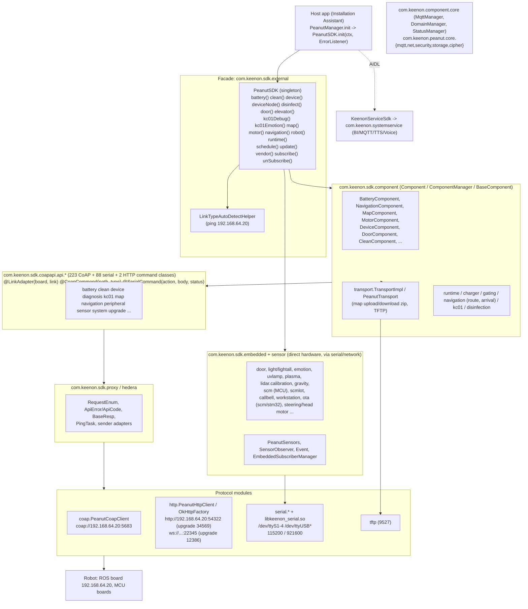

# Keenon "peanut-sdk" 2.2.6rc3-beta24 - API Catalog and Architecture (as embedded in Robot Installation Assistant v4.11.0, C40 V246)

Source APK: `robot-installation-assistant-v4.11.0-0-gb7c7c7b-prod-release-p.apk` (`com.keenon.peanut.peanutservice`). This report catalogues the **Keenon robot SDK that is statically linked into that APK**. It is the main SDK of the system; other APKs of the release (RemoteControl, ServiceSystem, krlog, peanut-clean) may embed other versions.

Evidence labels: CONFIRMED (read directly from DEX metadata/strings/annotations), STRONGLY_SUPPORTED (traced chain, no gaps seen), INFERRED (from names/types), UNKNOWN, NOT_ANALYZED, BLOCKED.
Method: author-written Python DEX parser (class/method/field tables, annotations, static values, const-string and invoke traces). **JADX/REA decompilation was BLOCKED (JADX_BAD, hash check failure)**; no decompiled source exists. Parameter names are mostly unavailable (release DEX); types are exact. Bodies were not reconstructed beyond call/string traces. Appendices A-E are machine-generated from the DEX and are complete for public/protected methods of public top-level classes in each listed package group (inner classes, lambdas, R and BuildConfig omitted; a few large classes are truncated with a "... N more" marker).

## 1. Overview, versions and module inventory

| Artifact id / package | Version (BuildConfig / strings) | Role |
|---|---|---|
| `peanut-sdk` (`com.keenon.sdk.{external,component,robot,coapapi,embedded,sensor,hedera,protocol.*,serial,http,coap,proxy,tftp,config,auth,service,compat,common,core,constant}`) | **2.2.6rc3-beta24** (`BuildConfig.BUILD_VERSION`; `PeanutSDK.init` log "[PeanutSDK][SDK start init ]2.2.6rc3-beta24") | Robot control SDK: components, command APIs, transports, embedded device drivers, sensors, OTA |
| `peanut-common` (`com.keenon.common.*`, `com.keenon.peanut` BuildConfig) | 2.2.6rc3-beta24 | PeanutConfig, PeanutConstants, PeanutError, utils |
| `com.keenon.corelibs` | n/a | Utilities, KLog, vendor manager |
| `peanut-core` modules (`com.keenon.peanut.core.*`) | logger 1.0.1, **mqtt 1.1.6**, **net 1.1.6**, **security 1.1.13**, storage 1.0.4, utils 1.0.044, cipher (native) | Paho MQTT wrapper, okhttp/retrofit net, AES/DES/MD5/signature utils, storage, shell/device utils |
| `component core` (`com.keenon.component.core.*`) | 2.0.4-beta21 | Domain manager, MQTT servers, token/http, status manager, robot facade |
| `component location` | 3.0.0-beta1-test27 | Region restriction, Google geolocation proxy |
| `component machineAuth` / `sshPwd` / `cybersecurity-qrcode` | n/a / n/a / 1.0.0-test21 | Machine identity reporting / ROS SSH password provisioning / cybersecurity QR |
| `component serviceloader` | 2.0.3 | `KeenonServiceLoader` (reads `META-INF/services/`) |
| `component widget`, `wifi-fun` | 2.0.0-beta66-test2, 1.2.3 | UI dialogs/status bar, Wi-Fi helpers |
| `serviceSdk` + `serviceDefine` + AIDL (`aidl`, `bi.aidl`, `tts.aidl`, `voice.aidl`) | 1.0.2beta15 / 1.0.1beta11 | AIDL clients to `com.keenon.systemservice` |

Class counts (DEX): ~1,320 under `com.keenon.sdk.*` (coapapi 566, embedded 376, robot 296, component 284, sensor 228, protocol 72, http 39, serial 39, hedera 19, core 18, ...), 274 `peanut.core`, 211 `component.core`.

## 2. Architecture

Layering (CONFIRMED by class relationships): `PeanutSDK` registers `Component`s in `ComponentManager`; component methods instantiate API classes of `coapapi.api.*`; each API class is annotated `@LinkAdapter(board, link)` and `@CoapCommond`/`@SerialCommand`/`@HttpCommand`, so the proxy layer (`com.keenon.sdk.proxy`, `protocol.proxy`) chooses CoAP, HTTP or serial at runtime according to `PeanutConstants$LinkType` (`COAP`, `HTTP`, `COM`, `COM_COAP`, `DEFAULT`).

## 3. Initialisation and configuration

### 3.1 `PeanutSDK.init(Context, PeanutSDK$ErrorListener)` (CONFIRMED trace)
1. `PeanutConfig.isLogEnable()/getLogLevel()` -> `LogUtils.init`.
2. Null context -> `RuntimeException("上下文Context为空")`, error `INIT_NULL_CONTEXT=203010`.
3. State machine `SDK_IDLE=-2`, `SDK_INITIALIZING=-1`, `SDK_INIT_SUCCESS=0`, `SDK_PROTOCOL_SWITCHED=1`; second call logs "SDK already init"/"SDK is initializing".
4. `initPermissionCheck(PeanutConstants.SDK_PERMISSION_LIST)` via `PackageManager.checkPermission` (missing -> RuntimeException "缺少权限", `INIT_PERMISSION_DENIED=203012`).
5. `initLog` (logback files under `LOG_PATH`, only if external storage mounted), `initAuth`: logs "[Auth :", then `initLight` (`PeanutLightHalManage.init(ctx, PropertiesValue.getRobotTypeOrMachineType())`), `initStatistics`, `initSensors` (`PeanutSensors.initSensors`, global observer = `PeanutSDK`), `initComponent` (`createComponents` -> `ComponentManager.registerComponent` -> `Component.init(IRobotComponentInitListener)`), then link detection: if `PeanutConfig.isAutoLinkType()` -> `LinkTypeAutoDetectHelper.startDetect` else `NetworkUtils.ping("192.168.64.20")` -> `initLinkTypeSuccess` -> `PingTask.init(connectionTimeout, IPing.Listener)`, `RobotApiCompat.init`, `notifyStatusChanged`.
6. Errors are delivered on the main thread through `PeanutSDK$ErrorListener.onInit(int)` registered with `registerListener/removeListener`.

### 3.2 Configuration sources
* `PeanutConfig` (`com.keenon.common.external`) - runtime switches: `isLogEnable`, `getLogLevel`, `isLogbackEnable`, `isLogbackPrintLogCatEnable`, `isStatisticsEnable`, `isAutoLinkType`, `getLinkType`, `getConnectionTimeout` (default 60000 ms), request timeout 10000 ms, `NETWORK_TIMEOUT`.
* `PeanutProperties` (`com.keenon.sdk.config`): loads **product (1) / machine (2) / user (3)** `.properties` files (path in `PeanutConstants.PATH_PARAMS_PROPERTIES`); typed getters `getValue(String, int|float|boolean|String)`, `loadProperties(int)`, `loadPropertiesAsJson`, `loadRobotParams`, `setProperties`. `PropertiesValue` wraps them; `PropertiesKey` constants: `app.robot.link.{type,ip,port,com}`, `app.door.link.com`, `app.emotion.link.com`, `app.kc01.link.com`, `app.kc01.emotion.link.com`, `app.hrc.enable`, `app.jerk.enable`, `app.pallet.{enable,num}`, `app.express.enable`, `app.head.touch.enable`, `app.dock.origin.lock.status`, `app.lock.dock.target.status`, `app.lock.pause.status`, `app.biz.{sfd,ssd}.speed`, `machine.type`, `machine.location.type`, `robot.type`, `robot.radius`, `robot.max.speed.boundary`, `robot.lidar.type`, `robot.lidar.filter.enable`, `robot.imu.enable`, `robot.door.num`, `robot.path.type`, `robot.log.level`, `robot.coredump.enable`, `robot.depth.{number,type}`, `robot.gazer.limit.{number,size}`, `robot.schedule.{enable,server.ip,wireless.mode,origin.channel|all|priority|number}`.
* `sensors.json` (`PeanutConstants.SENSOR_CONFIG`) - in this APK `{"factories":[]}` (empty).
* Required Android permissions are checked from `PeanutConstants.SDK_PERMISSION_LIST` (array content not extracted - NOT_ANALYZED).

### 3.3 `PeanutConstants` (selected, CONFIRMED values)
`COAP_PORT=5683` `COAP_PROTOCOL="coap://"`, `HTTP_PORT=54322`, `HTTP_PORT_UPGRADE=34569`, `WS_PORT=22345`, `WS_PORT_UPGRADE=12386`, `TFTP_PORT=9527`, `LOCAL_ETHER_IP="192.168.64.10"`, `REMOTE_LINK_PROXY="192.168.64.20"`, `LOCAL_LINK_PROXY="127.0.0.1"`, serial `COM1..COM4="/dev/ttyS1..4"`, `COM3RATE=921600`, `DEFAULT_RATE=115200`, `COM_USB0/2/3="/dev/ttyUSB0/2/3"`, `COM_USB4="/dev/ttyUSBDoorCtl"`, `SERIAL_TIME_OUT=60000`, `CONNECTION_TIMEOUT=60000`, `REQUEST_TIMEOUT=10000`, `DEFAULT_INTERVAL_OBSERVE=5000`, `TRANSCEIVER_ANDROID_SERIAL_PORT=1`, `TRANSCEIVER_ANDROID_NETWORK=2`, `SCM_VER_1/2/3 = v1.0/v2.0/v3.0`, `API_SUCCESS_CODE=0`, `API_FAIL_CODE=1`, `AUTH_ID=""`, `AUTH_SECRET=""`, log tags (`SDK--`, `API--`, `NAVI--`, `CHARGE--`, `DOOR--`, `TRANSPORT--`, `TFTP--`...). Enums: `LinkType{COAP,COM,COM_COAP,DEFAULT,HTTP}`, `BoardType{BATTERY,DEFAULT,DOOR,EMOTION,KC01,KC01_EMOTION,LIGHT,ROBOT,ROLA}`, `Device` enum (30 hardware identities incl. ALGORITHM_BOARD, ANDROID, APP, DOOR, DOOR_T3, EXPANSION_BOARD, EYE, GAZER, KC01_EMOTION, LIDAR_BACK/FRONT, LIGHT_BOARD_T9PRO, MOTOR, PERIPHERAL_CONTROL_BOARD, POWER, ROBOT_ARM, ROS, SCHEDULE, SLIDE_VISION_LEFT/RIGHT, STM32, SUB_PERIPHERAL_CONTROL_BOARD, VISION_LEFT/RIGHT/SINGLE, VSLAM, WORD_BANK, WORK_STATION_CTL_BOARD_VERSION, UNKNOWN; string forms such as `gd32f3-c40-chassis`, `c40-...-board`, `c55...`).
Events (`PeanutEvent`): `EVENT_BASE/COMMAND_FAILED=10000`, `SYNC_PARAMS_REBOOT_STARTUP=10001`, `..._INIT=10002`, `..._READY=10003`, `SYNC_PARAMS_RESULT=10004`, `CONNECT_SUCCESS=10006`, `CONNECT_TIMEOUT=10007`, `WORK_MODE_CHANGED=10010`, `POWER_CHANGED=10011`, `IP_CHANGED=10012`, `EMERGENCY_STATUS_CHANGED=10013`, `MOTOR_STATUS_CHANGED=10014`, `ODO_CHANGED=10015`, `LOCATION_SUCCESS=10016`, `SET_TIME_SUCCESS=10017`, `GET_PATH_SUCCESS=10018`.

## 4. Public API: facade and components (CONFIRMED signatures; behaviours INFERRED from names/annotations)

Full signature lists are in **Appendix B.1**. Summary of `PeanutSDK` and the 17 component classes (all extend `BaseComponent implements Component`; `getComponentName()` ids in `Component$RobotComponentName`):

| Accessor (`PeanutSDK`) | Component class | Methods (async, `ApiCallback`) |
|---|---|---|
| `battery()` | `BatteryComponent` | `autoCharge(int pile)`, `chargeDefault(int)`, `manualCharge`, `stopCharge`, `batteryInfo`, `scmBatteryInfo`, `getStatus`, `getChargeMatches` -> `/charge/{auto,default,manu,stop,status,matchTimes}`, `/devices/batteryInfo` |
| `navigation()` | `NavigationComponent` | `setTarget(id, mode[, name, ...])`, `setTargetPatrol`, `setCruise`, `setGuideList`, `stop/reset/pause/resume`, `setSpeed`, `setSportMode`, `setStableMode`, `setShortPath`, `setBlockTimeout`, `setHumanDetectionResult`, `sortTargets`, `getAllTargets`, `getAllDestPose(V2)`, `getDestInfo`, `getErrorStatus`, `getGuideInfo`, `getPath`, `getStatus`, `onTaskToRos` |
| `map()` | `MapComponent` | `mapList`, `mapDataGet`, `mapZone(List)`, `zonePath(List)`, `upload*/download*` (zip, optimised map, TFTP), `sendDownloadAction/Info`, `slamAction(SlamAction)`, `getPositionReport`, `getRecommendZone`, `getVslamPicture` |
| `motor()` | `MotorComponent` | `forward/backward/turnLeft/turnRight`, `moveControl(ParamDevicesMove)`, `moveSpeedControl`, `securityMoveControl`, `enable`, `getSpeed/State/Status`, `hrc`, `onDanceCmd` |
| `device()` | `DeviceComponent` | `reboot(+algBoard/service)`, `getConfig/ConfigDescInfo/List/DevicesTreeStatus`, `updateConfigV1/V2/Compat`, `getAutoCheckStatus`, `observeCheckRobotReport`, `getScramButtonStatus`, `setButtonEnable`, `setElevatorLockParam`, bell sync (`sendBellInformation*`, `syncBellConfigurations`) |
| `deviceNode()` | `DeviceNodeComponent` | device-tree upload listeners, `PostAutoCheck`, `getDeviceNodes` |
| `runtime()` | `RuntimeComponent` | `getHeartBeat`, `getIPAddress`, `getLocationId/Status`, `getOdo`, `getPath`, `getRobotPosition/StartUp/Wifi`, `getSystemStartUpState`, `setMode`, `setPositionAction`, `setPowerSavingMode`, `setResourceConfig`, `setTime`, `setWelcomeSwitch`, `sync`, `notifyVslamRelocation` |
| `schedule()` | `ScheduleComponent` | `forbid`, `pause/resume`, `getLiveStatus/Status`, `scheduleOriginTypeEnable`, `scheduleStatusAck`, `setMode` |
| `door()` | `DoorComponent` | `open/close(doorId)`, `openFan/closeFan`, `getDoorInfo/State/LockStatus/AllDoorStatus`, `setDoorType`, `observeDoorType/Fault/LimitFault`, `getDoorVersionApi` |
| `clean()` | `CleanComponent` | `cleanStart`, `cleanAction`, `cleanConfig(CleanConfigParam)`, `cleanStatus`, `cameraCalibration(+Status)` |
| `disinfect()` | `DisinfectComponent` | UV/atomizer/drainage/cabin/fan enablers, `actionDisinfectionTask`, status, task area |
| `elevator()` | `ElevatorComponent` | cloud elevator + turnstile message bridges |
| `update()` | `UpdateComponent` | `setPackageInfo`, `uploadPackage(bytes)`, `start(int)`, `handle`, `cancel`, `reboot`, `getStatus` (CoAP `/update/*`) |
| `vendor()` | `VendorComponent` | shelf/vendor jacking: `setTarget`, `moveIn/moveOut`, `setVendorAction`, `getVendorPosition/ExitStatus`, `postJackingStatus` |
| `kc01Debug()`, `kc01Emotion()` | `Kc01Component`, `Kc01EmotionComponent` | KC01 robot-arm/emotion board debug (serial) |
| `robot()` | `BaseComponent` | link properties (robotLink, robotLinkIP, robotLinkPort, ...) |
| `subscribe(key, [interval], ApiCallback)` / `unSubscribe` | keys starting `embedded.` go to `EmbeddedSubscriberManager`; others to `RobotApiCompat.subscribe()` -> `SubscribeApi` | server push / polling observers |

### 4.1 Callbacks, listeners and result types
* `com.keenon.sdk.robot.ApiCallback<T>` (`onSuccess(T)`, `onFail(ApiError)`), `ApiProgressCallback` (upload/download progress), `Component$IRobotComponentInitListener`, `PeanutSDK$ErrorListener.onInit(int)`, `LinkTypeAutoDetectHelper$LinkTypeDetectListener{canSwitchProtocol,onDetectFinished,onLinkTypeSwitched}`, `IDeviceNodeCallback`, `Transport$ITaskCallback`, `SensorObserver.onUpdate(Event, Sensor)`, `PeanutError$Listener.onUpdate(int)`, `IPing$Listener.onUpdate(int)`, `OnServiceConnectListener.onConnected/onDisconnected`.
* Generic envelope `com.keenon.sdk.robot.base.BaseResp<T>`; error object `com.keenon.sdk.hedera.model.ApiError{code, mid}`; `ApiCode` enum (`COAP_RESPONSE_EMPTY|ERROR|TIMEOUT`, `HTTP_RESPONSE_ERROR|INVALID`, `OBSERVER_LOSS`, `PARAM_ERROR`, `RESULT_EMPTY`, `SCM_RESPONSE_EMPTY`, `SOURCE_ERROR`); `RequestEnum` (request type for observers).
* Data models: `com.keenon.sdk.robot.model.bean.*` (battery 5, clean 14, device 14, diagnosis 23, kc01 8, map 33, navigation 36, peripheral 10, sensor 26, system 15, upgrade 2 classes) and request parameter classes `com.keenon.sdk.robot.model.param.*` (45 + clean 6 + vendor 2) - listed in Appendix B.1 when public top-level.

## 5. Transport and robot reachability

| Mode | Classes | Endpoint (static) | Notes |
|---|---|---|---|
| CoAP | `com.keenon.sdk.coap.PeanutCoapClient`, `coap.adapter.CoapCommond/CoapParams/CoapResponse`, `protocol.coap` | `coap://192.168.64.20:5683` | `@CoapCommond(path, requestType|msgType)`; observers via CoAP observe (`observe()`/`cancel()` methods on API classes); sequential-request set (`needSequential` strings `/na...`) |
| HTTP/WS | `sdk.http.PeanutHttpClient`, `OkHttpFactory`, `HttpRequestBody{uri,path,params,method,tag,interval}`, `http.ws.*` (20 classes), `http.adapter.HttpCommand`, `HttpPing` | `http://192.168.64.20:54322`, upgrade `:34569`, push `ws://...:22345` (upgrade 12386) | Auto-selected when ping to 192.168.64.20 succeeds (`isUseHttpProtocol`, `isNetPortConn`) |
| Serial | `sdk.serial.*` (`SerialPort`, `SerialPortFinder`, `transport.HederaTransportHeadTailCRC` frame states, `transciever`, `adapter.SerialCommand`) + `libkeenon_serial.so` | `/dev/ttyS1-4`, `/dev/ttyUSB*`, 115200/921600 baud | `@SerialCommand(action, body, status)` hex codes (e.g. door 0x64/0x66/0x71/0x7A/0xE4/0xF4, emotion 0x68/0x69/0x6A, disinfect 0x52/0x53, KC01 0x62/0xA0/0xE0, SCM 0x7C/0x20, touch 0x70/0x68, system 0xE0/0xE2) |
| TFTP | `sdk.tftp.*`, `protocol.tftp`, `component.transport.TransportImpl` | `tftp://...:9527` | map/firmware transfer, `PATH_TFTP_SERVER`, `tftpIP/tftpPath` keys |
| Proxy | `sdk.proxy.adapter` (`PingTask`, adapters), `sender.anno.{LinkAdapter,RequestType}` | n/a | selects link per API class (`board`, `link`) |
| Map transport | `TransportImpl`: modes `MODE_UPLOAD/MODE_DOWNLOAD`, types `MAP_TYPE_OFFICIAL=0, TEMP=1, PROCESS=2`; `PeanutTransport` types `UPLOAD_MAP=0, UPLOAD_MAP_ZIP=1, DOWNLOAD_MAP=2`; files `map.keenon`, `path.tmp.json`, `path.download.json.zip` | | zip min size 1024 |
| META-INF/services | `ThroughUpDataTransfer -> ThroughUpDataTransferService (toTransData(String))`, `IRobotApiCompat -> RobotApiCompatService (compat(): RobotApi)`, `ISubscribeCompat -> SubscribeCompatService (subscribe/unSubscribe)` | | loaded via `KeenonServiceLoader` / ServiceLoader; `@SingletonService` (3 classes) |

No authentication, signing or TLS is present in the CoAP/HTTP/TFTP transports (`HttpRequestBody` has no credential field; URL schemes `coap://`, `http://`, `ws://`, `tftp://`). Security therefore depends on the isolated robot network (see report RIA-024).

## 6. Device and hardware managers

Command API groups (Appendix C lists every class, path, link). Counts are classes annotated with command annotations:

| Group (`coapapi.api.<g>`) | Command classes | Representative resources (CoAP paths unless `serial:`) |
|---|---:|---|
| battery | 8 | `/charge/auto|default|manu|stop|status|matchTimes`, `/devices/batteryInfo` |
| clean | 27 | `/clean/{action,config,dst,dstV2,status,params_config,personalPath,positionStatus,taskSelfClean,...}`, `/clean/cameraCalibration(+Status)`, `/error/Alert` |
| device | 32 | `/devices/{info,list,reboot,version,moveControl,selfCheck,xmanCmd,deviceStatusReport}`, `/motor/{set_speed,enable,manu,speed,status}`, `/button/{enable,lock,status}`, `/param/{integrate,upload,loraChannel,elevator_lock}`, `/through/{up,down}`, `/security/{cmd,result}` |
| diagnosis | 17 | `/diagnosis/{deviceCheck,deviceCheckStatus(v2),deviceMatch,robotStatus,environmentCheck,robotEvent}`, `/runtime/{error,heartbeat,event_report,eventTrack,massage_report}` |
| map | 35 | `/map/{list,data,zone,zoneList,path,pathList,uploadmap,uploadobs,uploadoptmap,downloadmap,downloadwebmap,downloadoptmap,commandrequest,commandreply,requestZoneOrder}`, `/position/*` (location status, relocation, region, report), `/vslam/{image,picture}`, `/detect/image` |
| navigation | 38 | `/navigation/{action,all,cruise,destInfo,dest_poses(V2),dst,error_status,multi,path,speed,status,movemodeinfo,humanDetection_*,disinfect*}`, `/guide/{info,dst}`, `/schedule/{action,live,module,status,statusAction,quick_origin_switch}`, `/task/status`, follow cmd/data |
| peripheral | 20 | elevator (`/elevator/*`), gate (`/gate/*`), vendor/shelf (`/vendor/*`, `/navigation/vendor*`) |
| sensor | 22 | `/sensor/{lidar,imu,imuangle,sonar,psd,depth,gazer,bump*,status,fdl,pointCloudSwitch}`, `/fdl/*`, `/imu/reset`, `/welcome/switch`, dynamic obstacles/object |
| system | 16 | `/runtime/{bellConfig,rostime,workmode,time,odo,wifi,startup,setScheduleOrigin}`, `/rk/ip`, `/timestamp/sync`, `/devices/powerSavingMode`, `/position/notify`, serial 0xE0/0xE2 |
| upgrade | 9 | `/update/{cancel,download,handle,package,reboot,start,state}` + 2 serial |
| serial boards | door 23, emotion 9 + emotions 8, kc01 9 (+17 `Kc01*Api` at package root), disinfect 7, scm 11, light 2, touch 2, rola 1 | door open/close/lock/fan/version, emotion/eye expressions, KC01 robot-arm/lamps/brushes/OTA, SCM (MCU) frames, head-touch, LED light |

Embedded drivers (`com.keenon.sdk.embedded.*`, `com.keenon.sdk.sensor.*`): door controller (74 classes), SCM protocol packer (`scmlot.protopack.*` annotation/marshal framework), light and light-all (`PeanutLightHalManage`, per-model devices), emotion/eye lamps, UV lamp, plasma, gravity, lidar calibration (16 classes), battery, jacking/lift, head motor, steering motor, vision, call-bell (`sensor.callbell.*` 15 + transfer/param/bean), workstation (`sensor.workstation`), key events, keys, stm32/scm OTA (`sensor.ota.impl.scm` 38 classes), ERA.
Telemetry/diagnostics: `StatusManager` (action sub keys such as `ACTION_SUB_CHARGE_STATE`, `..._HARDWARE_INTERRUPT_STATE`, `..._SOFTWARE_INTERRUPT_STATE` with details DOOR_OPEN, JACKING, UPGRADING, FAULT, LOCATION, SCHEDULE, ALGORITHM_REBOOT, RES_UPDATING), `PeanutStatistics`, `CrashHandler.report`, `FdMonitor`.
Charger state enums: `RosChargeStatusEnum` (ADAPTER..., ARRIVE..., MATCH..., BACK..., EXIT..., OUT..., CHARGE...), `StateEntity`, `DisinfectState S0..S5`, `UVLampStatus`.

## 7. Authentication, identity and secrets in the SDK
* `com.keenon.sdk.auth.OfflineAuth.getInstance().start(Context, String, String) -> int` with `AuthInfo{appId, appName, appSecret, robotSN, license, activatedTime, expireTime, usedTime}` and `LicenseInfo{appId, expireTime, packageName, robotSN}`; error ids `PeanutError.AUTH_FAILED=203021`, `AUTH_PARAMS_NULL=203022`, `AUTH_INVALID_SECRET=203023`, `AUTH_INVALID_LICENSE=203024`, `AUTH_INVALID_SN=203025`, `AUTH_INVALID_APP=203026`, `AUTH_INVALID_APPID=203027`, `AUTH_INVALID_FP=203028`, `AUTH_INVALID_DISTANCE=203029`, `AUTH_FP_ENCODE/DECODE_EXCEPTION=203030/31`, `AUTH_EXPIRED=203032`. In this APK `PeanutConstants.AUTH_ID/AUTH_SECRET` are empty and `PeanutSDK.initAuth` only logs then continues (STRONGLY_SUPPORTED: licence not enforced for this app).
* Robot SN: `PeanutProfile.calcRobotSn`, `PeanutSNManagerUtils.getSN` (LAN/WLAN MAC via `cat /sys/class/net/{eth0,wlan0}/address`, board criteria `rockchip`, `rk3288`, `allwinner`, `octopus a83 f1`, `quad-core r18 ads`).
* Cloud: `component.core.http.token` (`ITokenApi` POST `/api/app/token/getSingleToken`), `component.core.mqtt` (`IMqttPwdApi` GET `/api/app/mqtt/secret/v2`), domain manager (`/api/app/v1/robot_iso_domain_name_link`), machine identity reporting (`/api/app/device/report/identity`), SSH login secret (`/api/app/v1/device/ssh/login-secret`).
* Native secret store: `peanut.core.cipher.CipherUtil.get(Context,String)` (`libcipher_pack.so`); key ids in `CipherUtil$CipherKey` (Section 3 of the app report, RIA-008). `peanut.core.security`: `AesUtil` (encrypt/decrypt with key+iv arguments, mode unknown), `DesUtil`, `Md5Util`, `AppSecurity.checkAppSignatureSha1/getAppSignatureSha1` (app-signature check helper; callers not traced).
* ROS SSH password management: `component.sshPwd.RosSshPasswordManager.genShhPasswordValue` (decrypt platform secret JSON `{secretKey, secretIv}` with the registered AES key/iv, AES-encrypt the robot SN, filter/concat) and `RosNetHelper.sendRosSshPassword` push it to the ROS module over the link; MQTT credential topics `RobotSshCredential`/`...Reply`.

## 8. Service SDK (AIDL) - `com.keenon.serviceSdk`
`KeenonServiceSdk.init(Context[, boolean], OnServiceConnectListener)` starts and binds four AIDL services of package **`com.keenon.systemservice`**: `bi.BiService` (`IBiApis.send(String, Map)` / `send(String, boolean, Map)`), `mqtt.MqttApiService` (`IMqtt` from peanut-core: connect/publish/subscribe/listeners), `tts.TtsApiService` (`ITtsApis`, `ITtsAidlApi`, `OnTtsAidlListener`, commands `tt_*`), `voice.VoiceApiService` (`IVoiceApis` V1/V2 proxies: voice enable/switch, awake word, ASR language, dynamic dictionary/hot words, GPT function list/system role, TTS stream type...). `BaseAidlClient` retries connection (`nextRetryConnect`). Data classes: `NlpAnswerBean`, `NlpSkillEntity`, `NlpSkillExtrasBean`, `SpecialConfig` (Parcelable). Utilities: `KeenonServiceUtil.exeCmd(Context,String)` and `silentInstallApp(Context,String)` send the global broadcasts `com.keenon.action.EXECUTE_CMD` (extra `keenon_data`) and `com.keenon.action.SILENT_INSTALL_APP` (extra `formPath`).

## 9. How the Installation Assistant uses the SDK (traced, CONFIRMED)

| Host class#method | SDK call | Robot-side resource (static) |
|---|---|---|
| `PeanutManager.init` | `PeanutSDK.getInstance().init(...)` (INFERRED from name; init call site not printed) | n/a |
| `RobotManager.autoCharger` | `PeanutSDK.battery().autoCharge(int, ApiCallback)` | `/charge/auto` POST |
| `RobotManager.stopCharger` | `BatteryComponent.stopCharge(ApiCallback)` | `/charge/stop` POST |
| `RobotManager.navigation` | `PeanutSDK.navigation().setTarget(int, int, ApiCallback)` | `/navigation/dst` (INFERRED mapping) |
| `RobotManager.controlNavigation` | `NavigationComponent.stop/reset/pause/resume` | `/navigation/action` (INFERRED) |
| `RobotManager.scheduleLive` | `RobotApiCompat.ins().navigation().scheduleLive(cb)` | `/schedule/live` (INFERRED) |
| `RobotManager.onSubscribe/unSubscribe` | `PeanutSDK.subscribe/unSubscribe("navi.status" \| "battery.charge.status" \| "diagnosis.error", ...)` | observers |
| `WorkStationManager.init/release` | sensor `device.through.up` observer; events `_sensor.call.work.received.{bind,unbind,update,can,unbind.state}` | workstation/charging-station radio (LoRa channel `/param/loraChannel` INFERRED) |
| `SlamApplication.initBi`, `InformationSupport.onHandlePostDataCloud` | `KeenonServiceSdk.init`, `biApis().send(eventKey, data)` | AIDL |
| `ServerManager`, `DomainManager`, `MqttManager` | component.core domain/MQTT | cloud |
| `PeanutLocationManager.initData/queryRobotLimitInfo` | component.location | cloud geolocation/restriction |

## 10. Confirmed vs inferred summary
* CONFIRMED: versions, packages, public method signatures, annotation tables (223/88/2), constants/ports/serial devices, error code values, init sequence strings, META-INF service registrations, AIDL package/class names, Installation-Assistant call chains up to the SDK facade.
* STRONGLY_SUPPORTED: link-type auto-detection semantics, absence of transport authentication, licence not enforced, component-to-resource mapping for the traced calls.
* INFERRED: physical effects of commands, mapping of component methods to specific CoAP resources other than those with direct annotations, subscription key semantics (Appendix D), observer/polling behaviour.
* NOT_ANALYZED: bodies of OTA, calibration and scmlot marshalling, widget/dialog UI classes, `SDK_PERMISSION_LIST` contents, robot-side implementation.
* BLOCKED: decompilation to Java (JADX engine unusable); use REA/JADX later for method bodies.

---

# Generated appendices

## Appendix A. Package inventory (generated from DEX class definitions)

Counts are total class definitions / public top-level (non-inner, non-lambda) classes. Source: `keenon_deep.json` produced by the author-written DEX parser (`scripts/ria/dexx.py`).

| Package | Classes | Public top-level |
|---|---:|---:|
| `com.keenon.aidl` | 4 | 1 |
| `com.keenon.aidl.mqtt` | 12 | 3 |
| `com.keenon.bi.aidl` | 4 | 1 |
| `com.keenon.common.constant` | 4 | 2 |
| `com.keenon.common.error` | 3 | 2 |
| `com.keenon.common.external` | 6 | 3 |
| `com.keenon.common.log` | 9 | 2 |
| `com.keenon.common.utils` | 44 | 29 |
| `com.keenon.common.utils.gsontypeadapter` | 9 | 8 |
| `com.keenon.component.core` | 18 | 2 |
| `com.keenon.component.core.action` | 1 | 1 |
| `com.keenon.component.core.base` | 14 | 9 |
| `com.keenon.component.core.base.initializer` | 7 | 5 |
| `com.keenon.component.core.callback` | 1 | 1 |
| `com.keenon.component.core.config` | 1 | 1 |
| `com.keenon.component.core.config.domain` | 20 | 6 |
| `com.keenon.component.core.config.shareParams` | 4 | 2 |
| `com.keenon.component.core.constant` | 7 | 2 |
| `com.keenon.component.core.http` | 5 | 4 |
| `com.keenon.component.core.http.bean` | 7 | 7 |
| `com.keenon.component.core.http.interceptor` | 1 | 1 |
| `com.keenon.component.core.http.observer` | 3 | 2 |
| `com.keenon.component.core.http.token` | 6 | 4 |
| `com.keenon.component.core.interceptor` | 6 | 6 |
| `com.keenon.component.core.legacy` | 5 | 4 |
| `com.keenon.component.core.module` | 4 | 3 |
| `com.keenon.component.core.mqtt` | 19 | 4 |
| `com.keenon.component.core.mqtt.api` | 2 | 2 |
| `com.keenon.component.core.mqtt.bean` | 1 | 1 |
| `com.keenon.component.core.proxy` | 5 | 2 |
| `com.keenon.component.core.registry` | 4 | 4 |
| `com.keenon.component.core.robot` | 20 | 4 |
| `com.keenon.component.core.runtime` | 1 | 1 |
| `com.keenon.component.core.server` | 2 | 2 |
| `com.keenon.component.core.status` | 11 | 3 |
| `com.keenon.component.core.status.model` | 3 | 3 |
| `com.keenon.component.core.status.model.biz` | 12 | 5 |
| `com.keenon.component.core.status.test` | 3 | 1 |
| `com.keenon.component.core.utils` | 17 | 8 |
| `com.keenon.component.core.wrapper` | 1 | 1 |
| `com.keenon.component.cybersecurity` | 23 | 3 |
| `com.keenon.component.cybersecurity.api` | 2 | 2 |
| `com.keenon.component.cybersecurity.bean` | 2 | 2 |
| `com.keenon.component.cybersecurity.constant` | 4 | 2 |
| `com.keenon.component.cybersecurity.iface` | 1 | 1 |
| `com.keenon.component.cybersecurity.util` | 10 | 2 |
| `com.keenon.component.cybersecurity.view` | 2 | 1 |
| `com.keenon.component.location` | 38 | 5 |
| `com.keenon.component.location.amap` | 2 | 1 |
| `com.keenon.component.location.bean` | 22 | 12 |
| `com.keenon.component.location.google` | 3 | 1 |
| `com.keenon.component.location.http` | 4 | 4 |
| `com.keenon.component.location.listener` | 4 | 3 |
| `com.keenon.component.location.net` | 1 | 1 |
| `com.keenon.component.location.proto` | 6 | 1 |
| `com.keenon.component.location.utils` | 17 | 10 |
| `com.keenon.component.machineAuth` | 8 | 1 |
| `com.keenon.component.machineAuth.api` | 2 | 2 |
| `com.keenon.component.machineAuth.bean` | 8 | 2 |
| `com.keenon.component.machineAuth.net` | 3 | 1 |
| `com.keenon.component.machineAuth.utils` | 3 | 1 |
| `com.keenon.component.serviceloader` | 22 | 6 |
| `com.keenon.component.sshPwd` | 5 | 1 |
| `com.keenon.component.sshPwd.api` | 2 | 2 |
| `com.keenon.component.sshPwd.bean` | 2 | 2 |
| `com.keenon.component.sshPwd.net` | 9 | 3 |
| `com.keenon.component.sshPwd.utils` | 4 | 2 |
| `com.keenon.component.widget` | 80 | 35 |
| `com.keenon.component.widget.adapter` | 5 | 4 |
| `com.keenon.component.widget.bean` | 4 | 4 |
| `com.keenon.component.widget.dialogadapter` | 4 | 1 |
| `com.keenon.component.widget.dialogmanager` | 16 | 6 |
| `com.keenon.component.widget.dialogview` | 66 | 28 |
| `com.keenon.component.widget.layoutmanager` | 5 | 4 |
| `com.keenon.component.widget.r2` | 2 | 2 |
| `com.keenon.component.widget.r2.format` | 3 | 3 |
| `com.keenon.component.widget.r2.helper` | 1 | 1 |
| `com.keenon.component.widget.r2.widget` | 8 | 4 |
| `com.keenon.component.widget.running` | 4 | 1 |
| `com.keenon.component.widget.statusbar` | 22 | 5 |
| `com.keenon.component.widget.statusbar.livedata` | 6 | 5 |
| `com.keenon.component.widget.util` | 3 | 3 |
| `com.keenon.component.wifi` | 29 | 9 |
| `com.keenon.corelibs` | 16 | 2 |
| `com.keenon.corelibs.utils` | 26 | 16 |
| `com.keenon.corelibs.utils.log` | 4 | 3 |
| `com.keenon.corelibs.vendor` | 7 | 5 |
| `com.keenon.corelibs.widget` | 2 | 2 |
| `com.keenon.peanut` | 18 | 2 |
| `com.keenon.peanut.core.cipher` | 2 | 1 |
| `com.keenon.peanut.core.log` | 35 | 6 |
| `com.keenon.peanut.core.mqtt` | 42 | 8 |
| `com.keenon.peanut.core.net` | 19 | 5 |
| `com.keenon.peanut.core.net.http` | 14 | 5 |
| `com.keenon.peanut.core.security` | 26 | 11 |
| `com.keenon.peanut.core.storage` | 29 | 9 |
| `com.keenon.peanut.core.utils` | 18 | 4 |
| `com.keenon.peanut.core.utils.android` | 11 | 8 |
| `com.keenon.peanut.core.utils.collection` | 2 | 2 |
| `com.keenon.peanut.core.utils.device` | 14 | 5 |
| `com.keenon.peanut.core.utils.internal` | 1 | 1 |
| `com.keenon.peanut.core.utils.io` | 2 | 2 |
| `com.keenon.peanut.core.utils.patch` | 1 | 1 |
| `com.keenon.peanut.core.utils.third` | 23 | 8 |
| `com.keenon.peanut.core.utils.thread` | 9 | 6 |
| `com.keenon.peanut.core.utils.usual` | 19 | 15 |
| `com.keenon.peanut.core.utils.vender` | 7 | 2 |
| `com.keenon.sdk.auth` | 5 | 3 |
| `com.keenon.sdk.coap` | 15 | 4 |
| `com.keenon.sdk.coap.adapter` | 4 | 4 |
| `com.keenon.sdk.coapapi` | 19 | 3 |
| `com.keenon.sdk.coapapi.api.battery` | 17 | 8 |
| `com.keenon.sdk.coapapi.api.clean` | 74 | 27 |
| `com.keenon.sdk.coapapi.api.device` | 61 | 32 |
| `com.keenon.sdk.coapapi.api.diagnosis` | 46 | 17 |
| `com.keenon.sdk.coapapi.api.kc01` | 13 | 7 |
| `com.keenon.sdk.coapapi.api.map` | 88 | 35 |
| `com.keenon.sdk.coapapi.api.navigation` | 69 | 38 |
| `com.keenon.sdk.coapapi.api.peripheral` | 43 | 20 |
| `com.keenon.sdk.coapapi.api.sensor` | 57 | 24 |
| `com.keenon.sdk.coapapi.api.system` | 41 | 16 |
| `com.keenon.sdk.coapapi.api.upgrade` | 17 | 9 |
| `com.keenon.sdk.coapapi.base` | 2 | 2 |
| `com.keenon.sdk.coapapi.impl` | 14 | 13 |
| `com.keenon.sdk.coapapi.impl.actuator` | 1 | 1 |
| `com.keenon.sdk.coapapi.util` | 4 | 4 |
| `com.keenon.sdk.common` | 12 | 2 |
| `com.keenon.sdk.compat` | 2 | 1 |
| `com.keenon.sdk.compat.map` | 10 | 1 |
| `com.keenon.sdk.component` | 28 | 17 |
| `com.keenon.sdk.component.charger` | 10 | 2 |
| `com.keenon.sdk.component.charger.common` | 16 | 6 |
| `com.keenon.sdk.component.charger.utils` | 1 | 1 |
| `com.keenon.sdk.component.disinfection` | 6 | 1 |
| `com.keenon.sdk.component.disinfection.common` | 13 | 5 |
| `com.keenon.sdk.component.gating.callback` | 1 | 1 |
| `com.keenon.sdk.component.gating.data` | 8 | 3 |
| `com.keenon.sdk.component.gating.manager` | 15 | 2 |
| `com.keenon.sdk.component.gating.state` | 10 | 3 |
| `com.keenon.sdk.component.kc01` | 59 | 18 |
| `com.keenon.sdk.component.kc01.emotions` | 29 | 9 |
| `com.keenon.sdk.component.navigation` | 17 | 3 |
| `com.keenon.sdk.component.navigation.arrival` | 6 | 2 |
| `com.keenon.sdk.component.navigation.common` | 15 | 3 |
| `com.keenon.sdk.component.navigation.route` | 10 | 4 |
| `com.keenon.sdk.component.param` | 2 | 1 |
| `com.keenon.sdk.component.runtime` | 27 | 2 |
| `com.keenon.sdk.component.transport` | 8 | 3 |
| `com.keenon.sdk.component.transport.bean` | 3 | 2 |
| `com.keenon.sdk.config` | 4 | 3 |
| `com.keenon.sdk.constant` | 8 | 3 |
| `com.keenon.sdk.core` | 18 | 2 |
| `com.keenon.sdk.embedded` | 18 | 2 |
| `com.keenon.sdk.embedded.api.disinfect` | 18 | 7 |
| `com.keenon.sdk.embedded.api.door` | 74 | 24 |
| `com.keenon.sdk.embedded.api.emotion` | 20 | 9 |
| `com.keenon.sdk.embedded.api.kc01` | 4 | 2 |
| `com.keenon.sdk.embedded.api.light` | 4 | 2 |
| `com.keenon.sdk.embedded.api.proxy` | 3 | 3 |
| `com.keenon.sdk.embedded.api.rola` | 2 | 1 |
| `com.keenon.sdk.embedded.api.scm` | 25 | 11 |
| `com.keenon.sdk.embedded.api.touch` | 8 | 2 |
| `com.keenon.sdk.embedded.assist` | 10 | 4 |
| `com.keenon.sdk.embedded.battery` | 6 | 4 |
| `com.keenon.sdk.embedded.bean` | 2 | 1 |
| `com.keenon.sdk.embedded.common` | 14 | 11 |
| `com.keenon.sdk.embedded.emotion` | 6 | 1 |
| `com.keenon.sdk.embedded.gravity` | 6 | 1 |
| `com.keenon.sdk.embedded.lidar` | 4 | 1 |
| `com.keenon.sdk.embedded.lidar.calibration` | 16 | 11 |
| `com.keenon.sdk.embedded.light` | 17 | 2 |
| `com.keenon.sdk.embedded.lightall` | 10 | 5 |
| `com.keenon.sdk.embedded.lightall.devices` | 12 | 10 |
| `com.keenon.sdk.embedded.lightall.model` | 2 | 1 |
| `com.keenon.sdk.embedded.lightall.util` | 1 | 1 |
| `com.keenon.sdk.embedded.plasma` | 8 | 5 |
| `com.keenon.sdk.embedded.plasma.transfer` | 4 | 4 |
| `com.keenon.sdk.embedded.scmlot` | 3 | 1 |
| `com.keenon.sdk.embedded.scmlot.bean` | 3 | 2 |
| `com.keenon.sdk.embedded.scmlot.bean.request` | 9 | 9 |
| `com.keenon.sdk.embedded.scmlot.bean.response` | 7 | 7 |
| `com.keenon.sdk.embedded.scmlot.protopack.annotation` | 3 | 3 |
| `com.keenon.sdk.embedded.scmlot.protopack.base` | 14 | 14 |
| `com.keenon.sdk.embedded.scmlot.protopack.exception` | 2 | 2 |
| `com.keenon.sdk.embedded.scmlot.protopack.marshal` | 18 | 17 |
| `com.keenon.sdk.embedded.scmlot.protopack.util` | 8 | 8 |
| `com.keenon.sdk.embedded.scmlot.transfer` | 4 | 4 |
| `com.keenon.sdk.embedded.utils` | 2 | 1 |
| `com.keenon.sdk.embedded.uvlamp` | 9 | 5 |
| `com.keenon.sdk.external` | 15 | 2 |
| `com.keenon.sdk.hedera` | 1 | 1 |
| `com.keenon.sdk.hedera.base` | 9 | 5 |
| `com.keenon.sdk.hedera.model` | 9 | 7 |
| `com.keenon.sdk.http` | 11 | 5 |
| `com.keenon.sdk.http.adapter` | 8 | 6 |
| `com.keenon.sdk.http.ws` | 20 | 6 |
| `com.keenon.sdk.protocol.coap` | 12 | 2 |
| `com.keenon.sdk.protocol.common` | 12 | 2 |
| `com.keenon.sdk.protocol.http` | 12 | 2 |
| `com.keenon.sdk.protocol.proxy` | 12 | 2 |
| `com.keenon.sdk.protocol.serial` | 12 | 2 |
| `com.keenon.sdk.protocol.tftp` | 12 | 2 |
| `com.keenon.sdk.proxy.adapter` | 9 | 5 |
| `com.keenon.sdk.proxy.sender` | 1 | 1 |
| `com.keenon.sdk.proxy.sender.anno` | 2 | 2 |
| `com.keenon.sdk.robot` | 7 | 7 |
| `com.keenon.sdk.robot.api` | 25 | 14 |
| `com.keenon.sdk.robot.base` | 18 | 5 |
| `com.keenon.sdk.robot.compat` | 2 | 2 |
| `com.keenon.sdk.robot.model.bean` | 4 | 3 |
| `com.keenon.sdk.robot.model.bean.battery` | 5 | 3 |
| `com.keenon.sdk.robot.model.bean.clean` | 14 | 11 |
| `com.keenon.sdk.robot.model.bean.device` | 14 | 12 |
| `com.keenon.sdk.robot.model.bean.diagnosis` | 23 | 11 |
| `com.keenon.sdk.robot.model.bean.kc01` | 8 | 4 |
| `com.keenon.sdk.robot.model.bean.map` | 33 | 30 |
| `com.keenon.sdk.robot.model.bean.navigation` | 36 | 20 |
| `com.keenon.sdk.robot.model.bean.peripheral` | 10 | 9 |
| `com.keenon.sdk.robot.model.bean.sensor` | 26 | 23 |
| `com.keenon.sdk.robot.model.bean.system` | 15 | 15 |
| `com.keenon.sdk.robot.model.bean.upgrade` | 2 | 2 |
| `com.keenon.sdk.robot.model.param` | 45 | 33 |
| `com.keenon.sdk.robot.model.param.clean` | 6 | 4 |
| `com.keenon.sdk.robot.model.param.vendor` | 2 | 1 |
| `com.keenon.sdk.robot.service` | 1 | 1 |
| `com.keenon.sdk.sensor.Motor` | 7 | 3 |
| `com.keenon.sdk.sensor.bell` | 2 | 1 |
| `com.keenon.sdk.sensor.calibration` | 7 | 3 |
| `com.keenon.sdk.sensor.callbell` | 15 | 4 |
| `com.keenon.sdk.sensor.callbell.bean` | 5 | 5 |
| `com.keenon.sdk.sensor.callbell.param` | 9 | 9 |
| `com.keenon.sdk.sensor.callbell.transfer` | 10 | 10 |
| `com.keenon.sdk.sensor.container` | 3 | 1 |
| `com.keenon.sdk.sensor.diagnose` | 5 | 1 |
| `com.keenon.sdk.sensor.door` | 15 | 5 |
| `com.keenon.sdk.sensor.era` | 5 | 4 |
| `com.keenon.sdk.sensor.expression` | 4 | 2 |
| `com.keenon.sdk.sensor.eyelamp` | 5 | 3 |
| `com.keenon.sdk.sensor.headmotor` | 13 | 7 |
| `com.keenon.sdk.sensor.jacking` | 11 | 6 |
| `com.keenon.sdk.sensor.keyevnet` | 8 | 5 |
| `com.keenon.sdk.sensor.map` | 6 | 3 |
| `com.keenon.sdk.sensor.ota` | 2 | 1 |
| `com.keenon.sdk.sensor.ota.base` | 5 | 2 |
| `com.keenon.sdk.sensor.ota.impl` | 22 | 2 |
| `com.keenon.sdk.sensor.ota.impl.scm` | 38 | 7 |
| `com.keenon.sdk.sensor.scmreboot` | 6 | 3 |
| `com.keenon.sdk.sensor.steeringmotor` | 7 | 4 |
| `com.keenon.sdk.sensor.stm32` | 8 | 5 |
| `com.keenon.sdk.sensor.vision` | 5 | 1 |
| `com.keenon.sdk.sensor.workstation` | 5 | 3 |
| `com.keenon.sdk.serial` | 9 | 4 |
| `com.keenon.sdk.serial.adapter` | 5 | 4 |
| `com.keenon.sdk.serial.base` | 5 | 3 |
| `com.keenon.sdk.serial.internal` | 4 | 2 |
| `com.keenon.sdk.serial.transciever` | 3 | 1 |
| `com.keenon.sdk.serial.transport` | 13 | 2 |
| `com.keenon.sdk.service` | 3 | 3 |
| `com.keenon.sdk.tftp` | 2 | 2 |
| `com.keenon.service` | 2 | 1 |
| `com.keenon.service.define` | 18 | 2 |
| `com.keenon.serviceSdk` | 19 | 3 |
| `com.keenon.serviceSdk.bi` | 3 | 2 |
| `com.keenon.serviceSdk.common` | 7 | 5 |
| `com.keenon.serviceSdk.mqtt` | 8 | 1 |
| `com.keenon.serviceSdk.tts` | 10 | 3 |
| `com.keenon.serviceSdk.utils` | 1 | 1 |
| `com.keenon.serviceSdk.voice` | 6 | 4 |
| `com.keenon.serviceSdk.voice.callback` | 7 | 6 |
| `com.keenon.serviceSdk.voice.internal` | 25 | 1 |
| `com.keenon.tts.aidl` | 8 | 2 |
| `com.keenon.tts.define` | 4 | 4 |
| `com.keenon.voice.aidl` | 24 | 8 |
| `com.keenon.voice.define` | 10 | 1 |
| `com.keenon.voice.define.bean` | 4 | 4 |

## Appendix B. Public API surface by package (generated)

Signatures are decoded from DEX method_ids/proto_ids (names/types exact; parameter names are not available in release DEX unless in MethodParameters annotations). Types use simple names.

### B.1 Facade, components, robot API, config, auth (com.keenon.sdk.*)

#### `com.keenon.sdk.auth`

- **class `AuthInfo`**
  - `String getActivatedTime()`
  - `String getAppId()`
  - `String getAppName()`
  - `String getAppSecret()`
  - `long getExpireTime()`
  - `LicenseInfo getLicense()`
  - `String getRobotSN()`
  - `long getUsedTime()`
  - `void setActivatedTime(String)`
  - `void setAppId(String)`
  - `void setAppName(String)`
  - `void setAppSecret(String)`
  - `void setExpireTime(long)`
  - `void setLicense(LicenseInfo)`
  - `void setRobotSN(String)`
  - `void setUsedTime(long)`
  - `String toString()`
- **class `LicenseInfo`**
  - `String getAppId()`
  - `long getExpireTime()`
  - `String getPackageName()`
  - `String getRobotSN()`
  - `void setAppId(String)`
  - `void setExpireTime(long)`
  - `void setPackageName(String)`
  - `void setRobotSN(String)`
- **class `OfflineAuth`**
  - `static OfflineAuth getInstance()`
  - `int start(Context, String, String)`

#### `com.keenon.sdk.common`

- **class `BuildConfig`**
  - constants: `BUILD_ARTIFACTID='peanut-sdk'`; `BUILD_TYPE='release'`; `BUILD_VERSION='2.2.6rc3-beta24'`; `DEBUG=False`; `LIBRARY_PACKAGE_NAME='com.keenon.sdk.common'`; `THIRD_PARTY=False`
- **class `R`**

#### `com.keenon.sdk.compat`

- **class `RobotApiCompat`** implements `RobotApi`
  - `static RobotApiCompat ins()`
  - `BatteryApi battery()`
  - `CleanApi clean()`
  - `DeviceApi device()`
  - `DiagnosisApi diagnosis()`
  - `void init()`
  - `Kc01ExtApi kc01Ext()`
  - `MapApi map()`
  - `NavigationApi navigation()`
  - `PeripheralApi peripheral()`
  - `void release()`
  - `SensorApi sensor()`
  - `SubscribeApi subscribe()`
  - `SystemApi system()`
  - `UpgradeApi upgrade()`

#### `com.keenon.sdk.compat.map`

- **class `MapTransportCompat`**
  - `static MapTransportCompat ins()`
  - `static boolean isDownloadZipFail(int)`
  - `void download(String, String, int, String, MapTransportCompat$OnDownloadListener)`
  - `void upload(MapTransportCompat$OnUpLoadListener)`

#### `com.keenon.sdk.component`

- **class `BaseComponent`** implements `Component`
  - `String getComponentName()`
  - `int getStatusCode()`
  - `void init(Component$IRobotComponentInitListener)`
  - `void release()`
- **class `BatteryComponent`** extends `BaseComponent` implements `Component`
  - `void autoCharge(int, ApiCallback)`
  - `void batteryInfo(ApiCallback)`
  - `void chargeDefault(int, ApiCallback)`
  - `void getChargeMatches(ApiCallback)`
  - `String getComponentName()`
  - `void getStatus(ApiCallback)`
  - `void manualCharge(ApiCallback)`
  - `void scmBatteryInfo(ApiCallback)`
  - `void stopCharge(ApiCallback)`
- **class `CleanComponent`** extends `BaseComponent` implements `Component`
  - `void cameraCalibration(Integer, ApiCallback)`
  - `void cameraCalibrationStatus(ApiCallback)`
  - `void cleanAction(Integer, ApiCallback)`
  - `void cleanConfig(CleanConfigParam, ApiCallback)`
  - `void cleanStart(int, ApiCallback)`
  - `void cleanStatus(ApiCallback)`
  - `String getComponentName()`
- **interface `Component`**
  - `String getComponentName()`
  - `int getStatusCode()`
  - `void init(Component$IRobotComponentInitListener)`
  - `void release()`
- **class `ComponentManager`**
  - `static ComponentManager ins()`
  - `Component getComponent(Component$RobotComponentName)`
  - `Component getComponent(String)`
  - `boolean isFinishInit()`
  - `boolean registerComponent(Component)`
  - `void release()`
  - `void unregisterComponent(String)`
- **class `DeviceComponent`** extends `BaseComponent` implements `Component`
  - `void checkParamKey(ApiCallback, String)`
  - `void checkRobotReport()`
  - `void getAutoCheckStatus(ApiCallback, int, int)`
  - `void getAutoCheckStatus(ApiCallback, int, List)`
  - `void getAutoCheckStatus(ApiCallback, String)`
  - `String getComponentName()`
  - `void getConfig(ApiCallback)`
  - `void getConfigDescInfo(ApiCallback)`
  - `void getList(ApiCallback)`
  - `void getRobotDevicesTreeStatus(ApiCallback)`
  - `void getScramButtonStatus(ApiCallback)`
  - `void observeCheckRobotReport(ApiCallback)`
  - `void reboot(ApiCallback)`
  - `void reboot(ApiCallback, boolean)`
  - `void rebootAlgBoard(ApiCallback, boolean)`
  - `void rebootService(ApiCallback)`
  - `void sendBellInformation(byte[], byte, ApiCallback)`
  - `void sendBellInformationForID(byte[], short, ApiCallback)`
  - `void setButtonEnable(ApiCallback, boolean)`
  - `void setElevatorLockParam(ApiCallback, Map)`
  - `void syncBellConfigurations(byte[], byte, byte, byte, byte, byte, byte, byte, ApiCallback)`
  - `void unObserveCheckRobotReport()`
  - `void updateConfigCompat(ApiCallback, Map)`
  - `void updateConfigV1(ApiCallback, Map)`
  - `void updateConfigV2(ApiCallback, Map)`
- **class `DeviceNodeComponent`** extends `BaseComponent` implements `Component`
  - `void PostAutoCheck(ApiCallback, int, int)`
  - `void PostAutoCheck(ApiCallback, String)`
  - `void addDeviceNodeListen(IDeviceNodeCallback)`
  - `String getComponentName()`
  - `void getDeviceNodes(String)`
  - `void onStartUpload()`
  - `void onStartUpload(IDeviceNodeCallback)`
  - `void onStopUpload()`
- **class `DisinfectComponent`** extends `BaseComponent` implements `Component`
  - `void actionDisinfectionTask(ApiCallback, String, int)`
  - `void enableAtomizer(ApiCallback, boolean)`
  - `void enableCabin(ApiCallback, boolean)`
  - `void enableDrainage(ApiCallback, boolean)`
  - `void enableUltraviolet(ApiCallback, boolean)`
  - `String getComponentName()`
  - `void getDisinfectionStatus(ApiCallback)`
  - `void getDisinfectionTaskArea(ApiCallback)`
  - `void setFanSpeedLevel(ApiCallback, int)`
- **class `DoorComponent`** extends `BaseComponent` implements `Component`
  - `void close(ApiCallback, int)`
  - `void closeFan(ApiCallback, int)`
  - `void getALlDoorStatus(ApiCallback)`
  - `void getAllLockStatus(ApiCallback)`
  - `String getComponentName()`
  - `void getDoorInfo(ApiCallback, int)`
  - `int getDoorNum()`
  - `void getDoorVersionApi(ApiCallback)`
  - `void getLockStatus(ApiCallback, int)`
  - `void getState(ApiCallback, int)`
  - `void observeDoorType(ApiCallback)`
  - `void observeFault(ApiCallback)`
  - `void observeLimitFault(ApiCallback)`
  - `void open(ApiCallback, int)`
  - `void openFan(ApiCallback, int)`
  - `void setDoorType(ApiCallback, int)`
- **class `ElevatorComponent`** extends `BaseComponent` implements `Component`
  - `String getComponentName()`
  - `void getStatus(ApiCallback)`
  - `void receiveMessageFromServer(ApiCallback)`
  - `void receiveTurnstileMessageFromServer(ApiCallback)`
  - `void sendMessageToRobot(String, ApiCallback)`
  - `void sendTurnstileMessageToRobot(String, ApiCallback)`
- **class `MapComponent`** extends `BaseComponent` implements `Component`
  - `void download(ApiProgressCallback)`
  - `void downloadOptWebMap(byte[], ApiProgressCallback)`
  - `void downloadTftp(ParamUploadMap, ApiCallback)`
  - `String getComponentName()`
  - `void getPositionReport(ApiCallback)`
  - `void getRecommendZone(ApiCallback, List)`
  - `void getVslamPicture(ApiCallback)`
  - `void mapDataGet(ApiCallback, Integer, String)`
  - `void mapList(ApiCallback)`
  - `void mapZone(ApiCallback, int)`
  - `void mapZoneList(ApiCallback)`
  - `void sendDownloadAction(int, ApiCallback)`
  - `void sendDownloadInfo(ParamSendDownloadInfo, ApiCallback)`
  - `void slamAction(SlamAction, ApiCallback)`
  - `void upload(ApiProgressCallback, byte[])`
  - `void uploadNew(ApiProgressCallback, byte[])`
  - `void uploadObs(ApiCallback)`
  - `void uploadOptMap(ApiProgressCallback)`
  - `void uploadTftp(ParamDownloadMap, ApiCallback)`
  - `void zonePath(ApiCallback, int)`
  - `void zonePathList(ApiCallback)`
- **class `MotorComponent`** extends `BaseComponent` implements `Component`
  - `void backward(ApiCallback)`
  - `void enable(ApiCallback, int)`
  - `void forward(ApiCallback)`
  - `String getComponentName()`
  - `void getSpeed(ApiCallback)`
  - `void getState(ApiCallback)`
  - `void getStatus(ApiCallback)`
  - `void hrc(ApiCallback, boolean)`
  - `void moveControl(ApiCallback, ParamDevicesMove)`
  - `void moveSpeedControl(ApiCallback, ParamDevicesMoveSpeed)`
  - `void onDanceCmd(ApiCallback, int)`
  - `void securityMoveControl(ApiCallback, ParamSecurityRobotMove)`
  - `void turnLeft(ApiCallback)`
  - `void turnRight(ApiCallback)`
- **class `NavigationComponent`** extends `BaseComponent` implements `Component`
  - `void getAllDestPose(ApiCallback)`
  - `void getAllDestPoseV2(ApiCallback)`
  - `void getAllTargets(ApiCallback)`
  - `String getComponentName()`
  - `void getDestInfo(int, ApiCallback)`
  - `void getErrorStatus(ApiCallback)`
  - `void getGuideInfo(ApiCallback)`
  - `void getPath(ApiCallback)`
  - `void getStatus(ApiCallback)`
  - `void onTaskToRos(ApiCallback, String, String)`
  - `void pause(ApiCallback)`
  - `void reset(ApiCallback)`
  - `void resume(ApiCallback)`
  - `void setBlockTimeout(int, ApiCallback)`
  - `void setCruise(int, int, int, ApiCallback)`
  - `void setGuideList(List, ApiCallback)`
  - `void setHumanDetectionResult(int, ApiCallback)`
  - `void setShortPath(int, ApiCallback)`
  - `void setSpeed(int, ApiCallback)`
  - `void setSportMode(int, ApiCallback)`
  - `void setStableMode(int, ApiCallback)`
  - `void setTarget(int, int, ApiCallback)`
  - `void setTarget(int, int, String, int, ApiCallback)`
  - `void setTarget(int, int, String, ApiCallback)`
  - `void setTargetPatrol(int, int, int, ApiCallback)`
  - `void sortTargets(List, ApiCallback)`
  - `void stop(ApiCallback)`
- **class `RuntimeComponent`** extends `BaseComponent` implements `Component`
  - `String getComponentName()`
  - `void getHeartBeat(ApiCallback)`
  - `void getIPAddress(ApiCallback)`
  - `void getLocationId(ApiCallback)`
  - `void getLocationStatus(ApiCallback)`
  - `void getOdo(ApiCallback)`
  - `void getPath(ApiCallback)`
  - `void getRobotPosition(ApiCallback)`
  - `void getRobotStartUp(ApiCallback)`
  - `void getRobotWifi(ApiCallback)`
  - `void getSystemStartUpState(ApiCallback)`
  - `void notifyVslamRelocation(ApiCallback, String)`
  - `void setMode(ApiCallback, int)`
  - `void setPositionAction(String, ApiCallback)`
  - `void setPowerSavingMode(ApiCallback, int)`
  - `void setResourceConfig(String, ApiCallback)`
  - `void setTime(ApiCallback, long)`
  - `void setWelcomeSwitch(ApiCallback, boolean)`
  - `void sync(int, ApiCallback)`
- **class `ScheduleComponent`** extends `BaseComponent` implements `Component`
  - `void forbid(ApiCallback)`
  - `String getComponentName()`
  - `void getLiveStatus(ApiCallback)`
  - `void getStatus(ApiCallback)`
  - `void pause(ApiCallback)`
  - `void resume(ApiCallback)`
  - `void scheduleOriginTypeEnable(ApiCallback, boolean)`
  - `void scheduleStatusAck(ApiCallback)`
  - `void setMode(ApiCallback, int, int)`
- **class `UpdateComponent`** extends `BaseComponent` implements `Component`
  - `void cancel(ApiCallback)`
  - `String getComponentName()`
  - `void getStatus(ApiCallback)`
  - `void handle(ApiCallback)`
  - `void reboot(ApiCallback)`
  - `void setPackageInfo(ApiCallback, String)`
  - `void start(ApiCallback, int)`
  - `void uploadPackage(ApiProgressCallback, byte[])`
- **class `VendorComponent`** extends `BaseComponent` implements `Component`
  - `String getComponentName()`
  - `void getVendorExitStatus(ApiCallback)`
  - `void getVendorPosition(ApiCallback, String)`
  - `void moveIn(int, ApiCallback)`
  - `void moveOut(int, ApiCallback)`
  - `void postJackingStatus(ApiCallback, int)`
  - `void setTarget(int, ApiCallback)`
  - `void setTarget(int, ApiCallback, int)`
  - `void setTarget(ApiCallback, int, int)`
  - `void setVendorAction(ApiCallback, String)`

#### `com.keenon.sdk.component.charger`

- **class `ChargerImpl`** implements `Charger`, `ChargerFsm$Listener`
  - constants: `EVENT_ADAPTER_CHARGE_CANCEL=8`; `EVENT_AUTO_CHARGE=1`; `EVENT_CANCEL=4`; `EVENT_CANCEL_SUCCESS=9`; `EVENT_CHARGE_ADAPTER=3`; `EVENT_CHARGE_GIVE_UP=6`; `EVENT_CHARGE_INTERRUPT=7`; `EVENT_MANUAL_CHARGE=2`; `EVENT_STATE_CHARGING=5`
  - `static ChargerImpl getInstance()`
  - `void adapterCharge()`
  - `void addListener(Charger$Listener)`
  - `void autoCharge()`
  - `void cancelCharge()`
  - `void execute(PeanutCharger)`
  - `void handleChargerEvent(int)`
  - `void manualCharge()`
  - `void onEventAction(int)`
  - `void onStateSafely(int)`
  - `void perform(int)`
  - `void release()`
  - `void removeListener(Charger$Listener)`
- **class `PeanutCharger`**
  - constants: `CHARGE_ACTION_ADAPTER=3`; `CHARGE_ACTION_AUTO=1`; `CHARGE_ACTION_MANUAL=2`; `CHARGE_ACTION_STOP=4`
  - `void execute()`
  - `int getPile()`
  - `void performAction(int)`
  - `void release()`
  - `void setPile(int)`

#### `com.keenon.sdk.component.charger.common`

- **interface `Charger`**
  - constants: `STATE_ADAPTER_CHARGE_IN_CHARGING=5`; `STATE_CANCELING_CHARGING=6`; `STATE_CHARGE_AUTO_GOING_TO_CHARGE=2`; `STATE_CHARGE_IDLE=1`; `STATE_CHARGE_IN_CHARGING=4`; `STATE_CHARGE_MANUAL_GOING_TO_CHARGE=3`
  - `void adapterCharge()`
  - `void addListener(Charger$Listener)`
  - `void autoCharge()`
  - `void cancelCharge()`
  - `void execute(PeanutCharger)`
  - `void manualCharge()`
  - `void perform(int)`
  - `void release()`
  - `void removeListener(Charger$Listener)`
- **class `ChargerEventCode`**
  - constants: `ADAPTER_CHARGE=40015`; `ARRIVED_CHARGE_POINT=40001`; `AUTO_CHARGE_MODEL=40022`; `BACKED_TO_CHARGE_POINT=40014`; `BACKING_TO_CHARGE_POINT=40013`; `BASE=40000`; `CHARGE_COMPLETE=40019`; `CHARGE_DISCONNECT=40018`; `CHARGE_INTERRUPT=40010`; `CHARGE_SUCCESS=40011`; `CHARGING=40017`; `DEFAULT=40000`; `EXIT_CHARGE_MODEL=40020`; `FORCED_CHARGING=40024`; `GIVE_UP_CHARGE=40012`; `LOW_CURRENT=40009`; `MANUAL_CHARGE_MODEL=40021`; `MATCH_TO_CHARGING_PILE_AT_LEAST_ONE_TIME=40003`; `NO_5V=40008`; `NO_LABEL=40004`; `NO_MATCH_TO_CHARGING_PILE_TIMEOUT=40002`; `NO_RADAR=40005`; `NO_STM32=40006`; `STM32_CANCEL_CHARGE=40016`; `TIME_OUT=40023`; `UNDEFINED_ERR=40007`
- **class `ChargerFsm`**
  - `void addListener(ChargerFsm$Listener)`
  - `StateEntity getChargerState()`
  - `ChargerFsm$Listener getListener()`
  - `void process(int)`
- **class `ChargerInfo`** implements `Serializable`
  - `boolean equals(Object)`
  - `int getEvent()`
  - `int getPower()`
  - `int hashCode()`
  - `void setEvent(int)`
  - `void setPower(int)`
  - `String toString()`
- **enum `RosChargeStatusEnum`** extends `Enum`
  - values: `ADAPTER_CHARGE`, `ADAPTER_CHARGE_EXIT`, `ADAPTER_LINK`, `ARRIVED_CHARGE_POINT`, `BACKED_TO_CHARGE_POINT`, `BACKING_TO_CHARGE_POINT`, `CHARGE_BEGIN`, `CHARGE_GIVE_UP`, `CHARGE_ING`, `CHARGE_INTERRUPT`, `CHARGE_OUTAGE`, `CHARGE_REPORT_FLAG`, `CHARGE_SUCCESS`, `EXIT_CHARGE_MODEL`, `LOW_CURRENT`, `MATCH_TO_CHARGING_PILE_AT_LEAST_ONE_TIME`, `NO_5V`, `NO_LABEL`, `NO_MATCH_TO_CHARGING_PILE_TIMEOUT`, `NO_RADAR`, `NO_STM32`, `OUT_PILE_BEGIN`, `OUT_PILE_END`, `OUT_PILE_ERROR_FINISH`, `OUT_PILE_ING`, `UNDEFINED_ERR`
  - `static RosChargeStatusEnum getByStatus(int)`
  - `int getStatus()`
- **enum `StateEntity`** extends `Enum`
  - values: `ADAPTER_CHARGE_STATE_CHARGING`, `CHARGE_STATE_CANCELING_CHARGING`, `CHARGE_STATE_CHARGING`, `CHARGE_STATE_GOING_TO_CHARGE`, `CHARGE_STATE_IDLE`, `CHARGE_STATE_MANUAL_GOING_TO_CHARGE`

#### `com.keenon.sdk.component.charger.utils`

- **class `ChassisEventHelper`**
  - `static int getChargeEvent(int)`

#### `com.keenon.sdk.component.disinfection`

- **class `PeanutDisinfection`** implements `Disinfection`, `DisinfectFsm$Listener`
  - `static PeanutDisinfection getInstance()`
  - `void addListener(Disinfection$Listener)`
  - `void enableAtomizer(boolean)`
  - `void enableCabin(boolean)`
  - `void enableDrainage(boolean)`
  - `void enableUltraviolet(boolean)`
  - `DisinfectInfo getInfo()`
  - `int getState()`
  - `int getTankState()`
  - `boolean isAtomizerEnable()`
  - `boolean isLowAtomizer()`
  - `boolean isUltravioletEnable()`
  - `void onStateSafely(int)`
  - `void release()`
  - `void removeListener(Disinfection$Listener)`
  - `void setFanSpeed(int)`
  - `void start()`
  - `void stop()`

#### `com.keenon.sdk.component.disinfection.common`

- **class `DisinfectFsm`**
  - `void addListener(DisinfectFsm$Listener)`
  - `DisinfectFsm$Listener getListener()`
  - `DisinfectState getState()`
  - `void process(int)`
  - `void setState(DisinfectState)`
- **class `DisinfectInfo`** implements `Serializable`
  - `int getLiquidLevel()`
  - `int getLiquidPercent()`
  - `int getStatus()`
  - `void setLiquidLevel(int)`
  - `void setLiquidPercent(int)`
  - `void setStatus(int)`
  - `String toString()`
- **enum `DisinfectState`** extends `Enum`
  - values: `S0_DISINFECT_STATE_IDLE`, `S1_DISINFECT_STATE_ATOMIZER`, `S2_DISINFECT_STATE_ULTRAVIOLET`, `S3_DISINFECT_STATE_ALL`, `S4_DISINFECT_STATE_ERROR_AT`, `S5_DISINFECT_STATE_ERROR_UV`
- **interface `Disinfection`**
  - constants: `STATE_CLOSE_ATOMIZER=4`; `STATE_CLOSE_ULTRAVIOLET=5`; `STATE_IDLE=0`; `STATE_LOW_ATOMIZER=6`; `STATE_LOW_ATOMIZER_UV=7`; `STATE_OPEN_ALL=3`; `STATE_OPEN_ATOMIZER=1`; `STATE_OPEN_ULTRAVIOLET=2`; `STATE_TANK_EMPTY=3`; `STATE_TANK_ERROR=0`; `STATE_TANK_FULL=2`; `STATE_TANK_NORMAL=1`
  - `void addListener(Disinfection$Listener)`
  - `void enableAtomizer(boolean)`
  - `void enableCabin(boolean)`
  - `void enableDrainage(boolean)`
  - `void enableUltraviolet(boolean)`
  - `DisinfectInfo getInfo()`
  - `int getState()`
  - `int getTankState()`
  - `boolean isAtomizerEnable()`
  - `boolean isLowAtomizer()`
  - `boolean isUltravioletEnable()`
  - `void release()`
  - `void removeListener(Disinfection$Listener)`
  - `void setFanSpeed(int)`
  - `void start()`
  - `void stop()`
- **class `Event`**
  - constants: `CLOSE_ALL=0`; `CLOSE_ATOMIZER=4`; `CLOSE_ULTRAVIOLET=5`; `LOW_ATOMIZER=6`; `NORMAL_ATOMIZER=7`; `OPEN_ALL=3`; `OPEN_ATOMIZER=1`; `OPEN_ULTRAVIOLET=2`

#### `com.keenon.sdk.component.gating.callback`

- **interface `DoorListener`**
  - `void onError(int)`
  - `void onFault(Faults, int)`
  - `void onStateChange(int, int)`
  - `void onTypeChange(GatingType)`
  - `void onTypeSetting(boolean)`

#### `com.keenon.sdk.component.gating.data`

- **enum `DoorStatus`** extends `Enum`
  - values: `CLOSE`, `CLOSING`, `DEFAULT`, `OPEN`, `OPENING`
- **enum `Faults`** extends `Enum`
  - values: `CLOSE_FAULT`, `LIMIT_FAULT`, `OPEN_FAULT`
- **enum `GatingType`** extends `Enum`
  - values: `DOUBLE`, `FOUR`, `SINGLE`, `THREE`, `THREE_REVERSE`
  - `static GatingType getGatingType(int)`
  - `int[] getGatingIdArr()`
  - `int getTypeId()`

#### `com.keenon.sdk.component.gating.manager`

- **interface `Door`**
  - constants: `SET_TYPE_AUTO=5`; `SET_TYPE_DOUBLE=2`; `SET_TYPE_FOUR=1`; `SET_TYPE_THREE=3`; `SET_TYPE_THREE_REV=4`; `STATE=200`; `STATE_CLOSED=204`; `STATE_CLOSING=203`; `STATE_EXCEPTION=205`; `STATE_OPENED=202`; `STATE_OPENING=201`
  - `void closeAllDoor()`
  - `void closeDoor(int)`
  - `GatingState getDoorState(int)`
  - `int getDoorType()`
  - `VersionInfoEntry$VersionInfoBean getDoorVersion()`
  - `void init(Context)`
  - `boolean isAllDoorClose()`
  - `void openDoor(int, boolean)`
  - `void release()`
  - `void removeFloorListener(String)`
  - `void setDoorListerner(String, DoorListener)`
  - `void setDoorType(int, String, DoorListener)`
  - `boolean supportDoorTypeSetting()`
- **class `PeanutDoor`**
  - `static PeanutDoor getInstance()`
  - `void closeAllDoor()`
  - `void closeDoor(int)`
  - `GatingState getDoorState(int)`
  - `int getDoorType()`
  - `String getDoorVersion()`
  - `void init(Context)`
  - `boolean isAllDoorClose()`
  - `void openDoor(int, boolean)`
  - `void release()`
  - `void removeFloorListener(String)`
  - `void setDoorListerner(String, DoorListener)`
  - `void setDoorType(int, String, DoorListener)`
  - `boolean supportDoorTypeSetting()`

#### `com.keenon.sdk.component.gating.state`

- **enum `GatingEvent`** extends `Enum`
  - values: `CLOSE_EVENT`, `EXCEPTION_EVENT`, `OPEN_EVENT`, `SUCCESS_EVENT`
- **class `GatingFsm`**
  - `GatingState getGatingState()`
  - `GatingFsm$GatingStateListener getListener()`
  - `void process(GatingEvent)`
  - `void setGatingStateListener(GatingFsm$GatingStateListener)`
- **enum `GatingState`** extends `Enum`
  - values: `CLOSED`, `CLOSING`, `EXCEPTION`, `OPENED`, `OPENING`
  - `void entry(GatingFsm)`
  - `void process(GatingFsm, GatingEvent)`

#### `com.keenon.sdk.component.kc01`

- **class `Kc01AllVersionApi`**
  - `Byte[] SerialParams()`
  - `void send(ApiCallback, int)`
- **class `Kc01ArmUpdateApi`**
  - `Byte[] SerialParams()`
  - `void send(ApiCallback, byte[])`
- **class `Kc01ArmVersionApi`**
  - `Byte[] SerialParams()`
  - `void send(ApiCallback, int)`
- **class `Kc01Component`** extends `BaseComponent` implements `Component`
  - `void armUpdateVersion(ApiCallback, byte[])`
  - `void depthTop(ApiCallback)`
  - `void dropEnable(ApiCallback, Boolean)`
  - `void getAllVersion(ApiCallback, int)`
  - `void getArmVersion(ApiCallback, int)`
  - `String getComponentName()`
  - `void getRobotCode(ApiCallback, int)`
  - `void lightEnable(ApiCallback, Boolean)`
  - `void lightState(ApiCallback)`
  - `void setDisinfectionLamp(ApiCallback, int)`
  - `void setDustPush(ApiCallback, int)`
  - `void setFanGear(ApiCallback, int)`
  - `void setKc01BootFinish(ApiCallback, byte[])`
  - `void setKc01BootInto(ApiCallback, byte[])`
  - `void setKc01BootProgress(ApiCallback, byte[])`
  - `void setKc01Debug(ApiCallback)`
  - `void setLightEnable(ApiCallback, int)`
  - `void setLightPlay(ApiCallback, int, int)`
  - `void setMotorEnable(ApiCallback, int)`
  - `void setMotorMove(ApiCallback, byte[])`
  - `void setRollerBrush(ApiCallback, int)`
  - `void setSideBrush(ApiCallback, int)`
  - `void setStm32Motor(ApiCallback, int)`
- **class `Kc01DisinfectionLampApi`**
  - `Byte[] SerialParams()`
  - `void send(ApiCallback, int)`
- **class `Kc01DustPushApi`**
  - `Byte[] SerialParams()`
  - `void send(ApiCallback, int)`
- **class `Kc01FanGearApi`**
  - `Byte[] SerialParams()`
  - `void send(ApiCallback, int)`
- **class `Kc01LightPlayApi`**
  - `Byte[] SerialParams()`
  - `void send(ApiCallback, int, int)`
- **class `Kc01LightSwitchApi`**
  - `Byte[] SerialParams()`
  - `void send(ApiCallback, int)`
- **class `Kc01MotorLockApi`**
  - `Byte[] SerialParams()`
  - `void send(ApiCallback, int)`
- **class `Kc01MotorMoveApi`**
  - `Byte[] SerialParams()`
  - `void send(ApiCallback, byte[])`
- **class `Kc01OtaBootApi`**
  - `Byte[] SerialParams()`
  - `void send(ApiCallback, byte[])`
- **class `Kc01OtaProgressApi`**
  - `Byte[] SerialParams()`
  - `void send(ApiCallback, byte[])`
- **class `Kc01OtaResultApi`**
  - `Byte[] SerialParams()`
  - `void send(ApiCallback, byte[])`
- **class `Kc01RobotCodeApi`**
  - `static String bytesToHex(Byte[])`
  - `Byte[] SerialParams()`
  - `void send(ApiCallback, int)`
- **class `Kc01RollerBrushApi`**
  - `Byte[] SerialParams()`
  - `void send(ApiCallback, int)`
- **class `Kc01SideBrushApi`**
  - `Byte[] SerialParams()`
  - `void send(ApiCallback, int)`
- **class `Kc01Stm32MotorApi`**
  - `Byte[] SerialParams()`
  - `void send(ApiCallback, int)`

#### `com.keenon.sdk.component.kc01.emotions`

- **class `EmotionAllApi`**
  - `Byte[] SerialParams()`
  - `void send(ApiCallback, byte[])`
- **class `EmotionFontApi`**
  - `Byte[] SerialParams()`
  - `void send(ApiCallback, byte[])`
- **class `EmotionFontConfigApi`**
  - `Byte[] SerialParams()`
  - `void send(ApiCallback, byte[])`
- **class `EmotionFontTransmissionApi`**
  - `Byte[] SerialParams()`
  - `void send(ApiCallback, byte[])`
- **class `EmotionFontTransmissionConfigApi`**
  - `Byte[] SerialParams()`
  - `void send(ApiCallback, byte[])`
- **class `EmotionScreenApi`**
  - `Byte[] SerialParams()`
  - `void send(ApiCallback, byte[])`
- **class `EmotionShowApi`**
  - `Byte[] SerialParams()`
  - `void send(ApiCallback, byte[])`
- **class `EmotionVersionApi`**
  - `Byte[] SerialParams()`
  - `void send(ApiCallback, int)`
- **class `Kc01EmotionComponent`** extends `BaseComponent` implements `Component`
  - `String getComponentName()`
  - `void getEmotionVersion(ApiCallback, int)`
  - `void setEmotionAll(ApiCallback, byte[])`
  - `void setEmotionScreenShow(ApiCallback, byte[])`
  - `void setEmotionShow(ApiCallback, byte[])`
  - `void setFontConfig(ApiCallback, byte[])`
  - `void setFontShow(ApiCallback, byte[])`

#### `com.keenon.sdk.component.navigation`

- **class `ConvertUtils`**
  - `static RouteNode[] intToRoute(List)`
  - `static RouteNode[] intToRoute(Integer[])`
  - `static List routeToInt(RouteNode[])`
- **class `NavigationImpl`** implements `Navigation`, `Handler$Callback`, `RouteLine$Listener`, `NavigationFsm$Listener`, `ArrivalControl$Listener`
  - `static NavigationImpl getInstance(ArrivalControl)`
  - `void addListener(Navigation$Listener)`
  - `void arrivalControlEnable(boolean)`
  - `void cancelArriveControl()`
  - `RouteNode getCurrentNode()`
  - `int getCurrentPosition()`
  - `RouteNode getNextNode()`
  - `RouteLine getRouteLine()`
  - `RouteNode[] getRouteNodes()`
  - `boolean handleMessage(Message)`
  - `boolean isLastRepeat()`
  - `void manual(int)`
  - `void onArrived()`
  - `void onRouteError(int)`
  - `void onRoutePrepared()`
  - `void onStateSafely(int)`
  - `void pilotNext()`
  - `void prepare(RouteLine)`
  - `void release()`
  - `void removeListener(Navigation$Listener)`
  - `void resetNewTargets()`
  - `void setBlockTimeout(int)`
  - `void setPilotWhenReady(boolean)`
  - `void setSpeed(int)`
  - `void setSportMode(int)`
  - `void setStableMode(int)`
  - `void skipTo(int)`
  - `void stop()`
- **class `PeanutNavigation`**
  - constants: `POLICY_ADAPTIVE=1`; `POLICY_FIXED=2`
  - `void addListener(Navigation$Listener)`
  - `void cancelArrivalControl()`
  - `RouteNode getCurrentNode()`
  - `int getCurrentPosition()`
  - `RouteNode getNextNode()`
  - `RouteNode[] getRouteNodes()`
  - `boolean isLastNode()`
  - `boolean isLastRepeat()`
  - `void manual(int)`
  - `void pilotNext()`
  - `void prepare()`
  - `void release()`
  - `void removeListerner(Navigation$Listener)`
  - `void setArrivalControlEnable(boolean)`
  - `void setLoopNum(int)`
  - `void setPilotWhenReady(boolean)`
  - `void setSpeed(int)`
  - `void setSportMode(int)`
  - `void setStableMode(int)`
  - `void setTargets(List)`
  - `void setTargets(Integer[])`
  - `void skipTo(int)`
  - `void stop()`

#### `com.keenon.sdk.component.navigation.arrival`

- **interface `ArrivalControl`**
  - constants: `DEFAULT_BLOCK_DELAY=5000`; `DEFAULT_MARGIN_SCOPE='float/double:803f'`; `DEFAULT_SCOPE_DELAY=10000`
  - `void addListener(ArrivalControl$Listener)`
  - `void enable(boolean)`
  - `void notifyBlocked()`
  - `void notifyDistanceChanged(double)`
  - `void release()`
  - `void removeListener(ArrivalControl$Listener)`
- **class `DefaultArrivalControl`** implements `ArrivalControl`
  - `void addListener(ArrivalControl$Listener)`
  - `void enable(boolean)`
  - `void notifyBlocked()`
  - `void notifyDistanceChanged(double)`
  - `void release()`
  - `void removeListener(ArrivalControl$Listener)`

#### `com.keenon.sdk.component.navigation.common`

- **interface `Navigation`**
  - constants: `BACKWARD=2`; `FORWARD=1`; `LEFT=3`; `RIGHT=4`; `STATE_BLOCKED=6`; `STATE_BLOCKING=9`; `STATE_COLLISION=5`; `STATE_DESTINATION=3`; `STATE_END=10`; `STATE_ERROR=8`; `STATE_IDLE=0`; `STATE_PAUSED=4`; `STATE_PREPARED=1`; `STATE_RUNNING=2`; `STATE_STOPPED=7`
  - `void addListener(Navigation$Listener)`
  - `void arrivalControlEnable(boolean)`
  - `void cancelArriveControl()`
  - `RouteNode getCurrentNode()`
  - `int getCurrentPosition()`
  - `RouteNode getNextNode()`
  - `RouteLine getRouteLine()`
  - `RouteNode[] getRouteNodes()`
  - `boolean isLastRepeat()`
  - `void manual(int)`
  - `void pilotNext()`
  - `void prepare(RouteLine)`
  - `void release()`
  - `void removeListener(Navigation$Listener)`
  - `void resetNewTargets()`
  - `void setBlockTimeout(int)`
  - `void setPilotWhenReady(boolean)`
  - `void setSpeed(int)`
  - `void setSportMode(int)`
  - `void setStableMode(int)`
  - `void skipTo(int)`
  - `void stop()`
- **class `NavigationFsm`**
  - `void addListener(NavigationFsm$Listener)`
  - `NavigationFsm$Listener getListener()`
  - `NavigationState getState()`
  - `void process(int)`
  - `void release()`
  - `void setEvent(int)`
  - `void setState(NavigationState)`
- **enum `NavigationState`** extends `Enum`
  - values: `BLOCKED`, `BLOCKING`, `COLLISION`, `DESTINATION`, `IDLE`, `PAUSE`, `PREPARED`, `RUNNING`, `STOP`

#### `com.keenon.sdk.component.navigation.route`

- **class `DefaultRouteSelector`** implements `RouteSelector`
  - constants: `TYPE_ADAPTIVE=1`; `TYPE_DEFAULT=0`; `TYPE_FIXED=2`
  - `static DefaultRouteSelector newAdaptiveInstance()`
  - `static DefaultRouteSelector newDefaultInstance()`
  - `static DefaultRouteSelector newFixedInstance()`
  - `void selectRoute(RouteSelector$Output, RouteNode[])`
- **class `RouteLine`** implements `RouteSelector$Output`
  - `void adaptiveRoute(RouteNode[])`
  - `void addListener(RouteLine$Listener)`
  - `void fixedRoute(RouteNode[])`
  - `int getLength()`
  - `int getRepeatCount()`
  - `RouteNode[] getRouteNodes()`
  - `boolean isAutoRepeat()`
  - `void onError(int)`
  - `void prepare()`
  - `void removeListener(RouteLine$Listener)`
  - `void setAutoRepeat(boolean)`
  - `void setRepeatCount(int)`
  - `void setRouteNodes(RouteNode[])`
- **class `RouteNode`** implements `Serializable`
  - `int getApproximatearrival()`
  - `int getDuration()`
  - `Integer getId()`
  - `int getIndex()`
  - `RouteNode$Location getLocation()`
  - `String getName()`
  - `RouteNode$NavigationInfo getNavigationInfo()`
  - `int getQueue()`
  - `int getQueueId()`
  - `int getQueueLoop()`
  - `String getQueueName()`
  - `Integer getType()`
  - `boolean isLastRouteMember()`
  - `boolean isRouteFirstNode()`
  - `boolean isRouteLastNode()`
  - `void setApproximatearrival(int)`
  - `void setDuration(int)`
  - `void setId(Integer)`
  - `void setIndex(int)`
  - `void setLastRouteMember(boolean)`
  - `void setLocation(RouteNode$Location)`
  - `void setName(String)`
  - `void setNavigationInfo(RouteNode$NavigationInfo)`
  - `void setQueue(int)`
  - `void setQueueId(int)`
  - `void setQueueLoop(int)`
  - `void setQueueName(String)`
  - `void setRouteFirstNode(boolean)`
  - `void setRouteLastNode(boolean)`
  - `void setType(Integer)`
  - `String toString()`
- **interface `RouteSelector`**
  - constants: `DEFAULT_LIMIT=10`
  - `void selectRoute(RouteSelector$Output, RouteNode[])`

#### `com.keenon.sdk.component.param`

- **class `ParamSettingHelp`**
  - `void checkParam(String, ApiCallback)`

#### `com.keenon.sdk.component.runtime`

- **class `PeanutRuntime`**
  - `static PeanutRuntime getInstance()`
  - `void destroy()`
  - `void getPath()`
  - `RuntimeInfo getRuntimeInfo()`
  - `void location()`
  - `void registerListener(PeanutRuntime$Listener)`
  - `void removeListener(PeanutRuntime$Listener)`
  - `void setEmergencyEnable(boolean)`
  - `void setIP(String, int)`
  - `void setTime(long)`
  - `void setWorkMode(int)`
  - `void start()`
  - `void start(PeanutRuntime$Listener)`
  - `void syncParams2Robot(boolean)`
- **class `RuntimeInfo`**
  - `String getDestList()`
  - `int getMotorStatus()`
  - `int getPower()`
  - `String getRobotArmInfo()`
  - `String getRobotIp()`
  - `String getRobotProperties()`
  - `String getRobotStm32Info()`
  - `int getSyncStatus()`
  - `Double getTotalOdo()`
  - `int getWorkMode()`
  - `boolean isEmergencyEnable()`
  - `boolean isEmergencyOpen()`
  - `void setDestList(String)`
  - `void setEmergencyEnable(boolean)`
  - `void setEmergencyOpen(boolean)`
  - `void setMotorStatus(int)`
  - `void setPower(int)`
  - `void setRobotArmInfo(String)`
  - `void setRobotIp(String)`
  - `void setRobotProperties(String)`
  - `void setRobotStm32Info(String)`
  - `void setSyncStatus(int)`
  - `void setTotalOdo(Double)`
  - `void setWorkMode(int)`

#### `com.keenon.sdk.component.transport`

- **class `PeanutTransport`**
  - constants: `DOWNLOAD_MAP=2`; `UPLOAD_MAP=0`; `UPLOAD_MAP_ZIP=1`
  - `void cancel()`
  - `void execute(Transport$ITaskCallback)`
  - `Transport$ITaskCallback getCallback()`
  - `String getDownloadPath()`
  - `String getFileJsonString()`
  - `String getFilePath()`
  - `int getType()`
- **interface `Transport`**
  - constants: `FILE_BUMP='map.keenon'`; `PATH_DOWNLOAD_JSON_NAME='path.tmp.json'`; `PATH_DOWNLOAD_JSON_ZIP='path.download.json.zip'`; `PATH_UPLOAD_JSON_NAME='path.tmp.json'`; `PATH_UPLOAD_JSON_ZIP='path.download.json.zip'`
- **class `TransportImpl`** implements `Transport`
  - constants: `FILE_BUMP_SIZE=1024`; `MAP_TYPE_OFFICIAL=0`; `MAP_TYPE_PROCESS=2`; `MAP_TYPE_TEMP=1`; `MINIMUM_ZIP_SIZE=1024`; `MODE_DOWNLOAD=1`
  - `static TransportImpl getInstance()`
  - `void cancel()`
  - `void download(long)`
  - `void execute(PeanutTransport)`
  - `String handleDownloadFile(String)`
  - `void upload(int, byte[], long)`

#### `com.keenon.sdk.component.transport.bean`

- **class `FileInfo`**
  - `FileInfo$FileInfoBean getFileInfo()`
  - `int getFileType()`
  - `int getType()`
  - `void setFileInfo(FileInfo$FileInfoBean)`
  - `void setFileType(int)`
  - `void setType(int)`
- **class `FileInfoBean`** implements `Serializable`
  - `String getMd5()`
  - `String getMd5File()`
  - `int getMode()`
  - `long getSize()`
  - `int getType()`
  - `void setMd5(String)`
  - `void setMd5File(String)`
  - `void setMode(int)`
  - `void setSize(long)`
  - `void setType(int)`
  - `String toString()`

#### `com.keenon.sdk.config`

- **class `PeanutProperties`**
  - constants: `MACHINE=2`; `PRODUCT=1`; `USER=3`
  - `static float getValue(String, float)`
  - `static int getValue(String, int)`
  - `static String getValue(int, String, String)`
  - `static String getValue(String, String)`
  - `static boolean getValue(String, boolean)`
  - `static Properties loadMachineProperties()`
  - `static Properties loadProductProperties()`
  - `static Properties loadProperties(int)`
  - `static Properties loadProperties(String)`
  - `static String loadPropertiesAsJson(String)`
  - `static HashMap loadRobotParams()`
  - `static Properties loadUserProperties()`
  - `static void setProperties(String, String)`
- **class `PropertiesKey`**
  - constants: 47 (first 40) `APP_AUDIO_BG_STATUS='app.audio.bg.status'`; `APP_AUDIO_WELCOME_STATUS='app.audio.welcome.status'`; `APP_BIZ_SFD_HEAD_TOUCH_STATUS='app.biz.sfd.head.touch.status'`; `APP_BIZ_SFD_SPEED='app.biz.sfd.speed'`; `APP_BIZ_SSD_HEAD_TOUCH_STATUS='app.biz.ssd.head.touch.status'`; `APP_BIZ_SSD_SPEED='app.biz.ssd.speed'`; `APP_DOCK_ORIGIN_ENABLE='app.dock.origin.lock.status'`; `APP_DOOR_LINK_COM='app.door.link.com'`; `APP_EMOTION_LINK_COM='app.emotion.link.com'`; `APP_EXPRESS_ENABLE='app.express.enable'`; `APP_HEAD_TOUCH_ENABLE='app.head.touch.enable'`; `APP_HRC_ENABLE='app.hrc.enable'`; `APP_JERK_ENABLE='app.jerk.enable'`; `APP_KC01_EMOTION_LINK_COM='app.kc01.emotion.link.com'`; `APP_KC01_LINK_COM='app.kc01.link.com'`; `APP_LOCK_DOCK_TARGET_STATUS='app.lock.dock.target.status'`; `APP_LOCK_PAUSE_STATUS='app.lock.pause.status'`; `APP_PALLET_ENABLE='app.pallet.enable'`; `APP_PALLET_NUM='app.pallet.num'`; `APP_ROBOT_LINK_COM='app.robot.link.com'`; `APP_ROBOT_LINK_IP='app.robot.link.ip'`; `APP_ROBOT_LINK_PORT='app.robot.link.port'`; `APP_ROBOT_LINK_TYPE='app.robot.link.type'`; `APP_SELECT_VOICE_PLAY_ENABLE='app.select.voice.play.enable'`; `MACHINE_LOCATION_TYPE='machine.location.type'`; `MACHINE_TYPE='machine.type'`; `RDN='robot.depth.number'`; `RDT='robot.depth.type'`; `RLN='robot.gazer.limit.number'`; `RLS='robot.gazer.limit.size'`; `ROBOT_COREDUMP_ENABLE='robot.coredump.enable'`; `ROBOT_DOOR_NUM='robot.door.num'`; `ROBOT_IMU_ENABLE='robot.imu.enable'`; `ROBOT_LIDAR_FILTER_ENABLE='robot.lidar.filter.enable'`; `ROBOT_LIDAR_TYPE='robot.lidar.type'`; `ROBOT_LOG_LEVEL='robot.log.level'`; `ROBOT_MAX_SPEED='robot.max.speed.boundary'`; `ROBOT_PATH_TYPE='robot.path.type'`; `ROBOT_RADIUS='robot.radius'`; `ROBOT_TYPE='robot.type'`
- **class `PropertiesValue`**
  - `static String getDoorLinkCOM()`
  - `static int getDoorNum()`
  - `static String getEmotionLinkCOM()`
  - `static String getKc01EmotionLinkCOM()`
  - `static String getKc01LinkCOM()`
  - `static int getLidarType()`
  - `static int getLocationType()`
  - `static String getMachineType()`
  - `static int getPalletNum()`
  - `static int getRcr()`
  - `static int getRdn()`
  - `static int getRdt()`
  - `static boolean getRec()`
  - `static boolean getRef()`
  - `static boolean getRei()`
  - `static int getRll()`
  - `static int getRln()`
  - `static String getRls()`
  - `static int getRms()`
  - `static String getRobotLinkCOM()`
  - `static String getRobotLinkIP()`
  - `static int getRobotLinkPort()`
  - `static String getRobotLinkType()`
  - `static String getRobotType()`
  - `static String getRobotTypeOrMachineType()`
  - `static String getRpt()`
  - `static String getRsc()`
  - `static int getRsh()`
  - `static String getRsi()`
  - `static boolean getRsm()`
  - `static String getRso()`
  - `static String getRsoh()`
  - `static String getRss()`
  - `static boolean isExpressEnable()`
  - `static boolean isHrcEnable()`
  - `static boolean isJerkEnable()`

#### `com.keenon.sdk.constant`

- **class `ApiConstants`**
  - constants: `CODE_DST_NOT_EXIST=35`; `CODE_INVALID_POS=256`; `CODE_IN_CHARGING=19`; `CODE_NO_PATH=81`; `CODE_SUCCESS=0`; `DELIMITER_COMMA=','`; `MOTOR_ENABLE_LOCK=1`
- **class `PeanutTips`**
  - constants: `TIP_ROBOT_INIT='robot init'`; `TIP_ROBOT_READY='robot ready'`; `TIP_ROBOT_STARTUP='robot startup'`
- **interface `RobotTopic`** implements `ApiTopic`, `EmbeddedTopic`

#### `com.keenon.sdk.core`

- **class `BuildConfig`**
  - constants: `BUILD_ARTIFACTID='peanut-sdk'`; `BUILD_TYPE='release'`; `BUILD_VERSION='2.2.6rc3-beta24'`; `DEBUG=False`; `LIBRARY_PACKAGE_NAME='com.keenon.sdk.core'`; `THIRD_PARTY=False`
- **class `R`**

#### `com.keenon.sdk.external`

- **class `PeanutEvent`**
  - constants: `EVENT_BASE=10000`; `EVENT_COMMAND_FAILED=10000`; `EVENT_CONNECT_SUCCESS=10006`; `EVENT_CONNECT_TIMEOUT=10007`; `EVENT_EMERGENCY_STATUS_CHANGED=10013`; `EVENT_GET_PATH_SUCCESS=10018`; `EVENT_IP_CHANGED=10012`; `EVENT_LOCATION_SUCCESS=10016`; `EVENT_MOTOR_STATUS_CHANGED=10014`; `EVENT_ODO_CHANGED=10015`; `EVENT_POWER_CHANGED=10011`; `EVENT_SET_TIME_SUCCESS=10017`; `EVENT_SYNC_PARAMS_REBOOT_INIT=10002`; `EVENT_SYNC_PARAMS_REBOOT_READY=10003`; `EVENT_SYNC_PARAMS_REBOOT_STARTUP=10001`; `EVENT_SYNC_PARAMS_RESULT=10004`; `EVENT_WORK_MODE_CHANGED=10010`
- **class `PeanutSDK`** implements `SensorObserver`
  - constants: `SDK_IDLE=-2`; `SDK_INITIALIZING=-1`; `SDK_INIT_SUCCESS=0`; `SDK_PROTOCOL_SWITCHED=1`
  - `static PeanutSDK getInstance()`
  - `BatteryComponent battery()`
  - `CleanComponent clean()`
  - `DeviceComponent device()`
  - `DeviceNodeComponent deviceNode()`
  - `DisinfectComponent disinfect()`
  - `DoorComponent door()`
  - `ElevatorComponent elevator()`
  - `PeanutMainThreadExecutor getMainThreadExecutor()`
  - `void init(Context, PeanutSDK$ErrorListener)`
  - `boolean isNetPortConn()`
  - `boolean isUseHttpProtocol()`
  - `Kc01Component kc01Debug()`
  - `Kc01EmotionComponent kc01Emotion()`
  - `MapComponent map()`
  - `MotorComponent motor()`
  - `NavigationComponent navigation()`
  - `void notifyApiError(String, ApiError)`
  - `void notifyApiSuccess(String, String)`
  - `void notifyError(int)`
  - `void onUpdate(Event, Sensor)`
  - `boolean registerListener(PeanutSDK$ErrorListener)`
  - `void release()`
  - `boolean removeListener(PeanutSDK$ErrorListener)`
  - `BaseComponent robot()`
  - `RuntimeComponent runtime()`
  - `ScheduleComponent schedule()`
  - `void subscribe(String, long, ApiCallback)`
  - `void subscribe(String, ApiCallback)`
  - `void unSubscribe(String, ApiCallback)`
  - `UpdateComponent update()`
  - `VendorComponent vendor()`

#### `com.keenon.sdk.hedera`

- **class `DefaultPing`** extends `IPing`
  - `void active()`
  - `boolean isTimeout()`
  - `void start()`
  - `void stop()`

#### `com.keenon.sdk.hedera.base`

- **interface `HederaFrameDetector`**
  - `void onFrameDetected(Byte[], int)`
- **interface `HederaTransceiver`**
  - `void addReceiveListener(HederaTransceiver$OnReceiveListener)`
  - `void close()`
  - `int open()`
  - `void removeReceiveListener(HederaTransceiver$OnReceiveListener)`
  - `int send(Byte[])`
  - `int setOnReceiveListener(HederaTransceiver$OnReceiveListener)`
  - `void setRawDataExchangedListener(iHedera$OnRawDataExchangedListener)`
- **interface `HederaTransportProtocol`**
  - `Byte[] generateFrame(Byte[])`
  - `void receiveData(byte[], int)`
  - `void sendData(Byte[])`
  - `void setFrameDataExchangedListener(iHedera$onFrameDataExchangedListener)`
  - `void setFrameDetector(HederaFrameDetector)`
  - `void setTransceiver(HederaTransceiver)`
- **interface `ILinkAdapter`**
  - `void adapt(boolean)`
  - `void release()`
  - `void reset()`
- **interface `iHedera`**
  - `void close()`
  - `void open()`

#### `com.keenon.sdk.hedera.model`

- **enum `ApiCode`** extends `Enum`
  - values: `COAP_RESPONSE_EMPTY`, `COAP_RESPONSE_ERROR`, `COAP_RESPONSE_TIMEOUT`, `HTTP_RESPONSE_ERROR`, `HTTP_RESPONSE_INVALID`, `OBSERVER_LOSS`, `PARAM_ERROR`, `RESULT_EMPTY`, `SCM_RESPONSE_EMPTY`, `SOURCE_ERROR`
- **class `ApiData`** implements `Serializable`
  - `int getCode()`
  - `String getMsg()`
  - `int getStatus()`
  - `String getTopic()`
  - `boolean isSuccess()`
  - `void setCode(int)`
  - `void setCode(Byte[])`
  - `void setMsg(String)`
  - `void setStatus(int)`
  - `void setStatus(Byte[])`
  - `void setTopic(Class)`
  - `void setTopic(String)`
- **class `ApiError`**
  - `int getCode()`
  - `int getMid()`
  - `String getMsg()`
  - `String getTag()`
  - `void setCode(int)`
  - `void setMid(int)`
  - `void setMsg(String)`
  - `void setTag(String)`
  - `String toString()`
- **class `BaseResponse`** implements `Serializable`
  - `static BaseResponse fromJson(String, Class)`
  - `static Object getData(String, Class)`
  - `static String getDataStr(String)`
  - `static List getList(String, Type)`
  - `static BaseResponse getSelf(String)`
  - `int getCode()`
  - `Object getData()`
  - `String getMsg()`
  - `int getStatus()`
  - `String getTopic()`
  - `void setCode(int)`
  - `void setData(Object)`
  - `void setMsg(String)`
  - `void setStatus(int)`
  - `void setTopic(String)`
- **interface `ICallback`**
  - `void onFail(ApiError)`
  - `void onSuccess(Object)`
  - `void onSuccess(String, Object)`
- **enum `MsgType`** extends `Enum`
  - values: `CON`, `NON`
- **enum `RequestEnum`** extends `Enum`
  - values: `FILE`, `GET`, `GET_LARGE`, `GET_RAW`, `OBSERVER`, `OBSERVER_RAW`, `POST`, `POST_LARGE`

#### `com.keenon.sdk.robot`

- **interface `ApiCallback`** implements `ICallback`
- **class `ApiCallbackDefault`** implements `ApiCallback`
  - `void onFail(ApiError)`
  - `void onSuccess(Object)`
- **abstract class `ApiCallbackWrapper`** implements `ApiCallback`
  - `void onFail(ApiError)`
- **interface `ApiProgressCallback`** implements `ApiCallback`
  - `void progress(int)`
  - `void readyToSend(Request)`
- **interface `IDeviceNodeCallback`**
  - `void error(ApiError)`
  - `void success(String, Map)`
- **interface `RobotApi`**
  - `BatteryApi battery()`
  - `CleanApi clean()`
  - `DeviceApi device()`
  - `DiagnosisApi diagnosis()`
  - `void init()`
  - `Kc01ExtApi kc01Ext()`
  - `MapApi map()`
  - `NavigationApi navigation()`
  - `PeripheralApi peripheral()`
  - `void release()`
  - `SensorApi sensor()`
  - `SubscribeApi subscribe()`
  - `SystemApi system()`
  - `UpgradeApi upgrade()`
- **interface `SubscribeRespDispatcher`**
  - `void notifyApiError(String, ApiError)`
  - `void notifyApiSuccess(String, String)`

#### `com.keenon.sdk.robot.api`

- **interface `BatteryApi`**
  - `void autoCharge(int, ApiCallback)`
  - `void batteryInfo(ApiCallback)`
  - `void chargeDefault(int, ApiCallback)`
  - `void chargeMatchTimes(ApiCallback)`
  - `void chargeStatus(ApiCallback)`
  - `void manualCharge(ApiCallback)`
  - `void scmBatteryInfo(ApiCallback)`
  - `void stopCharge(ApiCallback)`
- **class `BuildConfig`**
  - constants: `BUILD_ARTIFACTID='peanut-sdk'`; `BUILD_TYPE='release'`; `BUILD_VERSION='2.2.6rc3-beta24'`; `DEBUG=False`; `LIBRARY_PACKAGE_NAME='com.keenon.sdk.robot.api'`; `THIRD_PARTY=False`
- **interface `CleanApi`**
  - `void cameraCalibration(int, ApiCallback)`
  - `void cameraCalibrationStatus(ApiCallback)`
  - `void cleanAction(int, ApiCallback)`
  - `void cleanConfig(CleanConfigParam, ApiCallback)`
  - `void cleanMotionRecordAction(ApiCallback, String, int)`
  - `void cleanPersonPathAction(PersonalPathParam, ApiCallback)`
  - `void cleanReLocationPosition(ApiCallback, int, int)`
  - `void cleanStart(int, ApiCallback)`
  - `void cleanStart(int, boolean, ApiCallback)`
  - `void cleanStartV2(int, ApiCallback)`
  - `void cleanStartV2(int, boolean, ApiCallback)`
  - `void cleanStatus(ApiCallback)`
  - `void cleanTaskSnapshotAction(ApiCallback, int, int)`
  - `void getCleanInfo(ApiCallback)`
  - `void getCleanPositionState(ApiCallback)`
  - `void getCleanTaskSnapshotResult(ApiCallback)`
  - `void onSavePersonalPath(ApiCallback, String)`
  - `void postCleanIsCrossCarpet(int, ApiCallback)`
  - `void postCleanParamsConfig(CleanParamConfig, ApiCallback)`
  - `void postErrorCode(String, ApiCallback)`
  - `void postNoDisturbMode(boolean, ApiCallback)`
  - `void postTaskSelfClean(ApiCallback, int)`
- **interface `DeviceApi`**
  - `void configRobotParamV1(Map, ApiCallback)`
  - `void configRobotParamV2(Map, ApiCallback)`
  - `void deviceList(ApiCallback)`
  - `void elevatorLockParam(Map, ApiCallback)`
  - `void emergencyBtnAction(boolean, ApiCallback)`
  - `void emergencyBtnStatus(ApiCallback)`
  - `void getMotorSpeed(ApiCallback)`
  - `void getParamLoraChannel(ApiCallback)`
  - `void motorEnable(boolean, ApiCallback)`
  - `void motorMove(int, ApiCallback)`
  - `void motorStatus(ApiCallback)`
  - `void moveControl(ParamDevicesMove, ApiCallback)`
  - `void moveSpeedControl(ParamDevicesMoveSpeed, ApiCallback)`
  - `void onButtonLock(ApiCallback)`
  - `void onDanceCmd(ApiCallback, int)`
  - `void onRuntimeAppMode(ApiCallback, int)`
  - `void onUpperCoverStatus(ApiCallback, int)`
  - `void onXmanCmd(ApiCallback, XmanParam)`
  - `void postParamLoraChannel(String, ApiCallback)`
  - `void rebootDevice(ParamDevice, ApiCallback)`
  - `void securityMoveControl(ParamSecurityRobotMove, ApiCallback)`
  - `void throughDown(String, int, boolean, ApiCallback)`
  - `void throughUp(ApiCallback)`
  - `void uploadRobotParam(ApiCallback)`
  - `void uploadRobotParamDescInfo(ApiCallback)`
- **interface `DiagnosisApi`**
  - `void checkDeviceMatch(ParamDeviceMatch, ApiCallback)`
  - `void diagnosisCheck(ParamDiagnoseType, ApiCallback)`
  - `void diagnosisCheckStatus(ParamDiagnoseType, ApiCallback)`
  - `void diagnosisDeviceNodeStatus(ApiCallback)`
  - `void diagnosisError(ApiCallback)`
  - `void getDeviceMatchStatus(String, ApiCallback)`
  - `void getDevicesCalibrationStatusCompat(ParamDiagnoseType, ApiCallback)`
  - `void getRobotStatus(ApiCallback)`
  - `void robotEnvironmentCheck(String, String, ApiCallback)`
  - `void robotEvent(ApiCallback)`
  - `void setRobotStatus(DiagnosisRobotStatusBean, ApiCallback)`
- **interface `Kc01ExtApi`**
  - `void depthTop(ApiCallback)`
  - `void dropEnable(boolean, ApiCallback)`
  - `void getWordBankVersion(ApiCallback)`
  - `void lightEnable(boolean, ApiCallback)`
  - `void lightState(ApiCallback)`
- **interface `MapApi`**
  - `void downloadMapFile(boolean, byte[], ApiProgressCallback)`
  - `void downloadMapTftp(ParamDownloadMap, ApiCallback)`
  - `void downloadOptMap(byte[], ApiProgressCallback)`
  - `void getDetectImage(ApiCallback)`
  - `void getPositionRegion(ApiCallback)`
  - `void getPositionReport(ApiCallback)`
  - `void getRecommendZone(ApiCallback, List)`
  - `void getVslamIdentifyImage(ApiCallback)`
  - `void getVslamPicture(ApiCallback)`
  - `void judgeOriginPosition(double, ApiCallback)`
  - `void mapDataGet(ApiCallback, int, String)`
  - `void mapList(ApiCallback)`
  - `void mapZoneGet(ApiCallback, int)`
  - `void mapZoneList(ApiCallback)`
  - `void nearestTarget(ApiCallback)`
  - `void onReLocationPosition(ApiCallback, int, int)`
  - `void positionAction(PositionAction, ApiCallback)`
  - `void positionInfo(ApiCallback)`
  - `void positionStatus(ApiCallback)`
  - `void sendDownloadAction(ApiCallback, int)`
  - `void sendDownloadInfo(ParamSendDownloadInfo, ApiCallback)`
  - `void setDetectSwitch(ApiCallback, ImageDetectSwitchParam)`
  - `void setResourceConfig(String, ApiCallback)`
  - `void slamAction(SlamAction, ApiCallback)`
  - `void uploadMapFile(ApiProgressCallback)`
  - `void uploadMapTftp(ParamUploadMap, ApiCallback)`
  - `void uploadObs(ApiCallback)`
  - `void uploadOptMap(ApiProgressCallback)`
  - `void zonePath(ApiCallback, int)`
  - `void zonePathList(ApiCallback)`
- **interface `NavigationApi`**
  - `void allPoints(ApiCallback)`
  - `void configNavigation(NavigationConfig, ApiCallback)`
  - `void destinationPoseInfo(ApiCallback)`
  - `void destinationPoseInfoV2(ApiCallback)`
  - `void disinfectAction(DisinfectAction, ApiCallback)`
  - `void disinfectAreaInfo(ApiCallback)`
  - `void disinfectStatus(ApiCallback)`
  - `void getDestInfo(ApiCallback, int)`
  - `void guideInfo(ApiCallback)`
  - `void guideTargets(List, ApiCallback)`
  - `void navigationAction(NavigationAction, ApiCallback)`
  - `void navigationCruise(NavigationCruise, ApiCallback)`
  - `void navigationErrorStatus(ApiCallback)`
  - `void navigationHumanDetectionStatus(ApiCallback)`
  - `void navigationPath(ApiCallback)`
  - `void navigationStatus(ApiCallback)`
  - `void notifyVslamRelocation(ApiCallback, String)`
  - `void onFollowCmd(ApiCallback, int, String)`
  - `void onFollowData(ApiCallback, String)`
  - `void onNavigationPatrolChangeGoalAck(ApiCallback)`
  - `void onTaskToRos(ApiCallback, String, String)`
  - `void scheduleAction(boolean, ApiCallback)`
  - `void scheduleForbid(ApiCallback)`
  - `void scheduleLive(ApiCallback)`
  - `void scheduleOriginTypeEnable(boolean, ApiCallback)`
  - `void scheduleStatus(ApiCallback)`
  - `void scheduleStatusAction(ApiCallback)`
  - `void setMode(ApiCallback, int, int)`
  - `void sortNavigationDest(NavigationMultiDstBean, ApiCallback)`
- **interface `PeripheralApi`**
  - `void elevatorRequest4G(ApiCallback)`
  - `void elevatorResponse4G(String, ApiCallback)`
  - `void elevatorStatus(ApiCallback)`
  - `void getElevatorListToCloud(ApiCallback)`
  - `void getElevatorRequestToCloud(ApiCallback)`
  - `void getVendorExitStatus(ApiCallback)`
  - `void getVendorPosition(ApiCallback, String)`
  - `void postCloudElevatorInfoToRobot(String, ApiCallback)`
  - `void postJackingStatus(ApiCallback, int)`
  - `void setTarget(int, ApiCallback, int)`
  - `void setTarget(ApiCallback, int, int)`
  - `void setVendorAction(ApiCallback, String)`
  - `void setVendorIndustryShelfAction(ApiCallback, int)`
  - `void setVendorRackSet(ApiCallback, VendorRackSetParam)`
  - `void turnstileRequest4G(ApiCallback)`
  - `void turnstileResponse4G(String, ApiCallback)`
  - `void vendorMoveIn(int, ApiCallback)`
  - `void vendorMoveOut(int, ApiCallback)`
  - `void vendorStatus(ApiCallback)`
  - `void vendorTarget(int, ApiCallback)`
- **class `R`**
- **interface `SensorApi`**
  - `void fdlCmd(SensorFdlCmd, ApiCallback)`
  - `void fdlCmdStatus(String, ApiCallback)`
  - `void objectPerception(ApiCallback)`
  - `void sensorAll(ApiCallback)`
  - `void sensorBump(String, ApiCallback)`
  - `void sensorFdlManual(SensorFdlManual, ApiCallback)`
  - `void sensorFdlManualStatus(ApiCallback)`
  - `void sensorImu(String, ApiCallback)`
  - `void sensorImuReset(String, ApiCallback)`
  - `void sensorPointCloudSwitch(Map, ApiCallback)`
  - `void sensorPsd(String, ApiCallback)`
  - `void sensorSonar(String, ApiCallback)`
- **interface `SubscribeApi`**
  - `void setSubscribeRespDispatcher(SubscribeRespDispatcher)`
  - `void subscribe(String, long, ApiCallback)`
  - `void unSubscribe(String)`
  - `void unSubscribeAll()`
- **interface `SystemApi`**
  - `void currTime(ApiCallback)`
  - `void currWorkMode(ApiCallback)`
  - `void getDstDistance(ApiCallback, int)`
  - `void getRobotStartState(ApiCallback)`
  - `void getRobotWifi(ApiCallback)`
  - `void getScmVersion(ApiCallback)`
  - `void ipAddress(ApiCallback)`
  - `void protocolVersion(ApiCallback)`
  - `void robotOdo(ApiCallback)`
  - `void setAppTimeToRos(ApiCallback, String)`
  - `void setBellConfig(ApiCallback, BellConfigParams)`
  - `void setPowerSavingMode(ParamPowerSavingState, ApiCallback)`
  - `void setScheduleOrigin(ApiCallback, int)`
  - `void setWelcomeSwitch(boolean, ApiCallback)`
  - `void setWorkMode(ParamWorkMode, ApiCallback)`
  - `void startupTime(ApiCallback)`
  - `void syncTime(ParamTimeStamp, ApiCallback)`
- **interface `UpgradeApi`**
  - `void upgradeActionV1(UpgradeParamV1, ApiCallback)`
  - `void upgradeActionV2(UpgradeParamV2, ApiCallback)`
  - `void upgradeStatusV1(ApiCallback)`
  - `void upgradeStatusV2(ApiCallback)`

#### `com.keenon.sdk.robot.base`

- **class `ApiConstant`**
- **interface `ApiTopic`**
  - constants: 87 (first 40) `BATTERY_INFO='battery.info'`; `CHARGE_MATCH_TIMES='battery.charge.match.times'`; `CHARGE_STATUS='battery.charge.status'`; `CLEAN_3D_POSITION_STATUS='clean.3d.position.status'`; `CLEAN_DEVICE_STATUS='cleandevice.status'`; `CLEAN_MOTION_REPORT='cleanmotion.report'`; `CLEAN_MOTOR_SPEED_STATUS='cleandevice.motor.speed'`; `CLEAN_NEED_SELF_CLEAN='clean.need.self.clean'`; `CLEAN_PERSONAL_PATH_STATUS='clean.person.path.status'`; `CLEAN_POSITION_STATUS='clean.position.status'`; `CLEAN_STATUS='clean.status'`; `CLEAN_TASK_SELF_CLEAN_STATUS='clean.task.self.status'`; `CLEAN_THROUGH_UP='clean.through.up'`; `DEVICE_SPEED_REPORT='device.motor.speed.report'`; `DEVICE_STATUS_REPORT='device.device.status.report'`; `DEVICE_XMAN_STATUS='device.xman.status'`; `DIAGNOSIS_DEVICE_CHECK_STATUS='diagnosis.check.status'`; `DIAGNOSIS_DEVICE_STATUS='diagnosis.device.status'`; `DIAGNOSIS_ENVIRONMENT_STATUS='diagnosis.environment.status'`; `DIAGNOSIS_ERROR='diagnosis.error'`; `DIAGNOSIS_EVENT_REPORT='diagnosis.event.report'`; `DIAGNOSIS_EVENT_TRACK='diagnosis.event.track'`; `DIAGNOSIS_MESSAGE_REPORT='diagnosis.message.report'`; `DIAGNOSIS_ROBOT_EVENT='diagnosis.robot.event'`; `DIAGNOSIS_ROBOT_STATUS='diagnosis.robot.status'`; `DYNAMIC_OBJECT_PERCEPTION='sensordynamic.object.perception'`; `ELEVATOR_FORWARD_SERVER='peripheral.elevator.forward.server'`; `ELEVATOR_INFORMATION_TO_CLOUD='peripheral.elevator.information.to.cloud'`; `ELEVATOR_REQUEST_TO_CLOUD='peripheral.elevator.request.to.cloud'`; `ELEVATOR_STATUS='peripheral.elevator.status'`; `EMERGENCY_BTN_STATUS='device.emergency.btn.status'`; `GATE_TO_SERVER='peripheral.gate.to.server'`; `IMAGE_DETECT_STATUS='map.image.detect.status'`; `MAP_DOWNLOAD_STATUS='map.download.status'`; `MAP_DOWNLOAD_STATUS_V2='map.download.status.v2'`; `MAP_REQUEST_COMMAND_REPLY='map.request.reply'`; `MAP_UPLOAD_STATUS='map.upload.status'`; `MOTOR_STATUS='device.motor.status'`; `NAVI_AVOID_ACTION_STATUS='navi.aviod.action.status'`; `NAVI_DISINFECT_STATUS='navi.disinfect.status'`
- **class `BaseListResp`**
  - `static BaseListResp copy$default(BaseListResp, int, int, Object)`
  - `int component1()`
  - `BaseListResp copy(int)`
  - `boolean equals(Object)`
  - `int getCode()`
  - `List getData()`
  - `DataState getDataState()`
  - `String getDataString(String)`
  - `Throwable getError()`
  - `BaseListResp getSelf(String)`
  - `String getTopic()`
  - `int hashCode()`
  - `boolean isSuccess()`
  - `void setCode(int)`
  - `void setData(List)`
  - `void setDataState(DataState)`
  - `void setError(Throwable)`
  - `void setTopic(String)`
  - `String toString()`
- **class `BaseResp`**
  - `static BaseResp copy$default(BaseResp, int, int, Object)`
  - `int component1()`
  - `BaseResp copy(int)`
  - `boolean equals(Object)`
  - `int getCode()`
  - `Object getData()`
  - `Object getDataBean(String, Class)`
  - `DataState getDataState()`
  - `String getDataString(String)`
  - `Throwable getError()`
  - `String getMsg()`
  - `BaseResp getSelf(String)`
  - `String getTopic()`
  - `int hashCode()`
  - `boolean isSuccess()`
  - `void setCode(int)`
  - `void setData(Object)`
  - `void setDataState(DataState)`
  - `void setError(Throwable)`
  - `void setMsg(String)`
  - `void setTopic(String)`
  - `String toString()`
- **enum `DataState`** extends `Enum`
  - values: `STATE_COMPLETED`, `STATE_CREATE`, `STATE_EMPTY`, `STATE_ERROR`, `STATE_FAILED`, `STATE_LOADING`, `STATE_SUCCESS`, `STATE_UNKNOWN`

#### `com.keenon.sdk.robot.compat`

- **interface `IRobotApiCompat`**
  - `RobotApi compat()`
- **interface `ISubscribeCompat`**
  - `void subscribe(String, long, ApiCallback)`
  - `void unSubscribe(String, ApiCallback)`

#### `com.keenon.sdk.robot.model.bean`

- **class `ResultBean`**
  - `static ResultBean copy$default(ResultBean, String, int, Object)`
  - `String component1()`
  - `ResultBean copy(String)`
  - `boolean equals(Object)`
  - `String getResult()`
  - `int hashCode()`
  - `void setResult(String)`
  - `String toString()`
- **class `SlamActionAckBean`**
  - `static SlamActionAckBean copy$default(SlamActionAckBean, String, int, Object)`
  - `String component1()`
  - `SlamActionAckBean copy(String)`
  - `boolean equals(Object)`
  - `String getAction()`
  - `int getCode()`
  - `String getData()`
  - `long getMessageId()`
  - `SlamActionAckBean$PoseBean getPose()`
  - `int getStatus()`
  - `int hashCode()`
  - `void setAction(String)`
  - `void setCode(int)`
  - `void setData(String)`
  - `void setMessageId(long)`
  - `void setPose(SlamActionAckBean$PoseBean)`
  - `void setStatus(int)`
  - `String toString()`
- **class `SlamReplyBean`**
  - `static SlamReplyBean copy$default(SlamReplyBean, String, int, Object)`
  - `String component1()`
  - `SlamReplyBean copy(String)`
  - `boolean equals(Object)`
  - `String getAction()`
  - `int getCode()`
  - `long getMessageId()`
  - `int getStatus()`
  - `Object getValue()`
  - `int hashCode()`
  - `void setAction(String)`
  - `void setCode(int)`
  - `void setMessageId(long)`
  - `void setStatus(int)`
  - `void setValue(Object)`
  - `String toString()`

#### `com.keenon.sdk.robot.model.bean.battery`

- **class `BatteryInfoBean`**
  - `static BatteryInfoBean copy$default(BatteryInfoBean, int, int, Object)`
  - `int component1()`
  - `BatteryInfoBean copy(int)`
  - `boolean equals(Object)`
  - `int getPower()`
  - `int hashCode()`
  - `void setPower(int)`
  - `String toString()`
- **class `ChargeStatusBean`**
  - `static ChargeStatusBean copy$default(ChargeStatusBean, int, int, Object)`
  - `int component1()`
  - `ChargeStatusBean copy(int)`
  - `boolean equals(Object)`
  - `int getEvent()`
  - `int getTimes()`
  - `int hashCode()`
  - `void setEvent(int)`
  - `void setTimes(int)`
  - `String toString()`
- **class `ScmBatteryInfoBean`**
  - `static ScmBatteryInfoBean copy$default(ScmBatteryInfoBean, List, ScmBatteryInfoBean$BatteryDetails, int, Object)`
  - `List component1()`
  - `ScmBatteryInfoBean$BatteryDetails component2()`
  - `ScmBatteryInfoBean copy(List, ScmBatteryInfoBean$BatteryDetails)`
  - `boolean equals(Object)`
  - `List getCheckResult()`
  - `ScmBatteryInfoBean$BatteryDetails getDetails()`
  - `int hashCode()`
  - `void setCheckResult(List)`
  - `void setDetails(ScmBatteryInfoBean$BatteryDetails)`
  - `String toString()`

#### `com.keenon.sdk.robot.model.bean.clean`

- **class `CameraCalibrationStatusBean`**
  - `Integer getCommand()`
  - `PositionPoseBean getLeft()`
  - `PositionPoseBean getRight()`
  - `Integer getState()`
  - `PositionPoseBean getTop()`
  - `void setCommand(Integer)`
  - `void setLeft(PositionPoseBean)`
  - `void setRight(PositionPoseBean)`
  - `void setState(Integer)`
  - `void setTop(PositionPoseBean)`
- **class `Clean3dPositionStatusBean`**
  - `int getStatus()`
  - `void setStatus(int)`
  - `String toString()`
- **class `CleanCrossCarpetBean`**
  - `boolean isResult()`
  - `void setResult(boolean)`
  - `String toString()`
- **class `CleanCurrentMotorSpeedBean`**
  - `double getAngularZ()`
  - `double getLinearX()`
  - `void setAngularZ(double)`
  - `void setLinearX(double)`
  - `String toString()`
- **class `CleanDeviceStatusBean`**
  - `String getValue()`
  - `void setValue(String)`
  - `String toString()`
- **class `CleanInfoBean`**
  - `List getActuallycleanareaGeoInfos()`
  - `List getAreaCleanPaths()`
  - `int getFloor()`
  - `String getMapId()`
  - `String getMapName()`
  - `String getZoneIds()`
  - `void setActuallycleanareaGeoInfos(List)`
  - `void setAreaCleanPaths(List)`
  - `void setFloor(int)`
  - `void setMapId(String)`
  - `void setMapName(String)`
  - `void setZoneIds(String)`
  - `String toString()`
- **class `CleanPersonalPathStatusBean`**
  - `List getErrorData()`
  - `String getPathLength()`
  - `int getStatus()`
  - `String getZoneId()`
  - `void setErrorData(List)`
  - `void setPathLength(String)`
  - `void setStatus(int)`
  - `void setZoneId(String)`
  - `String toString()`
- **class `CleanStatusBean`**
  - `Double getCleanArea()`
  - `Integer getCleanNavStatus()`
  - `Integer getCleanStage()`
  - `Integer getCleanStatus()`
  - `Double getComplementArea()`
  - `Integer getCurZoneId()`
  - `Integer getCurZoneIndex()`
  - `Double getPercent()`
  - `Double getPlannerArea()`
  - `Double getZoneArea()`
  - `void setCleanArea(Double)`
  - `void setCleanNavStatus(Integer)`
  - `void setCleanStage(Integer)`
  - `void setCleanStatus(Integer)`
  - `void setComplementArea(Double)`
  - `void setCurZoneId(Integer)`
  - `void setCurZoneIndex(Integer)`
  - `void setPercent(Double)`
  - `void setPlannerArea(Double)`
  - `void setZoneArea(Double)`
  - `String toString()`
- **class `CleanTaskSelfCleanStatusBean`**
  - `double getPercent()`
  - `int getStatus()`
  - `void setPercent(double)`
  - `void setStatus(int)`
  - `String toString()`
- **class `CleanTaskSnapshotResultBean`**
  - `int getStatus()`
  - `int getZoneId()`
  - `void setStatus(int)`
  - `void setZoneId(int)`
  - `String toString()`
- **class `MotionReportBean`**
  - `List getInfo()`
  - `String getTaskId()`
  - `void setInfo(List)`
  - `void setTaskId(String)`
  - `String toString()`

#### `com.keenon.sdk.robot.model.bean.device`

- **class `DeviceListBean`**
  - `static DeviceListBean copy$default(DeviceListBean, List, int, Object)`
  - `List component1()`
  - `DeviceListBean copy(List)`
  - `boolean equals(Object)`
  - `List getDevices()`
  - `int hashCode()`
  - `void setDevices(List)`
  - `String toString()`
- **class `DeviceStatusReportBean`**
  - `static DeviceStatusReportBean copy$default(DeviceStatusReportBean, int, String, String, int, Object)`
  - `int component1()`
  - `String component2()`
  - `String component3()`
  - `DeviceStatusReportBean copy(int, String, String)`
  - `boolean equals(Object)`
  - `int getDevice_status()`
  - `String getDevice_type()`
  - `String getStatus_description()`
  - `int hashCode()`
  - `void setDevice_status(int)`
  - `void setDevice_type(String)`
  - `void setStatus_description(String)`
  - `String toString()`
- **class `DeviceXmanStatusBean`**
  - `static DeviceXmanStatusBean copy$default(DeviceXmanStatusBean, String, String, String, int, Object)`
  - `String component1()`
  - `String component2()`
  - `String component3()`
  - `DeviceXmanStatusBean copy(String, String, String)`
  - `boolean equals(Object)`
  - `String getCmd()`
  - `String getStatus()`
  - `String getTime()`
  - `int hashCode()`
  - `void setCmd(String)`
  - `void setStatus(String)`
  - `void setTime(String)`
  - `String toString()`
- **class `EmergencyBtnStatusBean`**
  - `static EmergencyBtnStatusBean copy$default(EmergencyBtnStatusBean, int, int, Object)`
  - `int component1()`
  - `EmergencyBtnStatusBean copy(int)`
  - `boolean equals(Object)`
  - `int getStatus()`
  - `int hashCode()`
  - `void setStatus(int)`
  - `String toString()`
- **class `MotorSpeedBean`**
  - `static MotorSpeedBean copy$default(MotorSpeedBean, double, double, int, Object)`
  - `double component1()`
  - `double component2()`
  - `MotorSpeedBean copy(double, double)`
  - `boolean equals(Object)`
  - `double getLeft()`
  - `double getRight()`
  - `MotorSpeedBean$Data getSpeed()`
  - `int hashCode()`
  - `void setLeft(double)`
  - `void setRight(double)`
  - `void setSpeed(MotorSpeedBean$Data)`
  - `String toString()`
- **class `MotorStatusBean`**
  - `static MotorStatusBean copy$default(MotorStatusBean, int, int, Object)`
  - `int component1()`
  - `MotorStatusBean copy(int)`
  - `boolean equals(Object)`
  - `int getStatus()`
  - `int hashCode()`
  - `void setStatus(int)`
  - `String toString()`
- **class `ParamIntegrateBean`**
  - `String getResult()`
  - `void setResult(String)`
- **class `ParamLoraChannelBean`**
  - `String getLoraChannel()`
  - `void setLoraChannel(String)`
- **class `RobotParamsBean`**
  - `static RobotParamsBean copy$default(RobotParamsBean, Map, int, Object)`
  - `Map component1()`
  - `RobotParamsBean copy(Map)`
  - `boolean equals(Object)`
  - `Map getParams()`
  - `int hashCode()`
  - `void setParams(Map)`
  - `String toString()`
- **class `ScmMotorParamBean`**
  - `boolean equals(Object)`
  - `int getActionId()`
  - `String getByteStr()`
  - `String getChassisSN()`
  - `String getContainerSN()`
  - `int getMsgId()`
  - `int getRetryCount()`
  - `int getVersion()`
  - `int hashCode()`
  - `void setActionId(int)`
  - `void setByteStr(String)`
  - `void setChassisSN(String)`
  - `void setContainerSN(String)`
  - `void setMsgId(int)`
  - `void setRetryCount(int)`
  - `void setVersion(int)`
  - `String toString()`
- **class `ScmMotorResultBean`**
  - `int getMsgId()`
  - `void setBytes(byte[])`
  - `void setMsgId(int)`
- **class `ThroughUpBean`**
  - `static ThroughUpBean copy$default(ThroughUpBean, String, int, Object)`
  - `String component1()`
  - `ThroughUpBean copy(String)`
  - `boolean equals(Object)`
  - `int getAisleType()`
  - `String getTrans()`
  - `List getTransList()`
  - `List getTransListT()`
  - `int hashCode()`
  - `void setAisleType(int)`
  - `void setTrans(String)`
  - `void setTransList(List)`
  - `String toString()`

#### `com.keenon.sdk.robot.model.bean.diagnosis`

- **class `DiagnosisCheckStatusBean`**
  - `static DiagnosisCheckStatusBean copy$default(DiagnosisCheckStatusBean, String, List, int, Object)`
  - `String component1()`
  - `List component2()`
  - `DiagnosisCheckStatusBean copy(String, List)`
  - `boolean equals(Object)`
  - `List getInfo()`
  - `String getType()`
  - `int hashCode()`
  - `void setInfo(List)`
  - `void setType(String)`
  - `String toString()`
- **class `DiagnosisCheckStatusV2Bean`**
  - `static DiagnosisCheckStatusV2Bean copy$default(DiagnosisCheckStatusV2Bean, List, int, Object)`
  - `List component1()`
  - `DiagnosisCheckStatusV2Bean copy(List)`
  - `boolean equals(Object)`
  - `List getInfo()`
  - `int hashCode()`
  - `void setInfo(List)`
  - `String toString()`
- **class `DiagnosisDeviceMatchStatusBean`**
  - `static DiagnosisDeviceMatchStatusBean copy$default(DiagnosisDeviceMatchStatusBean, List, int, Object)`
  - `List component1()`
  - `DiagnosisDeviceMatchStatusBean copy(List)`
  - `boolean equals(Object)`
  - `List getInfo()`
  - `int hashCode()`
  - `void setInfo(List)`
  - `String toString()`
- **class `DiagnosisDeviceStatusBean`**
  - `static DiagnosisDeviceStatusBean copy$default(DiagnosisDeviceStatusBean, List, int, Object)`
  - `List component1()`
  - `DiagnosisDeviceStatusBean copy(List)`
  - `boolean equals(Object)`
  - `List getInfo()`
  - `int hashCode()`
  - `void setInfo(List)`
  - `String toString()`
- **class `DiagnosisEnvironmentStatusBean`**
  - `static DiagnosisEnvironmentStatusBean copy$default(DiagnosisEnvironmentStatusBean, String, int, Object)`
  - `String component1()`
  - `DiagnosisEnvironmentStatusBean copy(String)`
  - `boolean equals(Object)`
  - `int getCode()`
  - `int getState()`
  - `String getType()`
  - `int hashCode()`
  - `void setCode(int)`
  - `void setState(int)`
  - `void setType(String)`
  - `String toString()`
- **class `DiagnosisErrorBean`**
  - `static DiagnosisErrorBean copy$default(DiagnosisErrorBean, List, int, Object)`
  - `List component1()`
  - `DiagnosisErrorBean copy(List)`
  - `boolean equals(Object)`
  - `List getErrors()`
  - `int hashCode()`
  - `void setErrors(List)`
  - `String toString()`
- **class `DiagnosisRobotStatusBean`**
  - `static DiagnosisRobotStatusBean copy$default(DiagnosisRobotStatusBean, int, int, Object)`
  - `int component1()`
  - `DiagnosisRobotStatusBean copy(int)`
  - `boolean equals(Object)`
  - `int getStatus()`
  - `int hashCode()`
  - `void setStatus(int)`
  - `String toString()`
- **class `RobotEventListBean`**
  - `static RobotEventListBean copy$default(RobotEventListBean, List, int, Object)`
  - `List component1()`
  - `RobotEventListBean copy(List)`
  - `boolean equals(Object)`
  - `List getEvents()`
  - `int hashCode()`
  - `void setEvents(List)`
  - `String toString()`
- **class `RuntimeEventReportBean`**
  - `static RuntimeEventReportBean copy$default(RuntimeEventReportBean, int, int, Object)`
  - `int component1()`
  - `RuntimeEventReportBean copy(int)`
  - `boolean equals(Object)`
  - `String getAction()`
  - `int getCode()`
  - `String getMsg()`
  - `int hashCode()`
  - `void setAction(String)`
  - `void setCode(int)`
  - `void setMsg(String)`
  - `String toString()`
- **class `RuntimeEventTrackBean`**
  - `static RuntimeEventTrackBean copy$default(RuntimeEventTrackBean, String, int, Object)`
  - `String component1()`
  - `RuntimeEventTrackBean copy(String)`
  - `boolean equals(Object)`
  - `String getEvent()`
  - `Map getProperties()`
  - `int hashCode()`
  - `void setEvent(String)`
  - `void setProperties(Map)`
  - `String toString()`
- **class `RuntimeMessageReportBean`**
  - `static RuntimeMessageReportBean copy$default(RuntimeMessageReportBean, int, int, Object)`
  - `int component1()`
  - `RuntimeMessageReportBean copy(int)`
  - `boolean equals(Object)`
  - `int getCode()`
  - `int getFrequency()`
  - `int getLevel()`
  - `String getMsg()`
  - `int hashCode()`
  - `void setCode(int)`
  - `void setFrequency(int)`
  - `void setLevel(int)`
  - `void setMsg(String)`
  - `String toString()`

#### `com.keenon.sdk.robot.model.bean.kc01`

- **class `C30UpBean`**
  - `String getBase64()`
  - `C30UpBean$C30Enum getC30Enum()`
  - `void setBase64(String)`
  - `void setC30Enum(C30UpBean$C30Enum)`
- **class `DepthBean`** implements `Serializable`
  - `Integer getCode()`
  - `DepthBean$DataDTO getData()`
  - `String getMsg()`
  - `Integer getStatus()`
  - `void setCode(Integer)`
  - `void setData(DepthBean$DataDTO)`
  - `void setMsg(String)`
  - `void setStatus(Integer)`
  - `String toString()`
- **class `WorkBankTranBean`**
  - `int getIndex()`
  - `void setIndex(int)`
  - `String toString()`
- **class `WorkBankVersionBean`**
  - `int getVersionCode()`
  - `void setVersionCode(byte[])`
  - `String toString()`

#### `com.keenon.sdk.robot.model.bean.map`

- **class `DetectImageDataBean`**
  - `static DetectImageDataBean copy$default(DetectImageDataBean, String, int, Object)`
  - `String component1()`
  - `DetectImageDataBean copy(String)`
  - `boolean equals(Object)`
  - `String getDetectImage()`
  - `int hashCode()`
  - `void setDetectImage(String)`
  - `String toString()`
- **class `GetRecommendZoneBean`**
  - `Integer getNextZoneId()`
  - `Integer getResult()`
  - `void setNextZoneId(Integer)`
  - `void setResult(Integer)`
  - `String toString()`
- **class `ImageDetectStatusBean`**
  - `int getBehaviorStatus()`
  - `void setBehaviorStatus(int)`
- **class `ImageDetectSwitchParam`**
- **class `MapAreaBean`**
  - `List getZoneArray()`
  - `void setZoneArray(List)`
- **class `MapDataBean`**
  - `Integer getHeight()`
  - `String getMapData()`
  - `Double getOriginX()`
  - `Double getOriginY()`
  - `Double getResolution()`
  - `Integer getWidth()`
  - `void setHeight(Integer)`
  - `void setMapData(String)`
  - `void setOriginX(Double)`
  - `void setOriginY(Double)`
  - `void setResolution(Double)`
  - `void setWidth(Integer)`
- **class `MapDownLoadStatusBean`**
  - `static MapDownLoadStatusBean copy$default(MapDownLoadStatusBean, int, int, Object)`
  - `int component1()`
  - `MapDownLoadStatusBean copy(int)`
  - `boolean equals(Object)`
  - `int getError()`
  - `int getPercent()`
  - `int getStatus()`
  - `int hashCode()`
  - `void setError(int)`
  - `void setPercent(int)`
  - `void setStatus(int)`
  - `String toString()`
- **class `MapFileInfoBean`**
  - `static MapFileInfoBean copy$default(MapFileInfoBean, String, String, int, Object)`
  - `String component1()`
  - `String component2()`
  - `MapFileInfoBean copy(String, String)`
  - `boolean equals(Object)`
  - `String getFileName()`
  - `String getMd5()`
  - `int hashCode()`
  - `void setFileName(String)`
  - `void setMd5(String)`
  - `String toString()`
- **class `MapInfoBean`**
  - `Integer getFloor()`
  - `String getMd5()`
  - `String getName()`
  - `String getType()`
  - `void setFloor(Integer)`
  - `void setMd5(String)`
  - `void setName(String)`
  - `void setType(String)`
- **class `MapListBean`**
  - `List getMapArray()`
  - `void setMapArray(List)`
- **class `MapReplyBean`**
  - `static MapReplyBean copy$default(MapReplyBean, String, int, Object)`
  - `String component1()`
  - `MapReplyBean copy(String)`
  - `boolean equals(Object)`
  - `String getData()`
  - `int hashCode()`
  - `void setData(String)`
  - `String toString()`
- **class `MapSendInfoStatusBean`**
  - `static MapSendInfoStatusBean copy$default(MapSendInfoStatusBean, int, int, Object)`
  - `int component1()`
  - `MapSendInfoStatusBean copy(int)`
  - `boolean equals(Object)`
  - `int getStatus()`
  - `int hashCode()`
  - `void setStatus(int)`
  - `String toString()`
- **class `MapTransferStatusBean`**
  - `static MapTransferStatusBean copy$default(MapTransferStatusBean, int, int, int, Object)`
  - `int component1()`
  - `int component2()`
  - `MapTransferStatusBean copy(int, int)`
  - `boolean equals(Object)`
  - `int getPercent()`
  - `int getStatus()`
  - `int hashCode()`
  - `void setPercent(int)`
  - `void setStatus(int)`
  - `String toString()`
- **class `NearestTargetBean`**
  - `int getDstId()`
  - `String getDstName()`
  - `void setDstId(int)`
  - `void setDstName(String)`
- **class `PositionInfoBean`**
  - `static PositionInfoBean copy$default(PositionInfoBean, int, int, Object)`
  - `int component1()`
  - `PositionInfoBean copy(int)`
  - `boolean equals(Object)`
  - `List getBuildDesc()`
  - `int getElevatorPosState()`
  - `int getFloor()`
  - `PositionInfoBean$RobotPosBean getRobotPos()`
  - `int hashCode()`
  - `void setElevatorPosState(int)`
  - `void setFloor(int)`
  - `String toString()`
- **class `PositionLocationStatusBean`**
  - `static PositionLocationStatusBean copy$default(PositionLocationStatusBean, int, int, Object)`
  - `int component1()`
  - `PositionLocationStatusBean copy(int)`
  - `boolean equals(Object)`
  - `int getLocationStatus()`
  - `int hashCode()`
  - `void setLocationStatus(int)`
  - `String toString()`
- **class `PositionNearestInfoBean`**
  - `static PositionNearestInfoBean copy$default(PositionNearestInfoBean, double, int, Object)`
  - `double component1()`
  - `PositionNearestInfoBean copy(double)`
  - `boolean equals(Object)`
  - `double getDistance()`
  - `PositionNearestInfoBean$Pose getPose()`
  - `int hashCode()`
  - `void setDistance(double)`
  - `String toString()`
- **class `PositionOriginJudgeBean`**
  - `static PositionOriginJudgeBean copy$default(PositionOriginJudgeBean, boolean, int, Object)`
  - `boolean component1()`
  - `PositionOriginJudgeBean copy(boolean)`
  - `boolean equals(Object)`
  - `boolean getStatus()`
  - `int hashCode()`
  - `void setStatus(boolean)`
  - `String toString()`
- **class `PositionPoseBean`**
  - `Double getX()`
  - `Double getY()`
  - `Double getZ()`
  - `void setX(Double)`
  - `void setY(Double)`
  - `void setZ(Double)`
- **class `PositionRealtimeStatusBean`**
  - `int getStatus()`
  - `int getType()`
  - `void setStatus(int)`
  - `void setType(int)`
  - `String toString()`
- **class `PositionRegionBean`**
  - `static PositionRegionBean copy$default(PositionRegionBean, int, int, Object)`
  - `int component1()`
  - `PositionRegionBean copy(int)`
  - `boolean equals(Object)`
  - `int getAreaId()`
  - `String getAreaName()`
  - `int getFloor()`
  - `String getType()`
  - `int hashCode()`
  - `void setAreaId(int)`
  - `void setAreaName(String)`
  - `void setFloor(int)`
  - `void setType(String)`
  - `String toString()`
- **class `PositionReportBean`**
  - `String getFloor()`
  - `int getId()`
  - `String getName()`
  - `void setFloor(String)`
  - `void setId(int)`
  - `void setName(String)`
- **class `PositionStatusBean`**
  - `static PositionStatusBean copy$default(PositionStatusBean, int, int, Object)`
  - `int component1()`
  - `PositionStatusBean copy(int)`
  - `boolean equals(Object)`
  - `int getFloor()`
  - `int getPoseId()`
  - `List getPosition()`
  - `int getStatus()`
  - `int getType()`
  - `int hashCode()`
  - `void setFloor(int)`
  - `void setPoseId(int)`
  - `void setPosition(List)`
  - `void setStatus(int)`
  - `void setType(int)`
  - `String toString()`
- **class `ReLocationPositionBean`**
  - `String getMsg()`
  - `int getStatus()`
  - `void setMsg(String)`
  - `void setStatus(int)`
  - `String toString()`
- **class `TaskStatusBean`**
  - `static TaskStatusBean copy$default(TaskStatusBean, List, int, Object)`
  - `List component1()`
  - `TaskStatusBean copy(List)`
  - `boolean equals(Object)`
  - `List getLandmarks()`
  - `int hashCode()`
  - `void setLandmarks(List)`
  - `String toString()`
- **class `VslamImageDataBean`**
  - `static VslamImageDataBean copy$default(VslamImageDataBean, String, int, Object)`
  - `String component1()`
  - `VslamImageDataBean copy(String)`
  - `boolean equals(Object)`
  - `String getVslamImage()`
  - `int hashCode()`
  - `void setVslamImage(String)`
  - `String toString()`
- **class `VslamPictureBean`**
  - `static VslamPictureBean copy$default(VslamPictureBean, String, int, Object)`
  - `String component1()`
  - `VslamPictureBean copy(String)`
  - `boolean equals(Object)`
  - `String getPicture()`
  - `int hashCode()`
  - `void setPicture(String)`
  - `String toString()`
- **class `ZoneInfoBean`**
  - `Integer getFloor()`
  - `String getName()`
  - `Long getParentId()`
  - `Double getZoneArea()`
  - `List getZoneCoordsPoints()`
  - `int getZoneId()`
  - `String getZoneMd5()`
  - `String getZoneType()`
  - `void setFloor(Integer)`
  - `void setName(String)`
  - `void setParentId(Long)`
  - `void setZoneArea(Double)`
  - `void setZoneCoordsPoints(List)`
  - `void setZoneId(int)`
  - `void setZoneMd5(String)`
  - `void setZoneType(String)`
- **class `ZonePathBean`**
  - `List getPathArray()`
  - `void setPathArray(List)`
- **class `ZonePathInfoBean`**
  - `Integer getFloor()`
  - `String getPathDividedIndex()`
  - `String getPathId()`
  - `String getPathMd5()`
  - `String getPathType()`
  - `List getPathValue()`
  - `Integer getZoneId()`
  - `void setFloor(Integer)`
  - `void setPathDividedIndex(String)`
  - `void setPathId(String)`
  - `void setPathMd5(String)`
  - `void setPathType(String)`
  - `void setPathValue(List)`
  - `void setZoneId(Integer)`

#### `com.keenon.sdk.robot.model.bean.navigation`

- **class `DisinfectAreaListBean`**
  - `static DisinfectAreaListBean copy$default(DisinfectAreaListBean, List, int, Object)`
  - `List component1()`
  - `DisinfectAreaListBean copy(List)`
  - `boolean equals(Object)`
  - `List getData()`
  - `int hashCode()`
  - `void setData(List)`
  - `String toString()`
- **class `DisinfectStatusBean`**
  - `static DisinfectStatusBean copy$default(DisinfectStatusBean, int, int, Object)`
  - `int component1()`
  - `DisinfectStatusBean copy(int)`
  - `boolean equals(Object)`
  - `double getCleanArea()`
  - `List getCleanPath()`
  - `double getCleanPercent()`
  - `double getCleanTime()`
  - `int getStatus()`
  - `List getUncleanPath()`
  - `int hashCode()`
  - `void setStatus(int)`
  - `String toString()`
- **class `GuideInfoBean`**
  - `static GuideInfoBean copy$default(GuideInfoBean, List, int, Object)`
  - `List component1()`
  - `GuideInfoBean copy(List)`
  - `boolean equals(Object)`
  - `List getInfo()`
  - `int hashCode()`
  - `void setInfo(List)`
  - `String toString()`
- **class `GuideMultiDstBean`**
  - `static GuideMultiDstBean copy$default(GuideMultiDstBean, List, int, Object)`
  - `List component1()`
  - `GuideMultiDstBean copy(List)`
  - `boolean equals(Object)`
  - `List getDst()`
  - `int hashCode()`
  - `void setDst(List)`
  - `String toString()`
- **class `NavigationAvoidActionStatusBean`**
  - `static NavigationAvoidActionStatusBean copy$default(NavigationAvoidActionStatusBean, int, int, Object)`
  - `int component1()`
  - `NavigationAvoidActionStatusBean copy(int)`
  - `boolean equals(Object)`
  - `int getCmd()`
  - `int hashCode()`
  - `void setCmd(int)`
  - `String toString()`
- **class `NavigationDestInfoBean`**
  - `static NavigationDestInfoBean copy$default(NavigationDestInfoBean, int, int, Object)`
  - `int component1()`
  - `NavigationDestInfoBean copy(int)`
  - `boolean equals(Object)`
  - `String getBuildingInfo()`
  - `int getFloor()`
  - `int getId()`
  - `String getMacAddress()`
  - `String getName()`
  - `String getPhone()`
  - `String getType()`
  - `String getX()`
  - `String getY()`
  - `int hashCode()`
  - `void setBuildingInfo(String)`
  - `void setFloor(int)`
  - `void setId(int)`
  - `void setMacAddress(String)`
  - `void setName(String)`
  - `void setPhone(String)`
  - `void setType(String)`
  - `void setX(String)`
  - `void setY(String)`
  - `String toString()`
- **class `NavigationDestPoseBean`**
  - `static NavigationDestPoseBean copy$default(NavigationDestPoseBean, List, int, Object)`
  - `List component1()`
  - `NavigationDestPoseBean copy(List)`
  - `boolean equals(Object)`
  - `List getLandmarks()`
  - `int hashCode()`
  - `void setLandmarks(List)`
  - `String toString()`
- **class `NavigationDestPoseV2Bean`**
  - `static NavigationDestPoseV2Bean copy$default(NavigationDestPoseV2Bean, List, int, Object)`
  - `List component1()`
  - `NavigationDestPoseV2Bean copy(List)`
  - `boolean equals(Object)`
  - `String getBuildingInfo()`
  - `List getFloorArray()`
  - `int hashCode()`
  - `void setBuildingInfo(String)`
  - `void setFloorArray(List)`
  - `String toString()`
- **class `NavigationErrorStatusBean`**
  - `Integer getStatus()`
  - `void setStatus(Integer)`
- **class `NavigationHumanDetectionStatusBean`**
  - `static NavigationHumanDetectionStatusBean copy$default(NavigationHumanDetectionStatusBean, int, int, Object)`
  - `int component1()`
  - `NavigationHumanDetectionStatusBean copy(int)`
  - `boolean equals(Object)`
  - `int getCmd()`
  - `int getCode()`
  - `int hashCode()`
  - `void setCmd(int)`
  - `void setCode(int)`
  - `String toString()`
- **class `NavigationMultiDstBean`**
  - `static NavigationMultiDstBean copy$default(NavigationMultiDstBean, List, int, Object)`
  - `List component1()`
  - `NavigationMultiDstBean copy(List)`
  - `boolean equals(Object)`
  - `List getMultiDst()`
  - `int hashCode()`
  - `void setMultiDst(List)`
  - `String toString()`
- **class `NavigationNeedSelfCleanBean`**
  - `static NavigationNeedSelfCleanBean copy$default(NavigationNeedSelfCleanBean, int, int, Object)`
  - `int component1()`
  - `NavigationNeedSelfCleanBean copy(int)`
  - `boolean equals(Object)`
  - `int getStatus()`
  - `int hashCode()`
  - `void setStatus(int)`
  - `String toString()`
- **class `NavigationPathBean`**
  - `static NavigationPathBean copy$default(NavigationPathBean, int, int, Object)`
  - `int component1()`
  - `NavigationPathBean copy(int)`
  - `boolean equals(Object)`
  - `NavigationPathBean$PathPoseBean getDestPose()`
  - `int getDestType()`
  - `List getPathBack()`
  - `List getPathTo()`
  - `NavigationPathBean$PathPoseBean getRobotPose()`
  - `NavigationPathBean$PathSpeedBean getRobotSpeed()`
  - `int getRunStatus()`
  - `int hashCode()`
  - `void setRunStatus(int)`
  - `String toString()`
- **class `NavigationPatrolChangeGoalBean`**
  - `static NavigationPatrolChangeGoalBean copy$default(NavigationPatrolChangeGoalBean, int, int, Object)`
  - `int component1()`
  - `NavigationPatrolChangeGoalBean copy(int)`
  - `boolean equals(Object)`
  - `int getChange_goal()`
  - `int hashCode()`
  - `void setChange_goal(int)`
  - `String toString()`
- **class `NavigationPointBean`**
  - `static NavigationPointBean copy$default(NavigationPointBean, int, int, Object)`
  - `int component1()`
  - `NavigationPointBean copy(int)`
  - `boolean equals(Object)`
  - `List getChargers()`
  - `int getCount()`
  - `List getElevators()`
  - `List getList()`
  - `List getOrigins()`
  - `int hashCode()`
  - `String toString()`
- **class `NavigationRobotOnSlopeBean`**
  - `static NavigationRobotOnSlopeBean copy$default(NavigationRobotOnSlopeBean, int, int, Object)`
  - `int component1()`
  - `NavigationRobotOnSlopeBean copy(int)`
  - `boolean equals(Object)`
  - `int getStatus()`
  - `int hashCode()`
  - `void setStatus(int)`
  - `String toString()`
- **class `NavigationStatusBean`**
  - `static NavigationStatusBean copy$default(NavigationStatusBean, int, int, Object)`
  - `int component1()`
  - `NavigationStatusBean copy(int)`
  - `boolean equals(Object)`
  - `int getArriveType()`
  - `String getDesc()`
  - `int getDst()`
  - `double getRemainLength()`
  - `double getRemainTime()`
  - `int getSchedule()`
  - `int getStatus()`
  - `String getStrategy()`
  - `double getTotalLength()`
  - `double getTotalTime()`
  - `int hashCode()`
  - `boolean isApproximateStrategy()`
  - `void setArriveType(int)`
  - `void setDesc(String)`
  - `void setDst(int)`
  - `void setRemainLength(double)`
  - `void setRemainTime(double)`
  - `void setSchedule(int)`
  - `void setStatus(int)`
  - `void setStrategy(String)`
  - `void setTotalLength(double)`
  - `void setTotalTime(double)`
  - `String toString()`
- **class `NavigationSwerveStatusBean`**
  - `static NavigationSwerveStatusBean copy$default(NavigationSwerveStatusBean, int, int, Object)`
  - `int component1()`
  - `NavigationSwerveStatusBean copy(int)`
  - `boolean equals(Object)`
  - `int getCmd()`
  - `int getDirection()`
  - `int hashCode()`
  - `void setCmd(int)`
  - `void setDirection(int)`
  - `String toString()`
- **class `ScheduleLiveBean`**
  - `static ScheduleLiveBean copy$default(ScheduleLiveBean, ScheduleLiveBean$LiveBean, int, Object)`
  - `ScheduleLiveBean$LiveBean component1()`
  - `ScheduleLiveBean copy(ScheduleLiveBean$LiveBean)`
  - `boolean equals(Object)`
  - `ScheduleLiveBean$LiveBean getLocal()`
  - `List getOther()`
  - `int hashCode()`
  - `void setLocal(ScheduleLiveBean$LiveBean)`
  - `void setOther(List)`
  - `String toString()`
- **class `ScheduleStatusBean`**
  - `static ScheduleStatusBean copy$default(ScheduleStatusBean, int, int, Object)`
  - `int component1()`
  - `ScheduleStatusBean copy(int)`
  - `boolean equals(Object)`
  - `int getArrive_status()`
  - `ScheduleStatusBean$DataBean getData()`
  - `String getMsg()`
  - `int getStatus()`
  - `int hashCode()`
  - `void setArrive_status(int)`
  - `void setData(ScheduleStatusBean$DataBean)`
  - `void setMsg(String)`
  - `void setStatus(int)`
  - `String toString()`

#### `com.keenon.sdk.robot.model.bean.peripheral`

- **class `ElevatorInformationToCloudBean`**
  - `static ElevatorInformationToCloudBean copy$default(ElevatorInformationToCloudBean, String, int, Object)`
  - `String component1()`
  - `ElevatorInformationToCloudBean copy(String)`
  - `boolean equals(Object)`
  - `String getAction()`
  - `int getCurFloor()`
  - `int getDstFloor()`
  - `int getElevatorId()`
  - `List getElevatorList()`
  - `String getTaskNo()`
  - `int hashCode()`
  - `void setAction(String)`
  - `void setCurFloor(int)`
  - `void setDstFloor(int)`
  - `void setElevatorId(int)`
  - `void setElevatorList(List)`
  - `void setTaskNo(String)`
  - `String toString()`
- **class `ElevatorRequestBean`**
  - `static ElevatorRequestBean copy$default(ElevatorRequestBean, String, int, Object)`
  - `String component1()`
  - `ElevatorRequestBean copy(String)`
  - `boolean equals(Object)`
  - `String getAction()`
  - `JsonObject getData()`
  - `long getMessageId()`
  - `int getRobotId()`
  - `String getTaskNo()`
  - `int getVersion()`
  - `int hashCode()`
  - `void setAction(String)`
  - `void setData(JsonObject)`
  - `void setMessageId(long)`
  - `void setRobotId(int)`
  - `void setTaskNo(String)`
  - `void setVersion(int)`
  - `String toString()`
- **class `ElevatorRequestToCloudBean`**
  - `static ElevatorRequestToCloudBean copy$default(ElevatorRequestToCloudBean, String, int, Object)`
  - `String component1()`
  - `ElevatorRequestToCloudBean copy(String)`
  - `boolean equals(Object)`
  - `String getAction()`
  - `int getControlResult()`
  - `int getCurFloor()`
  - `int getDstFloor()`
  - `int getElevatorId()`
  - `String getTaskNo()`
  - `int hashCode()`
  - `void setAction(String)`
  - `void setControlResult(int)`
  - `void setCurFloor(int)`
  - `void setDstFloor(int)`
  - `void setElevatorId(int)`
  - `void setTaskNo(String)`
  - `String toString()`
- **class `ElevatorStatusBean`**
  - `static ElevatorStatusBean copy$default(ElevatorStatusBean, int, int, Object)`
  - `int component1()`
  - `ElevatorStatusBean copy(int)`
  - `boolean equals(Object)`
  - `int getCurFloor()`
  - `int getDstFloor()`
  - `int getElevatorId()`
  - `int getErrorCode()`
  - `ElevatorStatusBean$Extension getExtension()`
  - `int getRetryTimes()`
  - `int getStatus()`
  - `String getTaskNo()`
  - `int hashCode()`
  - `void setCurFloor(int)`
  - `void setDstFloor(int)`
  - `void setElevatorId(int)`
  - `void setErrorCode(int)`
  - `void setExtension(ElevatorStatusBean$Extension)`
  - `void setRetryTimes(int)`
  - `void setStatus(int)`
  - `void setTaskNo(String)`
  - `String toString()`
- **class `TurnstileRequestBean`**
  - `static TurnstileRequestBean copy$default(TurnstileRequestBean, String, int, Object)`
  - `String component1()`
  - `TurnstileRequestBean copy(String)`
  - `boolean equals(Object)`
  - `String getAction()`
  - `JsonObject getData()`
  - `long getMessageId()`
  - `int getRobotId()`
  - `String getTaskNo()`
  - `int getVersion()`
  - `int hashCode()`
  - `void setAction(String)`
  - `void setData(JsonObject)`
  - `void setMessageId(long)`
  - `void setRobotId(int)`
  - `void setTaskNo(String)`
  - `void setVersion(int)`
  - `String toString()`
- **class `VendorExitStatusBean`**
  - `static VendorExitStatusBean copy$default(VendorExitStatusBean, int, int, Object)`
  - `int component1()`
  - `VendorExitStatusBean copy(int)`
  - `boolean equals(Object)`
  - `int getStatus()`
  - `int hashCode()`
  - `void setStatus(int)`
  - `String toString()`
- **class `VendorIndustryShelfStatusBean`**
  - `static VendorIndustryShelfStatusBean copy$default(VendorIndustryShelfStatusBean, int, int, Object)`
  - `int component1()`
  - `VendorIndustryShelfStatusBean copy(int)`
  - `boolean equals(Object)`
  - `int getEvent()`
  - `int hashCode()`
  - `void setEvent(int)`
  - `String toString()`
- **class `VendorPositionStatusBean`**
  - `static VendorPositionStatusBean copy$default(VendorPositionStatusBean, int, int, Object)`
  - `int component1()`
  - `VendorPositionStatusBean copy(int)`
  - `boolean equals(Object)`
  - `int hashCode()`
  - `int isBelow()`
  - `void setBelow(int)`
  - `String toString()`
- **class `VendorStatusBean`**
  - `static VendorStatusBean copy$default(VendorStatusBean, int, int, Object)`
  - `int component1()`
  - `VendorStatusBean copy(int)`
  - `boolean equals(Object)`
  - `int getStatus()`
  - `int hashCode()`
  - `void setStatus(int)`
  - `String toString()`

#### `com.keenon.sdk.robot.model.bean.sensor`

- **class `Base64Bean`**
  - `static Base64Bean copy$default(Base64Bean, Integer, int, Object)`
  - `Integer component1()`
  - `Base64Bean copy(Integer)`
  - `boolean equals(Object)`
  - `byte[] getBytes()`
  - `Integer getCount()`
  - `String getData()`
  - `int hashCode()`
  - `void setBytes(byte[])`
  - `void setCount(Integer)`
  - `void setData(String)`
  - `String toString()`
- **class `BumpBean`**
  - `static BumpBean copy$default(BumpBean, boolean, int, Object)`
  - `boolean component1()`
  - `BumpBean copy(boolean)`
  - `boolean equals(Object)`
  - `boolean getValue()`
  - `int hashCode()`
  - `void setValue(boolean)`
  - `String toString()`
- **class `DynamicObjectBean`**
  - `static DynamicObjectBean copy$default(DynamicObjectBean, double, int, Object)`
  - `double component1()`
  - `DynamicObjectBean copy(double)`
  - `boolean equals(Object)`
  - `double getDistance()`
  - `boolean getExist()`
  - `boolean getLeft()`
  - `boolean getMiddle()`
  - `boolean getRight()`
  - `int hashCode()`
  - `void setDistance(double)`
  - `void setExist(boolean)`
  - `void setLeft(boolean)`
  - `void setMiddle(boolean)`
  - `void setRight(boolean)`
  - `String toString()`
- **class `ImuBean`**
  - `static ImuBean copy$default(ImuBean, Double, int, Object)`
  - `Double component1()`
  - `ImuBean copy(Double)`
  - `boolean equals(Object)`
  - `Double getImu()`
  - `double getPitch()`
  - `double getRoll()`
  - `double getYaw()`
  - `int hashCode()`
  - `void setImu(Double)`
  - `void setPitch(double)`
  - `void setRoll(double)`
  - `void setYaw(double)`
  - `String toString()`
- **class `ImuResetBean`**
  - `static ImuResetBean copy$default(ImuResetBean, int, int, Object)`
  - `int component1()`
  - `ImuResetBean copy(int)`
  - `boolean equals(Object)`
  - `int getStatus()`
  - `int hashCode()`
  - `void setStatus(int)`
  - `String toString()`
- **class `ObjectPerceptionBean`**
  - `static ObjectPerceptionBean copy$default(ObjectPerceptionBean, List, int, Object)`
  - `List component1()`
  - `ObjectPerceptionBean copy(List)`
  - `boolean equals(Object)`
  - `List getObjects()`
  - `int hashCode()`
  - `void setObjects(List)`
  - `String toString()`
- **class `PsdBean`**
  - `static PsdBean copy$default(PsdBean, Integer, Integer, int, Object)`
  - `Integer component1()`
  - `Integer component2()`
  - `PsdBean copy(Integer, Integer)`
  - `boolean equals(Object)`
  - `Integer getLeft()`
  - `Integer getRight()`
  - `int hashCode()`
  - `void setLeft(Integer)`
  - `void setRight(Integer)`
  - `String toString()`
- **class `SensorAntFallLidarBean`**
  - `byte[] getBytes()`
  - `List getPoints()`
  - `void setBytes(byte[])`
- **class `SensorBase64Bean`** implements `SensorId`
  - `static SensorBase64Bean copy$default(SensorBase64Bean, String, int, Object)`
  - `String component1()`
  - `SensorBase64Bean copy(String)`
  - `boolean equals(Object)`
  - `Base64Bean getData()`
  - `String getId()`
  - `int hashCode()`
  - `String sensorId()`
  - `void setData(Base64Bean)`
  - `void setId(String)`
  - `String toString()`
- **class `SensorBumpInfoBean`**
  - `static SensorBumpInfoBean copy$default(SensorBumpInfoBean, int, int, Object)`
  - `int component1()`
  - `SensorBumpInfoBean copy(int)`
  - `boolean equals(Object)`
  - `int getNo1()`
  - `int getNo2()`
  - `int getNo3()`
  - `int getNo4()`
  - `int getNo5()`
  - `int getNo6()`
  - `int getNo7()`
  - `int getNo8()`
  - `int hashCode()`
  - `void setNo1(int)`
  - `void setNo2(int)`
  - `void setNo3(int)`
  - `void setNo4(int)`
  - `void setNo5(int)`
  - `void setNo6(int)`
  - `void setNo7(int)`
  - `void setNo8(int)`
  - `String toString()`
- **class `SensorBumpStatusBean`**
  - `static SensorBumpStatusBean copy$default(SensorBumpStatusBean, String, int, Object)`
  - `String component1()`
  - `SensorBumpStatusBean copy(String)`
  - `boolean equals(Object)`
  - `String getStatus()`
  - `int hashCode()`
  - `void setStatus(String)`
  - `String toString()`
- **class `SensorBumpean`** implements `SensorId`
  - `static SensorBumpean copy$default(SensorBumpean, String, BumpBean, int, Object)`
  - `String component1()`
  - `BumpBean component2()`
  - `SensorBumpean copy(String, BumpBean)`
  - `boolean equals(Object)`
  - `BumpBean getData()`
  - `String getId()`
  - `int hashCode()`
  - `String sensorId()`
  - `void setData(BumpBean)`
  - `void setId(String)`
  - `String toString()`
- **class `SensorCollisionBean`**
  - `boolean getBack()`
  - `boolean getFront()`
  - `boolean getLeft()`
  - `boolean getMidleft()`
  - `boolean getMidright()`
  - `boolean getRight()`
  - `int getState()`
  - `void setBack(boolean)`
  - `void setFront(boolean)`
  - `void setLeft(boolean)`
  - `void setMidleft(boolean)`
  - `void setMidright(boolean)`
  - `void setRight(boolean)`
  - `void setState(int)`
  - `String toString()`
- **class `SensorDepthBean`**
  - `static SensorDepthBean copy$default(SensorDepthBean, String, int, Object)`
  - `String component1()`
  - `SensorDepthBean copy(String)`
  - `boolean equals(Object)`
  - `List getData()`
  - `String getType()`
  - `int hashCode()`
  - `void setData(List)`
  - `void setType(String)`
  - `String toString()`
- **class `SensorFdlCmdStatusBean`**
  - `static SensorFdlCmdStatusBean copy$default(SensorFdlCmdStatusBean, int, int, Object)`
  - `int component1()`
  - `SensorFdlCmdStatusBean copy(int)`
  - `boolean equals(Object)`
  - `String getMsg()`
  - `int getStatus()`
  - `String getType()`
  - `int hashCode()`
  - `boolean isFinish()`
  - `void setMsg(String)`
  - `void setStatus(int)`
  - `void setType(String)`
  - `String toString()`
- **class `SensorFdlStatusBean`**
  - `static SensorFdlStatusBean copy$default(SensorFdlStatusBean, int, int, Object)`
  - `int component1()`
  - `SensorFdlStatusBean copy(int)`
  - `boolean equals(Object)`
  - `int getCode()`
  - `String getMsg()`
  - `int hashCode()`
  - `void setCode(int)`
  - `void setMsg(String)`
  - `String toString()`
- **interface `SensorId`**
  - `String sensorId()`
- **class `SensorImuBean`** implements `SensorId`
  - `static SensorImuBean copy$default(SensorImuBean, String, int, Object)`
  - `String component1()`
  - `SensorImuBean copy(String)`
  - `boolean equals(Object)`
  - `ImuBean getData()`
  - `String getId()`
  - `int hashCode()`
  - `String sensorId()`
  - `void setData(ImuBean)`
  - `void setId(String)`
  - `String toString()`
- **class `SensorInfoBean`**
  - `static SensorInfoBean copy$default(SensorInfoBean, List, int, Object)`
  - `List component1()`
  - `SensorInfoBean copy(List)`
  - `boolean equals(Object)`
  - `List getBump()`
  - `List getDepth()`
  - `List getGazer()`
  - `List getImu()`
  - `List getLidar()`
  - `List getPsd()`
  - `List getSonar()`
  - `int hashCode()`
  - `void setBump(List)`
  - `void setDepth(List)`
  - `void setGazer(List)`
  - `void setImu(List)`
  - `void setPsd(List)`
  - `void setSonar(List)`
  - `String toString()`
- **class `SensorPsdBean`** implements `SensorId`
  - `static SensorPsdBean copy$default(SensorPsdBean, String, int, Object)`
  - `String component1()`
  - `SensorPsdBean copy(String)`
  - `boolean equals(Object)`
  - `PsdBean getData()`
  - `String getId()`
  - `int hashCode()`
  - `String sensorId()`
  - `void setData(PsdBean)`
  - `void setId(String)`
  - `String toString()`
- **class `SensorSonarBean`** implements `SensorId`
  - `static SensorSonarBean copy$default(SensorSonarBean, String, int, Object)`
  - `String component1()`
  - `SensorSonarBean copy(String)`
  - `boolean equals(Object)`
  - `SonarBean getData()`
  - `String getId()`
  - `int hashCode()`
  - `String sensorId()`
  - `void setData(SonarBean)`
  - `void setId(String)`
  - `String toString()`
- **class `SensorStatusBean`**
  - `static SensorStatusBean copy$default(SensorStatusBean, int, int, Object)`
  - `int component1()`
  - `SensorStatusBean copy(int)`
  - `boolean equals(Object)`
  - `int getCode()`
  - `String getMsg()`
  - `int hashCode()`
  - `void setCode(int)`
  - `void setMsg(String)`
  - `String toString()`
- **class `SonarBean`**
  - `static SonarBean copy$default(SonarBean, Integer, int, Object)`
  - `Integer component1()`
  - `SonarBean copy(Integer)`
  - `boolean equals(Object)`
  - `String getData()`
  - `Integer getDistance()`
  - `int hashCode()`
  - `void setData(String)`
  - `void setDistance(Integer)`
  - `String toString()`

#### `com.keenon.sdk.robot.model.bean.system`

- **class `ApiVersionBean`**
  - `static ApiVersionBean copy$default(ApiVersionBean, String, int, Object)`
  - `String component1()`
  - `ApiVersionBean copy(String)`
  - `boolean equals(Object)`
  - `String getCommunication()`
  - `String getRobot()`
  - `String getRos()`
  - `int hashCode()`
  - `void setCommunication(String)`
  - `void setRobot(String)`
  - `void setRos(String)`
  - `String toString()`
- **class `BellConfigBean`**
  - `static BellConfigBean copy$default(BellConfigBean, int, int, Object)`
  - `int component1()`
  - `BellConfigBean copy(int)`
  - `boolean equals(Object)`
  - `int getStatus()`
  - `int hashCode()`
  - `void setStatus(int)`
  - `String toString()`
- **class `GetDstDistanceBean`**
  - `static GetDstDistanceBean copy$default(GetDstDistanceBean, double, int, Object)`
  - `double component1()`
  - `GetDstDistanceBean copy(double)`
  - `boolean equals(Object)`
  - `double getDistance()`
  - `int hashCode()`
  - `void setDistance(double)`
  - `String toString()`
- **class `IPBean`**
  - `static IPBean copy$default(IPBean, String, int, Object)`
  - `String component1()`
  - `IPBean copy(String)`
  - `boolean equals(Object)`
  - `String getIp()`
  - `int hashCode()`
  - `void setIp(String)`
  - `String toString()`
- **class `OdoBean`**
  - `static OdoBean copy$default(OdoBean, double, int, Object)`
  - `double component1()`
  - `OdoBean copy(double)`
  - `boolean equals(Object)`
  - `double getOdo()`
  - `int hashCode()`
  - `void setOdo(double)`
  - `String toString()`
- **class `PositionNotifyBean`**
  - `static PositionNotifyBean copy$default(PositionNotifyBean, int, int, Object)`
  - `int component1()`
  - `PositionNotifyBean copy(int)`
  - `boolean equals(Object)`
  - `int getStatus()`
  - `int hashCode()`
  - `void setStatus(int)`
  - `String toString()`
- **class `PowerSavingModeBean`**
  - `static PowerSavingModeBean copy$default(PowerSavingModeBean, int, int, Object)`
  - `int component1()`
  - `PowerSavingModeBean copy(int)`
  - `boolean equals(Object)`
  - `int getError()`
  - `int getStatus()`
  - `int hashCode()`
  - `void setError(int)`
  - `void setStatus(int)`
  - `String toString()`
- **class `RobotWifiBean`**
  - `static RobotWifiBean copy$default(RobotWifiBean, String, int, Object)`
  - `String component1()`
  - `RobotWifiBean copy(String)`
  - `boolean equals(Object)`
  - `String getWifi()`
  - `int hashCode()`
  - `void setWifi(String)`
  - `String toString()`
- **class `RosTimeBean`**
  - `static RosTimeBean copy$default(RosTimeBean, long, int, Object)`
  - `long component1()`
  - `RosTimeBean copy(long)`
  - `boolean equals(Object)`
  - `long getTimestamp()`
  - `int hashCode()`
  - `void setTimestamp(long)`
  - `String toString()`
- **class `ScheduleOriginBean`**
  - `static ScheduleOriginBean copy$default(ScheduleOriginBean, int, int, Object)`
  - `int component1()`
  - `ScheduleOriginBean copy(int)`
  - `boolean equals(Object)`
  - `int getCode()`
  - `int hashCode()`
  - `void setCode(int)`
  - `String toString()`
- **class `ScmVersionInfoBean`**
  - `String getHw()`
  - `String getId()`
  - `String getName()`
  - `String getSw()`
  - `void setHw(String)`
  - `void setId(String)`
  - `void setName(String)`
  - `void setSw(String)`
  - `String toString()`
- **class `StartUpBean`**
  - `static StartUpBean copy$default(StartUpBean, int, int, Object)`
  - `int component1()`
  - `StartUpBean copy(int)`
  - `boolean equals(Object)`
  - `int getStatus()`
  - `int hashCode()`
  - `boolean isFinished()`
  - `void setStatus(int)`
  - `String toString()`
- **class `TimeBean`**
  - `static TimeBean copy$default(TimeBean, long, int, Object)`
  - `long component1()`
  - `TimeBean copy(long)`
  - `boolean equals(Object)`
  - `long getTime()`
  - `int hashCode()`
  - `void setTime(long)`
  - `String toString()`
- **class `TimeSyncBean`**
  - `static TimeSyncBean copy$default(TimeSyncBean, String, int, Object)`
  - `String component1()`
  - `TimeSyncBean copy(String)`
  - `boolean equals(Object)`
  - `String getRos_time()`
  - `long getTime_diff()`
  - `int hashCode()`
  - `void setRos_time(String)`
  - `void setTime_diff(long)`
  - `String toString()`
- **class `WorkModeBean`**
  - `static WorkModeBean copy$default(WorkModeBean, int, int, Object)`
  - `int component1()`
  - `WorkModeBean copy(int)`
  - `boolean equals(Object)`
  - `int getMode()`
  - `int hashCode()`
  - `void setMode(int)`
  - `String toString()`

#### `com.keenon.sdk.robot.model.bean.upgrade`

- **class `UpgradeStatusV1Bean`**
  - `static UpgradeStatusV1Bean copy$default(UpgradeStatusV1Bean, int, String, int, int, Object)`
  - `int component1()`
  - `String component2()`
  - `int component3()`
  - `UpgradeStatusV1Bean copy(int, String, int)`
  - `boolean equals(Object)`
  - `String getDesc()`
  - `int getResult()`
  - `int getStep()`
  - `int hashCode()`
  - `void setDesc(String)`
  - `void setResult(int)`
  - `void setStep(int)`
  - `String toString()`
- **class `UpgradeStatusV2Bean`**
  - `static UpgradeStatusV2Bean copy$default(UpgradeStatusV2Bean, int, Integer, int, Object)`
  - `int component1()`
  - `Integer component2()`
  - `UpgradeStatusV2Bean copy(int, Integer)`
  - `boolean equals(Object)`
  - `Integer getPercent()`
  - `int getStatus()`
  - `int hashCode()`
  - `void setPercent(Integer)`
  - `void setStatus(int)`
  - `String toString()`

#### `com.keenon.sdk.robot.model.param`

- **class `BellConfigParams`**
  - `List getData()`
  - `String getSn()`
  - `void setData(List)`
  - `void setSn(String)`
- **class `ChargeAction`**
  - `static ChargeAction copy$default(ChargeAction, String, int, Object)`
  - `String component1()`
  - `ChargeAction copy(String)`
  - `boolean equals(Object)`
  - `String getAction()`
  - `ChargeAction$DataBean getData()`
  - `int hashCode()`
  - `void setAction(String)`
  - `void setData(ChargeAction$DataBean)`
  - `String toString()`
- **class `DisinfectAction`**
  - `static DisinfectAction copy$default(DisinfectAction, String, int, int, Object)`
  - `String component1()`
  - `int component2()`
  - `DisinfectAction copy(String, int)`
  - `boolean equals(Object)`
  - `String getAction()`
  - `int getId()`
  - `int hashCode()`
  - `void setAction(String)`
  - `void setId(int)`
  - `String toString()`
- **class `EmergencyAction`**
  - `static EmergencyAction copy$default(EmergencyAction, String, int, Object)`
  - `String component1()`
  - `EmergencyAction copy(String)`
  - `boolean equals(Object)`
  - `String getAction()`
  - `int hashCode()`
  - `void setAction(String)`
  - `String toString()`
- **class `MotorAction`**
  - `static MotorAction copy$default(MotorAction, String, int, Object)`
  - `String component1()`
  - `MotorAction copy(String)`
  - `boolean equals(Object)`
  - `String getAction()`
  - `MotorAction$DataBean getData()`
  - `int hashCode()`
  - `void setAction(String)`
  - `void setData(MotorAction$DataBean)`
  - `String toString()`
- **class `NavigationAction`**
  - `static NavigationAction copy$default(NavigationAction, String, int, Object)`
  - `String component1()`
  - `NavigationAction copy(String)`
  - `boolean equals(Object)`
  - `String getAction()`
  - `NavigationAction$DataBean getData()`
  - `int hashCode()`
  - `void setAction(String)`
  - `void setData(NavigationAction$DataBean)`
  - `String toString()`
- **class `NavigationConfig`**
- **class `NavigationCruise`**
  - `static NavigationCruise copy$default(NavigationCruise, int, int, int, int, Object)`
  - `int component1()`
  - `int component2()`
  - `int component3()`
  - `NavigationCruise copy(int, int, int)`
  - `boolean equals(Object)`
  - `int getFrom()`
  - `int getSwitch()`
  - `int getTo()`
  - `int hashCode()`
  - `void setFrom(int)`
  - `void setTo(int)`
  - `String toString()`
- **class `ParamDevice`**
  - `static ParamDevice copy$default(ParamDevice, int, String, int, Object)`
  - `int component1()`
  - `String component2()`
  - `ParamDevice copy(int, String)`
  - `boolean equals(Object)`
  - `String getDevice()`
  - `int getId()`
  - `int hashCode()`
  - `void setDevice(String)`
  - `void setId(int)`
  - `String toString()`
- **class `ParamDeviceMatch`**
  - `static ParamDeviceMatch copy$default(ParamDeviceMatch, String, int, Object)`
  - `String component1()`
  - `ParamDeviceMatch copy(String)`
  - `boolean equals(Object)`
  - `int getKey()`
  - `String getType()`
  - `int hashCode()`
  - `void setKey(int)`
  - `void setType(String)`
  - `String toString()`
- **class `ParamDevicesMove`**
  - `static ParamDevicesMove copy$default(ParamDevicesMove, int, int, Object)`
  - `int component1()`
  - `ParamDevicesMove copy(int)`
  - `boolean equals(Object)`
  - `double getAngular()`
  - `double getDirection()`
  - `double getLinear()`
  - `int getReset()`
  - `double getTime()`
  - `int hashCode()`
  - `void setAngular(double)`
  - `void setDirection(double)`
  - `void setLinear(double)`
  - `void setReset(int)`
  - `void setTime(double)`
  - `String toString()`
- **class `ParamDevicesMoveSpeed`**
  - `static ParamDevicesMoveSpeed copy$default(ParamDevicesMoveSpeed, int, int, Object)`
  - `int component1()`
  - `ParamDevicesMoveSpeed copy(int)`
  - `boolean equals(Object)`
  - `double getAngularSpeed()`
  - `double getLinearSpeed()`
  - `int getReset()`
  - `int hashCode()`
  - `void setAngularSpeed(double)`
  - `void setLinearSpeed(double)`
  - `void setReset(int)`
  - `String toString()`
- **class `ParamDiagnoseType`**
  - `static ParamDiagnoseType copy$default(ParamDiagnoseType, String, int, Object)`
  - `String component1()`
  - `ParamDiagnoseType copy(String)`
  - `boolean equals(Object)`
  - `int getCount()`
  - `double getOffset()`
  - `double getStandard()`
  - `String getType()`
  - `int hashCode()`
  - `void setCount(int)`
  - `void setOffset(double)`
  - `void setStandard(double)`
  - `void setType(String)`
  - `String toString()`
- **class `ParamDownloadMap`**
  - `static ParamDownloadMap copy$default(ParamDownloadMap, String, String, String, int, Object)`
  - `String component1()`
  - `String component2()`
  - `String component3()`
  - `ParamDownloadMap copy(String, String, String)`
  - `boolean equals(Object)`
  - `String getMd5()`
  - `String getType()`
  - `String getUrl()`
  - `int hashCode()`
  - `void setMd5(String)`
  - `void setType(String)`
  - `void setUrl(String)`
  - `String toString()`
- **class `ParamPowerSavingState`**
  - `static ParamPowerSavingState copy$default(ParamPowerSavingState, int, int, Object)`
  - `int component1()`
  - `ParamPowerSavingState copy(int)`
  - `boolean equals(Object)`
  - `int getCmd()`
  - `int hashCode()`
  - `void setCmd(int)`
  - `String toString()`
- **class `ParamSecurityRobotMove`**
  - `static ParamSecurityRobotMove copy$default(ParamSecurityRobotMove, int, int, Object)`
  - `int component1()`
  - `ParamSecurityRobotMove copy(int)`
  - `boolean equals(Object)`
  - `int getAction()`
  - `float getData()`
  - `String getMsg()`
  - `int hashCode()`
  - `void setAction(int)`
  - `void setData(float)`
  - `void setMsg(String)`
  - `String toString()`
- **class `ParamSecurityRobotResult`**
  - `static ParamSecurityRobotResult copy$default(ParamSecurityRobotResult, int, int, Object)`
  - `int component1()`
  - `ParamSecurityRobotResult copy(int)`
  - `boolean equals(Object)`
  - `String getMsg()`
  - `int getResult()`
  - `int hashCode()`
  - `void setMsg(String)`
  - `void setResult(int)`
  - `String toString()`
- **class `ParamSendDownloadInfo`**
  - `static ParamSendDownloadInfo copy$default(ParamSendDownloadInfo, String, String, String, String, int, Object)`
  - `String component1()`
  - `String component2()`
  - `String component3()`
  - `String component4()`
  - `ParamSendDownloadInfo copy(String, String, String, String)`
  - `boolean equals(Object)`
  - `String getMapUuid()`
  - `String getMd5()`
  - `String getType()`
  - `String getUrl()`
  - `int hashCode()`
  - `void setMapUuid(String)`
  - `void setMd5(String)`
  - `void setType(String)`
  - `void setUrl(String)`
  - `String toString()`
- **class `ParamTimeStamp`**
  - `static ParamTimeStamp copy$default(ParamTimeStamp, long, int, Object)`
  - `long component1()`
  - `ParamTimeStamp copy(long)`
  - `boolean equals(Object)`
  - `long getTimestamp()`
  - `int hashCode()`
  - `void setTimestamp(long)`
  - `String toString()`
- **class `ParamTransContent`**
  - `static ParamTransContent copy$default(ParamTransContent, String, int, int, Object)`
  - `String component1()`
  - `int component2()`
  - `ParamTransContent copy(String, int)`
  - `boolean equals(Object)`
  - `String getTrans()`
  - `int getType()`
  - `int hashCode()`
  - `void setTrans(String)`
  - `void setType(int)`
  - `String toString()`
- **class `ParamTransContentV2`**
  - `static ParamTransContentV2 copy$default(ParamTransContentV2, String, String, int, Object)`
  - `String component1()`
  - `String component2()`
  - `ParamTransContentV2 copy(String, String)`
  - `boolean equals(Object)`
  - `String getTrans()`
  - `String getType()`
  - `int hashCode()`
  - `void setTrans(String)`
  - `void setType(String)`
  - `String toString()`
- **class `ParamUploadMap`**
  - `static ParamUploadMap copy$default(ParamUploadMap, String, String, int, Object)`
  - `String component1()`
  - `String component2()`
  - `ParamUploadMap copy(String, String)`
  - `boolean equals(Object)`
  - `String getType()`
  - `String getUrl()`
  - `int hashCode()`
  - `void setType(String)`
  - `void setUrl(String)`
  - `String toString()`
- **class `ParamWorkMode`**
  - `static ParamWorkMode copy$default(ParamWorkMode, int, int, Object)`
  - `int component1()`
  - `ParamWorkMode copy(int)`
  - `boolean equals(Object)`
  - `int getMode()`
  - `int hashCode()`
  - `void setMode(int)`
  - `String toString()`
- **class `PositionAction`**
  - `static PositionAction copy$default(PositionAction, String, int, Object)`
  - `String component1()`
  - `PositionAction copy(String)`
  - `boolean equals(Object)`
  - `String getAction()`
  - `int hashCode()`
  - `void setAction(String)`
  - `String toString()`
- **class `ScheduleAction`**
  - `static ScheduleAction copy$default(ScheduleAction, String, int, Object)`
  - `String component1()`
  - `ScheduleAction copy(String)`
  - `boolean equals(Object)`
  - `String getAction()`
  - `int hashCode()`
  - `void setAction(String)`
  - `String toString()`
- **class `SensorAction`**
  - `static SensorAction copy$default(SensorAction, String, String, int, Object)`
  - `String component1()`
  - `String component2()`
  - `SensorAction copy(String, String)`
  - `boolean equals(Object)`
  - `String getAction()`
  - `String getId()`
  - `int hashCode()`
  - `void setAction(String)`
  - `void setId(String)`
  - `String toString()`
- **class `SensorFdlCmd`**
  - `static SensorFdlCmd copy$default(SensorFdlCmd, String, String, int, Object)`
  - `String component1()`
  - `String component2()`
  - `SensorFdlCmd copy(String, String)`
  - `boolean equals(Object)`
  - `String getAction()`
  - `String getType()`
  - `int hashCode()`
  - `void setAction(String)`
  - `void setType(String)`
  - `String toString()`
- **class `SensorFdlManual`**
  - `static SensorFdlManual copy$default(SensorFdlManual, int, String, int, Object)`
  - `int component1()`
  - `String component2()`
  - `SensorFdlManual copy(int, String)`
  - `boolean equals(Object)`
  - `int getCmd()`
  - `String getSet()`
  - `int hashCode()`
  - `void setCmd(int)`
  - `void setSet(String)`
  - `String toString()`
- **class `SlamAction`**
  - `static SlamAction copy$default(SlamAction, String, int, Object)`
  - `String component1()`
  - `SlamAction copy(String)`
  - `boolean equals(Object)`
  - `String getAction()`
  - `Object getData()`
  - `long getMessageId()`
  - `int hashCode()`
  - `void setAction(String)`
  - `void setData(Object)`
  - `void setMessageId(long)`
  - `String toString()`
- **class `UpgradeParamV1`**
  - `static UpgradeParamV1 copy$default(UpgradeParamV1, String, int, Object)`
  - `String component1()`
  - `UpgradeParamV1 copy(String)`
  - `boolean equals(Object)`
  - `String getAction()`
  - `Object getBinary()`
  - `int getForce()`
  - `String getPackInfo()`
  - `int hashCode()`
  - `void setAction(String)`
  - `void setBinary(Object)`
  - `void setForce(int)`
  - `void setPackInfo(String)`
  - `String toString()`
- **class `UpgradeParamV2`**
  - `static UpgradeParamV2 copy$default(UpgradeParamV2, String, int, Object)`
  - `String component1()`
  - `UpgradeParamV2 copy(String)`
  - `boolean equals(Object)`
  - `String getAction()`
  - `UpgradeParamV2$UpgradeDataBean getData()`
  - `int hashCode()`
  - `void setAction(String)`
  - `void setData(UpgradeParamV2$UpgradeDataBean)`
  - `String toString()`
- **class `VendorAction`**
  - `static VendorAction copy$default(VendorAction, String, int, Object)`
  - `String component1()`
  - `VendorAction copy(String)`
  - `boolean equals(Object)`
  - `String getAction()`
  - `VendorAction$DataBean getData()`
  - `int hashCode()`
  - `void setAction(String)`
  - `void setData(VendorAction$DataBean)`
  - `String toString()`
- **class `XmanParam`**
  - `String getCmd()`
  - `void setCmd(String)`

#### `com.keenon.sdk.robot.model.param.clean`

- **class `CleanConfigInfo`**
  - `Integer getLock()`
  - `Integer getType()`
  - `Integer getValue()`
  - `void setLock(Integer)`
  - `void setType(Integer)`
  - `void setValue(Integer)`
  - `String toString()`
- **class `CleanConfigParam`**
  - `List getConfigArray()`
  - `void setConfigArray(List)`
- **class `CleanParamConfig`**
  - `String toString()`
- **class `PersonalPathParam`**
  - `String toString()`

#### `com.keenon.sdk.robot.model.param.vendor`

- **class `VendorRackSetParam`**
  - `VendorRackSetParam$RackDimensions getRackDimensions()`
  - `void setRackDimensions(VendorRackSetParam$RackDimensions)`

#### `com.keenon.sdk.robot.service`

- **interface `ThroughUpDataTransfer`**
  - `String toTransData(String)`

#### `com.keenon.sdk.service`

- **class `RobotApiCompatService`** implements `IRobotApiCompat`
  - `static RobotApiCompatService ins()`
  - `RobotApi compat()`
- **class `SubscribeCompatService`** implements `ISubscribeCompat`
  - `static SubscribeCompatService ins()`
  - `void subscribe(String, long, ApiCallback)`
  - `void unSubscribe(String, ApiCallback)`
- **class `ThroughUpDataTransferService`** implements `ThroughUpDataTransfer`
  - `static ThroughUpDataTransferService ins()`
  - `String toTransData(String)`

### B.2 Common layer (com.keenon.common, com.keenon.corelibs)

#### `com.keenon.common.constant`

- **enum `Device`** extends `Enum`
  - values: `ALGORITHM`, `ALGORITHM_BOARD`, `ANDROID`, `APP`, `DOOR`, `DOOR_T3`, `EXPANSION_BOARD`, `EYE`, `GAZER`, `GENERAL`, `KC01_EMOTION`, `LIDAR_BACK`, `LIDAR_FRONT`, `LIGHT_BOARD_T9PRO`, `MOTOR`, `PERIPHERAL_CONTROL_BOARD`, `POWER`, `ROBOT_ARM`, `ROS`, `SCHEDULE`, `SLIDE_VISION_LEFT`, `SLIDE_VISION_RIGHT`, `STM32`, `SUB_PERIPHERAL_CONTROL_BOARD`, `UNKNOWN`, `VISION_LEFT`, `VISION_RIGHT`, `VISION_SINGLE`, `VSLAM`, `WORD_BANK`, `WORK_STATION_CTL_BOARD_VERSION`
  - `static Device valueOfId(int)`
  - `static Device valueOfName(String)`
  - `String toString()`
- **class `PeanutConstants`**
  - constants: 60 (first 40) `API_FAIL_CODE=1`; `API_FAIL_MESSAGE='error'`; `API_FAIL_STATUS=1`; `API_SUCCESS_CODE=0`; `API_SUCCESS_MESSAGE='success'`; `API_SUCCESS_STATUS=0`; `COAP_PORT=5683`; `COAP_PROTOCOL='coap://'`; `COM1='/dev/ttyS1'`; `COM2='/dev/ttyS2'`; `COM3='/dev/ttyS3'`; `COM3RATE=921600`; `COM4='/dev/ttyS4'`; `COM_PREFIX='/dev/'`; `COM_USB0='/dev/ttyUSB0'`; `COM_USB2='/dev/ttyUSB2'`; `COM_USB3='/dev/ttyUSB3'`; `COM_USB4='/dev/ttyUSBDoorCtl'`; `CONNECTION_TIMEOUT=60000`; `DEFAULT_INTERVAL_OBSERVE=5000`; `DEFAULT_RATE=115200`; `HTTP_PORT=54322`; `HTTP_PORT_UPGRADE=34569`; `HTTP_PROTOCOL='http://'`; `LOCAL_ETHER_IP='192.168.64.10'`; `LOCAL_LINK_PROXY='127.0.0.1'`; `PARAMETERS_SERIAL_PORT='serial_port'`; `REMOTE_LINK_PROXY='192.168.64.20'`; `REQUEST_TIMEOUT=10000`; `SCM_VER_1='v1.0'`; `SCM_VER_2='v2.0'`; `SCM_VER_3='v3.0'`; `SENSOR_CONFIG='sensors.json'`; `SERIAL_TIME_OUT=60000`; `TAG_API='API--'`; `TAG_CHARGE='CHARGE--'`; `TAG_CONFIG='CONFIG--'`; `TAG_DEVICE_NODE='DEVICE_NODE--'`; `TAG_DISINFECT='DISINFECT--'`; `TAG_DOOR='DOOR--'`

#### `com.keenon.common.error`

- **class `ExceptionMessage`**
  - constants: `AuthFailed='授权失败'`; `InvalidDataLength='数据长度不足'`; `NullArrival='到达策略为空'`; `NullComponent='组件为空'`; `NullContext='上下文Context为空'`; `PermissionDenied='缺少权限'`
- **class `PeanutError`**
  - constants: 128 (first 40) `AUTH_EXPIRED=203032`; `AUTH_FAILED=203021`; `AUTH_FP_DECODE_EXCEPTION=203031`; `AUTH_FP_ENCODE_EXCEPTION=203030`; `AUTH_INVALID_APP=203026`; `AUTH_INVALID_APPID=203027`; `AUTH_INVALID_DISTANCE=203029`; `AUTH_INVALID_FP=203028`; `AUTH_INVALID_LICENSE=203024`; `AUTH_INVALID_SECRET=203023`; `AUTH_INVALID_SN=203025`; `AUTH_PARAMS_NULL=203022`; `BASE=203000`; `BindException=104`; `COAP_RESPONSE_ERROR=203171`; `COAP_RESPONSE_NULL_DATA=203172`; `COAP_RESPONSE_TIMEOUT=203173`; `CONNECTION_IP_DIS_CON=203103`; `CONNECTION_RESTORE=203102`; `CONNECTION_TIMEOUT=203101`; `CharConversionException=117`; `ConnectException=105`; `DOOR_DOORID_ILLEGAL=203502`; `DOOR_GATINGFSM_FAIL=203503`; `DOOR_TYPE_UNKNOW=203501`; `EOFException=118`; `ERROR_CHECK_MD5_FAILED=203561`; `ERROR_PARAM=203001`; `ERROR_SOURCE=203002`; `Exception=128`; `FileNotFoundException=119`; `HTTP_CONNECTION_EXCEPTION=203224`; `HTTP_RESPONSE_ERROR=203221`; `HTTP_RESPONSE_PARSE_EXCEPTION=203222`; `HTTP_RESPONSE_TIMEOUT=203223`; `HttpRetryException=106`; `INIT_NULL_COMPONENT=203011`; `INIT_NULL_CONTEXT=203010`; `INIT_PERMISSION_DENIED=203012`; `IOException=125`
  - `static int getExceptionCode(Exception)`
  - `static boolean isNetWorkConnectError(int)`
  - `static void notify(int)`
  - `static void notify(Exception)`
  - `static void registerListener(PeanutError$Listener)`
  - `static void removeListener(PeanutError$Listener)`

#### `com.keenon.common.external`

- **abstract class `IPing`**
  - `void active()`
  - `boolean isTimeout()`
  - `void notifyState(int)`
  - `boolean sendPingRequest(String)`
  - `void start()`
  - `void stop()`
- **class `LinkTypeSwitcher`**
  - `static void switchLinkType(PeanutConstants$LinkType)`
- **class `PeanutConfig`**
  - `static String getAppId()`
  - `static String getBatteryLinkCOM()`
  - `static PeanutConfig$Config getConfig()`
  - `static long getConnectionTimeout()`
  - `static Context getContext()`
  - `static String getDoorLinkCOM()`
  - `static int getDoorNum()`
  - `static String getEmotionLinkCOM()`
  - `static int getHttpProtocolDetectTimes()`
  - `static String getKc01EmotionLinkCOM()`
  - `static String getKc01LinkCOM()`
  - `static String getLightLinkCOM()`
  - `static String getLinkCom()`
  - `static String getLinkIP()`
  - `static int getLinkPort()`
  - `static PeanutConstants$LinkType getLinkType()`
  - `static String getLinkUrl()`
  - `static int getLogLevel()`
  - `static int getProtocolSwitchAskInterval()`
  - `static List getRequestQueueList()`
  - ... 9 more

#### `com.keenon.common.log`

- **class `LogManager`**
  - constants: `ACTION_APP_START=1`; `ACTION_APP_START_OK=2`; `ACTION_CRASH=9`; `ACTION_DOWNLOAD_ERROR=6`; `ACTION_HTTP_REQUEST=5`; `ACTION_LOGCAT=8`; `ACTION_LOGIN=3`; `ACTION_LOGOUT=4`; `ACTION_ROBOT=7`; `ACTION_SERIAL=10`; `TAG_BASE='[BASE_INFO]'`; `TAG_CRASH='[LOGCAT_CRASH]'`; `TAG_DOWNLOAD='[DOWNLOAD_INFO]'`; `TAG_HTTP='[HTTP_INFO]'`; `TAG_LOGCAT='[LOG]'`; `TAG_PASSPORT='[PASSPORT_INFO]'`; `TAG_PLAY='[PLAY_INFO]'`; `TAG_SERIAL='[LOGCAT_SERIAL]'`; `TAG_START='[START_INFO]'`
  - `static String getAvailableStoragePath(Context, boolean)`
  - `static LogManager getInstance()`
  - `void flush()`
  - `String getTimeTag()`
  - `void init(String, boolean, boolean, boolean, boolean, Context, boolean, String)`
  - `void invokeMethod(int, String, String)`
- **class `PeanutStatistics`**
  - constants: `SDK_EVENT_ROBOT_SDK_APIS='robot_sdk_apis'`; `SDK_EVENT_ROBOT_SDK_INIT='robot_sdk_init'`
  - `static PeanutStatistics getInstance()`
  - `List getPaths()`
  - `void init(Context, boolean)`
  - `void onEvent(String, Map)`
  - `void onEventSend(String, Map)`
  - `void setListener(PeanutStatistics$Listener)`

#### `com.keenon.common.utils`

- **class `ArrayUtils`**
  - constants: `INDEX_NOT_FOUND=-1`
  - `static Object[] clone(Object[])`
  - `static Object[] concat(Object[], Object[])`
  - `static int getLength(Object)`
  - `static int indexOf(Object[], Object)`
  - `static int indexOf(Object[], Object, int)`
  - `static boolean isEmpty(Object[])`
  - `static boolean isNotEmpty(Object[])`
  - `static Object[] remove(Object[], int)`
  - `static Object[] removeElement(Object[], Object)`
- **class `AssetUtil`**
  - `static String loadJSONFromAsset(Context, String)`
- **class `ByteUtils`**
  - `static Byte[] ByteToObject(byte[])`
  - `static Byte[] ByteToObject(byte[], int)`
  - `static String BytesToHexStr(Byte[])`
  - `static int BytesToInt(byte[])`
  - `static byte[] IntToByte16(int)`
  - `static byte[] IntToByte8(int)`
  - `static byte[] ObjectToByte(Byte[])`
  - `static byte[] ObjectToByte(Byte[], int)`
  - `static String buildAppId()`
  - `static String buildSecret(String, String, String, long)`
  - `static String byteToBitString(byte)`
  - `static String byteToBitString(byte[])`
  - `static String bytesToHexMac(byte[])`
  - `static String bytesToHexStr(byte[])`
  - `static int bytesToInt(byte[], int)`
  - `static int bytesToInt2(byte[], int)`
  - `static int bytesToInt3(byte[], int)`
  - `static String bytesToUpperHexStr(byte[])`
  - `static byte[] dataConvert(byte[])`
  - `static String getBase64(String, byte[])`
  - ... 8 more
- **class `CheckException`** extends `RuntimeException`
- **abstract class `CheckUtils`**
  - `static void assertEmpty(Collection, String)`
  - `static void assertNotEmpty(Collection, String)`
  - `static void assertNotNull(Object, String)`
  - `static void assertTrue(boolean, String)`
  - `static void assertTrue(boolean, String, Long)`
  - `static Object checkNotNull(Object, String)`
  - `static boolean isEmpty(Collection)`
  - `static boolean isEmpty(Map)`
  - `static boolean isFastSpark()`
  - `static boolean isNotEmpty(Collection)`
  - `static boolean isNull(Object)`
- **class `DesUtil`**
  - `static byte[] build3DesKey(String)`
  - `static String decrypt(String)`
  - `static String encrypt(String)`
- **class `Dispatcher`**
  - `void cancelAll()`
  - `void enqueue(Dispatcher$NodeCall)`
  - `void executeNextNodeCall(Dispatcher$NodeCall)`
  - `int getMaxRequests()`
  - `List queuedCalls()`
  - `int queuedCallsCount()`
  - `void release()`
  - `List runningCalls()`
  - `int runningCallsCount()`
  - `void setIdleCallback(Runnable)`
  - `void setMaxRequests(int)`
- **class `FileUtil`**
  - `static void copyFile(File, File)`
  - `static void createDir(File)`
  - `static boolean createFile(String, long, FileUtil$FileUnit)`
  - `static void deleteDir(File)`
  - `static void deleteFile(File)`
  - `static boolean existSdCard()`
  - `static Object getAssetsObject(Context, String, Class)`
  - `static String getAvailableStoragePath(Context, boolean)`
  - `static byte[] getBytes(File)`
  - `static String getFileMD5(File)`
  - `static long getFileSize(File)`
  - `static File[] getFiles(String)`
  - `static String getFromAssert(Context, String)`
  - `static FileUtil getInstance()`
  - `static boolean isValidMd5(String, File)`
  - `static boolean isValidMd5(String, String)`
  - `static void mkDirIfNotExist(String)`
  - `static String readString(File)`
  - `static File save2sdcard(String, String, String)`
  - `static void writeFile(String, String)`
  - ... 2 more
- **class `GsonUtil`**
  - `static String bean2String(Object)`
  - `static String getData(String)`
  - `static Gson getGson()`
  - `static Object gson2Bean(String, Class)`
  - `static Object gson2Bean(String, Type)`
  - `static List gson2List(String, Type)`
  - `static List gson2ListMaps(String)`
  - `static Map gson2Maps(String)`
  - `static boolean isJson(String)`
  - `static ParameterizedType type(Class, Type[])`
- **class `InfoUtils`**
  - `static String getFormattedAppLogInfo(InfoUtils$ApplogInfo)`
  - `static String getRAMUsage(Context)`
  - `static String getScreenProp(Context)`
  - `static String getSdcardUsage(Context)`
  - `static String getTimeTag()`
- **class `LogUtils`**
  - `static void d(String, String)`
  - `static void e(String, int)`
  - `static void e(String, String)`
  - `static void e(String, String, Exception)`
  - `static void e(String, String, Throwable)`
  - `static void e(String, Throwable)`
  - `static String getTag()`
  - `static void i(String, String)`
  - `static void init(boolean, int)`
  - `static void s(String, String)`
  - `static void v(String, String)`
  - `static void w(String, String)`
- **class `MathUtils`**
  - `static int onCalculatePercent(long, int)`
- **class `MessageIdUtil`**
  - `static int getMessAgeId()`
  - `static void init()`
- **class `NetworkUtils`**
  - constants: `APN_TYPE_CM_CU_WAP=1`; `APN_TYPE_CT_WAP=2`; `APN_TYPE_DISABLED=-1`; `APN_TYPE_NET=3`; `APN_TYPE_OTHER=0`; `CMWAP='cmwap'`; `CTWAP='ctwap'`; `TAG='[NetworkUtils]'`; `UNIWAP='uniwap'`; `WAP_3G='3gwap'`
  - `static String bytesToHex(byte[])`
  - `static int getAPNType(Context)`
  - `static NetworkInfo getConnectedNetworkInfo()`
  - `static int getConnectionType(Context)`
  - `static String getEtherIp()`
  - `static String getFxMacAddress()`
  - `static String getIMEI(Context)`
  - `static String getIPAddress(boolean)`
  - `static String getLine1Number()`
  - `static String getLocalEthernetMacAddress()`
  - `static String getLocalIpAddress()`
  - `static String getMACAddress(String)`
  - `static String getMacAddress()`
  - `static String getMacAddressPure()`
  - `static String getMake()`
  - `static int getNetworkType()`
  - `static byte[] getUTF8Bytes(String)`
  - `static String getWifiSSID(Context)`
  - `static void init(Context)`
  - `static void initUserAgent(Context)`
  - ... 8 more
- **class `PackageUtils`**
  - `static int getVersionCode(Context)`
  - `static String getVersionName(Context)`
- **class `PeanutMainThreadExecutor`** implements `Executor`
  - `void execute(Runnable)`
  - `void release()`
- **class `PeanutSNManagerUtils`**
  - `static String getSN()`
- **class `PeanutSdkPoolExecutor`** extends `ThreadPoolExecutor`
  - `static PeanutSdkPoolExecutor getInstance(String)`
  - `static void release()`
  - `void afterExecute(Runnable, Throwable)`
- **class `PeanutThreadFactory`** implements `ThreadFactory`
  - `Thread newThread(Runnable)`
- **class `ReflectUtil`**
  - `static Object executeObjectMethod(Object, Class, Class[], String, Object[])`
  - `static String getClassName(Class)`
  - `static Object getInstance(String, Class[], Object[])`
  - `static Object invokeStaticMethod(String, String, Class[], Object[])`
- **class `ScmErrorCodeUtil`**
  - `static byte[] errorCodeToArrayCode(byte)`
- **class `SomeUtils`**
  - `static void threadSleep(long)`
- **class `StringUtils`**
  - `static byte[] SNToByteArray(String)`
  - `static String StringToSN(String)`
  - `static int compareNum(String, String)`
  - `static int compareStr(String, String)`
  - `static int compareVersion(String, String)`
  - `static String get(String, String)`
  - `static boolean isBlank(String)`
  - `static boolean isEmpty(String)`
  - `static boolean isNotBlank(String)`
  - `static boolean isNotEmpty(String)`
- **class `TextUtils`**
  - `static String formatStackTrace(StackTraceElement[])`
  - `static String getLeft(String)`
  - `static String getRight(String)`
  - `static boolean isEmpty(CharSequence)`
- **class `ThreadPoolMonitor`** extends `ThreadPoolExecutor`
  - `static ExecutorService newCachedThreadPool(String)`
  - `static ExecutorService newFixedThreadPool(int, String)`
  - `static ExecutorService newSingleThreadExecutor(String)`
  - `void afterExecute(Runnable, Throwable)`
  - `void beforeExecute(Thread, Runnable)`
  - `int getAc()`
  - `float getAverageCostTime()`
  - `long getMaxCostTime()`
  - `long getMinCostTime()`
  - `void shutdown()`
  - `List shutdownNow()`
- **class `TimeUtils`**
  - `static long getDistanceTime(String, String)`
  - `static String getTime()`
- **class `UsbDeviceUtil`**
  - `String getUsbDeviceName(String)`
- **class `VersionInfo`**
  - constants: `buildType='release'`; `isRelease=True`; `versionCode='2.2.6rc3-beta24'`; `versionName='peanut-sdk'`
- **class `ZipUtils`**
  - `static boolean ZipFile(File, String, String)`
  - `static boolean ZipFolder(String, String, String)`
  - `static void createFile(String)`
  - `static boolean unzip(String, String)`

#### `com.keenon.common.utils.gsontypeadapter`

- **class `BooleanTypeAdapter`** extends `TypeAdapter`
  - `Boolean read(JsonReader)`
  - `Object read(JsonReader)`
  - `void write(JsonWriter, Boolean)`
  - `void write(JsonWriter, Object)`
- **class `DoubleTypeAdapter`** extends `TypeAdapter`
  - `Double read(JsonReader)`
  - `Object read(JsonReader)`
  - `void write(JsonWriter, Double)`
  - `void write(JsonWriter, Object)`
- **class `FloatTypeAdapter`** extends `TypeAdapter`
  - `Float read(JsonReader)`
  - `Object read(JsonReader)`
  - `void write(JsonWriter, Float)`
  - `void write(JsonWriter, Object)`
- **class `IntegerTypeAdapter`** extends `TypeAdapter`
  - `Integer read(JsonReader)`
  - `Object read(JsonReader)`
  - `void write(JsonWriter, Integer)`
  - `void write(JsonWriter, Object)`
- **class `LongTypeAdapter`** extends `TypeAdapter`
  - `Long read(JsonReader)`
  - `Object read(JsonReader)`
  - `void write(JsonWriter, Long)`
  - `void write(JsonWriter, Object)`
- **class `MyObjectTypeAdapter`** extends `TypeAdapter`
  - `Object read(JsonReader)`
  - `void write(JsonWriter, Object)`
- **class `NumberUtils`**
  - `static boolean isFloatOrDouble(String)`
  - `static boolean isIntOrLong(String)`
- **class `StringTypeAdapter`** extends `TypeAdapter`
  - `Object read(JsonReader)`
  - `String read(JsonReader)`
  - `void write(JsonWriter, Object)`
  - `void write(JsonWriter, String)`

#### `com.keenon.corelibs`

- **class `BuildConfig`**
  - constants: `BUILD_TYPE='release'`; `DEBUG=False`; `LIBRARY_PACKAGE_NAME='com.keenon.corelibs'`
- **class `R`**

#### `com.keenon.corelibs.utils`

- **class `BitmapUtils`**
  - `static Drawable bitmapToDrawable(String, int, int, Resources)`
  - `static Bitmap resizeImage(String, int, int)`
- **class `CollectionSortUtil`** implements `Comparator`
  - `int compare(Object, Object)`
  - `int compare(Map$Entry, Map$Entry)`
- **class `CompareDataUtil`**
  - `static boolean CompareArry(boolean[], boolean[])`
- **class `FileUtil`**
  - `static void copyDirFiles(File, File)`
  - `static void copyFile(File, File)`
  - `static boolean copyFile(File, String)`
  - `static boolean createFile(String, long, FileUtil$FileUnit)`
  - `static void decoderBase64File(String, String)`
  - `static void deleteDir(File)`
  - `static void deleteFile(String)`
  - `static void deleteSuffixFile(File, String)`
  - `static String encodeBase64File(String)`
  - `static byte[] getBytes(File)`
  - `static String getFileMD5(File)`
  - `static String getFileName(String)`
  - `static String getFileNameNoSuffix(String)`
  - `static long getFileSize(File)`
  - `static List getFilesName(Context, String)`
  - `static List getFilesName(String)`
  - `static List getFilesName(String, Activity)`
  - `static void mkDirIfNotExist(String)`
  - `static String readFileSdcardFile(String)`
  - `static String readInputStream(InputStream)`
  - ... 4 more
- **class `GlideCacheUtil`**
  - `static GlideCacheUtil getInstance()`
  - `void clearImageDiskCache(Context)`
  - `void clearImageMemoryCache(Context)`
- **class `JsonUtil`**
  - `static String GsonString(Object)`
  - `static Object GsonToBean(String, Class)`
  - `static List GsonToList(String, Class)`
  - `static List GsonToListMaps(String)`
  - `static Map GsonToMaps(String)`
  - `static List gson2List(String, Type)`
  - `List jsonToList(String, Class)`
- **class `MyItemTouchHandler`** extends `ItemTouchHelper$Callback`
  - `void clearView(RecyclerView, RecyclerView$ViewHolder)`
  - `int getMovementFlags(RecyclerView, RecyclerView$ViewHolder)`
  - `boolean isItemViewSwipeEnabled()`
  - `boolean isLongPressDragEnabled()`
  - `void onChildDraw(Canvas, RecyclerView, RecyclerView$ViewHolder, float, float, int, boolean)`
  - `boolean onMove(RecyclerView, RecyclerView$ViewHolder, RecyclerView$ViewHolder)`
  - `void onSelectedChanged(RecyclerView$ViewHolder, int)`
  - `void onSwiped(RecyclerView$ViewHolder, int)`
- **class `MyLruCache`**
  - `static MyLruCache getInstance()`
  - `void addBitmapToMemoryCache(String, Bitmap)`
  - `Bitmap addCacheBitmapMemory(String, int, int)`
  - `void clearCache()`
  - `Bitmap getBitmapFromMemoryCache(String)`
  - `int getMemorySize()`
  - `void removeImageCache(String)`
  - `Bitmap showCacheBitmapMemory(String)`
- **class `PatchUtils`**
  - `static int bspatch(String, String, String)`
- **class `PeanutPoolExecutor`** extends `ThreadPoolExecutor`
  - `static PeanutPoolExecutor getInstance(String)`
  - `void afterExecute(Runnable, Throwable)`
- **class `PeanutThreadFactory`** implements `ThreadFactory`
  - `Thread newThread(Runnable)`
- **class `SpaceItemDecoration`** extends `RecyclerView$ItemDecoration`
  - `void getItemOffsets(Rect, View, RecyclerView, RecyclerView$State)`
- **class `StatusBarUtil`**
  - `static StatusBarUtil getInstance()`
  - `void hideBottomUIMenu(Context, boolean)`
  - `void hideUIMenu(Activity, boolean)`
- **class `StringUtils`**
  - `static int compareNum(String, String)`
  - `static int compareStr(String, String)`
  - `static int compareVersion(String, String)`
  - `static String dateToString(Date, String)`
  - `static String get(String, String)`
  - `static String getFileName(String)`
  - `static String getUUID()`
  - `static String intArrayToString(int[], String)`
  - `static Date stringToDate(String, String)`
- **class `TextUtils`**
  - `static boolean equals(String, String)`
  - `static String formatStackTrace(StackTraceElement[])`
  - `static String getLeft(String)`
  - `static String getRight(String)`
  - `static boolean isEmpty(CharSequence)`
- **class `ToastUtil`**
  - `static void showToast(Context, int, int)`
  - `static void showToast(Context, String, int)`
  - `static void showToastCenter(Context, int, int)`
  - `static void showToastCenter(Context, String, int)`

#### `com.keenon.corelibs.utils.log`

- **class `Config`**
  - constants: `SCOPE_GLOBAL=1`; `SCOPE_INSTANCE=3`; `SCOPE_URL=2`
  - `Config setEnable(Boolean)`
  - `Config setShowTrace(Boolean)`
  - `Config setUrl(String)`
  - `void submit()`
- **class `KLog`**
  - `static void d(String, String)`
  - `static void d(String, Map)`
  - `static void e(String, String)`
  - `static KLog getInstance()`
  - `static void i(String, String)`
  - `static void init(Application)`
  - `static void l(String, String, int)`
  - `static void v(String, String)`
  - `static void w(String, String)`
  - `Logger build()`
  - `Logger build(String)`
  - `Config config()`
  - `Config config(String)`
  - `Boolean outEnable(String)`
- **class `Logger`**
  - `void d(String)`
  - `void d(String, String)`
  - `void d(String, Map)`
  - `void e(String)`
  - `void e(String, String)`
  - `void e(String, Map)`
  - `void i(String)`
  - `void i(String, String)`
  - `void i(String, Map)`
  - `Logger setEnable(Boolean)`
  - `Logger setLevel(int)`
  - `Logger setMsg(String)`
  - `Logger setMsg(Map)`
  - `Logger setShowTrace(Boolean)`
  - `Logger setTag(String)`
  - `Logger setUrl(String)`
  - `void v(String)`
  - `void v(String, String)`
  - `void v(String, Map)`
  - `void w(String)`
  - ... 2 more

#### `com.keenon.corelibs.vendor`

- **abstract class `AbsBoardManager`** implements `VendorManager$BoardManager`
  - `static File[] getUsbFiles()`
  - `String getRobotSn()`
  - `List getUsbPaths(Context)`
  - `int setStatusBar(Context, boolean)`
- **class `BoardException`** extends `RuntimeException`
- **class `KeenonRk3288Manager`** extends `AbsBoardManager`
  - `String getRobotSn()`
  - `List getUsbPaths(Context)`
  - `int setStatusBar(Context, boolean)`
- **class `SmdtBoardManager`** extends `AbsBoardManager`
  - `String getRobotSn()`
  - `List getUsbPaths(Context)`
  - `int setStatusBar(Context, boolean)`
- **class `VendorManager`**
  - `static String getBoardInfo()`
  - `static VendorManager$BoardManager getBoardManager()`

#### `com.keenon.corelibs.widget`

- **class `CircleImageView`** extends `ImageView`
  - `int getBorderColor()`
  - `int getBorderWidth()`
  - `ImageView$ScaleType getScaleType()`
  - `void onDraw(Canvas)`
  - `void onSizeChanged(int, int, int, int)`
  - `void setBorderColor(int)`
  - `void setBorderWidth(int)`
  - `void setImageBitmap(Bitmap)`
  - `void setImageDrawable(Drawable)`
  - `void setImageResource(int)`
  - `void setScaleType(ImageView$ScaleType)`
- **class `RecyclerViewSpace`** extends `RecyclerView$ItemDecoration`
  - `void getItemOffsets(Rect, View, RecyclerView, RecyclerView$State)`

### B.3 Service SDK / AIDL (com.keenon.serviceSdk, aidl, tts, voice)

#### `com.keenon.aidl`

- **interface `OnCmdResultCallback`** implements `IInterface`
  - `void onCmdResult(String, String)`

#### `com.keenon.aidl.mqtt`

- **interface `IMqttAidlApi`** implements `IInterface`
  - `void addOnMqttAidlConnectListener(String, OnMqttAidlConnectListener)`
  - `void observer(String, String, OnMqttAidlMsgListener)`
  - `void publish(String, String, int, byte[])`
  - `void removeObserver(String, String, OnMqttAidlMsgListener)`
  - `void subscribe(String, String, int, OnMqttAidlMsgListener)`
  - `void unSubscribe(String, String, OnMqttAidlMsgListener)`
- **interface `OnMqttAidlConnectListener`** implements `IInterface`
  - `void onMqttConnected(String, boolean)`
  - `void onMqttDisconnected()`
- **interface `OnMqttAidlMsgListener`** implements `IInterface`
  - `void onMessageArrived(String, String, int, byte[])`

#### `com.keenon.bi.aidl`

- **interface `IBiManager`** implements `IInterface`
  - `void send(String, Map, String, String)`

#### `com.keenon.service`

- **class `ServiceDefine`**
  - `static String sdkInfo()`

#### `com.keenon.service.define`

- **class `BuildConfig`**
  - constants: `BUILD_ARTIFACTID='serviceDefine'`; `BUILD_TYPE='release'`; `BUILD_VERSION='1.0.1beta11'`; `DEBUG=False`; `LIBRARY_PACKAGE_NAME='com.keenon.service.define'`
- **class `R`**

#### `com.keenon.serviceSdk`

- **class `BuildConfig`**
  - constants: `BUILD_ARTIFACTID='serviceSdk'`; `BUILD_TYPE='release'`; `BUILD_VERSION='1.0.2beta15'`; `DEBUG=False`; `LIBRARY_PACKAGE_NAME='com.keenon.serviceSdk'`
- **class `KeenonServiceSdk`**
  - `static IBiApis biApis()`
  - `static void init(Context, OnServiceConnectListener)`
  - `static void init(Context, boolean, OnServiceConnectListener)`
  - `static IMqtt mqttApis()`
  - `static void release(Context)`
  - `static ITtsApis ttsApis()`
  - `static IVoiceApis voiceApis()`
- **class `R`**

#### `com.keenon.serviceSdk.bi`

- **class `BiClient`** extends `BaseAidlClient` implements `IBiApis`
  - `static BiClient ins()`
  - `IBiManager getBiManager()`
  - `String getServiceClass()`
  - `void init(Context, boolean, OnServiceConnectListener)`
  - `void onAidlServiceConnected(ComponentName, IBinder)`
  - `void onAidlServiceDisconnected(ComponentName)`
  - `void send(String, Map)`
  - `void send(String, boolean, Map)`
- **interface `IBiApis`**
  - `void send(String, Map)`
  - `void send(String, boolean, Map)`

#### `com.keenon.serviceSdk.common`

- **abstract class `BaseAidlClient`**
  - `String getServiceClass()`
  - `String getServicePackage()`
  - `void init(Context, OnServiceConnectListener)`
  - `void init(Context, boolean, OnServiceConnectListener)`
  - `boolean isConnected()`
  - `void onAidlServiceConnected(ComponentName, IBinder)`
  - `void onAidlServiceDisconnected(ComponentName)`
  - `void release(Context)`
- **interface `OnResultCallback`**
  - `void onResult(Object)`
- **interface `OnServiceConnectListener`**
  - `void onConnected(String, boolean)`
  - `void onDisconnected(String)`
- **class `ServiceConstant`**
  - constants: `BI_SERVICE_CLASS='com.keenon.systemservice.bi.BiService'`; `MQTT_SERVICE_CLASS='com.keenon.systemservice.mqtt.MqttApiService'`; `SERVICE_PACKAGE_NAME='com.keenon.systemservice'`; `TTS_SERVICE_CLASS='com.keenon.systemservice.tts.TtsApiService'`; `VOICE_SERVICE_CLASS='com.keenon.systemservice.voice.VoiceApiService'`
- **class `ServiceSdkUtil`**
  - `static Map buildCmdParams(String, Object)`
  - `static void e(String, String)`
  - `static Object getResult(Map, String, Class, Object)`
  - `static void i(String, String)`
  - `static String sdkInfo()`

#### `com.keenon.serviceSdk.mqtt`

- **class `MqttClient`** extends `BaseAidlClient`
  - `static MqttClient ins()`
  - `IMqtt getApis()`
  - `String getServiceClass()`
  - `void init(Context, OnServiceConnectListener)`
  - `void onAidlServiceConnected(ComponentName, IBinder)`
  - `void onAidlServiceDisconnected(ComponentName)`

#### `com.keenon.serviceSdk.tts`

- **interface `ITtsApis`**
  - `void getCurrTtsAudioStreamType(OnResultCallback)`
  - `void getCurrTtsTimbre(OnResultCallback)`
  - `boolean isTtsPlaying()`
  - `void setTtsAudioStreamType(int)`
  - `void setTtsTimbre(int)`
  - `void startTts(String)`
  - `void startTts(String, String)`
  - `void startTts(String, String, boolean, OnTtsListener)`
  - `void startTts(String, boolean, OnTtsListener)`
  - `void stopTts()`
- **interface `OnTtsListener`**
  - `void onTtsEvent(int)`
- **class `TtsClient`** extends `BaseAidlClient`
  - `static TtsClient ins()`
  - `ITtsApis getApis()`
  - `String getServiceClass()`
  - `void onAidlServiceConnected(ComponentName, IBinder)`
  - `void onAidlServiceDisconnected(ComponentName)`

#### `com.keenon.serviceSdk.utils`

- **class `KeenonServiceUtil`**
  - `static void copyDataToUDrive(Context, String, String)`
  - `static void exeCmd(Context, String)`
  - `static void silentInstallApp(Context, String)`

#### `com.keenon.serviceSdk.voice`

- **interface `IVoiceApis`**
  - `void activeVoice()`
  - `void addOnVoiceListener(OnVoiceListener)`
  - `void execCmd(String, String)`
  - `void execCmd(String, String, OnResultCallback)`
  - `void getAudioHardwareVersion(OnResultCallback)`
  - `void getAudioPreHeartbeatTime(OnResultCallback)`
  - `void getCurrentRobotState(OnResultCallback)`
  - `void getCurrentTtsStreamType(OnResultCallback)`
  - `void getCurrentTtsTimbre(OnResultCallback)`
  - `void getCurrentVoiceState(OnResultCallback)`
  - `void getVoiceInfo(OnResultCallback)`
  - `void isAudioHeartbeatHealth(OnResultCallback)`
  - `void isTtsInterruptedByVoiceInteraction(OnResultCallback)`
  - `boolean isTtsPlaying()`
  - `void isVoiceBusinessEnable(OnResultCallback)`
  - `void isVoiceInteractionEnable(OnResultCallback)`
  - `void removeOnVoiceListener(OnVoiceListener)`
  - `void setBusinessInfo(BusinessInfoBean)`
  - `void setDynamicDictionary(DictionaryBean)`
  - `void setDynamicHotWords(List)`
  - `void setRobotState(int)`
  - `void setSpecialConfig(SpecialConfig)`
  - `void setTtsInterruptedByVoiceInteraction(boolean)`
  - `void setTtsStreamType(int)`
  - `void setTtsTimbre(int)`
  - `void setVoiceBusinessEnable(boolean)`
  - `void setVoiceInteractionEnable(boolean)`
  - `void sleep()`
  - `void startNlp(String)`
  - `void startTts(String)`
  - ... 4 more
- **interface `OnVoiceListener`**
  - `void onAsrFrame(String)`
  - `void onAsrResult(String)`
  - `void onAwake(float)`
  - `void onError(String)`
  - `void onNlpAnswer(String)`
  - `void onNlpSkill(NlpSkillEntity)`
  - `void onSleep(boolean)`
  - `void onStateChanged(int)`
- **abstract class `OnVoiceListenerWrapper`** implements `OnVoiceListener`
  - `void onAsrFrame(String)`
  - `void onAsrResult(String)`
  - `void onAwake(float)`
  - `void onError(String)`
  - `void onNlpAnswer(String)`
  - `void onNlpSkill(NlpSkillEntity)`
  - `void onSleep(boolean)`
  - `void onStateChanged(int)`
- **class `VoiceClient`** extends `BaseAidlClient`
  - `static VoiceClient ins()`
  - `void addOnVoiceListener(OnVoiceListener)`
  - `IVoiceApis getAidlApis()`
  - `String getServiceClass()`
  - `void init(Context, boolean, OnServiceConnectListener)`
  - `void onAidlServiceConnected(ComponentName, IBinder)`
  - `void onAidlServiceDisconnected(ComponentName)`
  - `void release(Context)`
  - `void removeOnVoiceListener(OnVoiceListener)`

#### `com.keenon.serviceSdk.voice.callback`

- **class `BooleanDataConvert`** implements `DataConvert`
  - `Boolean toConvert(String)`
  - `Object toConvert(String)`
- **interface `DataConvert`**
  - `Object toConvert(String)`
- **class `IntegerDataConvert`** implements `DataConvert`
  - `Integer toConvert(String)`
  - `Object toConvert(String)`
- **class `ObjectDataConvert`** implements `DataConvert`
  - `Object toConvert(String)`
- **class `OnCmdResultCallbackProxy`** extends `OnCmdResultCallback$Stub`
  - `void onCmdResult(String, String)`
- **class `StringDataConvert`** implements `DataConvert`
  - `Object toConvert(String)`
  - `String toConvert(String)`

#### `com.keenon.serviceSdk.voice.internal`

- **class `VoiceApiProxy`**
  - `void addOnVoiceListener(OnVoiceListener)`
  - `IVoiceApis getAidlApis()`
  - `void onServerConnected(Context, String, IBinder)`
  - `void onServerDisconnected()`
  - `void release(String)`
  - `void removeOnVoiceListener(OnVoiceListener)`

#### `com.keenon.tts.aidl`

- **interface `ITtsAidlApi`** implements `IInterface`
  - `void execCmdAsync(String, String, OnCmdResultCallback)`
  - `void startTts(String, String, boolean, OnTtsAidlListener)`
- **interface `OnTtsAidlListener`** implements `IInterface`
  - `void onAidlTtsEvent(int)`

#### `com.keenon.tts.define`

- **interface `TtsCmd`**
  - constants: `CMD_GET_AUDIO_STREAM_TYPE='tt_get_audio_stream_type'`; `CMD_GET_TIMBRE='tt_get_timbre'`; `CMD_IS_PLAYING='tt_is_playing'`; `CMD_SET_AUDIO_STREAM_TYPE='tt_set_audio_stream_type'`; `CMD_SET_TIMBRE='tt_set_timbre'`; `CMD_STOP_PLAY='tt_stop_play'`
- **interface `TtsEvent`** implements `Annotation`
  - constants: `EVENT_CANCEL=-2`; `EVENT_FAILED=-1`; `EVENT_FINISH=2`; `EVENT_START=1`
- **interface `TtsProvider`** implements `Annotation`
  - constants: `IFLYTEK_OFFLINE='iflytek_offline'`
- **interface `TtsTimbre`** implements `Annotation`
  - constants: `SOUND_CHILD=0`; `SOUND_MAN=1`; `SOUND_WOMAN=2`

#### `com.keenon.voice.aidl`

- **interface `IVoiceAidlApi`** implements `IInterface`
  - `void addOnVoiceListener(String, OnVoiceAidlListener)`
  - `void addOnVoiceV2Listener(String, OnVoiceAidlV2Listener)`
  - `Map execCmd(String, Map)`
  - `void execCmdAsync(String, String, OnCmdResultCallback)`
  - `void removeOnVoiceListener(String, OnVoiceAidlListener)`
  - `void removeOnVoiceV2Listener(String, OnVoiceAidlV2Listener)`
  - `void setDynamicDict(String, Map)`
  - `void setDynamicHotwords(List)`
  - `void setSpecialConfig(SpecialConfig)`
  - `void startTts(String, boolean, OnTtsAidlListener)`
  - `void startTtsOnline(String, boolean, OnTtsAidlListener)`
- **class `NlpAnswerBean`** implements `Parcelable`
  - `static NlpAnswerBean create(String, boolean)`
  - `int describeContents()`
  - `List getAudioUrls()`
  - `String getFirstAudioUrl()`
  - `String getFirstImgUrl()`
  - `String getFirstVideoUrl()`
  - `List getImgUrls()`
  - `String getText()`
  - `List getVideoUrls()`
  - `boolean isFlowEnd()`
  - `void readFromParcel(Parcel)`
  - `void setAudioUrls(List)`
  - `void setFlowEnd(boolean)`
  - `void setImgUrls(List)`
  - `void setText(String)`
  - `void setVideoUrls(List)`
  - `void writeToParcel(Parcel, int)`
- **class `NlpSkillEntity`** implements `Parcelable`
  - `int describeContents()`
  - `String getActor()`
  - `String getActorType()`
  - `NlpAnswerBean getAnswer()`
  - `String getAnswerText()`
  - `List getExtras()`
  - `String getInfoValue(String)`
  - `Map getInfos()`
  - `String getQuestion()`
  - `List getRelationQuestion()`
  - `void readFromParcel(Parcel)`
  - `void setActor(String)`
  - `void setActorType(String)`
  - `void setAnswer(NlpAnswerBean)`
  - `void setAnswerText(String)`
  - `void setAnswerText(String, boolean)`
  - `void setExtras(List)`
  - `void setInfos(Map)`
  - `void setQuestion(String)`
  - `void setRelationQuestion(List)`
  - `void writeToParcel(Parcel, int)`
- **class `NlpSkillExtrasBean`** implements `Parcelable`
  - `int describeContents()`
  - `String getDesc()`
  - `String getFirstImgUrl()`
  - `String getFirstVideoUrl()`
  - `String getId()`
  - `List getImgUrls()`
  - `String getName()`
  - `Map getProperties()`
  - `String getProperty(String)`
  - `String getType()`
  - `List getVideoUrls()`
  - `void readFromParcel(Parcel)`
  - `void setDesc(String)`
  - `void setId(String)`
  - `void setImgUrls(List)`
  - `void setName(String)`
  - `void setProperties(Map)`
  - `void setType(String)`
  - `void setVideoUrls(List)`
  - `void writeToParcel(Parcel, int)`
- **interface `OnTtsAidlListener`** implements `IInterface`
  - `void onAidlTtsEvent(int)`
- **interface `OnVoiceAidlListener`** implements `IInterface`
  - `void onNlpSkill(NlpSkillEntity)`
  - `void onVoiceEvent(String, Map)`
- **interface `OnVoiceAidlV2Listener`** implements `IInterface`
  - `void onNlpSkill(String)`
  - `void onVoiceEvent(String, Map)`
- **class `SpecialConfig`** implements `Parcelable`
  - `void addWhiteSkill(String)`
  - `int describeContents()`
  - `List getWhiteSkills()`
  - `boolean isEnableNlpTts()`
  - `void readFromParcel(Parcel)`
  - `void setEnableNlpTts(boolean)`
  - `void setWhiteSkills(List)`
  - `void writeToParcel(Parcel, int)`

#### `com.keenon.voice.define`

- **class `VoiceDefine`**

#### `com.keenon.voice.define.bean`

- **class `BusinessInfoBean`**
  - `String getPackageName()`
  - `String getRobotType()`
  - `String getVersionName()`
  - `void setPackageName(String)`
  - `void setRobotType(String)`
  - `void setVersionName(String)`
- **class `DictionaryBean`**
  - `Map getDictData()`
  - `String getDictId()`
  - `void setDictData(Map)`
  - `void setDictId(String)`
- **class `FunctionCallbackBean`**
  - `String getFlag()`
  - `String getFuncArguments()`
  - `String getFuncCallId()`
  - `String getFuncName()`
  - `String getQuestion()`
  - `String getResultInfo()`
  - `void setFlag(String)`
  - `void setFuncArguments(String)`
  - `void setFuncCallId(String)`
  - `void setFuncName(String)`
  - `void setQuestion(String)`
  - `void setResultInfo(String)`
- **class `VoiceInfoBean`**
  - `String getDeviceId()`
  - `long getEffectiveTimestamp()`
  - `String getProjectId()`
  - `boolean isActive()`
  - `void setActive(int)`
  - `void setDeviceId(String)`
  - `void setEffectiveTimestamp(long)`
  - `void setProjectId(String)`

### B.4 peanut-core utilities (mqtt, net, security, storage, log, utils)

#### `com.keenon.peanut.core.cipher`

- **class `CipherUtil`**
  - `static boolean checkValue(Context, String, String)`
  - `static String get(Context, String)`
  - `static void init()`

#### `com.keenon.peanut.core.log`

- **class `BuildConfig`**
  - constants: `BUILD_ARTIFACTID='logger'`; `BUILD_TYPE='release'`; `BUILD_VERSION='1.0.1'`; `DEBUG=False`; `LIBRARY_PACKAGE_NAME='com.keenon.peanut.core.log'`
- **interface `IObjectToJsonConverter`**
  - `String convert(Object)`
- **class `KLog`**
  - `static LoggerConfig config()`
  - `static void config(LoggerConfig)`
  - `static void d(String, String, Object)`
  - `static void d(String, String, String, Object[])`
  - `static void e(String, String, String, Object[])`
  - `static void e(String, String, Throwable, String, Object[])`
  - `static void i(String, String, String, Object[])`
  - `static void json(String, String, Object)`
  - `static void json(String, String, String)`
  - `static String sdkInfo()`
  - `static void v(String, String, String, Object[])`
  - `static void w(String, String, String, Object[])`
  - `static void wtf(String, String, String, Object[])`
  - `static void xml(String, String, String)`
- **class `LoggerConfig`**
  - `void changeLogcatLevel(int)`
  - `boolean isModuleFlagEnable(String)`
  - `void setModuleFlagEnable(String, boolean)`
  - `Map whiteModuleEnables()`
  - `String[] whiteModuleFlags()`
- **interface `Printer`**
  - `void addAdapter(b)`
  - `void d(String, String, boolean, Object)`
  - `void d(String, String, boolean, String, Object[])`
  - `void e(String, String, boolean, String, Object[])`
  - `void e(String, String, boolean, Throwable, String, Object[])`
  - `void i(String, String, boolean, String, Object[])`
  - `void json(String, String, boolean, String)`
  - `void v(String, String, boolean, String, Object[])`
  - `void w(String, String, boolean, String, Object[])`
  - `void wtf(String, String, boolean, String, Object[])`
  - `void xml(String, String, boolean, String)`
- **class `R`**

#### `com.keenon.peanut.core.mqtt`

- **class `BuildConfig`**
  - constants: `BUILD_ARTIFACTID='mqtt'`; `BUILD_TYPE='release'`; `BUILD_VERSION='1.1.6'`; `DEBUG=False`; `LIBRARY_PACKAGE_NAME='com.keenon.peanut.core.mqtt'`
- **interface `IMqtt`**
  - constants: `TOPIC_ALL='topic_all'`
  - `void addConnectListener(OnMqttConnectListener)`
  - `boolean isConnected()`
  - `void observer(String, LifecycleOwner, OnMqttMsgListener)`
  - `void observer(String, OnMqttMsgListener)`
  - `void observerAll(OnMqttMsgListener)`
  - `void publish(String, int, String)`
  - `void publish(String, int, byte[])`
  - `void publish(String, String)`
  - `void publishWithSn(String, int, String)`
  - `void publishWithSn(String, int, byte[])`
  - `void removeConnectListener(OnMqttConnectListener)`
  - `void removeObserver(OnMqttMsgListener)`
  - `void removeObserver(String, OnMqttMsgListener)`
  - `void subscribe(String)`
  - ... 5 more
- **class `MqttConfig`**
- **class `MqttParams`**
  - `boolean equals(Object)`
  - `String getClientId()`
  - `OnMqttConnectListener getIMqttConnectListener()`
  - `int getOnlineCheckInterval()`
  - `String getPassword()`
  - `SSLSocketFactory getSSLSocketFactory()`
  - `String getServerUrl()`
  - `String getStorePath()`
  - `String getTag()`
  - `String getUname()`
  - `String toString()`
- **class `MqttService`**
  - `static MqttService ins()`
  - `static String sdkInfo()`
  - `void connectMqtt(MqttParams)`
  - `IMqtt getMqtt(String)`
  - `void init(Context)`
  - `void release(Context)`
  - `void release(String)`
- **interface `OnMqttConnectListener`**
  - `void onConnected(String, boolean)`
  - `void onDisconnected()`
  - `void onReconnect(int)`
- **interface `OnMqttMsgListener`**
  - `void onMessageArrived(String, String, int, String)`
  - `void onMessageArrived(String, String, int, String, byte[])`
- **class `R`**

#### `com.keenon.peanut.core.net`

- **class `BuildConfig`**
  - constants: `BUILD_ARTIFACTID='net'`; `BUILD_TYPE='release'`; `BUILD_VERSION='1.1.6'`; `DEBUG=False`; `LIBRARY_PACKAGE_NAME='com.keenon.peanut.core.net'`
- **class `NetConfig`**
- **class `NetInitException`** extends `RuntimeException`
- **class `NetService`**
  - `static NetService ins()`
  - `static String sdkInfo()`
  - `IHttp getHttp(String)`
  - `void initHttp(HttpConfig)`
- **class `R`**

#### `com.keenon.peanut.core.net.http`

- **class `HttpConfig`**
  - `long getCallTimeout()`
  - `long getConnectTimeout()`
  - `List getInterceptors()`
  - `HttpLoggingInterceptor$Level getLogLevel()`
  - `long getReadTimeout()`
  - `String getTag()`
  - `String getUrl()`
  - `long getWriteTimeout()`
- **class `HttpFactory`**
  - `static IInnerHttp createHttp()`
- **class `HttpSchedulers`**
  - `static Scheduler net()`
- **interface `IHttp`**
  - `Object buildService(Class)`
  - `void changeBaseUrl(String)`
  - `OkHttpClient getHttpClient()`
  - `void setHttpLogLevel(HttpLoggingInterceptor$Level)`
- **interface `IInnerHttp`** implements `IHttp`
  - `void init(HttpConfig)`

#### `com.keenon.peanut.core.security`

- **class `AesUtil`**
  - `static String aesDecrypt(String, String)`
  - `static String aesEncrypt(String, String)`
  - `static String decrypt(String, String, String)`
  - `static String decryptAES(String, String, String)`
  - `static String encrypt(String, String, String)`
  - `static String encryptAES(String, String, String)`
  - `static String initIV()`
  - `static String initKey()`
- **class `AppSecurity`**
  - `static void checkAppSignatureHash(Context, int)`
  - `static void checkAppSignatureSha1(Context, String)`
  - `static int getAppSignatureHash(Context)`
  - `static String getAppSignatureSha1(Context)`
- **class `Base64Utils`**
  - `static String encode(byte[])`
- **class `BuildConfig`**
  - constants: `BUILD_ARTIFACTID='security'`; `BUILD_TYPE='release'`; `BUILD_VERSION='1.1.13'`; `DEBUG=False`; `LIBRARY_PACKAGE_NAME='com.keenon.peanut.core.security'`
- **class `DesUtil`**
  - `static byte[] build3DesKey(String)`
  - `static String decrypt(String)`
  - `static String encrypt(String)`
- **class `Md5Util`**
  - `static String getFileMd5(File)`
  - `static String getMd5(String)`
  - `static boolean isValidFileMd5(String, File)`
  - `static boolean isValidFileMd5(String, String)`
  - `static boolean isValidStringMd5(String, String)`
- **class `R`**
- **class `RsaUtil`**
  - `static String encodePrivateKeyToPem(PrivateKey)`
  - `static String encodePublicKeyToPem(PublicKey)`
  - `static RsaUtil$RSAKeyPair generateKeyPair()`
  - `static PrivateKey loadPrivateKeyFromPem(String)`
  - `static PublicKey loadPublicKeyFromPem(String)`
  - `static String sign(String, String)`
  - `static String sign(byte[], String)`
  - `static String sign(byte[], PrivateKey)`
  - `static boolean verify(String, String, String)`
  - `static boolean verify(byte[], String, String)`
  - `static boolean verify(byte[], String, PublicKey)`
- **class `SSLSocketFactoryCreator`**
  - `static SSLSocketFactory create(String, String, String, InputStream, String, InputStream, String, TrustManager)`
- **class `SecurityConfig`**
- **class `SecurityService`**
  - `static void init(Context)`
  - `static String sdkInfo()`

#### `com.keenon.peanut.core.storage`

- **class `BuildConfig`**
  - constants: `BUILD_ARTIFACTID='storage'`; `BUILD_TYPE='release'`; `BUILD_VERSION='1.0.4'`; `DEBUG=False`; `LIBRARY_PACKAGE_NAME='com.keenon.peanut.core.storage'`
- **interface `IMemory`** implements `IStorage`
  - `Object get(String)`
  - `Object get(String, Object)`
  - `IMemory put(String, Object)`
  - `Object removeGet(String)`
- **interface `IPreferences`** implements `IStorage`
  - `boolean getBoolean(String)`
  - `boolean getBoolean(String, boolean)`
  - `float getFloat(String)`
  - `float getFloat(String, float)`
  - `int getInt(String)`
  - `int getInt(String, int)`
  - `long getLong(String)`
  - `long getLong(String, long)`
  - `Object getObject(Class)`
  - `Parcelable getParcelable(String, Class)`
  - `String getString(String)`
  - `String getString(String, String)`
  - `Set getStringSet(String)`
  - `void importFromSharedPreferences(SharedPreferences)`
  - ... 9 more
- **interface `IProperties`** implements `IStorage`
  - `boolean getBoolean(String)`
  - `boolean getBoolean(String, boolean)`
  - `float getFloat(String)`
  - `float getFloat(String, float)`
  - `int getInt(String)`
  - `int getInt(String, int)`
  - `String getString(String)`
  - `String getString(String, String)`
  - `IProperties setProperty(String, String)`
- **interface `IStorage`** implements `Iterable`
  - `void clear()`
  - `boolean containsKey(String)`
  - `void init(Context)`
  - `void remove(String)`
- **class `R`**
- **class `StorageConfig`**
- **class `StorageInitCheckException`** extends `RuntimeException`
- **class `StorageService`**
  - `static StorageService ins()`
  - `static String sdkInfo()`
  - `void init(Context)`
  - `IMemory memory()`
  - `IMemory memory(String)`
  - `IPreferences preferences()`
  - `IPreferences preferences(String)`
  - `IProperties properties(String)`

#### `com.keenon.peanut.core.utils`

- **class `BuildConfig`**
  - constants: `BUILD_ARTIFACTID='utils'`; `BUILD_TYPE='release'`; `BUILD_VERSION='1.0.044'`; `DEBUG=False`; `LIBRARY_PACKAGE_NAME='com.keenon.peanut.core.utils'`
- **class `R`**
- **class `UtilsConfig`**
- **class `UtilsService`**
  - `static void init(Context)`
  - `static String sdkInfo()`

#### `com.keenon.peanut.core.utils.android`

- **class `AlarmManagerUtil`**
  - constants: `ALARM_ACTION='android.intent.action.SCHEDUALE_ALARM'`; `DATE='alarm_date'`; `HOUR='alarm_hour'`; `ID='alarm_id'`; `INTERVAL_MILLIS='interval_millis'`; `MINUTE='alarm_minute'`; `START_OR_END_FLAG='START_OR_END_FLAG'`; `TAG='AlarmManagerUtil'`; `WEEK='alarm_week'`
  - `static void cancelAlarm(Context, long)`
  - `static void setAlarm(Context, int, int, int, int, long, int, int)`
  - `static void setAlarmTime(Context, Intent, int)`
- **class `AppInstallerUtil`**
  - `static boolean hasRootPermission()`
  - `static void installApp(Context, String)`
  - `static void installAppSilence(Context, String)`
  - `static boolean isInstalledApk(Context, String)`
  - `static void uninstallApp(Context, String)`
  - `static void uninstallAppSilence(Context, String)`
- **class `ApplicationUtil`**
  - `static String getAppNameByPID(Context, int)`
  - `static boolean isActivityForeground(Activity)`
  - `static boolean isActivityForeground(Activity, String)`
  - `static boolean isAppForeground(Context)`
  - `static boolean isAppMainProcess(Context)`
  - `static boolean isApplicationBroughtToBackground(Context)`
- **class `BitmapUtils`**
  - `static Drawable bitmapToDrawable(String, int, int, Resources)`
  - `static Bitmap resizeImage(String, int, int)`
- **class `DensityUtil`**
  - constants: `LAND_MDPI_HEIGHT=720`; `SCREEN_HEIGHT=1280`; `SCREEN_WIDTH=720`
  - `static void calcViewMeasure(View)`
  - `static int dimen(float)`
  - `static int dip2px(Context, float)`
  - `static float getHeightInPx(Context)`
  - `static int getRealHeightInPx(Context)`
  - `static int getRealWidthInPx(Context)`
  - `static int getViewMeasuredHeight(View)`
  - `static int getViewMeasuredWidth(View)`
  - `static float getWidthInPx(Context)`
  - `static boolean isSmallScreen(Context)`
  - `static int px2dip(Context, float)`
  - `static int px2sp(Context, float)`
  - `static int sp2px(Context, float)`
- **class `MainHandler`**
  - `static MainHandler ins()`
  - `String getMessageName(Message)`
  - `Message obtainMessage()`
  - `Message obtainMessage(int)`
  - `Message obtainMessage(int, int, int)`
  - `Message obtainMessage(int, int, int, Object)`
  - `Message obtainMessage(int, Object)`
  - `boolean post(Runnable)`
  - `boolean postAtTime(Runnable, long)`
  - `boolean postAtTime(Runnable, Object, long)`
  - `boolean postDelayed(Runnable, long)`
  - `boolean postDelayed(Runnable, Object, long)`
  - `void removeCallbacks(Runnable)`
  - `void removeCallbacks(Runnable, Object)`
  - ... 11 more
- **class `SdcardUtil`**
  - `static boolean exist()`
  - `static long getFreeSize()`
  - `static long getTotalSize()`
- **class `VersionUtil`**
  - `static String getApkPath(Context)`
  - `static String getAppPackName(Context)`
  - `static int getAppVersionCode(Context, String)`
  - `static String getAppVersionName(Context, String)`
  - `static long getSelfVersionCode(Context)`
  - `static String getSelfVersionName(Context)`

#### `com.keenon.peanut.core.utils.collection`

- **class `ArrayUtil`**
  - constants: `INDEX_NOT_FOUND=-1`
  - `static Object[] clone(Object[])`
  - `static Object[] concat(Object[], Object[])`
  - `static int[] fill(int, int)`
  - `static String[] fill(String, int)`
  - `static boolean[] fill(boolean, int)`
  - `static int indexOf(Object[], Object)`
  - `static int indexOf(Object[], Object, int)`
  - `static boolean isEmpty(Object[])`
  - `static boolean isNotEmpty(Object[])`
  - `static List merge(Object[][])`
  - `static String[] mergeString(String[][])`
  - `static Object[] remove(Object[], int)`
  - `static Object[] removeElement(Object[], Object)`
  - `static int size(Object)`
  - ... 2 more
- **class `CollectionUtil`**
  - `static void add(Collection, Object[])`
  - `static Object getFirstEntry(Collection)`
  - `static Object getNextEntity(List, Object, boolean)`
  - `static boolean isEmpty(Collection)`
  - `static boolean isLastEntity(List, Object)`
  - `static boolean isNotEmpty(Collection)`
  - `static List removeItemFromList(List, Object)`
  - `static int size(Collection)`

#### `com.keenon.peanut.core.utils.device`

- **class `DeviceUtil`**
  - `static String getCPUSerialId()`
  - `static String getDiskSerialId()`
  - `static float getTotalMemory()`
- **class `GpioUtil`**
  - `static void switchGpio(int, boolean)`
  - `void ctrlSecondScreenLight(int)`
- **class `NetworkUtil`**
  - `static String getIMEI(Context)`
  - `static String getIPAddress(boolean)`
  - `static String getLocalEthernetMacAddress()`
  - `static String getMacAddress(Context)`
  - `static int getNetWorkClass(Context)`
  - `static int getNetWorkStatus(Context)`
  - `static String getNetWorkType(Context)`
  - `static String getNetworkRssi(Context)`
  - `static int getSubscriptionOperatorType(Context)`
  - `static boolean hasSim(Context)`
  - `static boolean is3G(Context)`
  - `static boolean isGpsEnabled(Context)`
  - `static boolean isMobile(Context)`
  - `static boolean isNetworkAvailable(Context)`
  - ... 4 more
- **class `PeanutProfile`**
  - `static void calcRobotSn()`
  - `static String getRobotSn()`
- **class `ShellUtil`**
  - `static void exeCmd(String)`
  - `static void exeCmd(String, ShellUtil$OnShellExecCallback)`
  - `static void exeCmd(String, boolean)`
  - `static void exeCmd(String, boolean, ShellUtil$OnShellExecCallback)`
  - `static ShellUtil$CmdResult exeCmdSync(String)`
  - `static ShellUtil$CmdResult exeCmdSync(String, boolean)`
  - `static Map exeCmdSyncMap(String)`

#### `com.keenon.peanut.core.utils.internal`

- **class `UtilsLogger`**
  - `static void d(String, Object)`
  - `static void d(String, String, Object[])`
  - `static void e(String, String, Object[])`
  - `static void e(String, Throwable, String, Object[])`
  - `static String getModuleTag()`
  - `static void i(String, String, Object[])`
  - `static void json(String, Object)`
  - `static void json(String, String)`
  - `static void v(String, String, Object[])`
  - `static void w(String, String, Object[])`
  - `static void wtf(String, String, Object[])`
  - `static void xml(String, String)`

#### `com.keenon.peanut.core.utils.io`

- **class `FileUtil`**
  - `static boolean copyAssetsFileToSdcard(Context, String, String)`
  - `static void copyDirFiles(File, File)`
  - `static boolean copyFile(File, File)`
  - `static boolean copyFile(File, File, int)`
  - `static boolean copyFile(File, String)`
  - `static void createDir(File)`
  - `static void deleteDir(File)`
  - `static void deleteFile(String)`
  - `static void deleteSuffixFile(File, String)`
  - `static String formatFileSize(long)`
  - `static byte[] getBytes(File)`
  - `static String getFileName(String)`
  - `static String getFileNameNoSuffix(String)`
  - `static File[] getFiles(String)`
  - ... 15 more
- **class `IOUtil`**
  - `static void close(Closeable)`

#### `com.keenon.peanut.core.utils.patch`

- **class `PatchUtil`**
  - `static int bspatch(String, String, String)`

#### `com.keenon.peanut.core.utils.third`

- **abstract class `AutoDisposeObserver`** extends `ObserverWrapper` implements `LifecycleEventObserver`
  - `void onStateChanged(LifecycleOwner, Lifecycle$Event)`
  - `void onSubscribe(Disposable)`
- **class `BarcodeUtil`**
  - `static Bitmap createBarcode(Context, String, int, int, boolean)`
  - `static Bitmap createCodeBitmap(Context, String, int, int)`
  - `static Bitmap createQRCode(String, int)`
  - `static Bitmap createQRCodeWithLogo(String, int, Bitmap)`
  - `static Bitmap createQRCodeWithLogo(String, Bitmap)`
  - `static Bitmap encodeAsBitmap(String, BarcodeFormat, int, int)`
  - `static Bitmap mixtureBitmap(Bitmap, Bitmap, PointF)`
- **class `CustomerObjectTypeAdapter`** extends `TypeAdapter`
  - `Object read(JsonReader)`
  - `void write(JsonWriter, Object)`
- **class `DownloadHelper`**
  - `void cancel()`
  - `void start(DownloadHelper$DownloadConfig)`
  - `void start(String, String, String, String, DownloadHelper$DownloadListener)`
- **class `JSONUtil`**
  - `static Object fromJson(JsonElement, Class)`
  - `static Object fromJson(JsonElement, Type)`
  - `static Object fromJson(String, Class)`
  - `static Object fromJson(String, Type)`
  - `static List fromJsonToList(String)`
  - `static List fromJsonToMapList(String)`
  - `static Map fromJsonTopMap(String)`
  - `static String toJson(Object)`
  - `static String toJson(Object, Type)`
- **class `LifecycleUtil`**
  - `static Lifecycle$Event getAutoReleaseEvent(LifecycleOwner)`
- **abstract class `ObserverWrapper`** implements `Observer`
  - `void onComplete()`
  - `void onError(Throwable)`
  - `void onSubscribe(Disposable)`
  - `void release()`
- **class `ThreadSchedulingUtil`**
  - `static void ioToMainThread(Observable, ObserverWrapper)`
  - `static void ioToMainThread(ObservableOnSubscribe, ObserverWrapper)`
  - `static void runOnIo(ObservableOnSubscribe)`
  - `static void runOnIo(Runnable)`
  - `static void runOnMainThread(ObserverWrapper)`
  - `static void runOnMainThread(Object, ObserverWrapper)`

#### `com.keenon.peanut.core.utils.thread`

- **abstract class `PeanutDataRunnable`** extends `PeanutRunnable`
  - `Object doRun(Object)`
  - `void doRun()`
  - `void onFinish()`
  - `void onFinish(Object)`
- **abstract class `PeanutInputRunnable`** extends `PeanutRunnable`
  - `void doRun()`
  - `void doRun(Object)`
- **abstract class `PeanutOutputRunnable`** extends `PeanutRunnable`
  - `Object doRun(Void)`
  - `void doRun()`
  - `void onFinish()`
  - `void onFinish(Object)`
- **class `PeanutPoolExecutor`** extends `ThreadPoolExecutor`
  - `static void exe(PeanutRunnable)`
  - `static PeanutPoolExecutor getInstance()`
  - `void afterExecute(Runnable, Throwable)`
  - `void beforeExecute(Thread, Runnable)`
  - `void execute(Runnable)`
- **abstract class `PeanutRunnable`** implements `Runnable`
  - `void doRun()`
  - `String getFlag()`
  - `void onFinish()`
  - `void run()`
- **class `PeanutThreadFactory`** implements `ThreadFactory`
  - `Thread newThread(Runnable)`

#### `com.keenon.peanut.core.utils.usual`

- **class `ByteUtil`**
  - `static String byteToBitString(byte)`
  - `static String byteToBitString(byte[])`
  - `static Byte[] byteToObject(byte[])`
  - `static Byte[] byteToObject(byte[], int)`
  - `static String bytesToHexStr(byte[])`
  - `static String bytesToHexStr(Byte[])`
  - `static int bytesToInt(byte[], int)`
  - `static int bytesToInt2(byte[], int)`
  - `static int bytesToInt3(byte[], int)`
  - `static String bytesToUpperHexStr(byte[])`
  - `static Byte[] hexStrToByte(String)`
  - `static byte[] hexStrToBytes(String)`
  - `static byte[] intToBytes(int)`
  - `static byte[] intToBytes2(int)`
  - ... 3 more
- **class `CalendarUtil`**
  - `static int getWeekDayFlag()`
- **class `CountDownUtil`**
  - `static CountDownUtil getCountDownTimer()`
  - `void cancel()`
  - `void create()`
  - `boolean isRunning()`
  - `void release()`
  - `void reset()`
  - `CountDownUtil setCountDownInterval(long)`
  - `CountDownUtil setFinishDelegate(CountDownUtil$FinishDelegate)`
  - `CountDownUtil setMillisInFuture(long)`
  - `CountDownUtil setTickDelegate(CountDownUtil$TickDelegate)`
  - `void start()`
- **class `DateConvertUtil`**
  - constants: `DEFAULT_FORMAT='yyyy-MM-dd HH:mm:ss'`
  - `static float compareDaysByMillisecond(String)`
  - `static long dateToLong(String, String)`
  - `static String dateToString(Date)`
  - `static String dateToString(Date, String)`
  - `static String formatTimeS(long, boolean, boolean)`
  - `static String getUUID()`
  - `static String intArrayToString(int[], String)`
  - `static Date stringToDate(String)`
  - `static Date stringToDate(String, String)`
  - `static long stringToLong(String)`
  - `static String timeStamp2Date(long)`
- **class `LimitUtil`**
  - constants: `LIMIT_BLOCK_TIME=10000`; `LIMIT_TIME=15000`
  - `static boolean greaterLimitTime(long)`
  - `static boolean isFastClick()`
  - `static boolean isFastClick(View, long)`
  - `void setFastClickIntervalTime(int)`
- **class `MultiClickObserver`** implements `View$OnClickListener`
  - `static MultiClickObserver build(View)`
  - `static MultiClickObserver build(View, int)`
  - `static MultiClickObserver build(View, int, int)`
  - `void observer(Runnable)`
  - `void onClick(View)`
  - `void unObserver()`
- **class `ObjectAndByteUtil`**
  - `static byte[] toByteArray(Object)`
  - `static Object toObject(byte[])`
- **class `PatternUtil`**
  - `static boolean isChineseChar(String)`
  - `static boolean isEnLetter(String)`
  - `static boolean isNumeric(String)`
- **class `ReflectUtil`**
  - `static Object executeObjectMethod(Object, Class, Class[], String, Object[])`
  - `static String getClassName(Class)`
  - `static Object getInstance(String, Class[], Object[])`
  - `static Object invokeStaticMethod(String, String, Class[], Object[])`
- **class `StringUtils`**
  - `static int compareNum(String, String)`
  - `static int compareStr(String, String)`
  - `static int compareVersion(String, String)`
  - `static String filterTwoDigits(String)`
  - `static String getRegexStr(String, String)`
  - `static String getUUID()`
  - `static String hidePhone(String)`
  - `static String intArrayToString(int[], String)`
  - `static boolean isEmpty(CharSequence)`
  - `static boolean isNotEmpty(CharSequence)`
  - `static boolean isPhoneNum(String)`
  - `static boolean isTelNum(String)`
  - `static boolean onlyContainsNum(String)`
- **class `TextHtmlUtil`**
  - `static Spanned TextFromHtml(List)`
- **class `TextTagHandler`** implements `Html$TagHandler`
  - `void endEndHandleTag(String, Editable, XMLReader)`
  - `void handleTag(boolean, String, Editable, XMLReader)`
  - `void startHandleTag(String, Editable, XMLReader)`
- **class `TimeCostUtil`**
  - `static long logCost(String)`
  - `static void updateTime()`
- **class `TimeUtil`**
  - `static String getCurrentZoneOffsetTimeMethod(long, int)`
  - `static String getDate(long, String)`
  - `static Date getDate(String, String)`
  - `static long getDistanceTime(String, String)`
  - `static String getFormattedDate()`
  - `static String getFormattedTime()`
  - `static String getMonthEndDate(Date)`
  - `static String getMonthStartDate(Date)`
  - `static String getTime(Date, String)`
  - `static boolean isToday(Date)`
  - `static String timeConversion(long)`
  - `static String timeStamp2Date(long)`
  - `static Date timeStamp2Date(String)`
- **class `ZipTools`**
  - constants: `EXISTS_UNZIP_FILE=2`; `NOT_EXIST_ZIP_FILE=1`; `NULL_ZIP_PATH=0`; `SOURCE_PARSE_FAIL=7`; `SOURCE_PARSE_SUCCESS=6`; `UNZIP_SUCCESS=8`; `ZIP_DATE_EXIST=11`; `ZIP_FALL=9`; `ZIP_OPTION_FAIL=5`; `ZIP_OPTION_SUCCESS=3`; `ZIP_SUCCESS=10`
  - `static void ZipFolder(File, File)`
  - `static int createZip(String, String)`
  - `static int createZip(String, String, String)`
  - `static int unZip(String, String)`
  - `static void zip(ZipOutputStream, String, File)`

#### `com.keenon.peanut.core.utils.vender`

- **class `BoardException`** extends `RuntimeException`
- **class `VendorManager`**
  - `static String getBoardInfo()`
  - `static VendorManager$BoardManager getBoardManager()`

### B.5 Components (core/location/machineAuth/sshPwd/cybersecurity/wifi/serviceloader)

#### `com.keenon.component.core`

- **class `BuildConfig`**
  - constants: `BUILD_ARTIFACTID='core'`; `BUILD_TYPE='release'`; `BUILD_VERSION='2.0.4-beta21'`; `DEBUG=False`; `LIBRARY_PACKAGE_NAME='com.keenon.component.core'`
- **class `R`**

#### `com.keenon.component.core.action`

- **class `GsonObjectAction`**
  - `static void action(String, String, Object)`

#### `com.keenon.component.core.base`

- **class `ActivityManager`**
  - constants: `ACT_LIFECYCLE='app.activity.lifecycle'`
  - `static ActivityManager getInstance()`
  - `void addActivity(BaseActivity)`
  - `String allActivity()`
  - `void finishActivity(Class)`
  - `void finishAllActivity()`
  - `void finishCurrentActivity()`
  - `void finishOtherActivity(Class)`
  - `int getActivitySize()`
  - `BaseActivity getCurrentActivity()`
  - `boolean isContainsActivity(Class)`
  - `void onNewIntent(BaseActivity)`
  - `void removeActivity(BaseActivity)`
  - `void resumeCheck(BaseActivity)`
- **abstract class `BaseActivity`** extends `AppCompatActivity` implements `IStartActForResultCallback`
  - `boolean dispatchTouchEvent(MotionEvent)`
  - `void finish()`
  - `ActivityManager getAppManager()`
  - `FragmentManager getFragmentManager()`
  - `void onActivityResult(int, int, Intent)`
  - `void onCreate(Bundle)`
  - `void onDestroy()`
  - `void onNewIntent(Intent)`
  - `void onPause()`
  - `void onRestoreInstanceState(Bundle)`
  - `void onResume()`
  - `void onSaveInstanceState(Bundle)`
  - `void onStop()`
  - `void sendBroadcast(Intent)`
  - ... 6 more
- **abstract class `BaseApplication`** extends `Application` implements `IAppRunningState`
  - `static IAppBuildInfo buildInfo()`
  - `static BaseApplication ins()`
  - `static Resources resources()`
  - `void addAppRunningStateListener(IAppRunningState$OnAppRunningStateListener)`
  - `void addCoreInitializer(IInitializerChain)`
  - `void afterChainInit()`
  - `void attachBaseContext(Context)`
  - `IAppBuildInfo getAppInfo()`
  - `void initApp(IInitializerChain)`
  - `void initOtherProcess()`
  - `boolean isFusionBoard()`
  - `boolean isRunningForeground()`
  - `Handler mainHandler()`
  - `void onCreate()`
  - ... 8 more
- **abstract class `BaseBroadcastReceiver`** extends `BroadcastReceiver`
  - `void onReceive(Context, Intent)`
  - `void onReceive(Context, String, Intent)`
- **abstract class `BaseFragment`** extends `Fragment` implements `IStartActForResultCallback`
  - `BaseActivity getBaseActivity()`
  - `void onActivityResult(int, int, Intent)`
  - `void onAttach(Context)`
  - `void onDetach()`
  - `void sendBroadcast(Intent)`
  - `void startActivity(Class)`
  - `void startActivity(Class, Bundle)`
  - `int startActivityForResult(Intent, OnActivityResultCallback)`
  - `int startActivityForResult(Class, OnActivityResultCallback)`
  - `void startActivityForResult(Intent, int)`
- **abstract class `BaseService`** extends `Service`
  - `void onCreate()`
  - `void onDestroy()`
  - `int onStartCommand(Intent, int, int)`
- **interface `IAppBuildInfo`**
  - `Map componentVersion()`
  - `String defRobotType()`
  - `String getAppLogTag()`
  - `String getFlavor()`
  - `String getFlavorLower()`
  - `boolean isCnFlavor()`
  - `boolean isDevFlavor()`
  - `boolean isEngFlavor()`
  - `boolean isGlobalFlavor()`
  - `boolean isPreFlavor()`
  - `boolean isProdFlavor()`
  - `boolean isReleaseBuild()`
- **interface `IAppRunningState`**
  - `void addAppRunningStateListener(IAppRunningState$OnAppRunningStateListener)`
  - `boolean isRunningForeground()`
  - `void removeAppRunningStateListener(IAppRunningState$OnAppRunningStateListener)`
- **interface `OnActivityResultCallback`**
  - `void onResult(int, Intent)`

#### `com.keenon.component.core.base.initializer`

- **class `ComponentCoreInitializer`** implements `IInitializer`
  - `void init(Context)`
  - `void release(Context)`
- **interface `IInitializer`**
  - `void init(Context)`
  - `void release(Context)`
- **interface `IInitializerChain`**
  - `void add(IInitializer)`
- **class `InitializerChainImpl`** implements `IInitializerChain`
  - `void add(IInitializer)`
  - `void init()`
  - `void release()`
- **class `PeanutCoreInitializer`** implements `IInitializer`
  - `void init(Context)`
  - `void release(Context)`

#### `com.keenon.component.core.callback`

- **interface `IDataCallback`**
  - `void onDataCallback(Object)`

#### `com.keenon.component.core.config`

- **class `KeenonConfigManager`**
  - `static KeenonConfigManager ins()`
  - `IDomain domain()`
  - `void init(Context)`
  - `IShareParams shareParams()`

#### `com.keenon.component.core.config.domain`

- **class `AutoUpdateDomainHelper`**
  - `static void changeUpdateIntervalTime(long)`
  - `static void startUpdate()`
- **class `DomainApi`** extends `BaseApi`
  - `Class getApiInterface()`
  - `void getDomainNameList(HttpObserver)`
  - `void pingDomain(HttpObserver)`
- **interface `DomainIso`** implements `Annotation`
  - constants: `ISO_CN='CN'`; `ISO_ES='ES'`; `ISO_JP='JP'`
- **class `DomainManager`** implements `IDomain`
  - constants: `ACTION_ISO_CHANGED='com.keenon.action.DOMAIN_ISO_CHANGED'`
  - `static DomainManager ins()`
  - `void addOnDomainChangedListener(DomainManager$OnDomainChangedListener)`
  - `void changeDomainInfo(List)`
  - `void changeDomainInfo(List, Runnable)`
  - `void changeIso(String)`
  - `void changeIso(String, Runnable)`
  - `List getDomainList()`
  - `List getDomainList(String)`
  - `RegionBean$DomainBean getSelectDomain()`
  - `void init(Context)`
  - `void pingSelectedDomainUrl(IDomain$PingListener)`
  - `void removeOnDomainChangedListener(DomainManager$OnDomainChangedListener)`
- **interface `IDomain`**
  - `void changeDomainInfo(List)`
  - `void changeDomainInfo(List, Runnable)`
  - `void changeIso(String)`
  - `void changeIso(String, Runnable)`
  - `List getDomainList()`
  - `List getDomainList(String)`
  - `RegionBean$DomainBean getSelectDomain()`
  - `void pingSelectedDomainUrl(IDomain$PingListener)`
- **class `RegionBean`** implements `Serializable`
  - `List getData()`
  - `String getIso2()`
  - `void setData(List)`
  - `void setIso2(String)`
  - `String toString()`

#### `com.keenon.component.core.config.shareParams`

- **interface `IShareParams`**
  - `void clean()`
  - `ComponentName getAutoStartInfo()`
  - `IShareParams$BusinessScene getBusinessScene()`
  - `IShareParams$BusinessScene getBusinessSceneWithDefault(IShareParams$BusinessScene)`
  - `boolean isAutoStartEnable()`
  - `void setAutoStartEnable(Context, boolean)`
  - `void setBusinessScene(IShareParams$BusinessScene)`
- **class `InnerShareIntegrate`** implements `IShareParams`
  - `void clean()`
  - `ComponentName getAutoStartInfo()`
  - `IShareParams$BusinessScene getBusinessScene()`
  - `IShareParams$BusinessScene getBusinessSceneWithDefault(IShareParams$BusinessScene)`
  - `void init()`
  - `boolean isAutoStartEnable()`
  - `void setAutoStartEnable(Context, boolean)`
  - `void setBusinessScene(IShareParams$BusinessScene)`

#### `com.keenon.component.core.constant`

- **class `CoreConfig`**
  - constants: `BASE_URL_FORMAT='%s%s:%d'`; `HTTPS_DEF_FLAG='peanut_https'`; `HTTP_DEF_FLAG='peanut_http'`; `MQTT_DEF_FLAG='peanut_mqtt'`; `MQTT_SSL_DEF_FLAG='peanut_mqtt_ssl'`; `MQTT_SSL_PROD_PORT=8883`; `MQTT_SSL_TEST_PORT=18883`; `MQTT_SSL_TEST_PORT_CN=20001`; `MQTT_TCP_DEF_PORT=1883`; `SCHEME_HTTP='http://'`; `SCHEME_HTTPS='https://'`; `SCHEME_SSL='ssl://'`; `SCHEME_TCP='tcp://'`; `SSL_ALGORITHM='X509'`; `SSL_KEY_STORE_TYPE='BKS'`; `SSL_PROTOCOL='TLSv1.2'`
  - `static void init(Context)`
- **class `CoreConstants`**

#### `com.keenon.component.core.http`

- **abstract class `AbsHttpServer`** implements `IServer`
  - `void changeFlavor(String)`
  - `void changeLogLevel(HttpLoggingInterceptor$Level)`
  - `Interceptor[] getBaseCommonInterceptors()`
  - `String getBaseUrl(String)`
  - `Interceptor[] getCommonInterceptors()`
  - `IHttp getHttpInternal()`
  - `String getHttpTag()`
  - `String getTag()`
  - `void init(Context)`
  - `void initHttp(String, List)`
  - `void release()`
- **abstract class `BaseApi`**
  - `RequestBody createRequestBody(Object)`
  - `Class getApiInterface()`
  - `String getHttpTag()`
  - `String getPackName()`
  - `String getSn()`
  - `String getVerName()`
  - `Observable request(Observable, HttpObserver)`
- **class `DynamicHttpsServer`** extends `AbsHttpServer` implements `DomainManager$OnDomainChangedListener`
  - `String getBaseUrl(String)`
  - `String getHttpTag()`
  - `void init(Context)`
  - `void onDomainChanged()`
- **class `PeanutHttpServer`** extends `AbsHttpServer`
  - `String getBaseUrl(String)`
  - `String getHttpTag()`

#### `com.keenon.component.core.http.bean`

- **class `BaseListResp`** extends `Resp`
  - `List getData()`
  - `void setData(List)`
- **class `BaseObjectListResp`** extends `Resp`
  - `ObjectListBean getData()`
  - `List getInnerData()`
  - `void setData(ObjectListBean)`
- **class `BaseObjectResp`** extends `Resp`
  - `ObjectBean getData()`
  - `Object getInnerData()`
  - `void setData(ObjectBean)`
- **class `BaseResp`** extends `Resp`
  - `Object getData()`
  - `void setData(Object)`
- **class `ObjectBean`**
  - `Object getObject()`
  - `void setObject(Object)`
- **class `ObjectListBean`**
  - `List getObject()`
  - `void setObject(List)`
- **class `Resp`**
  - `String getCode()`
  - `String getMsg()`
  - `int getStatus()`
  - `boolean isNetError()`
  - `boolean isSuccess()`
  - `void setCode(String)`
  - `void setMsg(String)`
  - `void setStatus(int)`

#### `com.keenon.component.core.http.interceptor`

- **class `CommonHeaderInterceptor`** implements `Interceptor`
  - `Response intercept(Interceptor$Chain)`

#### `com.keenon.component.core.http.observer`

- **abstract class `AutoDisposeHttpObserver`** extends `HttpObserver` implements `LifecycleEventObserver`
  - `void onStateChanged(LifecycleOwner, Lifecycle$Event)`
  - `void onSubscribe(Disposable)`
- **abstract class `HttpObserver`** extends `ObserverWrapper`
  - constants: `TOKEN_EXPIRED='1037'`; `TOKEN_EXPIRED_NEW='610596'`; `TOKEN_NOT_EXIST='1036'`; `TOKEN_NOT_EXIST_NEW='610401'`
  - `void fail(String, String)`
  - `void observer(Observable)`
  - `void onError(Throwable)`
  - `void onNext(Resp)`
  - `void onNext(Object)`
  - `void prepare()`
  - `void release()`
  - `void success(Resp)`

#### `com.keenon.component.core.http.token`

- **interface `ITokenApi`**
  - `Observable getSingleToken(String, String)`
- **class `TokenApi`** extends `BaseApi`
  - `Class getApiInterface()`
  - `void getToken()`
  - `void getToken(HttpObserver)`
- **class `TokenBean`**
  - `Long getExpire()`
  - `String getToken()`
  - `void setExpire(Long)`
  - `void setToken(String)`
- **class `TokenHelper`**
  - `static TokenHelper ins()`
  - `void refreshToken(HttpObserver)`

#### `com.keenon.component.core.interceptor`

- **abstract class `ActionBooleanInterceptor`** extends `ActionInterceptor`
  - `boolean handle(Context, Navigator)`
  - `void onUpdate(boolean)`
- **abstract class `ActionCoreInterceptor`** extends `ActionInterceptor`
  - `void doHandle(Bundle)`
  - `boolean handle(Context, Navigator)`
  - `void onUpdate(Object)`
- **abstract class `ActionGsonObjectInterceptor`** extends `ActionInterceptor`
  - `boolean handle(Context, Navigator)`
  - `void onUpdate(Object)`
- **abstract class `ActionIntInterceptor`** extends `ActionInterceptor`
  - `boolean handle(Context, Navigator)`
  - `void onUpdate(int)`
- **abstract class `ActionParcelableInterceptor`** extends `ActionInterceptor`
  - `boolean handle(Context, Navigator)`
  - `void onUpdate(Parcelable)`
- **abstract class `ActionStringInterceptor`** extends `ActionCoreInterceptor`
  - `void doHandle(Bundle)`

#### `com.keenon.component.core.legacy`

- **interface `IRootManager`**
  - `void onBackPressed()`
  - `void onDestroy()`
  - `void onNewIntent(Intent)`
  - `void onOpen()`
  - `void onPause()`
  - `void onResume()`
  - `void onStart()`
  - `void onStop()`
- **interface `ITrackBiCtrl`**
  - `String getAliasName(int)`
  - `String getAppId()`
  - `String getPrefixName(int)`
- **class `LegacyInitializer`** implements `IInitializer`
  - `void init(Context)`
  - `void release(Context)`
- **class `TrackBiManager`**
  - `static TrackBiManager getInstance()`
  - `TrackBiManager eventId(String)`
  - `TrackBiManager eventId(String, String, int)`
  - `TrackBiManager eventId(String, String, int, boolean)`
  - `void init(Context)`
  - `void load()`
  - `TrackBiManager tagName(String)`
  - `TrackBiManager tagName(String, int, String)`
  - `TrackBiManager value(int)`
  - `TrackBiManager value(String)`

#### `com.keenon.component.core.module`

- **interface `IModuleService`**
  - `Object getModuleData(String, String)`
  - `void getModuleData(String, String, IDataCallback)`
  - `void init(Context)`
  - `boolean isProvideModuleData(String)`
  - `void onEvent(String, Bundle)`
- **class `ModuleServiceManager`**
  - `static ModuleServiceManager ins()`
  - `void addModuleService(IModuleService)`
  - `Object getModuleData(String, String)`
  - `void getModuleData(String, String, IDataCallback)`
  - `void sendModuleEvent(String, Bundle)`
- **class `ServiceManger`**
  - `static ServiceManger ins()`
  - `void bindService(Class, Object)`
  - `Object getService(Class)`

#### `com.keenon.component.core.mqtt`

- **abstract class `AbsMqttServer`** implements `IServer`, `OnMqttConnectListener`
  - `void addOnMqttConnectListener(OnMqttConnectListener)`
  - `void changeFlavor(String)`
  - `void connectMqtt()`
  - `String getBaseUrl(String)`
  - `IMqtt getMqtt()`
  - `MqttParams$Builder getMqttParamsBuilder(String)`
  - `String getMqttTag()`
  - `String getTag()`
  - `void init(Context)`
  - `boolean isConnected()`
  - `boolean isOverseaDomain()`
  - `void onConnected(String, boolean)`
  - `void onDisconnected()`
  - `void onReconnect(int)`
  - ... 2 more
- **interface `IMqttSslSupportStrategy`**
  - `boolean isSupportMqttSsl(String)`
- **class `MqttManager`**
  - `static MqttManager ins()`
  - `static IMqtt mqtt()`
  - `String getMqttClientIdPrefix()`
  - `IMqttSslSupportStrategy getMqttSslSupportStrategy()`
  - `void init()`
  - `boolean isUseRealMqtt()`
  - `void release()`
  - `void setMqttClientIdPrefix(String)`
  - `void setMqttSslSupportStrategy(IMqttSslSupportStrategy)`
- **class `PeanutMqttServer`** extends `AbsMqttServer`
  - `String getBaseUrl(String)`
  - `MqttParams$Builder getMqttParamsBuilder(String)`
  - `String getMqttTag()`

#### `com.keenon.component.core.mqtt.api`

- **interface `IMqttPwdApi`**
  - `Observable getMqttPwd(String)`
- **class `MqttPwdApi`** extends `BaseApi`
  - `Class getApiInterface()`
  - `void getMqttApi(String, HttpObserver)`

#### `com.keenon.component.core.mqtt.bean`

- **class `MqttInfoBean`**
  - `String getHost()`
  - `String getPassword()`
  - `int getPort()`
  - `int getTlsPort()`
  - `String getUsername()`
  - `void setHost(String)`
  - `void setPassword(String)`
  - `void setPort(int)`
  - `void setTlsPort(int)`
  - `void setUsername(String)`
  - `String toString()`

#### `com.keenon.component.core.proxy`

- **class `CoreServiceProxy`**
  - `static IPreferences defPrefer()`
- **class `KLogProxy`**

#### `com.keenon.component.core.registry`

- **abstract class `BaseMapRegistry`**
  - `void clearStickyData(String)`
  - `void observer(String, IMapRegistryCallback)`
  - `void post(String, Object)`
  - `void postSticky(String, Object)`
  - `void remove(String, IMapRegistryCallback)`
- **abstract class `BaseRegistry`**
  - `void clearStickyData()`
  - `void observer(IRegistryCallback)`
  - `void post(Object)`
  - `void postSticky(Object)`
  - `void remove(IRegistryCallback)`
- **interface `IMapRegistryCallback`**
  - `void onReceiveInfo(String, Object)`
- **interface `IRegistryCallback`**
  - `void onReceiveInfo(Object)`

#### `com.keenon.component.core.robot`

- **class `AlgorithmConnectManager`** implements `PeanutSDK$ErrorListener`, `IRobotDeviceInfo`, `IRobotFuncSwitch`
  - `static AlgorithmConnectManager ins()`
  - `void addOnConnectListener(AlgorithmConnectManager$OnConnectListener)`
  - `String getAlgorithmVersion()`
  - `DeviceListBean$DeviceBean getAlgorithmVersionInfo()`
  - `DeviceListBean$DeviceBean getDeviceInfo(Device)`
  - `String getDeviceVersion(Device)`
  - `List getDevices()`
  - `String getFuncValue(String, String)`
  - `boolean isConnected()`
  - `boolean isLaserLocation()`
  - `void onInit(int)`
  - `void removeOnConnectListener(AlgorithmConnectManager$OnConnectListener)`
  - `AlgorithmConnectManager setLocationFlag(boolean)`
  - `void subscribeTopics()`
  - ... 1 more
- **interface `IRobotDeviceInfo`**
  - `String getAlgorithmVersion()`
  - `DeviceListBean$DeviceBean getAlgorithmVersionInfo()`
  - `DeviceListBean$DeviceBean getDeviceInfo(Device)`
  - `String getDeviceVersion(Device)`
  - `List getDevices()`
- **interface `IRobotFuncSwitch`**
  - `String getFuncValue(String, String)`
- **class `RobotDeviceInfoImpl`** implements `IRobotDeviceInfo`
  - `String getAlgorithmVersion()`
  - `DeviceListBean$DeviceBean getAlgorithmVersionInfo()`
  - `DeviceListBean$DeviceBean getDeviceInfo(Device)`
  - `String getDeviceVersion(Device)`
  - `List getDevices()`
  - `void update()`

#### `com.keenon.component.core.runtime`

- **class `RuntimeDataCenter`**
  - `static RuntimeDataCenter ins()`
  - `Object getData(Class)`
  - `LiveData getLiveData(Class)`
  - `void postData(Object)`

#### `com.keenon.component.core.server`

- **interface `IServer`**
  - `void changeFlavor(String)`
  - `String getTag()`
  - `void init(Context)`
  - `void release()`
- **class `ServerManager`**
  - `static ServerManager ins()`
  - `void addServer(IServer)`
  - `void changeFlavor(String)`
  - `String getFlavor()`
  - `AbsHttpServer getHttpServer(String)`
  - `AbsMqttServer getMqttServer(String)`
  - `IServer getServer(String)`

#### `com.keenon.component.core.status`

- **interface `IStatusManager`**
  - `boolean judge()`
- **class `StateJudges`**
  - `void insert(StateCompareWrapper)`
  - `boolean judge()`
- **class `StatusManager`** implements `IStatusManager`
  - `static StatusManager ins()`
  - `StatusManager chargeState(int)`
  - `StatusManager hardwareInterruptState(int)`
  - `boolean judge()`
  - `StatusManager pageState(int)`
  - `void setChargeState(int)`
  - `void setHardwareInterruptState(int, boolean)`
  - `void setPageState(int)`
  - `void setSoftwareInterruptState(int, boolean)`
  - `void setTaskState(int)`
  - `StatusManager softwareInterruptState(int)`
  - `StatusManager start()`
  - `StatusManager taskState(int)`

#### `com.keenon.component.core.status.model`

- **interface `IComp`**
  - `boolean comp(int)`
- **abstract class `State`** implements `IComp`
  - `void setState(Object)`
  - `String toString()`
- **class `StateCompareWrapper`**
  - `boolean comp()`
  - `String toString()`

#### `com.keenon.component.core.status.model.biz`

- **class `ChargeState`** extends `State`
  - constants: `STATE_BUSY=3002`; `STATE_IDLE=3001`
  - `boolean comp(int)`
- **class `HardwareInterruptState`** extends `State`
  - constants: `STATE_DOOR_OPEN=4002`; `STATE_JACKING=4003`; `STATE_NORMAL=4001`
  - `boolean comp(int)`
- **class `PageState`** extends `State`
  - constants: `STATE_IDLE=1001`; `STATE_OPERATING=1002`
  - `boolean comp(int)`
- **class `SoftwareInterruptState`** extends `State`
  - constants: `STATE_ALGORITHM_REBOOT=5007`; `STATE_FAULT=5002`; `STATE_LOCATION=5005`; `STATE_NORMAL=5001`; `STATE_RES_UPDATING=5004`; `STATE_SCHEDULE=5006`; `STATE_UPGRADING=5003`
  - `boolean comp(int)`
- **class `TaskState`** extends `State`
  - constants: `STATE_IDLE=2001`; `STATE_WORKING=2002`
  - `boolean comp(int)`

#### `com.keenon.component.core.status.test`

- **class `JavaSample`**
  - `static void main(String[])`

#### `com.keenon.component.core.utils`

- **class `CoreLog`**
  - constants: `MODULE_TAG='component.core'`
- **class `CoreUtil`**
  - `static void addSupportKosInfo(String, int)`
  - `static String buildHttpTag(String)`
  - `static String buildMqttTag(String)`
  - `static String buildMqttTopicWithSn(String)`
  - `static String buildMqttTopicWithSnInsert(String)`
  - `static String getTag(Object)`
  - `static boolean hasKosLauncher()`
  - `static boolean hasKosService()`
  - `static boolean hasKosServiceButNotSelf()`
  - `static boolean hasSystemPermission(Context)`
  - `static void installApp(Context, String, boolean)`
  - `static boolean isBusinessApp()`
  - `static boolean isBusinessApp(String)`
  - `static boolean isBusinessAppSupportKos()`
  - ... 6 more
- **class `CrashHandler`** implements `Thread$UncaughtExceptionHandler`
  - `static void init()`
  - `void uncaughtException(Thread, Throwable)`
- **class `FdMonitor`**
  - `static void setInterval(int)`
  - `void start()`
  - `void stop()`
- **interface `IKosServiceBiService`**
  - `void sendBi(String, String, String, Map)`
  - `void sendBi(String, Map)`
- **class `ParamsIntegrate`**
  - constants: `MACHINE=2`; `PRODUCT=1`; `USER=3`
  - `static float getValue(String, float)`
  - `static int getValue(String, int)`
  - `static String getValue(String, String)`
  - `static boolean getValue(String, boolean)`
  - `static IProperties loadMachineProperties()`
  - `static IProperties loadProductProperties()`
  - `static IProperties loadProperties(int)`
  - `static IProperties loadProperties(String)`
  - `static String loadPropertiesAsJson(String)`
  - `static HashMap loadRobotParams()`
  - `static IProperties loadUserProperties()`
  - `static void setProperties(String, String)`
- **class `PropertiesValue`**
  - `static int getLidarType()`
  - `static int getLocationType()`
  - `static String getMachineType()`
  - `static String getPackageVersion()`
  - `static int getPalletNum()`
  - `static Object getPropertyDefaultValue(String, Object)`
  - `static int getRcr()`
  - `static int getRdn()`
  - `static int getRdt()`
  - `static boolean getRec()`
  - `static boolean getRef()`
  - `static boolean getRei()`
  - `static int getRll()`
  - `static int getRln()`
  - ... 19 more
- **class `TransparentMsgFilterHelper`**
  - `boolean checkRosMessage(String, String)`

#### `com.keenon.component.core.wrapper`

- **abstract class `ActivityLifecycleCallbacksWrapper`** implements `Application$ActivityLifecycleCallbacks`
  - `void onActivityCreated(Activity, Bundle)`
  - `void onActivityDestroyed(Activity)`
  - `void onActivityPaused(Activity)`
  - `void onActivityResumed(Activity)`
  - `void onActivitySaveInstanceState(Activity, Bundle)`
  - `void onActivityStarted(Activity)`
  - `void onActivityStopped(Activity)`

#### `com.keenon.component.cybersecurity`

- **class `BuildConfig`**
  - constants: `BUILD_ARTIFACTID='cybersecurity-qrcode'`; `BUILD_TYPE='release'`; `BUILD_VERSION='1.0.0-test21'`; `DEBUG=False`; `LIBRARY_PACKAGE_NAME='com.keenon.component.cybersecurity'`
- **class `CybersecurityQRCodeManager`**
  - `static CybersecurityQRCodeManager getInstance()`
  - `String getLocalCybersecurityQRCodePath()`
  - `BusinessRuntimeProvider getRuntimeProvider()`
  - `void hideCybersecurityDialog()`
  - `void init(Context)`
  - `void requestCyberSecurityQRCode()`
  - `void setBusinessRuntimeProvider(BusinessRuntimeProvider)`
  - `void showCybersecurityQRCodeDialog()`
  - `void updateNetWorkConnectStatus(boolean)`
  - `boolean verifyCybersecurity()`
- **class `R`**

#### `com.keenon.component.cybersecurity.api`

- **class `HttpCybersecurityApi`** extends `BaseApi`
  - `Class getApiInterface()`
  - `void getCybersecurityRCodeInfo(HttpObserver)`
- **interface `IHttpCybersecurityApi`**
  - `Observable getCybersecurityRCodeInfo()`

#### `com.keenon.component.cybersecurity.bean`

- **class `QRCodeInfoBean`** implements `Serializable`
  - `String getLocalQRUrl()`
  - `boolean isDisplay()`
  - `void setDisplay(boolean)`
  - `void setLocalQRUrl(String)`
- **class `RequestQRCodeBean`** implements `Serializable`
  - `String getFileMd5()`
  - `int getFileSize()`
  - `String getQrUrl()`
  - `void setFileMd5(String)`
  - `void setFileSize(int)`
  - `void setQrUrl(String)`

#### `com.keenon.component.cybersecurity.constant`

- **class `CybersecurityConstant`**
  - constants: `CYBERSECURITY_QRCODE_IMG_MD5='cybersecurity_qrcode_img_md5'`
- **class `CybersecurityLog`**
  - constants: `MODULE_TAG='log.cybersecurity'`

#### `com.keenon.component.cybersecurity.iface`

- **interface `BusinessRuntimeProvider`**
  - `void cybersecurityQRCodeState(boolean)`

#### `com.keenon.component.cybersecurity.util`

- **class `AsyncFileDownloader`**
  - `void downloadFileAsync(String, String, AsyncFileDownloader$DownloadProgressListener)`
- **class `FileCleaner`**
  - `static int deleteNonSpecifiedFiles(String, List)`

#### `com.keenon.component.cybersecurity.view`

- **class `CybersecurityShowQRCodeDialog`** extends `Dialog`
  - `void onCreate(Bundle)`
  - `void setData(String)`

#### `com.keenon.component.location`

- **class `AlarmLocationUtil`**
  - `static AlarmLocationUtil getInstance()`
  - `void startScheduleAlarmTask(Context)`
- **class `BuildConfig`**
  - constants: `BUILD_ARTIFACTID='location'`; `BUILD_TYPE='release'`; `BUILD_VERSION='3.0.0-beta1-test27'`; `DEBUG=False`; `LIBRARY_PACKAGE_NAME='com.keenon.component.location'`
- **class `LocationExecutor`**
  - `void checkHelper()`
  - `void destroyLocation()`
  - `boolean ismIsPositioning()`
  - `void onProxyLocationComplete(int, HashMap, boolean, String)`
  - `void startLocationForce(int, int)`
- **class `PeanutLocationManager`**
  - `static PeanutLocationManager ins()`
  - `void destroyLocation()`
  - `void fillForceCount()`
  - `LocationConfig getLocationConfig()`
  - `void initData(LocationConfig, MapLocationListener)`
  - `void locationSwitch(int)`
  - `boolean needCompensateCheck()`
  - `void notifyBusUpdateLimitInfo(RobotLimitInfo)`
  - `void queryRobotLimitInfo()`
  - `void resetLastLocationTime(long)`
  - `void startLocationCheck(boolean)`
  - `void updateGoogleKey(String)`
  - `void updateInterval(long)`
  - `void updateLastLocationTime()`
  - ... 2 more
- **class `R`**

#### `com.keenon.component.location.amap`

- **class `AMapLocationHelper`**
  - `void destroyLocation()`
  - `void robotLocationUpdate(Context, CallBack)`

#### `com.keenon.component.location.bean`

- **class `ComJsonBean`** implements `Serializable`
  - `static ComJsonBean fromJson(String, Class)`
  - `String getAction()`
  - `Object getData()`
  - `String getMsgId()`
  - `String getOriginData()`
  - `long getTimestamp()`
  - `String getVersion()`
  - `void setAction(String)`
  - `void setData(Object)`
  - `void setMsgId(String)`
  - `void setOriginData(String)`
  - `void setTimestamp(long)`
  - `void setVersion(String)`
  - `String toJson(Class)`
- **class `GoogleBean`** implements `Serializable`
  - `Double getAccuracy()`
  - `GoogleBean$LocationDTO getLocation()`
  - `void setAccuracy(Double)`
  - `void setLocation(GoogleBean$LocationDTO)`
- **class `GoogleErrorBean`** implements `Serializable`
  - `GoogleErrorBean$ErrorDTO getError()`
  - `void setError(GoogleErrorBean$ErrorDTO)`
- **class `GoogleProxyRequestBean`** implements `Serializable`
  - `GoogleRequestBean getGoogleGeoRequestBean()`
  - `List getLocationInfo()`
  - `void setGoogleGeoRequestBean(GoogleRequestBean)`
  - `void setLocationInfo(List)`
  - `String toString()`
- **class `GoogleRequestBean`** implements `Serializable`
  - `String getCarrier()`
  - `List getCellTowers()`
  - `Boolean getConsiderIp()`
  - `Integer getHomeMobileCountryCode()`
  - `int getHomeMobileNetworkCode()`
  - `String getRadioType()`
  - `List getWifiAccessPoints()`
  - `void setCarrier(String)`
  - `void setCellTowers(List)`
  - `void setConsiderIp(Boolean)`
  - `void setHomeMobileCountryCode(int)`
  - `void setHomeMobileNetworkCode(int)`
  - `void setRadioType(String)`
  - `void setWifiAccessPoints(List)`
  - ... 1 more
- **class `LocationConfig`** implements `Serializable`
  - `String getFlavorName()`
  - `String getLocationGoogleKey()`
  - `int getLocationLimitSwitch()`
  - `int getLocationRetryCount()`
  - `long getLocationTimeInterval()`
  - `int getServiceType()`
  - `int getSingleLocationLimitTime()`
  - `boolean isNeedMachineIdentifyInfo()`
  - `boolean isTestPlaintextStorage()`
  - `void setFlavorName(String)`
  - `void setLocationGoogleKey(String)`
  - `void setLocationLimitSwitch(int)`
  - `void setLocationRetryCount(int)`
  - `void setLocationTimeInterval(long)`
  - ... 5 more
- **class `LocationProxyResultInfo`** implements `Serializable`
  - `Double getAccuracy()`
  - `LocationProxyResultInfo$ErrorDTO getError()`
  - `LocationProxyResultInfo$LocationDTO getLocation()`
  - `void setAccuracy(Double)`
  - `void setError(LocationProxyResultInfo$ErrorDTO)`
  - `void setLocation(LocationProxyResultInfo$LocationDTO)`
  - `String toString()`
- **class `LocationResultInfo`** implements `Serializable`
  - `String getCity()`
  - `String getCityCode()`
  - `String getCoordinateType()`
  - `int getErrorCode()`
  - `double getLatitude()`
  - `int getLocationSource()`
  - `double getLongitude()`
  - `String getMessage()`
  - `String getUuid()`
  - `void setCity(String)`
  - `void setCityCode(String)`
  - `void setCoordinateType(String)`
  - `void setErrorCode(int)`
  - `void setLatitude(double)`
  - ... 5 more
- **class `PushLocationInfo`** implements `Serializable`
  - `int getCount()`
  - `int getEnabled()`
  - `String getKey()`
  - `long getTime()`
  - `int getType()`
  - `void setCount(int)`
  - `void setEnabled(int)`
  - `void setKey(String)`
  - `void setTime(long)`
  - `void setType(int)`
- **class `RobotLimitInfo`** implements `Serializable`
  - `int getLiftStatus()`
  - `String getSn()`
  - `String getType()`
  - `boolean isRestriction()`
  - `void setLiftStatus(int)`
  - `void setRestriction(boolean)`
  - `void setSn(String)`
  - `void setType(String)`
  - `String toString()`
- **class `StateLimitInfo`** implements `Serializable`
  - `int getLiftStatus()`
  - `String getType()`
  - `boolean isRestriction()`
  - `void setLiftStatus(int)`
  - `void setRestriction(boolean)`
  - `void setType(String)`
  - `String toString()`
- **class `UpdateLocationBean`** implements `Serializable`
  - `List getLocationInfo()`
  - `String getMachineIdentityInfo()`
  - `String getRobotSn()`
  - `void setLocationInfo(List)`
  - `void setMachineIdentityInfo(String)`
  - `void setRobotSn(String)`
  - `String toString()`

#### `com.keenon.component.location.google`

- **class `GoogleLocationHelper`**
  - `void destroyLocation()`
  - `GoogleRequestBean getRobotNetworkInfo()`
  - `void startApiGoogle(Context, CallBack)`

#### `com.keenon.component.location.http`

- **interface `LocationApi`**
  - `Observable googleProxyLocation(GoogleProxyRequestBean)`
  - `Observable queryStateLimitInfo(UpdateLocationBean)`
- **class `LocationInfoApi`** extends `BaseApi`
  - `Class getApiInterface()`
  - `void googleProxyLocation(GoogleProxyRequestBean, HttpObserver)`
  - `void queryStateLimitInfo(UpdateLocationBean, HttpObserver)`
- **class `NetWorkManager`**
  - `static NetWorkManager getInstance()`
  - `Request getRequestGoogle()`
  - `void init()`
- **interface `Request`**
  - constants: `HOST_GOOGLE='https://www.googleapis.com/'`
  - `Observable getGoogleMapLocation(String, GoogleRequestBean)`

#### `com.keenon.component.location.listener`

- **interface `CallBack`**
  - `void onFail(int, LocationResultInfo)`
  - `void onSuccess(int, LocationResultInfo)`
- **interface `MapLocationListener`**
  - `void onFail(int, HashMap)`
  - `void onLimitInfo(RobotLimitInfo)`
  - `void onSuccess(int, HashMap)`
- **interface `ServiceProviderListener`**
  - `void onFail(int, LocationResultInfo)`
  - `void onSuccess(int, LocationResultInfo)`

#### `com.keenon.component.location.net`

- **class `NetworkStateReceiver`** extends `BroadcastReceiver`
  - `void onReceive(Context, Intent)`

#### `com.keenon.component.location.proto`

- **class `RobotRestrictionOuter`**
  - `static Descriptors$FileDescriptor getDescriptor()`
  - `static void registerAllExtensions(ExtensionRegistry)`
  - `static void registerAllExtensions(ExtensionRegistryLite)`

#### `com.keenon.component.location.utils`

- **class `BiUtils`**
  - `static void sendBiData(int, HashMap, String)`
- **class `BusinessPreferencesUtil`**
  - `static String getKey(Class)`
  - `static String getKey(Class, String)`
  - `static BusinessPreferencesUtil getPrefer(Context)`
  - `static BusinessPreferencesUtil getPrefer(String, Context)`
  - `boolean exist(String)`
  - `boolean getBoolean(String, boolean)`
  - `float getFloat(String, float)`
  - `int getInt(String, int)`
  - `long getLong(String, long)`
  - `Object getObject(Class)`
  - `Object getObject(Class, String)`
  - `String getString(String, String)`
  - `void putBoolean(String, boolean)`
  - `void putFloat(String, float)`
  - ... 7 more
- **class `CellInfoUtils`**
  - `static List getCellInfo(Context)`
  - `static String getPhoneType(Context)`
- **class `LocationConstant`**
  - constants: `ERROR_LOCATION_CLOSE=1003`; `ERROR_LOCATION_INFO_NULL=1004`; `ERROR_PARSE_EXCEPTION=1002`; `ERROR_RESPON_NULL=1001`; `ERROR_UNKNOWN=1000`; `KEY_FORCE_COUNT='force_location_count'`; `KEY_FORCE_DATE='force_location_date'`; `LAST_APP_LOCATION_DATA='last_app_location_data'`; `LAST_APP_LOCATION_TIME='last_app_location_time'`; `LOCATION_CLOSE_CODE=2`; `MAX_FORCE_PER_DAY=3`; `ONE_DAY_TIME=86400000`; `RECEIVER_NET_CONNECT='android.net.conn.CONNECTIVITY_CHANGE'`; `ROBOT_STATE_LIMIT_INFO='robot_state_limit_info'`; `SINGLE_LOCATION_LIMIT_TIME=3`
- **class `LocationLog`**
  - constants: `MODULE_TAG='lib_Location3'`
- **class `LocationMqttSubscriber`** implements `OnMqttConnectListener`
  - `void onConnected(String, boolean)`
  - `void onDisconnected()`
  - `void onReconnect(int)`
- **class `LocationPersistence`**
  - `String getDecryptData(String, String)`
  - `int getInt(String, int)`
  - `long getLong(String, long)`
  - `Object getObject(Class)`
  - `String getPropertiesValue(String, String)`
  - `String getString(String, String)`
  - `void init()`
  - `void putInt(String, int)`
  - `void putLong(String, long)`
  - `void putObject(Object)`
  - `void putString(String, String)`
  - `String setEncryptData(String)`
  - `void setPropertiesValue(String, String)`
- **class `LocationShareParamsIntegrate`**
  - `int getForceLocationCount()`
  - `String getForceLocationDate()`
  - `long getLastLocationSuccessTime(long)`
  - `String getLocationGoogleKey()`
  - `int getLocationLimitSwitch()`
  - `int getLocationRetryCount()`
  - `long getLocationTimeInterval()`
  - `int getPushServiceType()`
  - `RobotLimitInfo getRobotLimitInfo()`
  - `HashMap getRobotLocationInfo()`
  - `void init()`
  - `void setForceLocationCount(int)`
  - `void setForceLocationDate(String)`
  - `void setLastLocationSuccessTime(long)`
  - ... 7 more
- **class `PreferencesLocationUtil`**
  - `static String getKey(Class)`
  - `static PreferencesLocationUtil getPrefer(Context)`
  - `static PreferencesLocationUtil getPrefer(String, Context)`
  - `boolean exist(String)`
  - `boolean getBoolean(String, boolean)`
  - `float getFloat(String, float)`
  - `int getInt(String, int)`
  - `long getLong(String, long)`
  - `Object getObject(Class)`
  - `String getString(String, String)`
  - `void putBoolean(String, boolean)`
  - `void putFloat(String, float)`
  - `void putInt(String, int)`
  - `void putLong(String, long)`
  - ... 4 more
- **class `WifiUtils`**
  - `static List getWifiList(Context)`

#### `com.keenon.component.machineAuth`

- **class `MachineAuthManager`**
  - `static MachineAuthManager ins()`
  - `void checkUiFirmwareChange()`
  - `String getMachineIdentifyValue()`
  - `void obtainIdentifyInfo(MachineAuthManager$MachineIdentifyCallback)`
  - `void reportMachineIdentifyInfo(String)`

#### `com.keenon.component.machineAuth.api`

- **interface `IRobotBaseApi`**
  - `Observable queryUiFirmwareChange()`
  - `Observable reportMachineIdentifyInfo(String, MachineIdentifyBean)`
- **class `RobotBaseApi`** extends `BaseApi`
  - `Class getApiInterface()`
  - `void queryUiFirmwareChange(HttpObserver)`
  - `void reportMachineIdentifyInfo(MachineIdentifyBean, HttpObserver)`

#### `com.keenon.component.machineAuth.bean`

- **class `AppDataInfo`**
  - `String getAction()`
  - `AppDataInfo$DataBean getData()`
  - `String getDeviceId()`
  - `long getMessageId()`
  - `String getTaskNo()`
  - `String getVersion()`
  - `void setAction(String)`
  - `void setData(AppDataInfo$DataBean)`
  - `void setDeviceId(String)`
  - `void setMessageId(long)`
  - `void setTaskNo(String)`
  - `void setVersion(String)`
- **class `MachineIdentifyBean`**
  - `String genSignature()`
  - `String getMachineIdentityInfo()`
  - `String getPushId()`
  - `String getSignature()`
  - `String getSn()`
  - `long getTimestamp()`
  - `void setMachineIdentityInfo(String)`
  - `void setPushId(String)`
  - `void setSignature(String)`
  - `void setSn(String)`
  - `void setTimestamp(long)`
  - `String toString()`

#### `com.keenon.component.machineAuth.net`

- **class `MqttHelper`**
  - constants: `ACTION_REPORTIDENTITY='reportIdentity'`; `TEN_MINUTE_TIME=600000`; `TOPIC_CLIENT_DATA_PUBLISH='/keenon/peanut/robot/data/pub'`; `TOPIC_OBSERVER_MACHINE_CHANGE_UI_FIRMWARE='/identity/report/server/'`
  - `void init()`

#### `com.keenon.component.machineAuth.utils`

- **class `MachineAuthLog`**
  - constants: `MODULE_TAG='component.machine.auth'`

#### `com.keenon.component.serviceloader`

- **class `BuildConfig`**
  - constants: `BUILD_ARTIFACTID='serviceLoader'`; `BUILD_TYPE='release'`; `BUILD_VERSION='2.0.3'`; `DEBUG=False`; `LIBRARY_PACKAGE_NAME='com.keenon.component.serviceloader'`
- **class `KeenonServiceLoadException`** extends `RuntimeException`
- **class `KeenonServiceLoader`**
  - `static Set load(Class)`
  - `static Object loadOne(Class)`
- **class `R`**
- **interface `SingletonInstanceMethod`** implements `Annotation`
- **interface `SingletonService`** implements `Annotation`

#### `com.keenon.component.sshPwd`

- **class `RosSshPasswordManager`**
  - `static RosSshPasswordManager ins()`
  - `void execute()`
  - `void init(Context)`
  - `void oldExecute()`
  - `void updateSecretKey()`

#### `com.keenon.component.sshPwd.api`

- **interface `IPlatformHttpApi`**
  - `Observable queryEncryptSecretKey()`
- **class `PlatformHttpApi`** extends `BaseApi`
  - `Class getApiInterface()`
  - `void queryEncryptKeyPair(HttpObserver)`

#### `com.keenon.component.sshPwd.bean`

- **class `EncryptSecretKeyBean`**
  - `String getEncryptedCredential()`
  - `void setEncryptedCredential(String)`
  - `String toString()`
- **class `MqttCredentialBean`** implements `Serializable`
  - `String getAction()`
  - `String getData()`
  - `String getMsgId()`
  - `long getTimestamp()`
  - `void setAction(String)`
  - `void setData(String)`
  - `void setMsgId(String)`
  - `void setTimestamp(long)`

#### `com.keenon.component.sshPwd.net`

- **class `MqttNetHelper`**
  - constants: `ACTION_SSHPWD_CREDENTIAL='RobotSshPwdCredential'`; `ACTION_SSHPWD_CREDENTIALREPLY='RobotSshPwdCredentialReply'`; `TOPIC_SSH_PWD_CREDENTIAL_PUBLISH='/robot/%s/devops_common/v1/dev_client'`; `TOPIC_SSH_PWD_CREDENTIAL_SUBSCRIBE='/robot/%s/devops_common/v1/cloud_client'`
  - `String buildMqttTopicWithSnInsert(String)`
  - `void init()`
- **class `PlatformNetHelper`**
  - `void requestPlatformSecretKey(Context, PlatformNetHelper$HttpNetListener)`
  - `void resetSecretKey()`
- **class `RosNetHelper`**
  - `boolean checkRosPwdCapability()`
  - `void sendRosSshPassword(String)`

#### `com.keenon.component.sshPwd.utils`

- **class `CharacterUtil`**
  - `static String filterAndConcat(String)`
- **class `SSHPwdLog`**
  - constants: `MODULE_TAG='component.ssh'`

#### `com.keenon.component.wifi`

- **class `BuildConfig`**
  - constants: `BUILD_ARTIFACTID='wifi-fun'`; `BUILD_TYPE='release'`; `BUILD_VERSION='1.2.3'`; `DEBUG=False`; `LIBRARY_PACKAGE_NAME='com.keenon.component.wifi'`
- **class `ConnectAsyncTask`** extends `AsyncTask`
  - `static ConnectAsyncTask ins()`
  - `Integer doInBackground(Void[])`
  - `Object doInBackground(Object[])`
  - `void executeTask(String, String, String)`
  - `void onPostExecute(Integer)`
  - `void onPostExecute(Object)`
- **interface `OnWifiResultListener`**
  - `void connected()`
  - `void connecting(NetworkInfo, BroadcastReceiver$PendingResult)`
  - `void disConnected()`
  - `void error()`
  - `void scanResult()`
  - `void wifiEnable(boolean)`
- **class `R`**
- **class `WifiConstant`**
  - constants: `EMPTY=''`; `TAG_EAP='EAP'`; `TAG_PSK='PSK'`; `TAG_WEP='WEP'`; `TYPE_EAP=3`; `TYPE_NO_PASS_WD=1`; `TYPE_PSK=4`; `TYPE_WEP=2`
- **class `WifiListComparator`** implements `Comparator`
  - `int compare(ScanResult, ScanResult)`
  - `int compare(Object, Object)`
- **interface `WifiStateChangeListener`**
  - `void authenticating()`
  - `void connecting()`
  - `void failed()`
  - `void obtainingIP()`
- **class `WifiSuperManager`**
  - `static WifiSuperManager ins()`
  - `int addNetWork(String, String, String)`
  - `void cancelConnecting()`
  - `void cancelTimer()`
  - `void closeWifi()`
  - `void closeWifiHotspot()`
  - `void connectWifi(String, String, String)`
  - `void connected()`
  - `boolean connected(int)`
  - `WifiConfiguration createWifiInfo(String, String, String)`
  - `WifiConfiguration existConfig(String)`
  - `int getConnectLevel()`
  - `WifiInfo getConnectWifiInfo()`
  - `String getConnectWifiSsid()`
  - ... 14 more
- **class `WifiTool`**
  - `static void cleanStorePass(String)`
  - `static BroadcastReceiver createWifiReceiver(OnWifiResultListener)`
  - `static boolean disWifi(String)`
  - `static int getSecurity(String)`
  - `static String getStorePass(String)`
  - `static WifiManager getWifiManager(Context)`
  - `static void i(String, String)`
  - `static void listFilter(List, String)`
  - `static void registerWifiReceiver(Context, BroadcastReceiver)`
  - `static void unregisterWifiReceiver(Context, BroadcastReceiver)`

### B.6 Embedded devices, sensors, transports (com.keenon.sdk.embedded/sensor/serial/http/coap/proxy)

#### `com.keenon.sdk.coap`

- **class `BaseCoapHandler`** implements `CoapHandler`
  - `void handleCallback(CoapResponse)`
  - `void onError()`
  - `void onLoad(CoapResponse)`
- **class `CoAPPing`** extends `IPing`
  - `void active()`
  - `boolean isTimeout()`
  - `void start()`
  - `void stop()`
- **class `PeanutCoapClient`**
  - constants: `DEFAULT_BLOCK_SIZE=1024`; `TAG='[PeanutCoapClient]'`
  - `static PeanutCoapClient getInstance()`
  - `void asyncObserver(RequestBody, ICallback)`
  - `void cancelCoapObserver()`
  - `void cancelCoapObserver(String)`
  - `CoapObserveRelation getCoapObserveRelation(String)`
  - `void getLarge(RequestBody, IProgressCallBack)`
  - `boolean ping(String)`
  - `void release()`
  - `void request(RequestBody, ICallback)`
- **class `RequestBody`**
  - `Integer getAcceptId()`
  - `CoAP$Type getCoapType()`
  - `String getPath()`
  - `byte[] getRequestParams()`
  - `String getTag()`
  - `RequestEnum getType()`
  - `String getUri()`
  - `void setAcceptId(Integer)`
  - `void setCoapType(CoAP$Type)`
  - `void setParamsBase64(String)`
  - ... 6 more

#### `com.keenon.sdk.coap.adapter`

- **interface `CoapCommond`** implements `Annotation`
  - `MsgType msgType()`
  - `String path()`
  - `RequestEnum requestType()`
  - `long timeout()`
- **interface `CoapParams`** implements `Annotation`
- **interface `CoapResponse`** implements `Annotation`
- **abstract class `IProgressCallBack`** implements `ICallback`
  - `void onFail(ApiError)`
  - `void onSuccess(String, Object)`
  - `void progress(int)`
  - `void readyToSend(Request)`

#### `com.keenon.sdk.embedded`

- **class `BuildConfig`**
  - constants: `BUILD_ARTIFACTID='peanut-sdk'`; `BUILD_TYPE='release'`; `BUILD_VERSION='2.2.6rc3-beta24'`; `DEBUG=False`; `LIBRARY_PACKAGE_NAME='com.keenon.sdk.embedded'`; `THIRD_PARTY=False`
- **class `R`**

#### `com.keenon.sdk.embedded.api.disinfect`

- **class `DisinfectAtomizerApi`**
  - `Byte[] SerialParams()`
  - `void send(ApiCallback, boolean)`
- **class `DisinfectCabinApi`**
  - `Byte[] SerialParams()`
  - `void send(ApiCallback, boolean)`
- **class `DisinfectDrainageApi`**
  - `Byte[] SerialParams()`
  - `void send(ApiCallback, boolean)`
- **class `DisinfectFanApi`**
  - `Byte[] SerialParams()`
  - `void send(ApiCallback, int)`
- **class `DisinfectLiquidApi`**
  - `void cancel()`
  - `void observe(ApiCallback)`
  - `RequestEnum requestType()`
  - `void send(ApiCallback)`
- **class `DisinfectStatusApi`**
  - `void cancel()`
  - `void observe(ApiCallback)`
  - `RequestEnum requestType()`
  - `void send(ApiCallback)`
- **class `DisinfectUltravioletApi`**
  - `Byte[] SerialParams()`
  - `void send(ApiCallback, boolean)`

#### `com.keenon.sdk.embedded.api.door`

- **class `DoorCloseApi`**
  - `Byte[] SerialParams()`
  - `void send(ApiCallback, int)`
- **class `DoorFaultApi`**
  - `void cancel()`
  - `void observe(ApiCallback)`
  - `RequestEnum requestType()`
  - `void send(ApiCallback)`
- **class `DoorFaultCodeApi`**
  - `void cancel()`
  - `void observe(ApiCallback)`
  - `RequestEnum requestType()`
  - `void send(ApiCallback)`
- **class `DoorLimitFaultApi`**
  - `void cancel()`
  - `void observe(ApiCallback)`
  - `RequestEnum requestType()`
  - `void send(ApiCallback)`
- **class `DoorLockAllStatusApi`**
  - `void send(ApiCallback)`
- **class `DoorLockSingleStatusApi`**
  - `Byte[] SerialParams()`
  - `void send(ApiCallback, int)`
- **class `DoorLockStatusApi`**
  - `void cancel()`
  - `void observe(ApiCallback)`
  - `RequestEnum requestType()`
  - `void send(ApiCallback)`
- **class `DoorOpenApi`**
  - `Byte[] SerialParams()`
  - `void send(ApiCallback, int)`
- **class `DoorSingleStatusApi`**
  - `Byte[] SerialParams()`
  - `void send(ApiCallback, int)`
- **class `DoorStatusApi`**
  - `void cancel()`
  - `void observe(ApiCallback)`
  - `RequestEnum requestType()`
  - `void send(ApiCallback)`
- **class `DoorStatusObserveApi`**
  - `void cancel()`
  - `void observe(ApiCallback)`
  - `RequestEnum requestType()`
- **class `DoorTaskFailStatusApi`**
  - `void cancel()`
  - `void observe(ApiCallback)`
  - `RequestEnum requestType()`
- **class `DoorTypeApi`**
  - `void cancel()`
  - `void observe(ApiCallback)`
  - `RequestEnum requestType()`
  - `void send(ApiCallback)`
- **class `DoorTypeAutoSetApi`**
  - `void send(ApiCallback)`
- **class `DoorTypeDoubleSetApi`**
  - `void send(ApiCallback)`
- **class `DoorTypeFourSetApi`**
  - `void send(ApiCallback)`
- **class `DoorTypeObserveApi`**
  - `void cancel()`
  - `void observe(ApiCallback)`
  - `RequestEnum requestType()`
- **class `DoorTypeThreeReverseSetApi`**
  - `void send(ApiCallback)`
- **class `DoorTypeThreeSetApi`**
  - `void send(ApiCallback)`
- **class `DoorVersionCompatApi`**
  - `void send(ApiCallback)`
- **class `DoorVersionNewApi`**
  - `RequestEnum requestType()`
  - `void send(ApiCallback)`
- **class `DoorVersionOldApi`**
  - `RequestEnum requestType()`
  - `void send(ApiCallback)`
- **class `FanCloseApi`**
  - `Byte[] SerialParams()`
  - `void send(ApiCallback, int)`
- **class `FanOpenApi`**
  - `Byte[] SerialParams()`
  - `void send(ApiCallback, int)`

#### `com.keenon.sdk.embedded.api.emotion`

- **class `EmotionProgressApi`**
  - `void cancel()`
  - `void observe(ApiCallback)`
  - `RequestEnum requestType()`
  - `void send(ApiCallback)`
- **class `EmotionRunApi`**
  - `Byte[] SerialParams()`
  - `void send(ApiCallback, String, Boolean, Integer)`
- **class `EmotionRunLocalApi`**
  - `Byte[] SerialParams()`
  - `void send(ApiCallback, Integer)`
- **class `EmotionSendDataApi`**
  - `Byte[] SerialParams()`
  - `void send(ApiCallback, byte[])`
- **class `EmotionSendEndApi`**
  - `void send(ApiCallback)`
- **class `EmotionSendStartApi`**
  - `Byte[] SerialParams()`
  - `void send(ApiCallback, byte[])`
- **class `EmotionSetIdleApi`**
  - `Byte[] SerialParams()`
  - `void send(ApiCallback, String)`
- **class `EmotionSetStartUpApi`**
  - `Byte[] SerialParams()`
  - `void send(ApiCallback, String)`
- **class `EmotionStatusApi`**
  - `void cancel()`
  - `void observe(ApiCallback)`
  - `RequestEnum requestType()`
  - `void send(ApiCallback)`

#### `com.keenon.sdk.embedded.api.kc01`

- **class `Kc01DebugApi`**
  - `void cancel()`
  - `void observe(ApiCallback)`
  - `RequestEnum requestType()`
  - `void send(ApiCallback)`
- **class `Kc01Stm32MotorDataApi`**
  - `void cancel()`
  - `void observe(ApiCallback)`
  - `RequestEnum requestType()`
  - `void send(ApiCallback)`

#### `com.keenon.sdk.embedded.api.light`

- **class `LightDisplayApi`**
  - `Byte[] SerialParams()`
  - `void send(ApiCallback, int, Integer, int)`
- **class `LightVersionApi`**
  - `RequestEnum requestType()`
  - `void send(ApiCallback)`

#### `com.keenon.sdk.embedded.api.proxy`

- **class `DoorSwitchFaultApi`**
  - `void cancel()`
  - `void observe(ApiCallback)`
- **class `DoorSwitchStatusApi`**
  - `void cancel()`
  - `void observe(ApiCallback)`
- **class `UVLampFaultApi`**
  - `void observe(ApiCallback)`

#### `com.keenon.sdk.embedded.api.rola`

- **class `SCMContainerMotorApi`**
  - `Byte[] SerialParams()`
  - `void send(ApiCallback, byte[])`

#### `com.keenon.sdk.embedded.api.scm`

- **class `SCMThingModelApi`**
  - `Byte[] SerialParams()`
  - `void send(ApiCallback, Byte[])`
- **class `SCMThingModelComS1Api`**
  - `Byte[] SerialParams()`
  - `void send(ApiCallback, Byte[])`
- **class `SCMThingModelComS2Api`**
  - `Byte[] SerialParams()`
  - `void send(ApiCallback, Byte[])`
- **class `SCMThingModelComS3Api`**
  - `Byte[] SerialParams()`
  - `void send(ApiCallback, Byte[])`
- **class `SCMThingModelComS4Api`**
  - `Byte[] SerialParams()`
  - `void send(ApiCallback, Byte[])`
- **class `SCMThingModelOldApi`**
  - `Byte[] SerialParams()`
  - `void send(ApiCallback, Byte[])`
- **class `SCMThingUSBModelApi`**
  - `Byte[] SerialParams()`
  - `void send(ApiCallback, Byte[])`
- **class `SCMUpgradeLastPackApi`**
  - `Byte[] SerialParams()`
  - `void send(ApiCallback, String)`
- **class `SCMUpgradePackInfoApi`**
  - `Byte[] SerialParams()`
  - `void send(ApiCallback, byte[])`
- **class `SCMUpgradeResetApi`**
  - `void cancel()`
  - `RequestEnum requestType()`
  - `void send(ApiCallback)`
- **class `SCMUpgradeTransApi`**
  - `Byte[] SerialParams()`
  - `void send(ApiCallback, byte[])`

#### `com.keenon.sdk.embedded.api.touch`

- **class `SensorTouchApi`**
  - `void cancel()`
  - `void observe(ApiCallback)`
  - `RequestEnum requestType()`
  - `void send(ApiCallback)`
- **class `SensorTouchApiOld`**
  - `void cancel()`
  - `void observe(ApiCallback)`
  - `RequestEnum requestType()`
  - `void send(ApiCallback)`

#### `com.keenon.sdk.embedded.assist`

- **class `AssistBean`**
  - `boolean getResult()`
  - `void setResult(boolean)`
  - `String toString()`
- **class `AssistDataTransfer`** extends `AbsSCMIotDataTransfer`
  - `AssistResult newDataInstance()`
  - `Object newDataInstance()`
- **class `AssistResult`**
  - `byte getResult()`
  - `void setResult(byte)`
  - `String toString()`
- **class `SensorElectricAssistance`** extends `Sensor`
  - `static SensorElectricAssistance getInstance()`
  - `void getAssistSwitch(ApiCallback)`
  - `void mount()`
  - `String name()`
  - `void onStartHeartBeat()`
  - `void onStopHeartBeat()`
  - `void release()`
  - `void setAssistSwitch(boolean)`
  - `void unMount()`

#### `com.keenon.sdk.embedded.battery`

- **class `BatteryDataTransfer`** extends `AbsSCMIotDataTransfer`
  - `BatteryTransportResult newDataInstance()`
  - `Object newDataInstance()`
- **class `BatteryTransportParam`**
  - `byte getOrder()`
  - `void setOrder(byte)`
  - `String toString()`
- **class `BatteryTransportResult`**
  - `byte getErrorCode()`
  - `byte getOrder()`
  - `void setErrorCode(byte)`
  - `void setOrder(byte)`
  - `String toString()`
- **class `SensorBattery`** extends `Sensor`
  - `static SensorBattery ins()`
  - `void enterTransportModel(ApiCallback)`
  - `void mount()`
  - `String name()`
  - `void release()`
  - `void unMount()`

#### `com.keenon.sdk.embedded.bean`

- **class `VersionInfoEntry`** extends `ApiData`
  - `VersionInfoEntry$VersionInfoBean getData()`
  - `void setData(VersionInfoEntry$VersionInfoBean)`

#### `com.keenon.sdk.embedded.common`

- **class `BaseSensorFactory`** implements `SensorFactory`
  - `List create()`
- **class `EmbeddedConstant`**
- **interface `EmbeddedTopic`**
  - constants: `DISINFECT_LIQUID='embedded.disinfect.liquid'`; `DISINFECT_STATUS='embedded.disinfect.status'`; `DOOR_CODE_FAULT='embedded.door.code.fault'`; `DOOR_FAULT='embedded.door.fault'`; `DOOR_LIMIT_FAULT='embedded.door.limit.fault'`; `DOOR_LOCK_STATUS='embedded.door.lock.status'`; `DOOR_STATUS='embedded.door.status'`; `DOOR_STATUS_OBSERVER='embedded.door.status.observer'`; `DOOR_SWITCH_FAULT='embedded.door.switch.fault'`; `DOOR_SWITCH_STATUS='embedded.door.switch.status'`; `DOOR_TASK_FAIL_OBSERVER='embedded.door.status.task.observer'`; `DOOR_TYPE='embedded.door.type'`; `DOOR_TYPE_OBSERVE='embedded.door.type.observe'`; `EMOTION_PROGRESS='embedded.emotion.progress'`; `EMOTION_STATUS='embedded.emotion.status'`; `KC01_DEBUG='embedded.kc01.status'`; `KC01_STM32_MOTOR='embedded.kc01.stm32.motor.status'`; `SENSOR_TOUCH='embedded.sensor.touch'`; `SENSOR_TOUCH_OLD='embedded.sensor.touch.old'`; `UV_LAMP_FAULT='embedded.uv.lamp.status'`
- **class `Event`**
  - `Object getData()`
  - `String getName()`
  - `String getScope()`
  - `String getSrc()`
  - `void setData(Object)`
  - `void setName(String)`
  - `void setScope(String)`
  - `void setSrc(String)`
  - `String toString()`
- **class `PeanutSensors`**
  - `static void destroy()`
  - `static PeanutSensors getInstance()`
  - `static boolean initSensors(Context)`
  - `static boolean initSensors(Context, String)`
  - `void putSensor(Sensor)`
  - `void putSensor(SensorFactory)`
  - `void putSensorFactory(Class)`
  - `void putSensors(List)`
  - `void registerGlobalObserver(SensorObserver)`
  - `void registerObserver(String, SensorObserver)`
  - ... 5 more
- **abstract class `Sensor`**
  - `void addObserver(SensorObserver)`
  - `void clearObserver()`
  - `boolean contains(SensorObserver)`
  - `Sensor$ConnectType getConnectType()`
  - `int getObserverSize()`
  - `boolean isSerialDirect()`
  - `boolean isTrans()`
  - `boolean isUsbDirect()`
  - `void log(String)`
  - `void log(String, int)`
  - ... 15 more
- **class `SensorConfig`**
  - `List getFactories()`
  - `void setFactories(List)`
- **class `SensorEvent`**
  - constants: 66 (first 40) `CONTROL_CONTAINER_ACK='_sensor.container.ack'`; `CONTROL_EXPRESSION_FAIL='_sensor.expression.fail'`; `CONTROL_EXPRESSION_SUCCESS='_sensor.expression.success'`; `CONTROL_EYE_LAMP_ACK='_sensor.eye.lamp.ack'`; `CONTROL_JACKING_ACK='_sensor.jacking.ack'`; `GET_JACKING_STATE_ACK='_sensor.jacking.get.state.ack'`; `GET_PLATE_LIDAR_CB_EVENT='_sensor.plate.lidar.cb.event'`; `GET_PLATE_LIDAR_CB_FAIL='_sensor.plate.lidar.cb.fail'`; `GET_PLATE_LIDAR_CB_PROP='_sensor.plate.lidar.cb.prop'`; `GET_PLATE_LIDAR_CB_STATE='_sensor.plate.lidar.cb.state'`; `LIDAR_PLATE_DETECT='_sensor.lidar.plate.detect'`; `NOTIFY_BELL_ACK='_sensor.bell.notify.ack'`; `PLAY_CONTROL_HEAD_MOTOR_ACK='_sensor.play.head.motor.ack'`; `PLAY_LIGHT_HeartBeat_V3_ACK='_sensor.light.heartBeat.v3.ack'`; `PLAY_LIGHT_MULTI_V1_ACK='_sensor.light.playMulti.v1.ack'`; `PLAY_LIGHT_MULTI_V2_ACK='_sensor.light.playMulti.v2.ack'`; `PLAY_LIGHT_MULTI_V3_ACK='_sensor.light.playMulti.v3.ack'`; `PLAY_LIGHT_SINGLE_ACK='_sensor.light.playSingle.ack'`; `PLAY_LIGHT_WARNING_ACK='_sensor.light.warning.ack'`; `RECEIVED_CALL_BELL_CONFIG='_sensor.call.bell.received.config'`; `RECEIVED_CALL_BELL_DEVICE_LIST='_sensor.call.bell.received.device.list'`; `RECEIVED_CALL_BELL_MARK_INFO='_sensor.call.bell.event.mark.info'`; `RECEIVED_CALL_BELL_TASK='_sensor.call.bell.received.task'`; `RECEIVED_WORK_STATION_BIND_ACK='_sensor.call.work.received.bind'`; `RECEIVED_WORK_STATION_BIND_STATE_ACK='_sensor.call.work.received.unbind.state'`; `RECEIVED_WORK_STATION_SCAN_DATA='_sensor.call.work.received.can'`; `RECEIVED_WORK_STATION_UNBIND_ACK='_sensor.call.work.received.unbind'`; `RECEIVED_WORK_STATION_UPDATE_ACK='_sensor.call.work.received.update'`; `REPLAY_CALL_BELL_INIT_ACK='_sensor.call.bell.init.ack'`; `REPLAY_CALL_BELL_TASK_STATE_ACK='_sensor.call.bell.update.task.state.ack'`; `REPLAY_CALL_BELL_UPDATE_STATE_ACK='_sensor.call.bell.update.state.ack'`; `REPLAY_GET_HEAD_MOTOR_STATE_ACK='_sensor.head.motor.state.ack'`; `REPLAY_KEY_EVENT_STATE_ACK='_sensor.key.event.state.ack'`; `REPORT_EAR_KEY_EVENT_STATE_EVENT='_sensor.ear.key.event.state.event'`; `REPORT_FAULT_CODE='_sensor.fault.code.event'`; `REPORT_HEAD_MOTOR_FAULT_EVENT='_sensor.play.head.motor.fault'`; `REPORT_HEAD_MOTOR_FAULT_EVENT_V2='_sensor.play.head.motor.fault.v2'`; `REPORT_HEAD_MOTOR_STATE_EVENT='_sensor.play.head.motor.event'`; `REPORT_JACKING_STATE='_sensor.jacking.event.state.ack'`; `REPORT_KEY_EVENT_STATE_EVENT='_sensor.key.event.state.event'`
- **interface `SensorFactory`**
  - `List create()`
- **class `SensorFaultInfo`**
  - `List getInfos()`
  - `void setInfos(List)`
- **interface `SensorObserver`**
  - `void onUpdate(Event, Sensor)`

#### `com.keenon.sdk.embedded.emotion`

- **class `SensorEmotion`** extends `Sensor` implements `Handler$Callback`
  - constants: `BOARD_V1=1`; `BOARD_V2=2`; `SIZE_EMOTION_CONFIG=4`; `SIZE_EMOTION_PICTURE=192`; `SIZE_MAX_PICTURES_ONE_PACKET=10`; `SIZE_ONE_PACKET=1920`; `STATE_IDLE=0`; `STATE_SEND_DATA=3`; `STATE_SEND_DATA_ACK=4`; `STATE_SEND_END=4`; `STATE_SEND_END_ACK=5`; `STATE_SEND_START=1`; `STATE_SEND_START_ACK=2`
  - `static SensorEmotion getInstance()`
  - `void getVersion(ApiCallback)`
  - `boolean handleMessage(Message)`
  - `void mount()`
  - `String name()`
  - `void release()`
  - `void runEmotion(ApiCallback, int, String, Boolean, Integer)`
  - `void runLocalEmotion(ApiCallback, int)`
  - `void setIdleEmotion(ApiCallback, String)`
  - `void setStartupEmotion(ApiCallback, String)`
  - ... 1 more

#### `com.keenon.sdk.embedded.gravity`

- **class `SensorGravityPlate`** extends `Sensor`
  - `static SensorGravityPlate getInstance()`
  - `int checkGravity(int[], int[])`
  - `int getDifference(SensorGravityPlate$Info$DetailBean)`
  - `void getGravityInfo(ApiCallback, int[])`
  - `int[] getIntArray(List, int)`
  - `void init(int, ApiCallback)`
  - `void mount()`
  - `String name()`
  - `void onCalibration(SensorGravityPlate$CalibrationCallback, int[])`
  - `void release()`
  - ... 3 more

#### `com.keenon.sdk.embedded.lidar`

- **class `SensorLidarPlate`** extends `Sensor`
  - `static SensorLidarPlate getInstance()`
  - `void detect()`
  - `void mount()`
  - `String name()`
  - `void release()`
  - `void unMount()`

#### `com.keenon.sdk.embedded.lidar.calibration`

- **class `CalibrationBean`**
  - `int getLeftStatus()`
  - `int getLidarId()`
  - `int getRightStatus()`
  - `void setLeftStatus(int)`
  - `void setLidarId(int)`
  - `void setRightStatus(int)`
- **class `CalibrationResultBean`**
  - `byte getLeftStatus()`
  - `int getLidarId()`
  - `byte getRightStatus()`
  - `void setLeftStatus(byte)`
  - `void setLidarId(int)`
  - `void setRightStatus(byte)`
- **class `LidarParamResultBean`**
  - `int getLidarId()`
  - `int[] getParamOne()`
  - `short[] getParamThree()`
  - `byte[] getParamTow()`
  - `void setLidarId(int)`
  - `void setParamOne(int[])`
  - `void setParamThree(short[])`
  - `void setParamTow(byte[])`
  - `String toString()`
- **class `LidarPointBean`**
  - `int getLidarId()`
  - `float[] getPointX()`
  - `float[] getPointY()`
  - `int getType()`
  - `void setLidarId(int)`
  - `void setPointX(float[])`
  - `void setPointY(float[])`
  - `void setType(int)`
  - `String toString()`
- **class `LidarPointResultBean`**
  - `float[] getAngles()`
  - `short[] getDistances()`
  - `int getLidarId()`
  - `byte getType()`
  - `void setAngles(float[])`
  - `void setDistances(short[])`
  - `void setLidarId(int)`
  - `void setType(byte)`
- **interface `PlateCalibrationInterface`**
- **class `PlateCalibrationStatusDataTransfer`** extends `AbsSCMIotDataTransfer`
  - `void acceptHeader(CalibrationResultBean, ProtoHeader)`
  - `void acceptHeader(Object, ProtoHeader)`
  - `CalibrationResultBean newDataInstance()`
  - `Object newDataInstance()`
- **class `PlateLidarParam`**
  - `byte getCode()`
  - `void setCode(byte)`
- **class `PlateLidarParamDataTransfer`** extends `AbsSCMIotDataTransfer`
  - `void acceptHeader(LidarParamResultBean, ProtoHeader)`
  - `void acceptHeader(Object, ProtoHeader)`
  - `LidarParamResultBean newDataInstance()`
  - `Object newDataInstance()`
- **class `PlateLidarPointDataTransfer`** extends `AbsSCMIotDataTransfer`
  - `void acceptHeader(LidarPointResultBean, ProtoHeader)`
  - `void acceptHeader(Object, ProtoHeader)`
  - `LidarPointResultBean newDataInstance()`
  - `Object newDataInstance()`
- **class `SensorLidarPlateCalibration`** extends `Sensor`
  - `static SensorLidarPlateCalibration getInstance()`
  - `void Calibration(PlateCalibrationInterface$PlateIds)`
  - `void mount()`
  - `String name()`
  - `void onClosePointReport(PlateCalibrationInterface$PlateIds)`
  - `void onOpenPointReport(PlateCalibrationInterface$PlateIds)`
  - `void onQueryProp(PlateCalibrationInterface$PlateIds)`
  - `void release()`
  - `void unMount()`

#### `com.keenon.sdk.embedded.light`

- **class `LightConfig`**
  - `LightConfig$Bead getBeads()`
  - `LightConfig$Blink getBlink()`
  - `int getBrightness()`
  - `LightConfig$Color getColor()`
  - `List getColors()`
  - `String getDesc()`
  - `int getDevId()`
  - `LightConfig$Effect getEffect()`
  - `String getSerialProtocolVersion()`
  - `List getSupportedEffect()`
  - ... 21 more
- **class `SensorLight`** extends `Sensor`
  - `static SensorLight getInstance()`
  - `void displayLight(int, Integer, int)`
  - `void getDeviceVersion(int, ApiCallback)`
  - `void mount()`
  - `String name()`
  - `void onStartHeartBeatV3()`
  - `void onStopHeartBeatV3()`
  - `void play(LightConfig)`
  - `void release()`
  - `void setLampBrightness(LightConfig)`
  - ... 2 more

#### `com.keenon.sdk.embedded.lightall`

- **class `LightDeviceFactory`**
  - `static BaseLightDevice creator(String)`
- **class `PeanutLightConstant`**
  - constants: 50 (first 40) `COM_TTYS2='ttyS2'`; `COM_USB0='ttyUSB0'`; `CONNECT_TYPE_COAP='coap'`; `CONNECT_TYPE_COM_S2='com_s2'`; `CONNECT_TYPE_USB='com_usb'`; `LIGHT_TYPE_CHASSIS=6`; `LIGHT_TYPE_CHASSIS_AFTER=10`; `LIGHT_TYPE_CHASSIS_FRONT=9`; `LIGHT_TYPE_COLUMN_LEFT=7`; `LIGHT_TYPE_COLUMN_RIGHT=8`; `LIGHT_TYPE_HEAD=0`; `LIGHT_TYPE_HEAD_SURROUND=5`; `LIGHT_TYPE_PLATE_FOUR=4`; `LIGHT_TYPE_PLATE_ONE=1`; `LIGHT_TYPE_PLATE_THREE=3`; `LIGHT_TYPE_PLATE_TOW=2`; `MODEL_S100='S100'`; `MODEL_T10='T10'`; `MODEL_T10PRO='T10PRO'`; `MODEL_T10S='T10S'`; `MODEL_T10_PRO='T10 PRO'`; `MODEL_T10_S='T10 S'`; `MODEL_T11='T11'`; `MODEL_T2P='T2P'`; `MODEL_T2Pro='T2 PRO'`; `MODEL_T3='T3'`; `MODEL_T5='T5'`; `MODEL_T5P='T5 P'`; `MODEL_T5PRO_PICKUP='T5 Pro_Pickup'`; `MODEL_T5Plus='T5 PLUS'`; `MODEL_T5Pro='T5 PRO'`; `MODEL_T8='T8'`; `MODEL_T8P='T8P'`; `MODEL_T8Pro='T8PRO'`; `MODEL_T8_P='T8 P'`; `MODEL_T8_Pro='T8 PRO'`; `MODEL_T9='T9'`; `MODEL_T9P='T9P'`; `MODEL_T9Pro='T9 PRO'`; `MODEL_T_11='T 11'`
- **enum `PeanutLightEffect`** extends `Enum`
  - values: `LIGHT_00`, `LIGHT_01`, `LIGHT_02`, `LIGHT_03`, `LIGHT_04`, `LIGHT_05`, `LIGHT_06`, `LIGHT_07`, `LIGHT_08`, `LIGHT_09`, `LIGHT_0a`, `LIGHT_0b`, `LIGHT_0c`, `LIGHT_0d`, `LIGHT_0e`, `LIGHT_0f`, `LIGHT_10`, `LIGHT_11`, `LIGHT_12`, `LIGHT_13`, `LIGHT_14`, `LIGHT_15`, `LIGHT_16`, `LIGHT_17`, `LIGHT_18`, `LIGHT_19`, `LIGHT_1a`, `LIGHT_1b`, `LIGHT_1c`, `LIGHT_1d`, `LIGHT_1e`, `LIGHT_1f`, `LIGHT_20`, `LIGHT_21`, `LIGHT_22`, `LIGHT_23`, `LIGHT_24`, `LIGHT_25`, `LIGHT_26`, `LIGHT_27`, `LIGHT_28`, `LIGHT_29`, `LIGHT_2a`, `LIGHT_2b`, `LIGHT_2c`, `LIGHT_2d`, `LIGHT_2e`, `LIGHT_2f`, `LIGHT_30`, `LIGHT_31`, `LIGHT_32`, `LIGHT_33`, `LIGHT_34`, `LIGHT_35`, `LIGHT_36`, `LIGHT_37`, `LIGHT_38`, `LIGHT_39`, `LIGHT_3a`, `LIGHT_3b`
  - `static PeanutLightEffect getEffectOfCode(int)`
  - `int getCode()`
- **class `PeanutLightHAL`**
  - `static PeanutLightHAL$Builder builder()`
  - `void installPlate(PeanutLightConstant$PLATE[])`
  - `void onLedAfterChassis(PeanutLightEffect)`
  - `void onLedAfterChassis(PeanutLightEffect, int)`
  - `void onLedChassis(PeanutLightEffect)`
  - `void onLedChassis(PeanutLightEffect, int)`
  - `void onLedColumn(PeanutLightEffect)`
  - `void onLedColumn(PeanutLightEffect, int)`
  - `void onLedFrontChassis(PeanutLightEffect)`
  - `void onLedFrontChassis(PeanutLightEffect, int)`
  - ... 12 more
- **class `PeanutLightHalManage`**
  - `static PeanutLightHalManage getInstance()`
  - `LightConfigBean getLightConfig()`
  - `String getRobotType()`
  - `void init(Context, String)`
  - `void logI(String)`
  - `void loge(String)`

#### `com.keenon.sdk.embedded.lightall.devices`

- **class `BaseLightDevice`** implements `LightInterface`
  - `int[] getControlPlateArray(PeanutLightConstant$PLATE[])`
  - `LightConfigBean$DevConfig getDevConfig(int, int, int)`
  - `int[] getPlateArray(PeanutLightConstant$PLATE[])`
  - `List getPlateDevs()`
  - `int getPlateNumber()`
  - `void handleDev(LightConfigBean$DevConfig, int, int)`
  - `void handleDev(LightConfigBean$DevConfig, int, int, boolean)`
  - `void installPlate(PeanutLightConstant$PLATE[])`
  - `void logI(String)`
  - `void loge(String)`
  - ... 22 more
- **class `LightDeviceS100`** extends `BaseLightDevice`
  - `void onLedAfterChassis(int, int)`
  - `void onLedFrontChassis(int, int)`
- **class `LightDeviceT10`** extends `BaseLightDevice`
  - `void onLedChassis(int, int)`
  - `void onLedPlate(int, int, boolean, PeanutLightConstant$PLATE[])`
- **class `LightDeviceT3`** extends `BaseLightDevice`
  - `void onLedChassis(int, int)`
  - `void onLedSurround(int, int)`
- **class `LightDeviceT5`** extends `BaseLightDevice`
  - `void onLedHead(int, int)`
- **class `LightDeviceT5Pro`** extends `BaseLightDevice`
  - `void onLedChassis(int, int)`
  - `void onLedColumn(int, int)`
  - `void onLedHead(int, int)`
  - `void onLedPlate(int, int, boolean, PeanutLightConstant$PLATE[])`
- **class `LightDeviceT8`** extends `BaseLightDevice`
  - `void onLedPlate(int, int, boolean, PeanutLightConstant$PLATE[])`
- **class `LightDeviceT9`** extends `BaseLightDevice`
  - `void onLedChassis(int, int)`
  - `void onLedHead(int, int)`
- **class `LightDeviceW3`** extends `BaseLightDevice`
  - `void onLedHead(int, int)`
- **interface `LightInterface`**
  - `void installPlate(PeanutLightConstant$PLATE[])`
  - `void onLedAfterChassis(int)`
  - `void onLedAfterChassis(int, int)`
  - `void onLedChassis(int)`
  - `void onLedChassis(int, int)`
  - `void onLedColumn(int)`
  - `void onLedColumn(int, int)`
  - `void onLedFrontChassis(int)`
  - `void onLedFrontChassis(int, int)`
  - `void onLedHead(int)`
  - ... 7 more

#### `com.keenon.sdk.embedded.lightall.model`

- **class `LightConfigBean`**
  - `String toString()`

#### `com.keenon.sdk.embedded.lightall.util`

- **class `LightUtil`**
  - `static int[] addElement(int[], int)`
  - `static int[] getPlate(int)`
  - `static int[] removeElement(int[], int)`
  - `static boolean whether(int[], int[])`

#### `com.keenon.sdk.embedded.plasma`

- **class `PlasmaFanStatusInfo`**
  - `int getIsOpen()`
  - `int getLevel()`
  - `void setIsOpen(int)`
  - `void setLevel(int)`
- **class `PlasmaStatusInfoResult`**
  - `short getAirDust()`
  - `short getCo2()`
  - `short getFinDust()`
  - `float getHumidity()`
  - `float getOzone()`
  - `float getTemperature()`
  - `short getVoc()`
  - `void setAirDust(short)`
  - `void setCo2(short)`
  - `void setFinDust(short)`
  - ... 4 more
- **class `PlasmaSwitchStatus`**
  - `int getIsOpen()`
  - `void setIsOpen(int)`
- **class `PlasmaUVSwitchStatus`**
  - `int getIsOpen()`
  - `void setIsOpen(int)`
- **class `SensorPlasma`** extends `Sensor`
  - constants: `FAN_LEVEL_0=0`; `FAN_LEVEL_1=1`; `FAN_LEVEL_2=2`; `FAN_LEVEL_3=3`
  - `static SensorPlasma getInstance()`
  - `void getFanSwitchState(ApiCallback)`
  - `void getPlasmaEnvironmentInfo(ApiCallback)`
  - `void getPlasmaSwitchState(ApiCallback)`
  - `void getUVtSwitchState(ApiCallback)`
  - `void mount()`
  - `String name()`
  - `void release()`
  - `void setFanSwitchAndLevel(int)`
  - `void setPlasmaSwitch(boolean)`
  - ... 2 more

#### `com.keenon.sdk.embedded.plasma.transfer`

- **class `PlasmaFanStatusDataTransfer`** extends `AbsSCMIotDataTransfer`
  - `PlasmaFanStatusInfo newDataInstance()`
  - `Object newDataInstance()`
- **class `PlasmaStatusDataTransfer`** extends `AbsSCMIotDataTransfer`
  - `PlasmaStatusInfoResult newDataInstance()`
  - `Object newDataInstance()`
- **class `PlasmaSwitchStatusDataTransfer`** extends `AbsSCMIotDataTransfer`
  - `PlasmaSwitchStatus newDataInstance()`
  - `Object newDataInstance()`
- **class `PlasmaUVSwitchStatusDataTransfer`** extends `AbsSCMIotDataTransfer`
  - `PlasmaUVSwitchStatus newDataInstance()`
  - `Object newDataInstance()`

#### `com.keenon.sdk.embedded.scmlot`

- **class `SCMIoTSender`**
  - `static void addReportDataCallback(ApiCallback, int[])`
  - `static void addSCMThingDataTransfer(int, ISCMThingDataTransfer)`
  - `static void addSCMThingDataTransferV2(int, int, int, ISCMThingDataTransfer)`
  - `static void addSingeReportDataCallback(ApiCallback, int, int, int)`
  - `static String receiveResponse(String)`
  - `static String receiveResponse(byte[])`
  - `static void removeReportDataCallback(int[])`
  - `static void removeSCMThingDataTransfer(int)`
  - `static void removeSCMThingDataTransferV2(int, int, int)`
  - `static void removeSingeReportDataCallback(int, int, int)`
  - ... 2 more

#### `com.keenon.sdk.embedded.scmlot.bean`

- **class `SCMRequest`**
  - `int getChannel()`
  - `int getCmd()`
  - `Sensor$ConnectType getConnectType()`
  - `int getDev()`
  - `Object getParams()`
  - `int getTopic()`
  - `int getType()`
  - `boolean isCon()`
  - `boolean isOldProtocol()`
  - `boolean isSerialDirect()`
  - ... 15 more
- **class `SCMResponse`** extends `ApiData`
  - `SCMResponse$DataBean getData()`
  - `void setData(SCMResponse$DataBean)`

#### `com.keenon.sdk.embedded.scmlot.bean.request`

- **class `BellConfig`**
  - `byte getAudioEnable()`
  - `byte getAudioSongid()`
  - `byte getAudioVolume()`
  - `byte getLedBrightness()`
  - `byte getLedColor()`
  - `byte getLedEnable()`
  - `byte getLedTime()`
  - `byte[] getMacAddress()`
  - `void setAudioEnable(byte)`
  - `void setAudioSongid(byte)`
  - ... 6 more
- **class `BellNotifyMsg`**
  - `byte[] getMacAddress()`
  - `byte getRobotStatus()`
  - `void setMacAddress(byte[])`
  - `void setRobotStatus(byte)`
  - `String toString()`
- **class `BellNotifyTsk`**
  - `byte[] getMacAddress()`
  - `short getTaskId()`
  - `void setMacAddress(byte[])`
  - `void setTaskId(short)`
  - `String toString()`
- **class `LEDMultiColorConfig`**
  - `int getMode()`
  - `short getNum()`
  - `int getTime()`
  - `void setMode(byte)`
  - `void setNum(byte)`
  - `void setTime(int)`
- **class `LEDMultiColorConfigV2`**
  - `short getHead()`
  - `short getMode()`
  - `short getNum()`
  - `short getTime()`
  - `void setHead(short)`
  - `void setMode(short)`
  - `void setNum(short)`
  - `void setTime(short)`
  - `String toString()`
- **class `LEDMultiColorConfigV3`**
  - `short getHead()`
  - `short getNum()`
  - `byte[] getRgbs()`
  - `void setHead(short)`
  - `void setNum(short)`
  - `void setRgbs(byte[])`
  - `String toString()`
- **class `LEDRGBConfig`**
  - `int getRgb()`
  - `void setRgb(int)`
- **class `LEDSingleColorConfig`**
  - `int getOffTime()`
  - `short getOnTime()`
  - `byte getRepeat()`
  - `void setOffTime(short)`
  - `void setOnTime(short)`
  - `void setRepeat(byte)`
- **class `LampBrightnessLeveConfig`**
  - `byte getBrightness()`
  - `short getHead()`
  - `short getNum()`
  - `void setBrightness(byte)`
  - `void setHead(short)`
  - `void setNum(short)`

#### `com.keenon.sdk.embedded.scmlot.bean.response`

- **class `BaseJsonContent`**
  - `String getJson()`
  - `void setJson(String)`
- **class `BellMacAddress`**
  - `byte[] getMacAddress()`
  - `void setMacAddress(byte[])`
  - `String toString()`
- **class `MotorStatus`**
  - `byte getStatus()`
  - `void setStatus(byte)`
- **class `PlateSensorGravityValue`**
  - `int getGravity_1()`
  - `int getGravity_2()`
  - `int getGravity_3()`
  - `int getGravity_4()`
  - `void setGravity_1(int)`
  - `void setGravity_2(int)`
  - `void setGravity_3(int)`
  - `void setGravity_4(int)`
  - `String toString()`
- **class `PlateSensorLidarValue`**
  - `int getPlate_1()`
  - `byte getPlate_2()`
  - `byte getPlate_3()`
  - `byte getPlate_4()`
  - `void setPlate_1(byte)`
  - `void setPlate_2(byte)`
  - `void setPlate_3(byte)`
  - `void setPlate_4(byte)`
  - `String toString()`
- **class `ReportInfo`**
  - `int getDev()`
  - `int getInfo()`
  - `byte getInfoByte()`
  - `int getTopic()`
  - `void setDev(int)`
  - `void setInfo(byte)`
  - `void setTopic(int)`
  - `String toString()`
- **class `ReportInfoV2`**
  - `int getDev()`
  - `List getErrorCodeList()`
  - `int getInfo()`
  - `int getTopic()`
  - `void setDev(int)`
  - `void setInfo(int)`
  - `void setTopic(int)`
  - `String toString()`

#### `com.keenon.sdk.embedded.scmlot.protopack.annotation`

- **interface `BeanFieldAno`** implements `Annotation`
  - `int order()`
- **interface `BeanMarshalAno`** implements `Annotation`
- **class `BeanMarshalFactory`**
  - `static boolean ifExistMarshallBean(Class)`
  - `static boolean ifMarshallBeanCheck(Object)`
  - `static boolean regist(Class)`
  - `static boolean regist(String)`

#### `com.keenon.sdk.embedded.scmlot.protopack.base`

- **interface `Header`** implements `Marshallable`
- **interface `Marshallable`**
  - `Object getData()`
  - `void marshal(Pack)`
  - `void unmarshal(Unpack)`
- **class `OTAUnpack`**
  - `ByteBuffer getBuffer()`
  - `byte[] popFetch(int)`
  - `Integer popInt()`
  - `String popVarstr(int)`
  - `String popVarstr(int, String)`
  - `void reset(byte[])`
  - `int size()`
  - `String toString()`
- **class `Pack`**
  - `void clear()`
  - `void ensureCapacity(int)`
  - `Object getAttachment()`
  - `ByteBuffer getBuffer()`
  - `byte[] getBytes()`
  - `void mark()`
  - `Pack putBoolean(boolean)`
  - `Pack putBuffer(ByteBuffer)`
  - `Pack putByte(byte)`
  - `Pack putBytes(byte[])`
  - ... 19 more
- **class `Packet`** implements `Marshallable`
  - `byte[] getBytes()`
  - `List getContents()`
  - `Object getData()`
  - `Header getHeader()`
  - `Pack getPack()`
  - `void marshal()`
  - `void marshal(Pack)`
  - `void marshalContent()`
  - `void marshalContent(Pack)`
  - `void marshalHeader()`
  - ... 14 more
- **class `ProtoCmd`**
  - constants: `CALL=6`; `DISABLE=3`; `ENABLE=4`; `READ=0`; `REPLY=2`; `REPORT=5`; `WRITE=1`
- **class `ProtoDev`**
  - constants: 43 (first 40) `BOARD_STM32=0`; `CONTROL_ASSIST=60`; `CONTROL_PLASMA_FAN=43`; `CONTROL_PLASMA_SWITCH=42`; `CONTROL_PLASMA_UV=44`; `GET_PLASMA_STATUS=41`; `NOTIFICATION_BELL=5`; `PLATE_SENSOR_GRAVITY=6`; `PLATE_SENSOR_GRAVITY_1=11`; `PLATE_SENSOR_GRAVITY_2=12`; `PLATE_SENSOR_GRAVITY_3=13`; `PLATE_SENSOR_GRAVITY_4=14`; `PLATE_SENSOR_LIDAR=15`; `PLATE_SENSOR_LIDAR_1=16`; `PLATE_SENSOR_LIDAR_2=17`; `PLATE_SENSOR_LIDAR_3=18`; `PLATE_SENSOR_LIDAR_4=19`; `SENSOR_BATTERY=56`; `SENSOR_CALL_BELL=65`; `SENSOR_DOOR_1=22`; `SENSOR_DOOR_2=23`; `SENSOR_DOOR_3=24`; `SENSOR_DOOR_4=25`; `SENSOR_EAR_KEY_EVENT=62`; `SENSOR_EYE_LAMP=59`; `SENSOR_HEAD_MOTOR=66`; `SENSOR_JACKING=57`; `SENSOR_KEY_EVENT=61`; `SENSOR_LIGHT_BOTTOM=9`; `SENSOR_LIGHT_HEAD=10`; `SENSOR_LIGHT_LEFT=7`; `SENSOR_LIGHT_RIGHT=8`; `SENSOR_STEERING_MOTOR_LEFT=73`; `SENSOR_STEERING_MOTOR_RIGHT=74`; `SENSOR_UV_LAMP_1=44`; `SENSOR_UV_LAMP_2=45`; `SENSOR_UV_LAMP_3=46`; `SENSOR_UV_LAMP_4=47`; `SENSOR_UV_LAMP_5=48`; `STM32_LIGHT_DIRECTION=1`
- **class `ProtoHeader`** implements `Header`
  - constants: `HEADER_SIZE=8`
  - `int getCmd()`
  - `Object getData()`
  - `int getDataLength()`
  - `int getDev()`
  - `int getSeq()`
  - `int getStatus()`
  - `int getTopic()`
  - `int getType()`
  - `void marshal(Pack)`
  - `void setCmd(int)`
  - ... 8 more
- **class `ProtoTag`**
  - `static ByteBuffer addTL(ByteBuffer, Byte)`
  - `static byte getLength(Byte)`
  - `static byte getTag(Byte)`
- **class `ProtoTopic`**
  - constants: `CHECK_DEVICE_CONNECTIVITY=8`; `CONTROL_ACK=30`; `CONTROL_ASSIST=28`; `CONTROL_BATTERY=21`; `CONTROL_BIND_MACHINE_BELL=36`; `CONTROL_CALIBRATION=38`; `CONTROL_CALL_BELL=29`; `CONTROL_CALL_BELL_CONFIG=48`; `CONTROL_CALL_BELL_MARK_INFO=49`; `CONTROL_CALL_BELL_REGISTER=32`; `CONTROL_DOOR=16`; `CONTROL_DOOR_UV_LAMP=24`; `CONTROL_EYE_LAMP=27`; `CONTROL_FINGERPRINT=15`; `CONTROL_HEAD_MOTOR=33`; `CONTROL_JACKING=25`; `CONTROL_KEY_EVENT=26`; `CONTROL_LAMP_BRIGHTNESS=50`; `CONTROL_LIDAR_PLATE=35`; `CONTROL_LIGHT_HEARTBEAT_V3=23`; `CONTROL_LIGHT_MULTI_COLOR_V1=3`; `CONTROL_LIGHT_MULTI_COLOR_V2=11`; `CONTROL_LIGHT_MULTI_COLOR_V3=22`; `CONTROL_LIGHT_SINGLE_COLOR=2`; `CONTROL_MODEL_CONFIGURATION=51`; `CONTROL_PLASMA=19`; `CONTROL_PLASMA_FAN=20`; `CONTROL_PLASMA_UV=21`; `CONTROL_RFID=14`; `CONTROL_STM32_ANTI_MOTOR_SWITCH=31`; `CONTROL_STM32_REBOOT=37`; `FAULT_REPORT=1`; `FAULT_REPORT_V2=41`; `GET_PLASMA_STATUS=18`; `NOTIFY_ROBOT_STATUS=10`; `PLATE_SENSOR_GRAVITY=12`; `PLATE_SENSOR_LIDAR_STATUS=13`; `REPORT_MOTION_STATUS=6`; `REPORT_NOTIFICATION_BELL=9`; `UNKNOWN=-1`
- **class `ProtoType`**
  - constants: `EVENT=1`; `PROP=0`; `SERV=2`
- **interface `Request`**
  - `void putBeanMarshal(Object)`
  - `void putBoolean(Boolean)`
  - `void putByte(Byte)`
  - `void putBytes(byte[])`
  - `void putInteger(Integer)`
  - `void putList(List, Class)`
  - `void putLong(Long)`
  - `void putMap(Map, Class, Class)`
  - `void putMarshall(Marshallable)`
  - `void putShort(Short)`
  - ... 5 more
- **interface `Response`**
  - `Object popBeanMarshal(Object)`
  - `Boolean popBoolean()`
  - `Byte popByte()`
  - `byte[] popBytes()`
  - `Integer popInteger()`
  - `List popList(Class)`
  - `Long popLong()`
  - `Map popMap(Class, Class)`
  - `Map popMap(Class, Class, boolean)`
  - `Marshallable popMarshallable(Marshallable)`
  - ... 6 more
- **class `Unpack`**
  - `Object getAttachment()`
  - `ByteBuffer getBuffer()`
  - `Boolean popBoolean()`
  - `Byte popByte()`
  - `byte[] popBytes()`
  - `byte[] popFetch(int)`
  - `float popFloat()`
  - `float[] popFloats()`
  - `Integer popInt()`
  - `int[] popInts()`
  - ... 24 more

#### `com.keenon.sdk.embedded.scmlot.protopack.exception`

- **class `PackException`** extends `RuntimeException`
- **class `UnpackException`** extends `RuntimeException`
  - constants: `serialVersionUID=12`

#### `com.keenon.sdk.embedded.scmlot.protopack.marshal`

- **abstract class `BeanMarshal`** implements `Marshallable`
  - `Field[] getFields(Object)`
  - `void marshal(Pack)`
  - `void marshalObject(Pack, Object)`
  - `String toString()`
  - `void unmarshal(Unpack)`
  - `void unmarshalObject(Unpack, Object)`
- **class `BooleanMarshal`** implements `Marshallable`
  - `Object getData()`
  - `void marshal(Pack)`
  - `String toString()`
  - `void unmarshal(Unpack)`
- **class `ByteArrayMarshal`** implements `Marshallable`
  - `Object getData()`
  - `void marshal(Pack)`
  - `void unmarshal(Unpack)`
- **class `ByteMarshal`** implements `Marshallable`
  - `Object getData()`
  - `void marshal(Pack)`
  - `String toString()`
  - `void unmarshal(Unpack)`
- **class `FloatMarshal`** implements `Marshallable`
  - `Object getData()`
  - `void marshal(Pack)`
  - `String toString()`
  - `void unmarshal(Unpack)`
- **class `IntegerMarshal`** implements `Marshallable`
  - `Object getData()`
  - `void marshal(Pack)`
  - `String toString()`
  - `void unmarshal(Unpack)`
- **class `JSONMarshal`** extends `StringMarshal`
  - `JSONObject getJSONObject()`
  - `String toString()`
- **class `LinkedMapMarshal`** extends `MapMarshal`
  - `String toString()`
  - `void unmarshal(Unpack)`
- **class `ListMarshal`** implements `Marshallable`
  - `Object getData()`
  - `void marshal(Pack)`
  - `String toString()`
  - `void unmarshal(Unpack)`
- **class `LongMarshal`** implements `Marshallable`
  - `Object getData()`
  - `void marshal(Pack)`
  - `String toString()`
  - `void unmarshal(Unpack)`
- **class `MapMarshal`** implements `Marshallable`
  - `Object getData()`
  - `void marshal(Pack)`
  - `String toString()`
  - `void unmarshal(Unpack)`
- **class `ObjectMarshal`** extends `BeanMarshal`
  - `Object getData()`
  - `Object getObj()`
  - `void marshal(Pack)`
  - `void setObj(Object)`
  - `void unmarshal(Unpack)`
- **class `ShortMarshal`** implements `Marshallable`
  - `Object getData()`
  - `void marshal(Pack)`
  - `String toString()`
  - `void unmarshal(Unpack)`
- **class `StringMarshal`** implements `Marshallable`
  - `boolean equals(Object)`
  - `Object getData()`
  - `int hashCode()`
  - `void marshal(Pack)`
  - `String toString()`
  - `void unmarshal(Unpack)`
- **class `UintMarshal`** implements `Marshallable`
  - `Object getData()`
  - `void marshal(Pack)`
  - `String toString()`
  - `void unmarshal(Unpack)`
- **class `UlongMarshal`** implements `Marshallable`
  - `Object getData()`
  - `void marshal(Pack)`
  - `String toString()`
  - `void unmarshal(Unpack)`
- **class `UshortMarshal`** implements `Marshallable`
  - `Object getData()`
  - `void marshal(Pack)`
  - `String toString()`
  - `void unmarshal(Unpack)`

#### `com.keenon.sdk.embedded.scmlot.protopack.util`

- **class `DataConversionUtils`**
  - `static List getErrorCodes(int)`
- **class `GenericsType`**
  - `TypeVo getType(int)`
- **class `GenericsUtils`**
  - `static Class getFieldGenericType(Field)`
  - `static Class getFieldGenericType(Field, int)`
  - `static Class getGenericClass(Class, int)`
  - `static GenericsType getGenericType(Type)`
  - `static List getMethodGenericParameterTypes(Method)`
  - `static List getMethodGenericParameterTypes(Method, int)`
  - `static Class getMethodGenericReturnType(Method)`
  - `static Class getMethodGenericReturnType(Method, int)`
  - `static Class getSuperClassGenricType(Class)`
  - `static Class getSuperClassGenricType(Class, int)`
- **class `MarshallUtils`**
  - `static Set getSupportedTypes()`
  - `static void packList(Pack, List, Class)`
  - `static void packMap(Pack, Map, Class, Class)`
  - `static void packMarshallable(Pack, Marshallable)`
  - `static void packSimpleType(Pack, Object, Class)`
  - `static List toMarshallable(List)`
  - `static List unpackList(Unpack, Class)`
  - `static Map unpackMap(Unpack, Class, Class, boolean)`
  - `static Marshallable unpackMarshall(Unpack, Class)`
  - `static Object unpackObject(Unpack, Type)`
  - ... 2 more
- **class `TypeVo`**
  - `Class getCls()`
  - `Type getNextType()`
  - `void setCls(Class)`
  - `void setNextType(Type)`
- **class `Uint`** extends `Number` implements `Comparable`
  - `static void main(String[])`
  - `static Uint toUInt(int)`
  - `int compareTo(Uint)`
  - `int compareTo(Object)`
  - `double doubleValue()`
  - `boolean equals(Object)`
  - `float floatValue()`
  - `int hashCode()`
  - `int intValue()`
  - `long longValue()`
  - ... 1 more
- **class `Ulong`** extends `Number` implements `Comparable`
  - `int compareTo(Ulong)`
  - `int compareTo(Object)`
  - `double doubleValue()`
  - `boolean equals(Object)`
  - `float floatValue()`
  - `int intValue()`
  - `long longValue()`
  - `String toString()`
- **class `Ushort`** extends `Number` implements `Comparable`
  - `static Ushort toUInt(int)`
  - `int compareTo(Ushort)`
  - `int compareTo(Object)`
  - `double doubleValue()`
  - `boolean equals(Object)`
  - `float floatValue()`
  - `int hashCode()`
  - `int intValue()`
  - `long longValue()`
  - `short shortValue()`
  - ... 1 more

#### `com.keenon.sdk.embedded.scmlot.transfer`

- **abstract class `AbsSCMIotDataTransfer`** implements `ISCMThingDataTransfer`
  - `void acceptHeader(Object, ProtoHeader)`
  - `Object dataTransfer(ProtoHeader, byte[])`
  - `Object newDataInstance()`
- **interface `ISCMThingDataTransfer`**
  - `Object dataTransfer(ProtoHeader, byte[])`
- **class `ReportFaultDataTransfer`** extends `AbsSCMIotDataTransfer`
  - `ReportInfo dataTransfer(ProtoHeader, byte[])`
  - `Object dataTransfer(ProtoHeader, byte[])`
  - `ReportInfo newDataInstance()`
  - `Object newDataInstance()`
- **class `ReportFaultDataTransferV2`** extends `AbsSCMIotDataTransfer`
  - `ReportInfoV2 dataTransfer(ProtoHeader, byte[])`
  - `Object dataTransfer(ProtoHeader, byte[])`
  - `ReportInfoV2 newDataInstance()`
  - `Object newDataInstance()`

#### `com.keenon.sdk.embedded.utils`

- **class `EmbeddedSubscriberManager`**
  - `static EmbeddedSubscriberManager ins()`
  - `void notifyApiError(String, ApiError)`
  - `void notifyApiSuccess(String, String)`
  - `void setSubscribeRespDispatcher(SubscribeRespDispatcher)`
  - `void subscribe(String, ApiCallback)`
  - `void unSubscribe(String)`

#### `com.keenon.sdk.embedded.uvlamp`

- **class `SensorUVLamp`** extends `Sensor`
  - `static SensorUVLamp getInstance()`
  - `void getUVLampSwitch(int, ApiCallback)`
  - `void mount()`
  - `String name()`
  - `void release()`
  - `void setDevs(int[])`
  - `void setUVLampSwitch(int, boolean)`
  - `void unMount()`
- **class `UVLampDataTransfer`** extends `AbsSCMIotDataTransfer`
  - `UVLampResult newDataInstance()`
  - `Object newDataInstance()`
- **class `UVLampResult`**
  - `byte getResult()`
  - `void setResult(byte)`
  - `String toString()`
- **enum `UVLampStatus`** extends `Enum`
  - values: `FAULT_CURRENT_TOO_BIG`, `FAULT_CURRENT_TOO_LOW`, `NO_FAULT`
  - `int code()`
- **class `UVLampStatusInfo`**
  - `int getLamp1()`
  - `int getLamp2()`
  - `int getLamp3()`
  - `int getLamp4()`
  - `void setDevStatus(List)`
  - `void setLamp1(int)`
  - `void setLamp2(int)`
  - `void setLamp3(int)`
  - `void setLamp4(int)`

#### `com.keenon.sdk.http`

- **class `BaseHttpHandler`** implements `Callback`
  - `void onFailure(Call, IOException)`
  - `void onResponse(Call, Response)`
- **class `HttpPing`** extends `IPing`
  - `void active()`
  - `boolean isTimeout()`
  - `void start()`
  - `void stop()`
- **class `HttpRequestBody`**
  - `long getInterval()`
  - `RequestEnum getMethod()`
  - `String getParams()`
  - `String getPath()`
  - `String getTag()`
  - `String getUri()`
  - `void setInterval(long)`
  - `void setMethod(RequestEnum)`
  - `void setParams(String)`
  - `void setPath(String)`
  - ... 2 more
- **class `OkHttpFactory`**
  - `static OkHttpFactory getInstance()`
  - `OkHttpClient getClient()`
  - `OkHttpClient getClient2()`
- **class `PeanutHttpClient`**
  - `static PeanutHttpClient getInstance()`
  - `void cancelObserver(String)`
  - `void handlePushEvent(String, String)`
  - `void send(HttpRequestBody, ICallback)`

#### `com.keenon.sdk.http.adapter`

- **interface `Field`** implements `Annotation`
  - `String value()`
- **interface `HttpCommand`** implements `Annotation`
  - `String contentType()`
  - `long interval()`
  - `String path()`
  - `RequestEnum requestType()`
  - `boolean shouldCache()`
- **class `HttpLinkAdapter`** implements `ILinkAdapter`
  - `void adapt(boolean)`
  - `HttpRequestBody buildRequest()`
  - `void release()`
  - `void reset()`
  - `void setCallBack(ICallback)`
  - `void setRequest(HttpCommand)`
  - `void setRequestParams(String)`
  - `void setRequestType(RequestEnum)`
- **class `HttpObserveRelation`**
  - `Response getCurrentResponse()`
  - `boolean isCanceled()`
  - `boolean longPoll()`
  - `boolean matchRequest(Request)`
  - `void onResponse(String)`
  - `void onResponse(Response)`
  - `void proactiveCancel()`
  - `void setCanceled(boolean)`
- **interface `HttpParams`** implements `Annotation`
- **interface `HttpResponse`** implements `Annotation`

#### `com.keenon.sdk.http.ws`

- **interface `IWsManager`**
  - `int getCurrentStatus()`
  - `WebSocket getWebSocket()`
  - `boolean isWsConnected()`
  - `boolean sendMessage(String)`
  - `boolean sendMessage(ByteString)`
  - `void setCurrentStatus(int)`
  - `void startConnect()`
  - `void stopConnect()`
- **class `PushManager2`**
  - `static PushManager2 getInstance()`
  - `void init(Context, OkHttpClient)`
  - `boolean isConnected()`
  - `void register(String, ICallback)`
  - `void release()`
- **class `WebSocketMessage`**
  - `String getAction()`
  - `WebSocketMessage$DataBean getData()`
  - `String getMsgId()`
  - `void setAction(String)`
  - `void setData(WebSocketMessage$DataBean)`
  - `void setMsgId(String)`
  - `String toString()`
- **class `WsManager`** implements `IWsManager`
  - `int getCurrentStatus()`
  - `WebSocket getWebSocket()`
  - `boolean isWsConnected()`
  - `boolean sendMessage(String)`
  - `boolean sendMessage(ByteString)`
  - `void setCurrentStatus(int)`
  - `void setWsStatusListener(WsStatusListener)`
  - `void startConnect()`
  - `void stopConnect()`
- **class `WsStatus`**
  - constants: `CONNECTED=1`; `CONNECTING=0`; `DISCONNECTED=-1`; `RECONNECT=2`
- **abstract class `WsStatusListener`**
  - `void onClosed(int, String)`
  - `void onClosing(int, String)`
  - `void onFailure(Throwable, Response)`
  - `void onMessage(String)`
  - `void onMessage(ByteString)`
  - `void onOpen(Response)`
  - `void onReconnect()`

#### `com.keenon.sdk.protocol.coap`

- **class `BuildConfig`**
  - constants: `BUILD_ARTIFACTID='peanut-sdk'`; `BUILD_TYPE='release'`; `BUILD_VERSION='2.2.6rc3-beta24'`; `DEBUG=False`; `LIBRARY_PACKAGE_NAME='com.keenon.sdk.protocol.coap'`; `THIRD_PARTY=False`
- **class `R`**

#### `com.keenon.sdk.protocol.common`

- **class `BuildConfig`**
  - constants: `BUILD_ARTIFACTID='peanut-sdk'`; `BUILD_TYPE='release'`; `BUILD_VERSION='2.2.6rc3-beta24'`; `DEBUG=False`; `LIBRARY_PACKAGE_NAME='com.keenon.sdk.protocol.common'`; `THIRD_PARTY=False`
- **class `R`**

#### `com.keenon.sdk.protocol.http`

- **class `BuildConfig`**
  - constants: `BUILD_ARTIFACTID='peanut-sdk'`; `BUILD_TYPE='release'`; `BUILD_VERSION='2.2.6rc3-beta24'`; `DEBUG=False`; `LIBRARY_PACKAGE_NAME='com.keenon.sdk.protocol.http'`; `THIRD_PARTY=False`
- **class `R`**

#### `com.keenon.sdk.protocol.proxy`

- **class `BuildConfig`**
  - constants: `BUILD_ARTIFACTID='peanut-sdk'`; `BUILD_TYPE='release'`; `BUILD_VERSION='2.2.6rc3-beta24'`; `DEBUG=False`; `LIBRARY_PACKAGE_NAME='com.keenon.sdk.protocol.proxy'`; `THIRD_PARTY=False`
- **class `R`**

#### `com.keenon.sdk.protocol.serial`

- **class `BuildConfig`**
  - constants: `BUILD_ARTIFACTID='peanut-sdk'`; `BUILD_TYPE='release'`; `BUILD_VERSION='2.2.6rc3-beta24'`; `DEBUG=False`; `LIBRARY_PACKAGE_NAME='com.keenon.sdk.protocol.serial'`; `THIRD_PARTY=False`
- **class `R`**

#### `com.keenon.sdk.protocol.tftp`

- **class `BuildConfig`**
  - constants: `BUILD_ARTIFACTID='peanut-sdk'`; `BUILD_TYPE='release'`; `BUILD_VERSION='2.2.6rc3-beta24'`; `DEBUG=False`; `LIBRARY_PACKAGE_NAME='com.keenon.sdk.protocol.tftp'`; `THIRD_PARTY=False`
- **class `R`**

#### `com.keenon.sdk.proxy.adapter`

- **class `Coap4SerialLinkAdapter`** extends `CoapLinkAdapter` implements `ILinkAdapter`
  - `void adapt(boolean)`
  - `void init(String)`
  - `void release()`
  - `void reset()`
- **class `CoapLinkAdapter`** implements `ILinkAdapter`
  - `void adapt(boolean)`
  - `RequestBody buildRequest()`
  - `void release()`
  - `void reset()`
  - `void setCallBack(ICallback)`
  - `void setRequest(CoapCommond)`
  - `void setRequestEnum(RequestEnum)`
  - `void setRequestParams(String)`
- **class `HederaUdpServer`**
  - `static HederaUdpServer getInstance()`
  - `void close()`
  - `void init(HederaTransportProtocol)`
  - `boolean isCoapProtocal(Byte[])`
  - `void sendResponse(Byte[], int)`
  - `void setHederaTransportProtocol(HederaTransportProtocol)`
  - `void setSocket(DatagramSocket)`
- **class `LinkAdapterFactory`**
  - `static LinkAdapterFactory getInstance()`
  - `ILinkAdapter build()`
  - `ILinkAdapter create(PeanutConstants$BoardType, PeanutConstants$LinkType, String, boolean)`
  - `String getSerialPath()`
  - `void release()`
- **class `PingTask`**
  - `static PingTask getInstance()`
  - `void active()`
  - `void init(long, IPing$Listener)`
  - `void start()`
  - `void stop()`

#### `com.keenon.sdk.proxy.sender`

- **class `SenderManager`**
  - `static SenderManager getInstance()`
  - `void cancel(Object)`
  - `void release()`
  - `void send(Object)`

#### `com.keenon.sdk.proxy.sender.anno`

- **interface `LinkAdapter`** implements `Annotation`
  - `PeanutConstants$BoardType board()`
  - `String com()`
  - `boolean custom()`
  - `PeanutConstants$LinkType link()`
- **interface `RequestType`** implements `Annotation`

#### `com.keenon.sdk.sensor.Motor`

- **class `MotorStatus`**
  - `byte getState()`
  - `void setState(byte)`
- **class `MotorStatusDataTransfer`** extends `AbsSCMIotDataTransfer`
  - `MotorStatus newDataInstance()`
  - `Object newDataInstance()`
- **class `SensorMotor`** extends `Sensor`
  - `static SensorMotor ins()`
  - `void getMotorState()`
  - `void mount()`
  - `String name()`
  - `void release()`
  - `void unMount()`

#### `com.keenon.sdk.sensor.bell`

- **class `SensorNotificationBell`** extends `Sensor`
  - `static SensorNotificationBell getInstance()`
  - `void mount()`
  - `String name()`
  - `void notify(byte[], byte)`
  - `void release()`
  - `void syncConfig(byte[], byte, byte, byte, byte, byte, byte, byte)`
  - `void unMount()`

#### `com.keenon.sdk.sensor.calibration`

- **class `FdlSwitchStatusHelper`**
  - constants: `TYPE_GET_STATUS=1`; `TYPE_MODIFY_SWITCH=2`
  - `void getFdlSwitchStatus(ApiCallback)`
- **class `SensorCalibration`** extends `Sensor`
  - `static SensorCalibration getInstance()`
  - `void getAntiFallStatus(ApiCallback)`
  - `void getDevicesCalibrationStatus(String, ApiCallback)`
  - `void getFdlSwitch(String, ApiCallback)`
  - `void modifyFdlSwitch(ApiCallback, boolean, String)`
  - `void mount()`
  - `String name()`
  - `void release()`
  - `void runAntiFallCalibration(ApiCallback, int, String)`
  - `void runDevicesCalibration(ParamDiagnoseType, ApiCallback)`
  - ... 1 more
- **class `SensorParamsBean`**

#### `com.keenon.sdk.sensor.callbell`

- **class `BellBindMachineConfig`**
  - `List getBellIds()`
  - `int getBindNum()`
  - `String getSN()`
  - `boolean isBindingEnable()`
  - `void setBellIds(List)`
  - `void setBindNum(int)`
  - `void setBindingEnable(boolean)`
  - `void setSN(String)`
  - `String toString()`
- **class `BellConfig`**
  - `BellInterface$KeyEvent getKeyEvent()`
  - `BellInterface$RobotState getRobotState()`
  - `String getSN()`
  - `int getStayTime()`
  - `boolean isEnable()`
  - `void setEnable(boolean)`
  - `void setKeyEvent(BellInterface$KeyEvent)`
  - `void setRobotState(BellInterface$RobotState)`
  - `void setSN(String)`
  - `void setStayTime(int)`
  - ... 1 more
- **interface `BellInterface`**
  - constants: `DEVICE_GATEWAY=0`; `DEVICE_RELAY=1`; `DEVICE_SCHEDULE=2`; `MSG_TYPE_INIT_CONFIG='initConfig'`; `MSG_TYPE_REPLY_TASK_STATE='replyTaskState'`; `MSG_TYPE_UPDATE_BIND_MACHINE_STATE='updateBindMachineState'`; `MSG_TYPE_UPDATE_ROBOT_STATE='updateRobotState'`
- **class `SensorCallBell`** extends `Sensor`
  - `static SensorCallBell getInstance()`
  - `void getBellConfig()`
  - `void getDeviceList()`
  - `List getList(byte[])`
  - `void initBell(BellConfig)`
  - `void mount()`
  - `String name()`
  - `void onPlayBellHeartBeat()`
  - `void onStartHeartBeat()`
  - `void onStopHeartBeat()`
  - ... 6 more

#### `com.keenon.sdk.sensor.callbell.bean`

- **class `BellConfigBean`**
  - `int getTimeOut()`
  - `boolean isCallNearby()`
  - `void setCallNearby(boolean)`
  - `void setTimeOut(int)`
  - `String toString()`
- **class `BellDeviceListBean`**
  - `List getGatewaySnList()`
  - `List getRelaySnList()`
  - `List getScheduleSnList()`
  - `void setGatewaySnList(List)`
  - `void setRelaySnList(List)`
  - `void setScheduleSnList(List)`
  - `String toString()`
- **class `BellMSGBean`**
  - `boolean equals(Object)`
  - `int hashCode()`
- **class `BellMarkInfoBean`**
  - `String toString()`
- **class `RepeatMsgBean`**
  - `boolean equals(Object)`
  - `int hashCode()`

#### `com.keenon.sdk.sensor.callbell.param`

- **class `BellBindMachineAckParam`**
  - `int getMsgId()`
  - `byte[] getSn()`
  - `void setMsgId(int)`
  - `void setSn(byte[])`
  - `String toString()`
- **class `BellBindMachineParam`**
  - `List getBellIds()`
  - `byte[] getBindRobotSn()`
  - `byte getBindingEnable()`
  - `int getMsgId()`
  - `byte getMsgType()`
  - `byte[] getSn()`
  - `void setBellIds(List)`
  - `void setBindRobotSn(byte[])`
  - `void setBindingEnable(byte)`
  - `void setMsgId(int)`
  - ... 3 more
- **class `BellConfigParam`**
  - `byte getCallNearby()`
  - `int getMsgId()`
  - `byte[] getSn()`
  - `int getTime()`
  - `void setCallNearby(byte)`
  - `void setMsgId(int)`
  - `void setSn(byte[])`
  - `void setTime(int)`
  - `String toString()`
- **class `BellInitParam`**
  - `byte getEnable()`
  - `byte getKeyEvent()`
  - `int getMsgId()`
  - `byte getMsgType()`
  - `byte getRobotState()`
  - `byte[] getSn()`
  - `short getStayTime()`
  - `void setEnable(byte)`
  - `void setKeyEvent(byte)`
  - `void setMsgId(int)`
  - ... 5 more
- **class `BellMarkInfoParam`**
  - `int getDayManualCancellationNum()`
  - `int getDayTaskTriggerNum()`
  - `byte[] getGateWaySn()`
  - `int getMsgId()`
  - `byte[] getRobotSn()`
  - `int getStatisticsDuration()`
  - `int getTimeOutTaskNum()`
  - `void setDayManualCancellationNum(int)`
  - `void setDayTaskTriggerNum(int)`
  - `void setGateWaySn(byte[])`
  - ... 5 more
- **class `BellReplyTaskParam`**
  - `int getMsgId()`
  - `byte[] getSn()`
  - `byte getState()`
  - `int getTaskID()`
  - `void setMsgId(int)`
  - `void setSn(byte[])`
  - `void setState(byte)`
  - `void setTaskID(int)`
  - `String toString()`
- **class `DeviceListParam`**
  - `byte[] getSn()`
  - `void setSn(byte[])`
- **class `HeartBeatParam`**
  - `byte[] getSn()`
  - `void setSn(byte[])`
  - `String toString()`
- **class `MessageParam`**
  - `int getMsgId()`
  - `byte[] getSn()`
  - `void setMsgId(int)`
  - `void setSn(byte[])`
  - `String toString()`

#### `com.keenon.sdk.sensor.callbell.transfer`

- **class `BellConfigDataTransfer`** extends `AbsSCMIotDataTransfer`
  - `BellConfigResult newDataInstance()`
  - `Object newDataInstance()`
- **class `BellConfigResult`**
  - `byte getCallNearby()`
  - `int getMsgId()`
  - `byte[] getSn()`
  - `int getTime()`
  - `void setCallNearby(byte)`
  - `void setMsgId(int)`
  - `void setSn(byte[])`
  - `void setTime(int)`
  - `String toString()`
- **class `BellDeviceListDataTransfer`** extends `AbsSCMIotDataTransfer`
  - `BellDeviceListResult newDataInstance()`
  - `Object newDataInstance()`
- **class `BellDeviceListResult`**
  - `byte[] getDataValue()`
  - `void setDataValue(byte[])`
- **class `BellMachineListTransfer`** extends `AbsSCMIotDataTransfer`
  - `BellBindMachineAckParam newDataInstance()`
  - `Object newDataInstance()`
- **class `BellMarkInfoTransfer`** extends `AbsSCMIotDataTransfer`
  - `BellMarkInfoParam newDataInstance()`
  - `Object newDataInstance()`
- **class `BellMsgAckResult`**
  - `int getMsgId()`
  - `byte[] getSn()`
  - `void setMsgId(int)`
  - `void setSn(byte[])`
  - `String toString()`
- **class `BellMsgAckTransfer`** extends `AbsSCMIotDataTransfer`
  - `BellMsgAckResult newDataInstance()`
  - `Object newDataInstance()`
- **class `BellReceivedDataTransfer`** extends `AbsSCMIotDataTransfer`
  - `BellReceivedTaskResult newDataInstance()`
  - `Object newDataInstance()`
- **class `BellReceivedTaskResult`**
  - `int getBellId()`
  - `byte getKeyEvent()`
  - `int getMsgId()`
  - `byte getMsgType()`
  - `int getRepeatTime()`
  - `byte[] getSn()`
  - `int getTaskId()`
  - `int getWaitTime()`
  - `void setBellId(int)`
  - `void setKeyEvent(byte)`
  - ... 7 more

#### `com.keenon.sdk.sensor.container`

- **class `SensorContainer`** extends `Sensor`
  - `static SensorContainer ins()`
  - `void init()`
  - `void mount()`
  - `String name()`
  - `void onControlMotor(ScmMotorParamBean)`
  - `void release()`
  - `void unMount()`

#### `com.keenon.sdk.sensor.diagnose`

- **class `SensorDiagnosis`** extends `Sensor`
  - `static SensorDiagnosis getInstance()`
  - `void diagnoseRobot()`
  - `void mount()`
  - `String name()`
  - `void release()`
  - `void start(String)`
  - `void unMount()`

#### `com.keenon.sdk.sensor.door`

- **class `DoorDefine`**
- **class `DoorStatusDataTransfer`** extends `AbsSCMIotDataTransfer`
  - `void acceptHeader(DoorStatusInfo, ProtoHeader)`
  - `void acceptHeader(Object, ProtoHeader)`
  - `DoorStatusInfo newDataInstance()`
  - `Object newDataInstance()`
- **class `DoorStatusInfo`**
  - `boolean equals(Object)`
  - `int getDoorId()`
  - `int getStatus()`
  - `int hashCode()`
  - `boolean isCLose()`
  - `boolean isOpened()`
  - `void setDoorId(int)`
  - `void setStatus(byte)`
  - `String toString()`
- **class `DoorSwitchParam`**
  - `byte getSwitchFlag()`
  - `void setSwitchFlag(byte)`
- **class `SensorDoor`** extends `Sensor`
  - `static SensorDoor getInstance()`
  - `void changeCmsExeInterval(int)`
  - `void changeSupportDevices(int[])`
  - `void getAllDoorStatusUseCache()`
  - `void getDoorStatus(int, ApiCallback)`
  - `void getDoorStatus(ApiCallback, int[])`
  - `void mount()`
  - `String name()`
  - `void release()`
  - `void setDoorSwitch(int, boolean)`
  - ... 3 more

#### `com.keenon.sdk.sensor.era`

- **class `EarKeyEventBean`**
  - `int getEarId()`
  - `int getIsExists()`
  - `int getState()`
  - `int getType()`
  - `void setEarId(int)`
  - `void setIsExists(int)`
  - `void setState(int)`
  - `void setType(int)`
  - `String toString()`
- **class `EarKeyEventResult`**
  - `byte getEarId()`
  - `byte getIsExists()`
  - `byte getStatus()`
  - `byte getType()`
  - `void setEarId(byte)`
  - `void setIsExists(byte)`
  - `void setStatus(byte)`
  - `void setType(byte)`
  - `String toString()`
- **class `EarKeyEventStateTransfer`** extends `AbsSCMIotDataTransfer`
  - `EarKeyEventResult newDataInstance()`
  - `Object newDataInstance()`
- **class `SensorEarKeyEvent`** extends `Sensor`
  - `static SensorEarKeyEvent getInstance()`
  - `void init()`
  - `void mount()`
  - `String name()`
  - `void release()`
  - `void unMount()`

#### `com.keenon.sdk.sensor.expression`

- **class `ExpressionFontParams`**
- **class `SensorExpression`** extends `Sensor`
  - `static SensorExpression ins()`
  - `void mount()`
  - `String name()`
  - `void onPlayFont(ExpressionFontParams)`
  - `void release()`
  - `void unMount()`

#### `com.keenon.sdk.sensor.eyelamp`

- **interface `EyeLampInterface`**
- **class `EyeLampParam`**
  - `byte getLeft()`
  - `byte getLeftRate()`
  - `byte getRight()`
  - `byte getRightRate()`
  - `void setLeft(byte)`
  - `void setLeftRate(byte)`
  - `void setRight(byte)`
  - `void setRightRate(byte)`
  - `String toString()`
- **class `SensorEyeLamp`** extends `Sensor`
  - `static SensorEyeLamp getInstance()`
  - `void mount()`
  - `String name()`
  - `void onPlay(EyeLampInterface$LampEffect, int, EyeLampInterface$LampEffect, int)`
  - `void onPlay(EyeLampInterface$LampEffect, EyeLampInterface$LampEffect)`
  - `void release()`
  - `void unMount()`

#### `com.keenon.sdk.sensor.headmotor`

- **class `HeadMotorBean`**
  - `int getAngleX()`
  - `int getAngleY()`
  - `int getState()`
  - `void setAngleX(int)`
  - `void setAngleY(int)`
  - `void setState(int)`
  - `String toString()`
- **interface `HeadMotorInterface`**
- **class `HeadMotorStateResult`**
  - `byte getAngleX()`
  - `byte getAngleY()`
  - `byte getStatus()`
  - `void setAngleX(byte)`
  - `void setAngleY(byte)`
  - `void setStatus(byte)`
  - `String toString()`
- **class `HeadMotorStateTransfer`** extends `AbsSCMIotDataTransfer`
  - `HeadMotorStateResult newDataInstance()`
  - `Object newDataInstance()`
- **class `PlayHeadMotorParam2`**
  - `byte getAction()`
  - `Ushort getAngleX()`
  - `Ushort getAngleY()`
  - `void setAction(byte)`
  - `void setAngleX(Ushort)`
  - `void setAngleY(Ushort)`
  - `String toString()`
- **class `PlayHeadMotorParam`**
  - `byte getAction()`
  - `Ushort getAngle()`
  - `void setAction(byte)`
  - `void setAngle(Ushort)`
  - `String toString()`
- **class `SensorHeadMotor`** extends `Sensor`
  - `static SensorHeadMotor getInstance()`
  - `void getHeadMotorState()`
  - `void mount()`
  - `String name()`
  - `void onControlHeadMotorPlay(HeadMotorInterface$MotorAction)`
  - `void onControlHeadMotorPlay(HeadMotorInterface$MotorAction, short)`
  - `void onControlHeadMotorPlay(HeadMotorInterface$MotorAction, short, short)`
  - `void release()`
  - `void unMount()`

#### `com.keenon.sdk.sensor.jacking`

- **class `JackingDataTransfer`** extends `AbsSCMIotDataTransfer`
  - `JackingStateResult newDataInstance()`
  - `Object newDataInstance()`
- **class `JackingDefine`**
- **class `JackingParam`**
  - `byte getStatus()`
  - `void setStatus(byte)`
  - `String toString()`
- **class `JackingParamV2`**
  - `byte getPresetsValue()`
  - `byte getStatus()`
  - `void setPresetsValue(byte)`
  - `void setStatus(byte)`
  - `String toString()`
- **class `JackingStateResult`**
  - `byte getStatus()`
  - `void setStatus(byte)`
  - `String toString()`
- **class `SensorJacking`** extends `Sensor`
  - `static SensorJacking getInstance()`
  - `void getJackingState()`
  - `void mount()`
  - `String name()`
  - `void onControlDrop()`
  - `void onControlPresets(int)`
  - `void onControlUpRise()`
  - `void release()`
  - `void unMount()`

#### `com.keenon.sdk.sensor.keyevnet`

- **class `KeyEventBean`**
  - `int getState()`
  - `void setState(int)`
  - `String toString()`
- **class `KeyEventResult`**
  - `byte getStatus()`
  - `void setStatus(byte)`
  - `String toString()`
- **class `KeyEventStateTransfer`** extends `AbsSCMIotDataTransfer`
  - `KeyEventResult newDataInstance()`
  - `Object newDataInstance()`
- **class `OpCodeParam`**
  - `byte getStatus()`
  - `void setStatus(byte)`
  - `String toString()`
- **class `SensorKeyEvent`** extends `Sensor`
  - constants: `OPCODE_1=1`; `OPCODE_2=2`
  - `static SensorKeyEvent getInstance()`
  - `void getHeadMotorState()`
  - `void mount()`
  - `String name()`
  - `void onShutdown(int)`
  - `void release()`
  - `void unMount()`

#### `com.keenon.sdk.sensor.map`

- **class `ErrorCodeBean`**
  - `int getError()`
  - `void setError(int)`
  - `String toString()`
- **class `MapConfig`**
  - `String getFileDirectory()`
  - `String getFileMd5()`
  - `String getFileName()`
  - `String getMapUuid()`
  - `String getType()`
  - `void setFileDirectory(String)`
  - `void setFileMd5(String)`
  - `void setFileName(String)`
  - `void setMapUuid(String)`
  - `void setType(String)`
  - ... 1 more
- **class `SensorMap`** extends `Sensor`
  - constants: `ERROR_CODE_DOWNLOAD_ING=1002`; `ERROR_CODE_DOWNLOAD_RESTART_ROS=1004`; `ERROR_CODE_DOWNLOAD_UUID_REPEAT=1003`; `ERROR_CODE_ROS_RESTART_ING=1005`; `ERROR_CODE_TFTP_FAIL=1001`
  - `static SensorMap getInstance()`
  - `void download(MapConfig)`
  - `void mount()`
  - `String name()`
  - `void release()`
  - `void unMount()`

#### `com.keenon.sdk.sensor.ota`

- **class `SensorOTA`** extends `Sensor`
  - `static SensorOTA getInstance()`
  - `void mount()`
  - `String name()`
  - `void release()`
  - `void start(OTAConfig, IOta$Listener)`
  - `void stop()`
  - `void unMount()`

#### `com.keenon.sdk.sensor.ota.base`

- **interface `IOta`**
  - constants: `STATE_CANCELED=4`; `STATE_CANCELING=3`; `STATE_COMPLETE=6`; `STATE_ERROR=-1`; `STATE_IDLE=0`; `STATE_PREPARED=1`; `STATE_REBOOTING=5`; `STATE_UPGRADING=2`
  - `OTAConfig getConfig()`
  - `void release()`
  - `void start(OTAConfig, IOta$Listener)`
  - `void stop()`
- **class `OTAConfig`**
  - `String curVersion()`
  - `String dependentVer()`
  - `Device device()`
  - `File file()`
  - `String fileDirectory()`
  - `String fileMD5()`
  - `String fileName()`
  - `long fileSize()`
  - `Device getSourceDevice()`
  - `boolean isCheckVersionWhenComplete()`
  - ... 5 more

#### `com.keenon.sdk.sensor.ota.impl`

- **class `RobotOTAImpl`** implements `IOta`
  - `OTAConfig getConfig()`
  - `void release()`
  - `void start(OTAConfig, IOta$Listener)`
  - `void stop()`
- **class `RobotOTAImplV2`** implements `IOta`
  - `OTAConfig getConfig()`
  - `void release()`
  - `void start(OTAConfig, IOta$Listener)`
  - `void stop()`

#### `com.keenon.sdk.sensor.ota.impl.scm`

- **class `AppPackInfo`**
  - `List getByteArray()`
  - `List getContentArray()`
  - `void setByteArray(List)`
  - `void setContentArray(List)`
  - `String toString()`
- **class `AppWordBankPackInfo`**
  - `List getByteArray()`
  - `List getContentArray()`
  - `void setByteArray(List)`
  - `void setContentArray(List)`
  - `String toString()`
- **class `C30WordBankOTAImpl`** implements `IOta`
  - `OTAConfig getConfig()`
  - `void release()`
  - `void start(OTAConfig, IOta$Listener)`
  - `void stop()`
- **class `DoorOTAImpl`** implements `IOta`
  - `OTAConfig getConfig()`
  - `void release()`
  - `void start(OTAConfig, IOta$Listener)`
  - `void stop()`
- **class `PackDetail`**
  - `byte[] getAppData()`
  - `String getFwMd5()`
  - `String getFwName()`
  - `int getFwSize()`
  - `String getFwVersion()`
  - `byte[] getPackDetail()`
  - `void setAppData(byte[])`
  - `void setFwMd5(String)`
  - `void setFwName(String)`
  - `void setFwSize(int)`
  - ... 3 more
- **class `SCMCmd`**
  - constants: `BL_DATA_TRANSFER=35`; `BL_DT_ACK=6`; `BL_DT_CA=24`; `BL_DT_EOT=4`; `BL_DT_NAK=21`; `BL_DT_SOH=1`; `BL_DT_STX=2`; `BL_REBOOT=33`; `BL_RUN_APP=34`; `BL_STATUS=32`; `BL_STS_APP_RUN=2`; `BL_STS_APP_RUN_FAIL=3`; `BL_STS_BL_START=0`; `BL_STS_BL_WAITING=1`; `CMDBL=32`; `CMDCTL=98`; `CMDGET=96`; `CMDINFO=4`; `CMDSETP=97`; `CMDSTART=96`
- **class `ScmOTAImpl`** implements `IOta`
  - `OTAConfig getConfig()`
  - `void release()`
  - `void start(OTAConfig, IOta$Listener)`
  - `void stop()`

#### `com.keenon.sdk.sensor.scmreboot`

- **class `RebootParam`**
  - `byte getType()`
  - `void setType(byte)`
  - `String toString()`
- **class `RebootStateDataTransfer`** extends `AbsSCMIotDataTransfer`
  - `RebootParam newDataInstance()`
  - `Object newDataInstance()`
- **class `SensorScmReBoot`** extends `Sensor`
  - `static SensorScmReBoot ins()`
  - `void getRebootState()`
  - `void mount()`
  - `String name()`
  - `void onReboot()`
  - `void release()`
  - `void unMount()`

#### `com.keenon.sdk.sensor.steeringmotor`

- **class `SensorSteeringMotor`** extends `Sensor`
  - `static SensorSteeringMotor ins()`
  - `void calibration(int)`
  - `void mount()`
  - `String name()`
  - `void onStartCalibration()`
  - `void release()`
  - `void unMount()`
- **class `SteeringMotorBean`**
  - `String toString()`
- **class `SteeringMotorDataTransfer`** extends `AbsSCMIotDataTransfer`
  - `SteeringMotorResultData newDataInstance()`
  - `Object newDataInstance()`
- **class `SteeringMotorResultData`**
  - `byte getResult()`
  - `void setResult(byte)`
  - `String toString()`

#### `com.keenon.sdk.sensor.stm32`

- **class `AntiMotorSwitch`**
  - `byte getSwitchValue()`
  - `void setSwitchValue(byte)`
  - `String toString()`
- **class `RobotMode`**
  - `int getMode()`
  - `void setMode(int)`
  - `String toString()`
- **class `SensorStm32`** extends `Sensor`
  - `static SensorStm32 ins()`
  - `void getAntiMotorSwitch()`
  - `void getRobotMode()`
  - `void modifyAntiMotorSwitch(boolean)`
  - `void mount()`
  - `String name()`
  - `void release()`
  - `void setRobotMode(int)`
  - `void unMount()`
- **class `Stm32AntiMotorSwitchDataTransfer`** extends `AbsSCMIotDataTransfer`
  - `AntiMotorSwitch newDataInstance()`
  - `Object newDataInstance()`
- **class `Stm32RobotModeDataTransfer`** extends `AbsSCMIotDataTransfer`
  - `RobotMode newDataInstance()`
  - `Object newDataInstance()`

#### `com.keenon.sdk.sensor.vision`

- **class `SensorVisionDepth`** extends `Sensor`
  - `static SensorVisionDepth$Info formatVisionData(Byte[])`
  - `static SensorVisionDepth getInstance()`
  - `void capture()`
  - `void mount()`
  - `String name()`
  - `void release()`
  - `void unMount()`

#### `com.keenon.sdk.sensor.workstation`

- **class `SensorWorkStation`** extends `Sensor`
  - `static SensorWorkStation getInstance()`
  - `void getBindState(String)`
  - `byte[] getUpdateChannel(int, byte[])`
  - `void mount()`
  - `String name()`
  - `void onBindWok(String)`
  - `void onScanWokChannel()`
  - `void onUnBindWok(String)`
  - `void onUpdateChannel(int, String)`
  - `void release()`
  - ... 1 more
- **class `WorkStationOpAck`**
  - `void setBytes(byte[])`
  - `String toString()`
- **class `WorkStationScanData`**
  - `void setBytes(byte[])`
  - `String toString()`

#### `com.keenon.sdk.serial`

- **class `HederaClient`** implements `iHedera`
  - `void close()`
  - `iHedera$OnDataExchangedListener getDataExchangeListener()`
  - `HederaTransportProtocol getTransportProtocol()`
  - `void open()`
  - `void setDataExchangedListener(iHedera$OnDataExchangedListener)`
- **class `HederaClientFactory`**
  - `static HederaClientFactory getInstance()`
  - `HederaClient getClient(String, HederaFrameDetector)`
  - `void release()`
- **class `RetryControlManager`**
  - constants: `MAX_RETRIES=6`
  - `void execute()`
  - `boolean isExecute()`
  - `void shutdown()`
- **class `SerialPing`** extends `IPing`
  - `void active()`
  - `boolean isTimeout()`
  - `void start()`
  - `void stop()`

#### `com.keenon.sdk.serial.adapter`

- **interface `SerialCommand`** implements `Annotation`
  - `String action()`
  - `String body()`
  - `String status()`
- **class `SerialLinkAdapter`** implements `ILinkAdapter`
  - `void adapt(boolean)`
  - `void init(String)`
  - `void release()`
  - `void reset()`
  - `void setCallBack(ICallback)`
  - `void setRequest(SerialCommand)`
  - `void setRequestEnum(RequestEnum)`
  - `void setRequestParams(Byte[])`
- **interface `SerialParams`** implements `Annotation`
- **interface `SerialResponse`** implements `Annotation`

#### `com.keenon.sdk.serial.base`

- **class `SerialCommand`**
  - `static SerialCommand create(Byte[], int)`
  - `static SerialCommand create(Byte[], Byte[])`
  - `SerialCommand clone()`
  - `Object clone()`
  - `boolean equalsCommand(String)`
  - `boolean equalsCommandIncludeReport(String)`
  - `Byte[] getCommandAction()`
  - `Byte[] getCommandBody()`
  - `String getCommandId()`
  - `Byte[] getData()`
  - ... 11 more
- **class `SerialCommandClient`**
  - constants: `TAG='[SerialCommandClient]'`
  - `static SerialCommandClient getInstance()`
  - `void cancelSubscribe(String)`
  - `void execute(Runnable)`
  - `HederaFrameDetector getFrameDetector()`
  - `void release()`
  - `void removeAllCallBack()`
  - `void removeAllReportCallBack()`
  - `void send(SerialCommand, RequestEnum, ICallback)`
  - `void setClient(HederaClient)`
- **class `SerialData`**
  - `Byte[] getData()`
  - `Byte[] getStatus()`
  - `void setData(Byte[])`
  - `void setStatus(Byte[])`

#### `com.keenon.sdk.serial.internal`

- **class `SerialPort`**
  - `void close()`
  - `InputStream getInputStream()`
  - `OutputStream getOutputStream()`
  - `void openSerialPortWithTimeout(String, int, int, long)`
- **class `SerialPortFinder`**
  - `String[] getAllDevices()`
  - `String[] getAllDevicesPath()`

#### `com.keenon.sdk.serial.transciever`

- **class `SerialPortTransceiver`** implements `HederaTransceiver`, `RetryControlManager$ICallback`
  - `static SerialPortTransceiver getInstanceBySerialPort(String)`
  - `void addReceiveListener(HederaTransceiver$OnReceiveListener)`
  - `void close()`
  - `int getBaudRate()`
  - `String getPath()`
  - `void onTime(int, String)`
  - `int open()`
  - `void removeReceiveListener(HederaTransceiver$OnReceiveListener)`
  - `int send(Byte[])`
  - `void setBaudRate(int)`
  - ... 3 more

#### `com.keenon.sdk.serial.transport`

- **class `HederaTransportHeadTailCRC`** implements `HederaTransportProtocol`
  - `Byte[] generateFrame(Byte[])`
  - `void receiveData(byte[], int)`
  - `void sendData(Byte[])`
  - `void setFrameDataExchangedListener(iHedera$onFrameDataExchangedListener)`
  - `void setFrameDetector(HederaFrameDetector)`
  - `void setTransceiver(HederaTransceiver)`
- **class `HederaTransportTransparent`** implements `HederaTransportProtocol`
  - `Byte[] generateFrame(Byte[])`
  - `void receiveData(byte[], int)`
  - `void sendData(Byte[])`
  - `void setFrameDataExchangedListener(iHedera$onFrameDataExchangedListener)`
  - `void setFrameDetector(HederaFrameDetector)`
  - `void setTransceiver(HederaTransceiver)`

#### `com.keenon.sdk.tftp`

- **class `TFTPServerManager`**
  - `static TFTPServerManager getInstance()`
  - `String getUri()`
  - `boolean init(String)`
  - `boolean init(String, String)`
  - `boolean init(String, String, int)`
  - `boolean isRunning()`
  - `void stop()`
- **class `TFTPService`** extends `Service`
  - constants: `PORT=9527`
  - `IBinder onBind(Intent)`
  - `void onCreate()`
  - `void onDestroy()`
  - `int onStartCommand(Intent, int, int)`

## Appendix C. Robot-side command APIs declared by annotation (CoAP / Serial / HTTP)

Each class under `com.keenon.sdk.coapapi.api.*` is annotated with `@CoapCommond(path, requestType|msgType)`, `@SerialCommand(action, body, status)` or `@HttpCommand`, plus `@LinkAdapter(board, link)`. These are STATIC REFERENCES to resources of the robot-side software (ROS/embedded boards); no live observation was made.

### C.1 CoAP commands (223)

| CoAP path | Method/msgType | API class | Signature(s) | LinkAdapter |
|---|---|---|---|---|
| `/button/enable` | POST | `device.EmergencyBtnEnableApi` | send(ApiCallback, boolean) |  |
| `/button/lock` | POST | `device.EmergencyBtnLockApi` | send(ApiCallback) |  |
| `/button/status` | GET(default) | `device.EmergencyBtnStatusApi` | cancel(); observe(ApiCallback); send(ApiCallback) |  |
| `/calib/C30_depth` | GET(default) | `kc01.DepthTopApi` | send(ApiCallback) |  |
| `/charge/auto` | POST | `battery.ChargeAutoApi` | send(ApiCallback, int) |  |
| `/charge/default` | POST | `battery.ChargeDefaultApi` | send(ApiCallback, int) |  |
| `/charge/manu` | POST | `battery.ChargeManualApi` | send(ApiCallback) |  |
| `/charge/matchTimes` | GET(default) | `battery.ChargeMatchTimesApi` | cancel(); observe(ApiCallback); send(ApiCallback) |  |
| `/charge/status` | CON | `battery.BatteryInfoApi` | send(ApiCallback) |  |
| `/charge/status` | CON | `battery.ChargeStatusApi` | cancel(); observe(ApiCallback); send(ApiCallback) |  |
| `/charge/stop` | POST | `battery.ChargeStopApi` | send(ApiCallback) |  |
| `/clean/3dPositionStatus` | GET(default) | `clean.Clean3dPositionStatusApi` | cancel(); observe(ApiCallback); send(ApiCallback) |  |
| `/clean/action` | POST | `clean.CleanActionApi` | send(Integer, ApiCallback) |  |
| `/clean/cameraCalibration` | POST | `clean.CameraCalibrationApi` | send(Integer, ApiCallback) |  |
| `/clean/cameraCalibrationStatus` | GET | `clean.CameraCalibrationStatusApi` | send(ApiCallback) |  |
| `/clean/cleanInfoGet` | POST | `clean.GetCleanInfoApi` | send(ApiCallback) |  |
| `/clean/config` | POST | `clean.CleanConfigApi` | send(CleanConfigParam, ApiCallback) |  |
| `/clean/current_motor_speed` | CON | `clean.CleanCurrentMotorSpeed` | cancel(); observe(ApiCallback); send(ApiCallback) |  |
| `/clean/deviceStatus` | CON | `clean.CleanDeviceStatusApi` | cancel(); observe(ApiCallback); send(ApiCallback) |  |
| `/clean/dst` | POST | `clean.CleanStartApi` | send(int, ApiCallback); send(int, boolean, ApiCallback) |  |
| `/clean/dstV2` | POST | `clean.CleanStartV2Api` | send(int, ApiCallback); send(int, boolean, ApiCallback) |  |
| `/clean/is_cross_carpet` | POST | `clean.CleanIsCrossCarpetApi` | send(int, ApiCallback) |  |
| `/clean/motionRecord` | POST | `clean.CleanMotionRecordApi` | send(ApiCallback, String, int) |  |
| `/clean/motionReport` | CON | `clean.CleanMotionReportApi` | cancel(); observe(ApiCallback); send(ApiCallback) |  |
| `/clean/noDisturbMode` | POST | `clean.CleanNoDisturbModeActionApi` | send(boolean, ApiCallback) |  |
| `/clean/params_config` | POST | `clean.CleanParamsConfigApi` | send(CleanParamConfig, ApiCallback) |  |
| `/clean/personalPath` | POST | `clean.CleanPersonalPathApi` | send(PersonalPathParam, ApiCallback) |  |
| `/clean/personalPathStatus` | CON | `clean.CleanPersonalPathStatusApi` | cancel(); observe(ApiCallback); send(ApiCallback) |  |
| `/clean/positionStatus` | CON | `clean.CleanPositionStatusApi` | cancel(); observe(ApiCallback); send(ApiCallback) |  |
| `/clean/relocationPosition` | POST | `clean.CleanRelocationPositionApi` | send(int, int, ApiCallback) |  |
| `/clean/reportSelfClean` | GET(default) | `clean.CleanNeedSelfCleanApi` | cancel(); observe(ApiCallback); send(ApiCallback) |  |
| `/clean/status` | CON | `clean.CleanStatusApi` | cancel(); observe(ApiCallback); send(ApiCallback) |  |
| `/clean/taskSelfClean` | POST | `clean.CleanTaskSelfCleanApi` | cancel(); send(ApiCallback, int) |  |
| `/clean/taskSelfCleanStatus` | CON | `clean.CleanTaskSelfCleanStatusApi` | cancel(); observe(ApiCallback); send(ApiCallback) |  |
| `/clean/taskSnapshotAction` | POST | `clean.CleanTaskSnapshotApi` | cancel(); send(ApiCallback, int, int) |  |
| `/clean/taskSnapshotResult` | POST | `clean.CleanTaskSnapshotResultApi` | cancel(); send(ApiCallback) |  |
| `/detect/image` | GET(default) | `map.DetectImageApi` | cancel(); send(ApiCallback) |  |
| `/devices/batteryInfo` | GET(default) | `battery.ScmBatteryInfoApi` | send(ApiCallback) |  |
| `/devices/deviceStatusReport` | GET(default) | `device.DeviceStatusReportApi` | cancel(); observe(ApiCallback); send(ApiCallback) |  |
| `/devices/info` | POST | `device.DeviceInfoApi` | send(ApiCallback, String) |  |
| `/devices/list` | GET(default) | `device.DeviceListApi` | send(ApiCallback) |  |
| `/devices/moveControl` | POST | `device.DevicesMoveControlApi` | send(ApiCallback, ParamDevicesMove) |  |
| `/devices/powerSavingMode` | GET(default) | `system.SystemPowerSavingMode` | send(ApiCallback, int) |  |
| `/devices/reboot` | POST | `device.DeviceRebootApi` | send(ApiCallback, DeviceRebootApi$DeviceRebootParam) |  |
| `/devices/reportCheck` | GET(default) | `diagnosis.DevicesCheckApi` | cancel(); observe(ApiCallback); send(ApiCallback) |  |
| `/devices/selfCheck` | POST | `diagnosis.SelfCheckApi` | send(ApiCallback) |  |
| `/devices/upperCoverStatus` | POST | `device.UpperCoverStatusApi` | send(ApiCallback, int) |  |
| `/devices/version` | GET(default) | `device.DeviceVersionApi` | send(ApiCallback) |  |
| `/devices/version` | GET(default) | `kc01.LightStateApi` | send(ApiCallback) |  |
| `/devices/xmanCmd` | POST | `device.DeviceXmanCmdApi` | send(ApiCallback, XmanParam) |  |
| `/devices/xmanStatus` | GET(default) | `device.DeviceXmanStatusApi` | cancel(); observe(ApiCallback); send(ApiCallback) |  |
| `/diagnosis/deviceCheck` | POST | `diagnosis.RobotDeviceCheckApi` | send(ApiCallback, ParamDiagnoseType) |  |
| `/diagnosis/deviceCheckStatus` | POST | `diagnosis.RobotDeviceCheckStatusApi` | send(ApiCallback, String) |  |
| `/diagnosis/deviceCheckStatus` | POST | `diagnosis.RobotDeviceCheckStatusV2Api` | send(ApiCallback, String) |  |
| `/diagnosis/deviceCheckStatus/v2` | POST_LARGE | `diagnosis.RobotDeviceCheckStatusPostLargeV2Api` | send(ApiCallback, String) |  |
| `/diagnosis/deviceMatch` | POST | `diagnosis.RobotDeviceMatchApi` | send(ApiCallback, ParamDeviceMatch) |  |
| `/diagnosis/deviceMatchStatus` | POST | `diagnosis.RobotDeviceMatchStatusApi` | send(ApiCallback, String) |  |
| `/diagnosis/environmentCheck` | POST | `diagnosis.RobotEnvironmentCheckApi` | send(ApiCallback, String, String) |  |
| `/diagnosis/environmentCheckStatus` | GET(default) | `diagnosis.RobotEnvironmentCheckStatusApi` | cancel(); observe(ApiCallback); send(ApiCallback) |  |
| `/diagnosis/realtimeStatus` | POST | `device.RealTimeStatusApi` | send(ApiCallback, int, List); send(ApiCallback, String) |  |
| `/diagnosis/robotEvent` | GET | `diagnosis.RobotEventApi` | cancel(); observe(ApiCallback); send(ApiCallback) |  |
| `/diagnosis/robotStatus` | GET | `diagnosis.RobotDeviceTreeStatusApi` | send(ApiCallback) |  |
| `/elevator/InformationToCloud` | GET(default) | `peripheral.ElevatorInformationToCloudApi` | cancel(); observe(ApiCallback); send(ApiCallback) |  |
| `/elevator/RequestToCloud` | GET(default) | `peripheral.ElevatorRequestToCloudApi` | cancel(); observe(ApiCallback); send(ApiCallback) |  |
| `/elevator/cloudElevatorToRobot` | GET(default) | `peripheral.CloudElevatorInformationToRobotApi` | send(ApiCallback, String) |  |
| `/elevator/forwardToRobot` | GET(default) | `peripheral.ElevatorToRobotApi` | send(ApiCallback, String) |  |
| `/elevator/forwardToRobot/v2` | POST_LARGE | `peripheral.ElevatorToRobotV2Api` | send(ApiCallback, String) |  |
| `/elevator/forwardToServer` | GET(default) | `peripheral.ElevatorToServerApi` | cancel(); observe(ApiCallback); send(ApiCallback) |  |
| `/elevator/status` | GET(default) | `peripheral.ElevatorStatusApi` | cancel(); observe(ApiCallback); send(ApiCallback) |  |
| `/error/Alert` | POST | `clean.CleanErrorAlertApi` | send(String, ApiCallback) |  |
| `/fdl/checkStatus` | POST | `sensor.SensorFdlCmdStatusApi` | send(String, ApiCallback) |  |
| `/fdl/cmd` | POST | `sensor.SensorFdlCmdApi` | send(SensorFdlCmd, ApiCallback) |  |
| `/fdl/manu` | POST | `sensor.SensorFdlManualApi` | send(SensorFdlManual, ApiCallback) |  |
| `/fdl/status` | GET(default) | `sensor.SensorFdlManualStatusApi` | cancel(); observe(ApiCallback); send(ApiCallback) |  |
| `/gate/forwardToRobot` | GET(default) | `peripheral.GateToRobotApi` | send(ApiCallback, String) |  |
| `/gate/forwardToServer` | GET(default) | `peripheral.GateToServerApi` | cancel(); observe(ApiCallback); send(ApiCallback) |  |
| `/guide/dst` | POST | `navigation.GuideSetTargetApi` | send(ApiCallback, List) |  |
| `/guide/info` | GET(default) | `navigation.GuideInfoApi` | cancel(); observe(ApiCallback); send(ApiCallback) |  |
| `/image/detectStatus` | CON | `map.ImageDetectStatusApi` | cancel(); observe(ApiCallback); send(ApiCallback) |  |
| `/image/detectSwitch` | GET(default) | `map.ImageDetectSwitchApi` | send(ApiCallback, ImageDetectSwitchParam) |  |
| `/imu/reset` | CON | `sensor.SensorImuResetApi` | cancel(); observe(ApiCallback); send(ApiCallback) |  |
| `/map/commandreply` | GET(default) | `map.MapCmdReplyApi` | cancel(); observe(ApiCallback); send(ApiCallback) |  |
| `/map/commandrequest` | POST | `map.MapCmdRequestApi` | send(ApiCallback, SlamAction) |  |
| `/map/data` | POST | `map.MapDataGetApi` | send(ApiCallback, Integer, String) |  |
| `/map/downloadmap` | POST_LARGE | `map.MapDownloadApi` | send(ApiProgressCallback, byte[]) |  |
| `/map/downloadoptmap` | POST_LARGE | `map.MapDownloadOptApi` | send(ApiProgressCallback, byte[]) |  |
| `/map/downloadwebmap` | FILE | `map.MapDownloadNewApi` | send(ApiProgressCallback, byte[]) |  |
| `/map/list` | GET | `map.MapListApi` | send(ApiCallback) |  |
| `/map/path` | POST | `map.ZonePathApi` | send(ApiCallback, int) |  |
| `/map/pathList` | GET | `map.ZonePathListApi` | send(ApiCallback) |  |
| `/map/requestZoneOrder` | POST | `map.GetRecommendZoneApi` | send(ApiCallback, List) |  |
| `/map/savePersonalPath` | POST_LARGE | `clean.CleanSavePersonalPathApi` | send(ApiCallback, String) |  |
| `/map/uploadmap` | GET_LARGE | `map.MapUploadApi` | send(ApiProgressCallback) |  |
| `/map/uploadobs` | GET(default) | `map.MapUploadObsApi` | send(ApiCallback) |  |
| `/map/uploadoptmap` | GET_LARGE | `map.MapUploadOptApi` | send(ApiProgressCallback) |  |
| `/map/zone` | POST | `map.MapZoneApi` | send(ApiCallback, int) |  |
| `/map/zoneList` | GET | `map.MapZoneListApi` | send(ApiCallback) |  |
| `/motor/enable` | POST | `device.MotorEnableApi` | send(ApiCallback, boolean) |  |
| `/motor/enable` | POST | `kc01.DropEnableApi` | send(ApiCallback, boolean) |  |
| `/motor/enable` | POST | `kc01.LightEnableApi` | send(ApiCallback, boolean) |  |
| `/motor/manu` | POST | `device.MotorManualApi` | send(ApiCallback, int) |  |
| `/motor/set_speed` | POST | `device.DevicesMoveSetSpeedApi` | send(ApiCallback, ParamDevicesMoveSpeed) |  |
| `/motor/speed` | GET(default) | `device.MotorSpeedApi` | cancel(); observe(ApiCallback); send(ApiCallback) |  |
| `/motor/status` | GET(default) | `device.MotorStatusApi` | cancel(); observe(ApiCallback); send(ApiCallback) |  |
| `/navigation/action` | POST | `navigation.NavigationActionApi` | send(ApiCallback, int) |  |
| `/navigation/all` | GET(default) | `navigation.NavigationAllApi` | send(ApiCallback) |  |
| `/navigation/app_task_info` | POST | `navigation.NavigationTaskInfoApi` | send(ApiCallback, String, String) |  |
| `/navigation/avoidAction` | GET(default) | `navigation.NavigationAvoidActionStatusApi` | cancel(); observe(ApiCallback); send(ApiCallback) |  |
| `/navigation/block_state_duration` | POST | `navigation.NavigationSetBlockTimeoutApi` | send(ApiCallback, int) |  |
| `/navigation/cruise` | POST | `navigation.NavigationCruiseApi` | send(ApiCallback, int, int, int) |  |
| `/navigation/destInfo` | POST | `navigation.NavigationDestInfoApi` | send(ApiCallback, int) |  |
| `/navigation/dest_poses` | GET(default) | `navigation.NavigationDestPoseApi` | send(ApiCallback) |  |
| `/navigation/dest_posesV2` | GET(default) | `navigation.NavigationDestPoseV2Api` | send(ApiCallback) |  |
| `/navigation/disinfectAction` | POST | `navigation.NavigationDisinfectActionApi` | send(ApiCallback, DisinfectAction) |  |
| `/navigation/disinfectStatus` | GET(default) | `navigation.NavigationDisinfectStatusApi` | cancel(); observe(ApiCallback); send(ApiCallback) |  |
| `/navigation/disinfectionInfo` | GET(default) | `navigation.NavigationDisinfectionInfoApi` | send(ApiCallback) |  |
| `/navigation/dst` | POST | `navigation.NavigationSetTargetApi` | send(ApiCallback, int, int); send(ApiCallback, int, int, String, int, int) |  |
| `/navigation/error_status` | GET(default) | `navigation.NavigationErrorStatusApi` | cancel(); observe(ApiCallback); send(ApiCallback) |  |
| `/navigation/exitStatus` | GET(default) | `peripheral.NavigationVendorExitStatusApi` | cancel(); observe(ApiCallback); send(ApiCallback) |  |
| `/navigation/extensionStatus` | POST | `peripheral.NavigationJackingStateApi` | send(ApiCallback, int) |  |
| `/navigation/humanDetection_cmd` | GET(default) | `navigation.NavigationHumanDetectionStatusApi` | cancel(); observe(ApiCallback); send(ApiCallback) |  |
| `/navigation/humanDetection_result` | POST | `navigation.NavigationHumanDetectionResultApi` | send(ApiCallback, int) |  |
| `/navigation/movemodeinfo` | POST | `navigation.NavigationSportModeApi` | send(ApiCallback, int) |  |
| `/navigation/multi` | POST | `navigation.NavigationSetMultiTargetApi` | send(ApiCallback, List) |  |
| `/navigation/path` | GET(default) | `navigation.NavigationPathApi` | cancel(); observe(ApiCallback); send(ApiCallback) |  |
| `/navigation/patrolChangeGoal` | GET(default) | `navigation.NavigationPatrolChangeGoalApi` | cancel(); observe(ApiCallback); send(ApiCallback) |  |
| `/navigation/patrolChangeGoalAck` | POST | `navigation.NavigationPatrolChangeGoalAckApi` | send(ApiCallback) |  |
| `/navigation/robotOnSlope` | GET(default) | `navigation.NavigationRobotOnSlopeApi` | cancel(); observe(ApiCallback); send(ApiCallback) |  |
| `/navigation/shortest_path_activate` | POST | `navigation.NavigationShortPath` | send(ApiCallback, int) |  |
| `/navigation/speed` | POST | `navigation.NavigationSpeedApi` | send(ApiCallback, int) |  |
| `/navigation/speed` | POST | `navigation.NavigationStableModeApi` | send(ApiCallback, int) |  |
| `/navigation/status` | GET(default) | `navigation.NavigationStatusApi` | cancel(); observe(ApiCallback); send(ApiCallback) |  |
| `/navigation/swerveStatus` | GET(default) | `navigation.NavigationSwerveStatusApi` | cancel(); observe(ApiCallback); send(ApiCallback) |  |
| `/navigation/vendorAction` | POST | `peripheral.NavigationVendorActionApi` | send(ApiCallback, String) |  |
| `/navigation/vendorPosition` | GET(default) | `peripheral.NavigationVendorPositionApi` | send(ApiCallback, String) |  |
| `/param/elevator_lock` | POST | `device.ElevatorLockApi` | send(ApiCallback, Map) |  |
| `/param/integrate` | POST | `device.ParamIntegrateV1Api` | send(ApiCallback, Map) |  |
| `/param/integrate/v2` | POST_LARGE | `device.ParamIntegrateV2Api` | send(ApiCallback, Map) |  |
| `/param/loraChannel` | GET(default) | `device.ParamLoraChannelApi` | send(String, ApiCallback) |  |
| `/param/upload` | GET(default) | `device.ParamUploadApi` | send(ApiCallback) |  |
| `/param/upload_integrate` | GET_LARGE | `device.ParamUploadDescInfoApi` | send(ApiCallback) |  |
| `/position/action` | POST | `map.PositionActionApi` | send(String, ApiCallback) |  |
| `/position/location_status` | GET(default) | `map.PositionLocationStatusApi` | cancel(); observe(ApiCallback); send(ApiCallback) |  |
| `/position/nearestPoseInfo` | GET(default) | `map.PositionNearestPoseInfoApi` | cancel(); observe(ApiCallback); send(ApiCallback) |  |
| `/position/notify` | POST | `system.PositionNotifyApi` | send(ApiCallback, String) |  |
| `/position/originJudge` | POST | `map.PositionOriginJudgeActionApi` | send(double, ApiCallback) |  |
| `/position/realtimePositionStatus` | CON | `map.PositionRealtimeStatusApi` | cancel(); observe(ApiCallback); send(ApiCallback) |  |
| `/position/region` | GET(default) | `map.PositionRegionApi` | cancel(); observe(ApiCallback); send(ApiCallback) |  |
| `/position/relocationPosition` | POST | `map.RelocationPositionApi` | send(int, int, ApiCallback) |  |
| `/position/report` | POST | `map.PositionReportApi` | send(ApiCallback) |  |
| `/position/robotPosInfo` | GET(default) | `map.PositionPosInfoApi` | cancel(); observe(ApiCallback); send(ApiCallback) |  |
| `/position/status` | GET(default) | `map.PositionStatusApi` | cancel(); observe(ApiCallback); send(ApiCallback) |  |
| `/rk/ip` | NON | `system.RobotIPApi` | send(ApiCallback) |  |
| `/runtime/bellConfig` | POST | `system.BellConfigApi` | send(ApiCallback, BellConfigParams) |  |
| `/runtime/currentAppMode` | POST | `device.RuntimeAppModeApi` | send(ApiCallback, int) |  |
| `/runtime/danceCmd` | POST | `device.DeviceDanceCmdApi` | send(ApiCallback, int) |  |
| `/runtime/download` | POST | `map.MapDownloadV2Api` | send(ParamSendDownloadInfo, ApiCallback) |  |
| `/runtime/download_action` | POST | `map.MapDownloadActionV2Api` | send(ApiCallback, int) |  |
| `/runtime/download_result` | GET(default) | `map.MapDownLoadStatusV2Api` | cancel(); observe(ApiCallback); send(ApiCallback) |  |
| `/runtime/dynamicObstacles` | GET(default) | `sensor.DynamicObjectApi` | cancel(); observe(ApiCallback); send(ApiCallback) |  |
| `/runtime/error` | GET(default) | `diagnosis.RuntimeHealthApi` | cancel(); observe(ApiCallback); send(ApiCallback) |  |
| `/runtime/eventTrack` | GET(default) | `diagnosis.RuntimeEventTrackApi` | cancel(); observe(ApiCallback); send(ApiCallback) |  |
| `/runtime/event_report` | GET(default) | `diagnosis.RuntimeEventReportApi` | cancel(); observe(ApiCallback); send(ApiCallback) |  |
| `/runtime/followCmd` | POST | `navigation.NavigationFollowCmdApi` | send(ApiCallback, int, String) |  |
| `/runtime/followData` | POST | `navigation.NavigationFollowDataApi` | send(ApiCallback, String) |  |
| `/runtime/getDstDistance` | POST | `system.GetDstDistanceApi` | send(ApiCallback, int) |  |
| `/runtime/heartbeat` | GET(default) | `diagnosis.RuntimeHeartbeatApi` | cancel(); observe(ApiCallback); send(ApiCallback) |  |
| `/runtime/massage_report` | GET(default) | `diagnosis.RuntimeMessageReportApi` | cancel(); observe(ApiCallback); send(ApiCallback) |  |
| `/runtime/object` | GET(default) | `sensor.ObjectPerceptionApi` | cancel(); observe(ApiCallback); send(ApiCallback) |  |
| `/runtime/odo` | GET(default) | `system.SystemOdoApi` | cancel(); observe(ApiCallback); send(ApiCallback) |  |
| `/runtime/queryId` | GET(default) | `map.NearestTargetApi` | send(ApiCallback) |  |
| `/runtime/resourceConfig` | POST | `map.ResourceConfigApi` | send(String, ApiCallback) |  |
| `/runtime/rostime` | NON | `system.RuntimeRosTimeApi` | send(ApiCallback) |  |
| `/runtime/setScheduleOrigin` | GET(default) | `system.SetScheduleOrigin` | send(ApiCallback, int) |  |
| `/runtime/startup` | GET(default) | `system.SystemStartUpApi` | cancel(); observe(ApiCallback); send(ApiCallback) |  |
| `/runtime/time` | POST | `system.SyncTimeApi` | send(ApiCallback, long) |  |
| `/runtime/wifi` | GET(default) | `system.SystemRobotWifiApi` | cancel(); observe(ApiCallback); send(ApiCallback) |  |
| `/runtime/workmode` | POST | `system.SetWorkModeApi` | send(ApiCallback, int) |  |
| `/schedule/action` | POST | `navigation.ScheduleActionApi` | send(ApiCallback, int, String) |  |
| `/schedule/live` | GET(default) | `navigation.ScheduleLiveApi` | cancel(); observe(ApiCallback); send(ApiCallback) |  |
| `/schedule/module` | POST | `navigation.ScheduleModuleApi` | send(ApiCallback, int, int) |  |
| `/schedule/quick_origin_switch` | POST | `navigation.ScheduleSubstituteEnableApi` | send(ApiCallback, boolean) |  |
| `/schedule/status` | GET(default) | `navigation.ScheduleStatusApi` | cancel(); observe(ApiCallback); send(ApiCallback) |  |
| `/schedule/statusAction` | POST | `navigation.ScheduleStatusActionApi` | send(ApiCallback, int) |  |
| `/security/cmd` | POST | `device.SecurityRobotMoveApi` | send(ApiCallback, ParamSecurityRobotMove) |  |
| `/security/result` | GET(default) | `device.SecurityRobotResultApi` | cancel(); observe(ApiCallback); send(ApiCallback) |  |
| `/sensor/bump` | GET(default) | `sensor.SensorBumpApi` | cancel(); observe(ApiCallback); send(ApiCallback) |  |
| `/sensor/bumpInfo` | GET(default) | `sensor.SensorBumpInfoApi` | cancel(); observe(ApiCallback); send(ApiCallback) |  |
| `/sensor/bumpStatus` | GET(default) | `sensor.SensorBumpStatusApi` | cancel(); observe(ApiCallback); send(ApiCallback) |  |
| `/sensor/depth` | GET(default) | `sensor.SensorDepthApi` | cancel(); observe(ApiCallback); send(ApiCallback) |  |
| `/sensor/depth_with_type` | GET(default) | `sensor.SensorDepthApiV2` | cancel(); observe(ApiCallback); send(ApiCallback) |  |
| `/sensor/fdl` | GET(default) | `sensor.SensorAntiFallLidarApi` | cancel(); observe(ApiCallback); send(ApiCallback) |  |
| `/sensor/gazer` | GET(default) | `sensor.SensorGazerApi` | cancel(); observe(ApiCallback); send(ApiCallback) |  |
| `/sensor/imu` | GET(default) | `sensor.SensorImuApi` | cancel(); observe(ApiCallback); send(ApiCallback) |  |
| `/sensor/imuangle` | GET(default) | `sensor.SensorImuAngleApi` | cancel(); observe(ApiCallback); send(ApiCallback) |  |
| `/sensor/lidar` | GET(default) | `sensor.SensorLidarApi` | cancel(); observe(ApiCallback); send(ApiCallback) |  |
| `/sensor/pointCloudSwitch` | POST | `sensor.SensorPointCloudSwitchApi` | send(ApiCallback, Map) |  |
| `/sensor/psd` | GET(default) | `sensor.SensorPsdApi` | cancel(); observe(ApiCallback); send(ApiCallback) |  |
| `/sensor/sonar` | GET(default) | `sensor.SensorSonarApi` | cancel(); observe(ApiCallback); send(ApiCallback) |  |
| `/sensor/status` | GET(default) | `sensor.SensorStatusApi` | cancel(); observe(ApiCallback); send(ApiCallback) |  |
| `/task/status` | GET(default) | `navigation.TaskStatusApi` | cancel(); observe(ApiCallback); send(ApiCallback) |  |
| `/through/down` | POST | `device.BottomRawDownApi` | send(ApiCallback, String, int) |  |
| `/through/down` | POST | `device.BottomRawDownNonApi` | send(ApiCallback, String, int) |  |
| `/through/up` | GET(default) | `device.BottomRawUpApi` | cancel(); observe(ApiCallback); send(ApiCallback) |  |
| `/timestamp/sync` | POST | `system.TimestampSyncApi` | send(ApiCallback, String) |  |
| `/update/cancel` | POST | `upgrade.UpdateCancelApi` | send(ApiCallback) |  |
| `/update/download` | FILE | `upgrade.UpdateDownloadApi` | send(ApiCallback, byte[]) |  |
| `/update/handle` | GET(default) | `upgrade.UpdateHandleApi` | send(ApiCallback) |  |
| `/update/package` | POST | `upgrade.UpdatePackageApi` | send(ApiCallback, String) |  |
| `/update/reboot` | POST | `upgrade.UpdateRebootApi` | send(ApiCallback) |  |
| `/update/start` | POST | `upgrade.UpdateStartApi` | send(ApiCallback, int) |  |
| `/update/state` | NON | `upgrade.UpdateStateApi` | cancel(); observe(ApiCallback); send(ApiCallback) |  |
| `/vendor/dst` | POST | `peripheral.VendorSetTargetApi` | send(ApiCallback, int) |  |
| `/vendor/industryShelfAction` | POST | `peripheral.VendorIndustryShelfActionApi` | send(ApiCallback, int) |  |
| `/vendor/industryShelfStatus` | GET(default) | `peripheral.VendorIndustryShelfStatusApi` | cancel(); observe(ApiCallback); send(ApiCallback) |  |
| `/vendor/match` | GET(default) | `peripheral.VendorMatchApi` | cancel(); observe(ApiCallback); send(ApiCallback) |  |
| `/vendor/moveIn` | POST | `peripheral.VendorMoveInApi` | send(ApiCallback, int) |  |
| `/vendor/moveOut` | POST | `peripheral.VendorMoveOutApi` | send(ApiCallback, int) |  |
| `/vendor/rackSet` | POST | `peripheral.VendorRackSetApi` | send(ApiCallback, VendorRackSetParam) |  |
| `/vendor/throughDown` | GET(default) | `device.BottomVendorUpApi` | cancel(); observe(ApiCallback); send(ApiCallback) |  |
| `/vslam/image` | GET(default) | `map.VslamIdentifyImageApi` | cancel(); send(ApiCallback) |  |
| `/vslam/picture` | GET(default) | `map.VslamPictureApi` | cancel(); send(ApiCallback) |  |
| `/welcome/switch` | POST | `sensor.WelcomeSwitchApi` | send(boolean, ApiCallback) |  |

### C.2 Serial commands (88)

| API class | board | link | action | body | status | Signature(s) |
|---|---|---|---|---|---|---|
| `kc01.SCMQueryWorkBankVersionApi` | KC01_EMOTION | COM | A0 | A9 | 00 | send(ApiCallback) |
| `kc01.SCMResetWorkBankApi` | KC01_EMOTION | COM | A0 | A0 | 00 | send(ApiCallback, byte[]) |
| `kc01.SCMWorkBankTransApi` | KC01_EMOTION | COM | A0 | A1 | 00 | send(ApiCallback, byte[]) |
| `system.ScmBatteryInfoApi` | BATTERY | COM | E0 | 20 | None | cancel(); observe(ApiCallback); send(ApiCallback) |
| `system.ScmBatteryStatusApi` | BATTERY | COM | E2 | 22 | None | cancel(); observe(ApiCallback); send(ApiCallback) |
| `system.ScmVersionApi` | LIGHT | COM | 04 | 28 | None | send(ApiCallback) |
| `com.keenon.sdk.component.kc01.Kc01AllVersionApi` | KC01 | COM | 04 | 28 | None | send(ApiCallback, int) |
| `com.keenon.sdk.component.kc01.Kc01ArmUpdateApi` | KC01 | COM | 62 | 71 | None | send(ApiCallback, byte[]) |
| `com.keenon.sdk.component.kc01.Kc01ArmVersionApi` | KC01 | COM | 04 | 23 | None | send(ApiCallback, int) |
| `com.keenon.sdk.component.kc01.Kc01DisinfectionLampApi` | KC01 | COM | 62 | AA | None | send(ApiCallback, int) |
| `com.keenon.sdk.component.kc01.Kc01DustPushApi` | KC01 | COM | 62 | AB | None | send(ApiCallback, int) |
| `com.keenon.sdk.component.kc01.Kc01FanGearApi` | KC01 | COM | 62 | A6 | None | send(ApiCallback, int) |
| `com.keenon.sdk.component.kc01.Kc01LightPlayApi` | KC01 | COM | 62 | A0 | None | send(ApiCallback, int, int) |
| `com.keenon.sdk.component.kc01.Kc01LightSwitchApi` | KC01 | COM | 62 | AF | None | send(ApiCallback, int) |
| `com.keenon.sdk.component.kc01.Kc01MotorLockApi` | KC01 | COM | 62 | 34 | None | send(ApiCallback, int) |
| `com.keenon.sdk.component.kc01.Kc01MotorMoveApi` | KC01 | COM | 62 | 26 | None | send(ApiCallback, byte[]) |
| `com.keenon.sdk.component.kc01.Kc01OtaBootApi` | KC01 | COM | 62 | 70 | None | send(ApiCallback, byte[]) |
| `com.keenon.sdk.component.kc01.Kc01OtaProgressApi` | KC01 | COM | 62 | 71 | None | send(ApiCallback, byte[]) |
| `com.keenon.sdk.component.kc01.Kc01OtaResultApi` | KC01 | COM | 62 | 72 | None | send(ApiCallback, byte[]) |
| `com.keenon.sdk.component.kc01.Kc01RobotCodeApi` | KC01 | COM | 04 | 30 | None | send(ApiCallback, int) |
| `com.keenon.sdk.component.kc01.Kc01RollerBrushApi` | KC01 | COM | 62 | A5 | None | send(ApiCallback, int) |
| `com.keenon.sdk.component.kc01.Kc01SideBrushApi` | KC01 | COM | 62 | A8 | None | send(ApiCallback, int) |
| `com.keenon.sdk.component.kc01.Kc01Stm32MotorApi` | KC01 | COM | 62 | AE | None | send(ApiCallback, int) |
| `com.keenon.sdk.component.kc01.emotions.EmotionAllApi` | KC01_EMOTION | COM | A0 | A7 | None | send(ApiCallback, byte[]) |
| `com.keenon.sdk.component.kc01.emotions.EmotionFontApi` | KC01_EMOTION | COM | A0 | A3 | None | send(ApiCallback, byte[]) |
| `com.keenon.sdk.component.kc01.emotions.EmotionFontConfigApi` | KC01_EMOTION | COM | A0 | A4 | None | send(ApiCallback, byte[]) |
| `com.keenon.sdk.component.kc01.emotions.EmotionFontTransmissionApi` | KC01_EMOTION | COM | A0 | AC | None | send(ApiCallback, byte[]) |
| `com.keenon.sdk.component.kc01.emotions.EmotionFontTransmissionConfigApi` | KC01_EMOTION | COM | A0 | AB | None | send(ApiCallback, byte[]) |
| `com.keenon.sdk.component.kc01.emotions.EmotionScreenApi` | KC01_EMOTION | COM | A0 | A8 | None | send(ApiCallback, byte[]) |
| `com.keenon.sdk.component.kc01.emotions.EmotionShowApi` | KC01_EMOTION | COM | A0 | A5 | None | send(ApiCallback, byte[]) |
| `com.keenon.sdk.component.kc01.emotions.EmotionVersionApi` | KC01_EMOTION | COM | 04 | 22 | None | send(ApiCallback, int) |
| `com.keenon.sdk.embedded.api.disinfect.DisinfectAtomizerApi` |  | COM | 52 | 22 | None | send(ApiCallback, boolean) |
| `com.keenon.sdk.embedded.api.disinfect.DisinfectCabinApi` |  | COM | 52 | 20 | None | send(ApiCallback, boolean) |
| `com.keenon.sdk.embedded.api.disinfect.DisinfectDrainageApi` |  | COM | 52 | 21 | None | send(ApiCallback, boolean) |
| `com.keenon.sdk.embedded.api.disinfect.DisinfectFanApi` |  | COM | 52 | 24 | None | send(ApiCallback, int) |
| `com.keenon.sdk.embedded.api.disinfect.DisinfectLiquidApi` |  | COM | 53 | 21 | None | cancel(); observe(ApiCallback); send(ApiCallback) |
| `com.keenon.sdk.embedded.api.disinfect.DisinfectStatusApi` |  | COM | 53 | 20 | None | cancel(); observe(ApiCallback); send(ApiCallback) |
| `com.keenon.sdk.embedded.api.disinfect.DisinfectUltravioletApi` |  | COM | 52 | 23 | None | send(ApiCallback, boolean) |
| `com.keenon.sdk.embedded.api.door.DoorCloseApi` | DOOR | COM | 66 | 21 | None | send(ApiCallback, int) |
| `com.keenon.sdk.embedded.api.door.DoorFaultApi` | DOOR | COM | 7A | 20 | None | cancel(); observe(ApiCallback); send(ApiCallback) |
| `com.keenon.sdk.embedded.api.door.DoorFaultCodeApi` | DOOR | COM | 7A | 22 | None | cancel(); observe(ApiCallback); send(ApiCallback) |
| `com.keenon.sdk.embedded.api.door.DoorLimitFaultApi` | DOOR | COM | 7A | 21 | None | cancel(); observe(ApiCallback); send(ApiCallback) |
| `com.keenon.sdk.embedded.api.door.DoorLockAllStatusApi` | DOOR | COM | 64 | 23 | None | send(ApiCallback) |
| `com.keenon.sdk.embedded.api.door.DoorLockSingleStatusApi` | DOOR | COM | 64 | 22 | None | send(ApiCallback, int) |
| `com.keenon.sdk.embedded.api.door.DoorLockStatusApi` | DOOR | COM | 64 | 21 | None | cancel(); observe(ApiCallback); send(ApiCallback) |
| `com.keenon.sdk.embedded.api.door.DoorOpenApi` | DOOR | COM | 66 | 20 | None | send(ApiCallback, int) |
| `com.keenon.sdk.embedded.api.door.DoorSingleStatusApi` | DOOR | COM | 64 | 21 | None | send(ApiCallback, int) |
| `com.keenon.sdk.embedded.api.door.DoorStatusApi` | DOOR | COM | 64 | 20 | None | cancel(); observe(ApiCallback); send(ApiCallback) |
| `com.keenon.sdk.embedded.api.door.DoorStatusObserveApi` | DOOR | COM | E4 | 20 | None | cancel(); observe(ApiCallback) |
| `com.keenon.sdk.embedded.api.door.DoorTaskFailStatusApi` | DOOR | COM | E4 | 21 | None | cancel(); observe(ApiCallback) |
| `com.keenon.sdk.embedded.api.door.DoorTypeApi` | DOOR | COM | 74 | 20 | None | cancel(); observe(ApiCallback); send(ApiCallback) |
| `com.keenon.sdk.embedded.api.door.DoorTypeAutoSetApi` | DOOR | COM | 71 | 20 | None | send(ApiCallback) |
| `com.keenon.sdk.embedded.api.door.DoorTypeDoubleSetApi` | DOOR | COM | 71 | 21 | None | send(ApiCallback) |
| `com.keenon.sdk.embedded.api.door.DoorTypeFourSetApi` | DOOR | COM | 71 | 24 | None | send(ApiCallback) |
| `com.keenon.sdk.embedded.api.door.DoorTypeObserveApi` | DOOR | COM | F4 | 20 | None | cancel(); observe(ApiCallback) |
| `com.keenon.sdk.embedded.api.door.DoorTypeThreeReverseSetApi` | DOOR | COM | 71 | 23 | None | send(ApiCallback) |
| `com.keenon.sdk.embedded.api.door.DoorTypeThreeSetApi` | DOOR | COM | 71 | 22 | None | send(ApiCallback) |
| `com.keenon.sdk.embedded.api.door.DoorVersionNewApi` | DOOR | COM | 04 | 28 | None | send(ApiCallback) |
| `com.keenon.sdk.embedded.api.door.DoorVersionOldApi` | DOOR | COM | 04 | 27 | None | send(ApiCallback) |
| `com.keenon.sdk.embedded.api.door.FanCloseApi` | DOOR | COM | 67 | 21 | None | send(ApiCallback, int) |
| `com.keenon.sdk.embedded.api.door.FanOpenApi` | DOOR | COM | 67 | 20 | None | send(ApiCallback, int) |
| `com.keenon.sdk.embedded.api.emotion.EmotionProgressApi` | EMOTION | COM | 68 | 24 | None | cancel(); observe(ApiCallback); send(ApiCallback) |
| `com.keenon.sdk.embedded.api.emotion.EmotionRunApi` | EMOTION | COM | 6a | 20 | None | send(ApiCallback, String, Boolean, Integer) |
| `com.keenon.sdk.embedded.api.emotion.EmotionRunLocalApi` | EMOTION | COM | 6a | 24 | None | send(ApiCallback, Integer) |
| `com.keenon.sdk.embedded.api.emotion.EmotionSendDataApi` | EMOTION | COM | 6a | 21 | None | send(ApiCallback, byte[]) |
| `com.keenon.sdk.embedded.api.emotion.EmotionSendEndApi` | EMOTION | COM | 6a | 22 | None | send(ApiCallback) |
| `com.keenon.sdk.embedded.api.emotion.EmotionSendStartApi` | EMOTION | COM | 6a | 20 | None | send(ApiCallback, byte[]) |
| `com.keenon.sdk.embedded.api.emotion.EmotionSetIdleApi` | EMOTION | COM | 69 | 20 | None | send(ApiCallback, String) |
| `com.keenon.sdk.embedded.api.emotion.EmotionSetStartUpApi` | EMOTION | COM | 69 | 25 | None | send(ApiCallback, String) |
| `com.keenon.sdk.embedded.api.emotion.EmotionStatusApi` | EMOTION | COM | 68 | 25 | None | cancel(); observe(ApiCallback); send(ApiCallback) |
| `com.keenon.sdk.embedded.api.kc01.Kc01DebugApi` | KC01 | COM | E0 | AE | None | cancel(); observe(ApiCallback); send(ApiCallback) |
| `com.keenon.sdk.embedded.api.kc01.Kc01Stm32MotorDataApi` | KC01 | COM | E0 | AF | None | cancel(); observe(ApiCallback); send(ApiCallback) |
| `com.keenon.sdk.embedded.api.light.LightDisplayApi` | EMOTION | COM | 6a | 23 | None | send(ApiCallback, int, Integer, int) |
| `com.keenon.sdk.embedded.api.light.LightVersionApi` | EMOTION | COM | 04 | 28 | None | send(ApiCallback) |
| `com.keenon.sdk.embedded.api.rola.SCMContainerMotorApi` | ROLA | COM | 62 | 72 | None | send(ApiCallback, byte[]) |
| `com.keenon.sdk.embedded.api.scm.SCMThingModelApi` | EMOTION | COM | 7c | 20 | None | send(ApiCallback, Byte[]) |
| `com.keenon.sdk.embedded.api.scm.SCMThingModelComS1Api` | DEFAULT | COM | 7c | 20 | None | send(ApiCallback, Byte[]) |
| `com.keenon.sdk.embedded.api.scm.SCMThingModelComS2Api` | DEFAULT | COM | 7c | 20 | None | send(ApiCallback, Byte[]) |
| `com.keenon.sdk.embedded.api.scm.SCMThingModelComS3Api` | DEFAULT | COM | 7c | 20 | None | send(ApiCallback, Byte[]) |
| `com.keenon.sdk.embedded.api.scm.SCMThingModelComS4Api` | DEFAULT | COM | 7c | 20 | None | send(ApiCallback, Byte[]) |
| `com.keenon.sdk.embedded.api.scm.SCMThingModelOldApi` | EMOTION | COM | 07 | 01 | None | send(ApiCallback, Byte[]) |
| `com.keenon.sdk.embedded.api.scm.SCMThingUSBModelApi` | LIGHT | COM | 7c | 20 | None | send(ApiCallback, Byte[]) |
| `com.keenon.sdk.embedded.api.scm.SCMUpgradeLastPackApi` | DOOR | COM | 20 | 23 | 04 | send(ApiCallback, String) |
| `com.keenon.sdk.embedded.api.scm.SCMUpgradePackInfoApi` | DOOR | COM | 20 | 23 | 01 | send(ApiCallback, byte[]) |
| `com.keenon.sdk.embedded.api.scm.SCMUpgradeResetApi` | DOOR | COM | 20 | 21 | None | cancel(); send(ApiCallback) |
| `com.keenon.sdk.embedded.api.scm.SCMUpgradeTransApi` | DOOR | COM | 20 | 23 | 02 | send(ApiCallback, byte[]) |
| `com.keenon.sdk.embedded.api.touch.SensorTouchApi` |  | COM | 70 | 21 | None | cancel(); observe(ApiCallback); send(ApiCallback) |
| `com.keenon.sdk.embedded.api.touch.SensorTouchApiOld` |  | COM | 68 | 2a | None | cancel(); observe(ApiCallback); send(ApiCallback) |

### C.3 HTTP commands (2)

- `com.keenon.sdk.coapapi.api.upgrade.UpgradeActionV2Api` {'path': '/upgrade/action', 'requestType': 'enum:POST'} {'custom': True, 'link': 'enum:HTTP'}
- `com.keenon.sdk.coapapi.api.upgrade.UpgradeStatusV2Api` {'interval': 1000, 'path': '/upgrade/status'} {'custom': True, 'link': 'enum:HTTP'}

## Appendix D. Subscription / event keys referenced by the SDK (candidates)

String literals of the form `a.b[.c]` found in `com.keenon.sdk.*` methods (used as `PeanutSDK.subscribe(key, ...)` keys or sensor/event names). INFERRED to be subscription keys; only those used by traced call sites are CONFIRMED (`navi.status`, `battery.charge.status`, `diagnosis.error` in the Installation Assistant).

`battery.charge.match.times`, `battery.charge.status`, `battery.info`, `clean.3d.position.status`, `clean.need.self.clean`, `clean.person.path.status`, `clean.position.status`, `clean.status`, `clean.task.self.status`, `clean.through.up`, `cleandevice.motor.speed`, `cleandevice.status`, `cleanmotion.report`, `device.device.status.report`, `device.emergency.btn.status`, `device.motor.speed.report`, `device.motor.status`, `device.security.result`, `device.through.up`, `device.vendor.through.up`, `device.xman.status`, `diagnosis.check.status`, `diagnosis.device.status`, `diagnosis.environment.status`, `diagnosis.error`, `diagnosis.event.report`, `diagnosis.event.track`, `diagnosis.message.report`, `diagnosis.robot.event`, `diagnosis.robot.status`, `embedded.disinfect`, `embedded.disinfect.liquid`, `embedded.disinfect.status`, `embedded.door`, `embedded.door.code.fault`, `embedded.door.fault`, `embedded.door.limit.fault`, `embedded.door.lock.status`, `embedded.door.status`, `embedded.door.status.observer`, `embedded.door.status.task.observer`, `embedded.door.switch.fault`, `embedded.door.switch.status`, `embedded.door.type`, `embedded.door.type.observe`, `embedded.emotion`, `embedded.emotion.progress`, `embedded.emotion.status`, `embedded.kc01`, `embedded.kc01.status`, `embedded.kc01.stm32.motor`, `embedded.kc01.stm32.motor.status`, `embedded.sensor`, `embedded.sensor.touch`, `embedded.sensor.touch.old`, `embedded.uv.lamp.status`, `map.download.status.v2`, `map.image.detect.status`, `map.keenon`, `map.position.info`, `map.position.location.status`, `map.position.nearest.pose.info`, `map.position.realtime.status`, `map.position.region.info`, `map.position.status`, `map.request.reply`, `navi.aviod.action.status`, `navi.disinfect.status`, `navi.error.status`, `navi.guide.info`, `navi.human.detection.status`, `navi.path`, `navi.patrol.change.goal`, `navi.robot.slope`, `navi.schedule.live`, `navi.schedule.status`, `navi.status`, `navi.swerve.status`, `navi.task.status`, `path.download.json.zip`, `path.tmp.json`, `peripheral.elevator.forward.server`, `peripheral.elevator.information.to.cloud`, `peripheral.elevator.request.to.cloud`, `peripheral.elevator.status`, `peripheral.gate.to.server`, `peripheral.vendor.industry.shelf`, `peripheral.vendor.match`, `product.properties`, `sensor.anti.fall.lidar`, `sensor.bump`, `sensor.depth`, `sensor.depth.v2`, `sensor.fdl.status`, `sensor.gazer`, `sensor.imu`, `sensor.imu.angle`, `sensor.imu.reset`, `sensor.lidar`, `sensor.object.perception`, `sensor.psd`, `sensor.sonar`, `sensor.status`, `sensorbump.info`, `sensorbump.status`, `sensordynamic.object.perception`, `sensors.json`, `system.battery.info`, `system.battery.status`, `system.odo`, `system.start.up`, `temp.bin`, `upgrade.status.v1`, `upgrade.status.v2`, `user.properties`, `v1.0`, `v2.0`, `v3.0`

### Sensor event names (`_sensor.*`)

`_sensor.assist.fault.event`, `_sensor.assist.setSwitch.ack`, `_sensor.assist.state.event`, `_sensor.bell.notify.ack`, `_sensor.call.bell.event.mark.info`, `_sensor.call.bell.init.ack`, `_sensor.call.bell.received.config`, `_sensor.call.bell.received.device.list`, `_sensor.call.bell.received.task`, `_sensor.call.bell.update.state.ack`, `_sensor.call.bell.update.task.state.ack`, `_sensor.call.work.received.bind`, `_sensor.call.work.received.can`, `_sensor.call.work.received.unbind`, `_sensor.call.work.received.unbind.state`, `_sensor.call.work.received.update`, `_sensor.container.ack`, `_sensor.diagnose.robot.online.ack`, `_sensor.diagnose.stm32.online.ack`, `_sensor.door.setSwitch.ack`, `_sensor.ear.key.event.state.event`, `_sensor.expression.fail`, `_sensor.expression.success`, `_sensor.eye.lamp.ack`, `_sensor.fault.code.event`, `_sensor.head.motor.state.ack`, `_sensor.jacking.ack`, `_sensor.jacking.event.state.ack`, `_sensor.jacking.get.state.ack`, `_sensor.key.event.state.ack`, `_sensor.key.event.state.event`, `_sensor.lidar.plate.detect`, `_sensor.light.heartBeat.v3.ack`, `_sensor.light.playMulti.v1.ack`, `_sensor.light.playMulti.v2.ack`, `_sensor.light.playMulti.v3.ack`, `_sensor.light.playSingle.ack`, `_sensor.light.setLampBrightness.ack`, `_sensor.light.setRGB.v1.ack`, `_sensor.light.setRGB.v2.ack`, `_sensor.light.warning.ack`, `_sensor.map.download.fault.event`, `_sensor.map.download.status`, `_sensor.plasma.fan.setSwitch.ack`, `_sensor.plasma.setSwitch.ack`, `_sensor.plasma.uv.setSwitch.ack`, `_sensor.plate.lidar.cb.event`, `_sensor.plate.lidar.cb.fail`, `_sensor.plate.lidar.cb.prop`, `_sensor.plate.lidar.cb.state`, `_sensor.play.head.motor.ack`, `_sensor.play.head.motor.event`, `_sensor.play.head.motor.fault`, `_sensor.play.head.motor.fault.v2`, `_sensor.request.failed`, `_sensor.steering.motor.event.state.event`, `_sensor.stm32.ani.motor.switch.ack`, `_sensor.stm32.ani.motor.switch.error.ack`, `_sensor.stm32.motor.state.ack`, `_sensor.stm32.motor.state.error.ack`, `_sensor.stm32.reboot.ack`, `_sensor.stm32.reboot.error`, `_sensor.stm32.reboot.success`, `_sensor.stm32.robot.mode.ack`, `_sensor.uvlamp.setSwitch.ack`, `_sensor.vision.depth.capture`

## Appendix E. Error codes (`com.keenon.common.error.PeanutError`)

| Constant | Value |
|---|---:|
| `IllegalStateException` | 100 |
| `IllegalArgumentException` | 101 |
| `NumberFormatException` | 102 |
| `JSONException` | 103 |
| `BindException` | 104 |
| `ConnectException` | 105 |
| `HttpRetryException` | 106 |
| `MalformedURLException` | 107 |
| `NoRouteToHostException` | 108 |
| `PortUnreachableException` | 109 |
| `ProtocolException` | 110 |
| `SocketException` | 111 |
| `SocketTimeoutException` | 112 |
| `TimeoutException` | 113 |
| `UnknownHostException` | 114 |
| `UnknownServiceException` | 115 |
| `URISyntaxException` | 116 |
| `CharConversionException` | 117 |
| `EOFException` | 118 |
| `FileNotFoundException` | 119 |
| `InterruptedIOException` | 120 |
| `ObjectStreamException` | 121 |
| `SyncFailedException` | 122 |
| `UnsupportedEncodingException` | 123 |
| `UTFDataFormatException` | 124 |
| `IOException` | 125 |
| `NullPointerException` | 126 |
| `UnsupportedOperationException` | 127 |
| `Exception` | 128 |
| `JsonSyntaxException` | 137 |
| `BASE` | 203000 |
| `ERROR_PARAM` | 203001 |
| `ERROR_SOURCE` | 203002 |
| `RESULT_EMPTY` | 203003 |
| `INIT` | 203010 |
| `INIT_NULL_CONTEXT` | 203010 |
| `INIT_NULL_COMPONENT` | 203011 |
| `INIT_PERMISSION_DENIED` | 203012 |
| `AUTH` | 203020 |
| `AUTH_FAILED` | 203021 |
| `AUTH_PARAMS_NULL` | 203022 |
| `AUTH_INVALID_SECRET` | 203023 |
| `AUTH_INVALID_LICENSE` | 203024 |
| `AUTH_INVALID_SN` | 203025 |
| `AUTH_INVALID_APP` | 203026 |
| `AUTH_INVALID_APPID` | 203027 |
| `AUTH_INVALID_FP` | 203028 |
| `AUTH_INVALID_DISTANCE` | 203029 |
| `AUTH_FP_ENCODE_EXCEPTION` | 203030 |
| `AUTH_FP_DECODE_EXCEPTION` | 203031 |
| `AUTH_EXPIRED` | 203032 |
| `PROPERTIES` | 203040 |
| `OTHER` | 203060 |
| `CONNECTION` | 203100 |
| `CONNECTION_TIMEOUT` | 203101 |
| `CONNECTION_RESTORE` | 203102 |
| `CONNECTION_IP_DIS_CON` | 203103 |
| `SERIAL` | 203150 |
| `SERIAL_RESPONSE_ERROR` | 203151 |
| `SERIAL_RESPONSE_NULL_DATA` | 203152 |
| `COAP` | 203170 |
| `COAP_RESPONSE_ERROR` | 203171 |
| `COAP_RESPONSE_NULL_DATA` | 203172 |
| `COAP_RESPONSE_TIMEOUT` | 203173 |
| `SOCKET` | 203190 |
| `HTTP` | 203220 |
| `HTTP_RESPONSE_ERROR` | 203221 |
| `HTTP_RESPONSE_PARSE_EXCEPTION` | 203222 |
| `HTTP_RESPONSE_TIMEOUT` | 203223 |
| `HTTP_CONNECTION_EXCEPTION` | 203224 |
| `WEBSOCKET_NOT_CONNECTED` | 203225 |
| `PM` | 203300 |
| `PM_DEFAULT` | 203300 |
| `PM_TIME_OUT` | 203301 |
| `PM_PARAM_NO_DST` | 203302 |
| `PM_NO_PATH` | 203303 |
| `PM_NO_MATCH_TO_CHARGING_PILE_TIMEOUT` | 203304 |
| `PM_MATCH_TO_CHARGING_PILE_AT_LEAST_ONE_TIME` | 203305 |
| `PM_NO_LABEL` | 203306 |
| `PM_NO_RADAR` | 203307 |
| `PM_NO_STM32` | 203308 |
| `PM_UNDEFINED_ERR` | 203309 |
| `PM_NO_5V` | 203310 |
| `PM_CHARGE_INTERRUPT` | 203311 |
| `PM_GIVE_UP_CHARGE` | 203312 |
| `PM_FSM_NOT_SET` | 203313 |
| `PM_RETRY_MAX_LIMIT` | 203314 |
| `PM_BATTERY_STATUS_ERROR` | 203315 |
| `PM_LOW_CURRENT` | 203316 |
| `PM_AUTO_CHARGED_FAILED` | 203317 |
| `MOTOR` | 203350 |
| `NAVI` | 203400 |
| `NAVI_ROUTE_NO_NODE` | 203401 |
| `NAVI_ROUTE_NO_PATH` | 203402 |
| `NAVI_ROUTE_INVALID_POSE` | 203403 |
| `NAVI_ROUTE_LIMIT` | 203404 |
| `NAVI_NO_DEST` | 203405 |
| `NAVI_NO_PATH` | 203406 |
| `NAVI_NO_FSM` | 203407 |
| `NAVI_IN_CHARGING` | 203408 |
| `NAVI_NO_ARRIVAL` | 203409 |
| `NAVI_NOT_IDLE` | 203410 |
| `NAVI_REPEAT_LIMIT` | 203411 |
| `RUNTIME` | 203449 |
| `DOOR` | 203500 |
| `DOOR_TYPE_UNKNOW` | 203501 |
| `DOOR_DOORID_ILLEGAL` | 203502 |
| `DOOR_GATINGFSM_FAIL` | 203503 |
| `TRANSPORT` | 203550 |
| `TRANSPORT_ERROR_TIMEOUT` | 203551 |
| `TRANSPORT_ERROR_ZIP_FAILED` | 203552 |
| `TRANSPORT_ERROR_ZIP_PATH_INVALID` | 203553 |
| `TRANSPORT_ERROR_EMPTY_DATA` | 203554 |
| `TRANSPORT_ERROR_ROBOT_CHECK_MD5_FAILED` | 203555 |
| `TRANSPORT_ERROR_UNZIP_FAILED` | 203556 |
| `TRANSPORT_ERROR_EMPTY_FILE` | 203557 |
| `TRANSPORT_ERROR_EMPTY_ZIP` | 203558 |
| `TRANSPORT_ERROR_EMPTY_UPLOAD_FILE` | 203559 |
| `TRANSPORT_ERROR_UNZIP_FILE_INVALID` | 203560 |
| `ERROR_CHECK_MD5_FAILED` | 203561 |
| `TRANSFER` | 203570 |
| `TRANSFER_DOWNLOAD_FILE_NOT_EXIST` | 203571 |
| `TRANSFER_DOWNLOAD_FILE_MD5_NULL` | 203572 |
| `TRANSFER_DOWNLOAD_FILE_MD5_INVALID` | 203573 |
| `TRANSFER_UPLOAD_INFO_NULL` | 203574 |
| `TRANSFER_UPLOAD_FILE_NOT_EXIST` | 203575 |
| `TRANSFER_UPLOAD_FILE_MD5_INVALID` | 203576 |
| `TRANSFER_ZIP_FAILED` | 203577 |
| `TRANSFER_UNZIP_FAILED` | 203578 |
| `TRANSFER_UPLOAD_MAP_NOT_EXIST` | 203579 |
| `OTA` | 203600 |
| `OTA_DEVICE_NOT_SUPPORT` | 203601 |
| `OTA_UNKNOWN_VERSION` | 203602 |
| `OTA_IN_PROGRESS` | 203603 |
| `OTA_SAME_VERSION` | 203604 |
| `OTA_DEVICE_NULL` | 203605 |
| `OTA_FW_NOT_EXIST` | 203606 |
| `OTA_FW_FILE_INVALID` | 203607 |
| `OTA_FW_MD5_EMPTY` | 203608 |
| `OTA_FW_MD5_NOT_MATCH` | 203609 |
| `OTA_LOW_VERSION_DEPENDENCY` | 203610 |
| `OTA_FW_PACK_INFO_NULL` | 203611 |
| `OTA_FW_APP_FILE_NULL` | 203612 |
| `OTA_APP_EXCEPTION_INTO` | 203613 |
| `OBSERVER_EXCEPTION` | 205012 |
