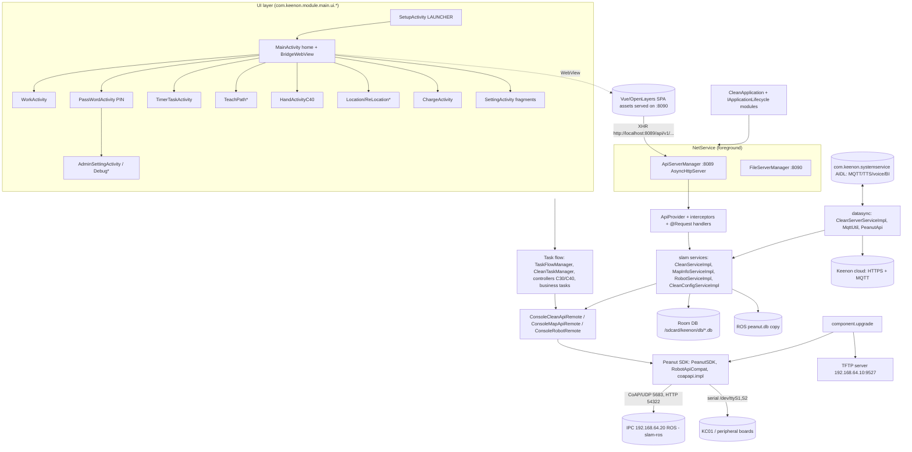
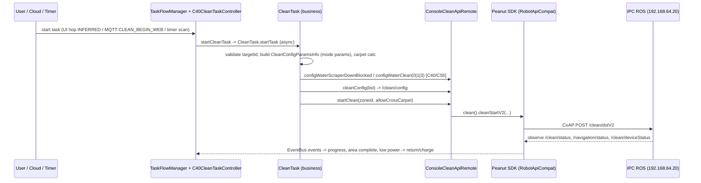

# Keenon C40 V246 - `peanut-clean` application (com.keenon.peanut.clean v3.7.8) - static analysis report

Scope: ONE APK, read-only static analysis. The APK was never executed, no device/server/robot was contacted.
Target: `peanut-clean-v3.7.8-0-g153214a-prod-release-p.apk` (121,990,249 bytes, SHA-256 `9b5eb4f2...b7fdd5`; upgradeConfig MD5 pre-verified by coordinator).

Status labels: CONFIRMED (directly observed) / STRONGLY_SUPPORTED (static analysis) / INFERRED / HISTORICAL / UNKNOWN / NOT_ANALYZED / BLOCKED. Confidence HIGH/MEDIUM/LOW.
All ROS/CoAP/MQTT/URL references below are **STATIC_REFERENCE** (found in code/assets), not live observations. Secrets are REDACTED (type + location only).

Companion files (same folder): `peanut_clean_app_findings.json` (68 findings PCL-001..068), `peanut_clean_app_artifacts.json`, `peanut_clean_app_endpoints.json`, `peanut_clean_app_ros_refs.json`.

## 0. Method and evidence base

| Technique | Result |
|---|---|
| ZIP/manifest/arsc/res decode (axml.py, custom arsc parser) | done |
| DEX parse + **bytecode scan** of all 7 DEX (own scanner: const-string, invoke, field/type refs, annotations incl. Retrofit/@Request/@CoapCommond, static field values) into a SQLite index (248,271 methods) | done |
| Mini Dalvik disassembler for targeted methods (`dis.py`) | done |
| **REA / JADX 0.7.1 decompilation** (`rea.sh inspect-android-method`, one call at a time) | **achieved**: 57 methods of ~16,081 JADX-loaded classes decompiled (embedded API server, MQTT trust/URL, PIN gate, task start/charge/self-clean/supply, cloud command handler, map change/ROS DB sync, upgrade download/MD5, crypto, WebView settings, init/boot paths). Everything else is DEX-level (class/method/field/string/call-graph) evidence. |
| ELF parse of 10 .so (headers, JNI exports, imports, strings) | done; no disassembly (no Ghidra/objdump) |
| openssl parse of signing cert and BKS-embedded public certs | done |
| Assets/JSON/SQL/proto/AIDL reading | done |

Limitations: no runtime observation; only a subset of methods decompiled; UI-click -> task hops partly INFERRED; native logic of `libcipher_pack.so` not analysed; secrets deliberately not recovered.

## 1. Manifest summary

* package `com.keenon.peanut.clean`, versionName `v3.7.8-0-g153214a`, versionCode 24, minSdk 28, targetSdk 28, compileSdk 29 (CONFIRMED).
* Application: `com.keenon.module.CleanApplication`; label (resources.arsc 0x7f11001f) = Chinese brand name of Keenon Robotics; theme/style ids not resolved.
* `android:usesCleartextTraffic="true"`; `networkSecurityConfig` = `<base-config cleartextTrafficPermitted="true">` only (no pins, no domain rules); `allowBackup="true"`; `requestLegacyExternalStorage="true"`; `defaultToDeviceProtectedStorage="true"`; `largeHeap`; no `sharedUserId`; no `debuggable` attribute; `testOnly=false`.
* Components: 48 activities, 7 services, 4 receivers, 8 providers (67 total).
* **Effective exported components (targetSdk 28 default export when an intent-filter exists):** `SetupActivity` (LAUNCHER + VIEW/BROWSABLE `supsetkeenon://supsetandroid.com`), `ApkInstallReceiver` (`PACKAGE_REPLACED`, data scheme `package`; JADX: acts only if the replaced package == own package), `androidx.test.core.app.InstrumentationActivityInvoker$BootstrapActivity/EmptyActivity/EmptyFloatingActivity` (MAIN filter; leaked test libs). `BootReceiver` has an intent-filter (BOOT_COMPLETED, AUDIO_BECOMING_NOISY, SD_ERROR, priority 1000) but explicit `exported=false`.
* Explicitly non-exported: NetService (directBootAware), HeartService, UpdateService, AlarmReceiver, InstallResultReceiver, ReStartActivity (`:restart` process), FileProvider, TheRouter/Sentry/lifecycle/autosize/basepopup/okdownload providers. Others without intent-filter: not exported (Android default).
* FileProvider `com.keenon.peanut.clean.fileprovider` (`grantUriPermissions=true`, paths = `res/xml/provider_paths.xml`: root-path `""`, external-path `.`, files/cache/external-files/cache `/`).
* Meta-data: Sentry (`io.sentry.dsn` http, `send-default-pii=true`, `attach-screenshot`, `attach-view-hierarchy`, traces sample 1.0, replay/profile keys), AMap API key (REDACTED), `design_width_in_dp=1024`.
* USB filter (`res/xml/device_filter.xml`): vendor 6790 (0x1A86) / product 29987 (0x7523) = CH340 USB-serial.

### Permissions (34 `uses-permission`, 4 `<permission>`) with risk comments

| Permission | Risk comment |
|---|---|
| INSTALL_PACKAGES, DELETE_PACKAGES, REQUEST_INSTALL_PACKAGES | silent APK install/uninstall (signature/privileged; matches AppInstaller/`pm install`) - HIGH capability |
| REBOOT, WRITE_SECURE_SETTINGS, WRITE_SETTINGS, MOUNT_UNMOUNT_FILESYSTEMS (+ misspelled MOUT_UNMOUNT_FILESYSTEMS), REORDER_TASKS | device control, platform-signed app expected |
| MANAGE_EXTERNAL_STORAGE, READ/WRITE_EXTERNAL_STORAGE | whole shared storage; DBs/logs live there |
| SYSTEM_ALERT_WINDOW | overlay (status bar window, WindowStatusBar) |
| INTERNET, ACCESS_NETWORK_STATE, CHANGE_NETWORK_STATE, ACCESS/CHANGE_WIFI_STATE | cloud + WiFi management |
| ACCESS_FINE/COARSE/BACKGROUND_LOCATION, ACCESS_LOCATION_EXTRA_COMMANDS | AMap/Google location; background location looks unnecessary |
| CALL_PHONE, READ_PHONE_STATE, READ_PRIVILEGED_PHONE_STATE | identifiers/phone - unnecessary for a cleaning robot (INFERRED) |
| CAMERA (+ camera features), BLUETOOTH, BLUETOOTH_ADMIN | camera (camera calibration/QR), BT |
| RECEIVE_BOOT_COMPLETED, FOREGROUND_SERVICE, WAKE_LOCK, com.android.alarm.permission.SET_ALARM, VIBRATE, MODIFY_AUDIO_SETTINGS | kiosk behaviour |
| `<permission>` redeclarations of android.permission.REBOOT, INTERNET, DEVICE_POWER, STOP_APP_SWITCHES | platform names redeclared (ignored by Android; hygiene issue) |

Signing: RSA-2048, issuer=subject `C=US,ST=California,L=Mountain View,O=Android,OU=Android,CN=Android/emailAddress=android@android.com`, valid 2014-12-23..2042-05-10, SHA-256 `2D:37:0C:21:...:7D:35:22`; v1 (AGP 4.2.0, Signflinger) + APK Sig Block 42 present. Whether this is the public AOSP key is UNKNOWN (PCL-055).

## 2. Architecture and module map



Package map (class counts from DEX): `com.keenon.module.main` 2,516 (ui ~1,800 classes incl. activity pkg 904, fragment 273, main 295; task ~215; manager; repo), `module.slam` 633, `module.common` 716, `module.api` 484, `module.datasync` 197, `module.datebase` 151, `module.android` 78, `module.alarm` 25, `module.rosbridge` 9; `com.keenon.component.{core 202,fault 153,upgrade 183,widget 242,multiLanguage 100,resource 85,task 110,wifi 92,location 58,...}`; `com.keenon.sdk.*` (coapapi 566, embedded 375, robot 296, component 284, sensor 228, protocol/http/serial/tftp/proxy), `com.keenon.peanut.core.*` 272, `com.keenon.rosbridge`/`com.jilk.ros` (rosbridge client).

Third-party (version where evidenced): okhttp 3.14.9, retrofit2+rxjava3, fastjson 1.2.55, Gson, EventBus, Room 2.2.5, androidx (fragment 1.3.6, appcompat 1.2.0, lifecycle 2.3.1, databinding 4.2.0), Paho MQTT (+android service), Eclipse Californium 3.x, AndroidAsync (embedded HTTP server), Sentry Android 5.5.2, ACRA, Umeng, AMap, MMKV, SQLCipher, greenDAO, TheRouter, ARouter, OkDownload, OkGo, Glide, AutoSize, utilcode, logback-android, JTS, snakeyaml, FreeMarker, protobuf, ZXing, sqlite-jdbc 3.44.1.0, commons-net (TFTP), jilk rosbridge + Java-WebSocket. Built with AGP 4.2.0 / R8 1.5.68.

Lifecycle modules (META-INF/services/IApplicationLifecycle): SlamLifecycle, RosLifecycle, AndroidLifecycle, DatasyncLifecycle, SoundPlayerLifecycle.

## 3. Screens and navigation

TheRouter routes (38, `assets/therouter/routeMap.json`, prefix `/solution_clean/`): setup, home, work, password, admin, setting, timer, teach_path, teach_path_creation, teach_path_preview, location, relocation, relocation_choose, retrieve_location, vslam_location*, charge, charge/c55, recharge_debug, immediately, push, maintenance, hand, hand_c40, debug, new/debug, new/debug/c55, new/debug/C55_V2*, new/debug/c50*, navi_debug, washing_test_c40, ros_net_connection_test, water_collect_settings, cruise_config, cruise_voice_list, task_config_modify, select_area, region_domain, hw_version. (*) class exists in DEX but is not declared in the manifest (INFERRED unregistered).

```mermaid
flowchart LR
  Boot[BOOT_COMPLETED / launcher] --> Setup[SetupActivity: init, permissions, self-check, map sync, DaemonService]
  Setup --> Home[MainActivity /home]
  Home -->|task buttons| RT[RealTimeTaskActivity /immediately + Tmp* fragments]
  Home --> TT[TimerTaskActivity /timer + 11 timer fragments]
  Home --> TP[TeachPathActivity -> Creation -> Preview]
  Home --> HD[HandActivityC40 /hand_c40]
  Home --> MT[MaintenanceActivity]
  Home --> PU[PushActivity /push (alerts)]
  Home -->|long click| PW[PassWordActivity /password]
  PW -->|user PIN| ST[SettingActivity: ConsumptiveStatistic, DataNote, WorkStation, ChargeSet, PasswordSetting, General, Expression, Audio, DoNotDisturb, SceneSetting, AboutMe, MachineAdjust]
  PW -->|admin PIN| AD[AdminSettingActivity: RobotInfo, System, CommonSet, ElevatorApproach, switches, BarCode, Region/Domain, HwVersion, FaultEvent]
  ST --> DBG[Debug / NewDebug* / RechargeDebug / NaviDebug / RosNetConnectionTest / WaterCollectSettings / C40WashingTest]
  Home --> LOC[Location / RetrieveLocation / ReLocation / PositionChoose]
  RT --> WK[WorkActivity /work]
  TT --> WK
  Home --> CH[ChargeActivity / ChargeActivityC55]
  WK -->|pause| PW
```

Fragment/screen inventory (from DEX supertypes): about 60 fragments (settings, timer, teach, tmp-task, mode/params), 48 manifest activities, ~106 classes under `ui.dialog`, 446 layout XMLs (not individually decoded). SettingActivity tabs are driven by `assets/slamConfig/cleanConfigSetting.json` (model filters C30/C40/C55).

## 4. Services, background behaviour, lifecycle

| Component | Behaviour | Evidence |
|---|---|---|
| NetService | foreground service started by `AndroidLifecycle.initService`; `initServer` starts ports 8089/8090 on a thread; if the servers are not up within 3 s it calls `SystemUtils.reboot` (reboots the Android device); Mqtt/ros-heart stubs | JADX NetService.initServer, DEX |
| HeartService | trivial logging service | DEX |
| DaemonService | started by SetupActivity when pref DAEMON_START; registers CLOSE_SYSTEM_DIALOGS (home key) receiver | DEX/JADX SetupActivity.initData |
| UpdateService | downloads an APK from intent extras `downUrl`/`appName` with notification | DEX |
| AutoCheckUpgradeService / RecordUploadService | periodic upgrade check (min interval, `key_check_interval`), upgrade-record upload (`/client/msg/push/`) | DEX |
| BootReceiver | BOOT_COMPLETED -> start app if auto-start enabled and `com.keenon.launcher` not installed; SD_ERROR -> ReStartActivity | JADX |
| ApkInstallReceiver | PACKAGE_REPLACED of own package -> TheRouter SETUP | JADX |
| AlarmReceiver | empty handler (1 instruction) - scheduled tasks use an internal scan job | DEX/JADX |
| Crash handling | EnvInitializer$CrashReportSender writes `keenon-crash_<time>.log` under /keenon/crashs and restarts via `:restart` ReStartActivity; ACRA CrashReportDialog declared | DEX |
| Dynamic receivers | SystemReceiver (MAPPING_START/STOP/HEART_BRAT, DISCONNECT_ROBOT, ARMREST_C40), DomainManager, UpgradeBroadcastReceiver, Network/WiFi receivers | DEX |

## 5. Local storage

* **Room DB** (`MyRoomDatabase`, 13 DAOs/tables): ALARM_SESSION, CLEAN_STRATEGY, ELEVATOR, ELEVATOR_FLOOR, MAP_AREA, MAP_DATA_HISTORY, MAP_POINTS, MAP_VIRTUAL_WALL, RECHARGE_LOG, ROBOT_MAP, SYS_DICT, SYS_DICT_DETAIL, TASK_ATTACH_DETAIL. Full column lists are in PCL-023 (from CREATE TABLE strings in `MyRoomDatabase_Impl`) and `peanut_clean_app_artifacts.json`. Migrations `assets/sql/24..41.sql` (e.g. 29/30 purge task/map data, 35 FINISH_TIME/CLEAN_FINISH_TYPE, 41 AREA_MATERIAL_TYPE and IS_DEFAULT_CHARGE). Legacy tables in migrations only: ROBOT_EXCEPTION_LOG, BURIED_POINT, CLEAN_LOG, CLEAN_LOG_DETAIL, CLEAN_DETAIL, TASK_IMAGE.
* File: `<external storage>/keenon/db/<kc01|keenon>.db` (unencrypted Room/SQLite; SQLCipher lib present but not wired).
* **ROS map DB copy**: `<storage>/ros/config/database/peanut.db` -> `<resources>/ros_db/peanut.db`, opened with `SQLiteDatabase.openDatabase` (tables map, dynamic_map, zone, path, pose, web_app_data, build_map_type).
* **MMKV** (id `encrypted_data`, key from native `mmkv_encrypt_key`), config dir `/peanut/clean_config/`; SharedPreferences for flags (ENABLE_*, DAEMON_START, IF_SHOW_STATUS_BAR, LOCATION_DETECTION, water-collect JSON, sp_key_*).
* Other: keenon_component.db, keenon_upgrade.db, component_task.db, okgo.db, logback.db, Umeng/AMap DBs; media under `/sdcard/peanut/media`, personal paths `/peanut/personal_path/`, crash logs `/keenon/crashs`, logs `/sdcard/keenon/slog`, crops `/sdcard/crop/`, TFTP root `/peanut/server/tftp/`, downloads `/peanut_sources/`.
* No embedded .db/.keystore/.jks/.pem/.p12 in the APK; 13 `.bks` keystores in `res/raw`.

## 6. Network communication

### 6.1 Cloud HTTPS (Retrofit, 58 endpoints; list in endpoints JSON)
Groups: device/robot registration (`/api/app/v1/device/keypair/request`, `/register/keypair`, `/api/app/robot/register`, `/robot/info`, `/info/update`, `/bindIccid`, `/version/status`), token and MQTT credentials (`/api/app/token/getSingleToken`, `/api/app/mqtt/secret/v2`), upgrade (`/api/app/robot/package/upgrade`, `/getSoftware`), resources/scenes/language packs, cleaning data (`/api/cleanapp/iot/v3/clean/{save_task,save_event,save_task_detail,save_task_pic,batchSaveForAndroidPad}`, `/v2/robot/{updateMapByAndroidPad,change/map,robotReply,robotActionNotice}`, `/v2/file/{saveAttachment,getAttachmentByMd5}`, `/v2/clean/*`, `/v1/email*`, `/v1/clean/model`), fault config (`/api/devops/v1/alertcode/robot/config/list`, `/kb/config`), elevator (`/api/elevator/v2/...`, `/api/hotel/robot/search/iot/device/{deviceName}`), Google geolocation. Base host is chosen at runtime (region): PROD CN `console.peanut.keenonrobot.com` (https; clean-api/clean-upload.keenonrobot.com), JP `cloud.robotkeenon.com`, ES `es-cloud.robotkeenon.com`, US `us-cloud.robotkeenon.com`; DEV/TEST/PRE use `*.ikeenon.com` / `*.keenonai.com` over plain http. Request headers gzip for map/task batch uploads (GzipRequestInterceptor).

### 6.2 MQTT
Two clients: in-process Paho (`DynamicMqttServer`/`PeanutMqttServer`) and AIDL client to the system-service app. Broker URL: `tcp://host:1883` (no TLS) or `ssl://host:8883` (prod) / 18883 / 20001; CN host `mqtt.keenonrobot.com`; domainConfig files set `isMqttTSL=false`. Credentials from native `peanut_mqtt_u/p` + cloud call. Subscribed topics (SN-suffixed): `ROBOT_<sn>`, `/server/push/<sn>`, `/server/push/msg/<sn>`, `/mockFault/server/sub/<sn>`, `/robot/<sn>/lift/v1|v2/cloud_msg`, `/resourcePush/server/<sn>`, `ROBOT_INFO/<sn>`, `/marketing/material/server/<sn>`. Published: `clean/<sn>/robot_open|robot_status|robot_push_message/v1/dev_msg`, `/keenon/peanut/robot/data/pub`, `/robot/<sn>/lift/v1|v2/dev_msg`, `/robot/<sn>/base/common_handler/v1/dev_msg`, `robot/<sn>/base/power/upload/v1/dev_msg`, `/eventRecord/client/`, `/softwareRecord/client/`, `/odometer/client/`, `/ad_config/v2/dev_msg`, `ROBOT_CLEAN_ROUTE/`, `/marketing/material/client/`. Command set `RobotCmdEnum` (CLEAN_BEGIN/PAUSE/CONTINUE/FINISH/SKIP_TASK_AREA_WEB, ROBOT_RECHARGE_WEB, CLEAN_STRATEGY_*_WEB, CLEAN_MODEL_WEB, MAP_* (create/finish/cancel/delete/download), ROBOT_RESTART_WEB, ROBOT_SOFT_NODE_RESTART_WEB, ROBOT_SOFT_UPGRADE_WEB, ROBOT_APP_PWD_RESET_WEB, SCREEN_UNLOCK, KR_LOG_UPLOAD, CALIBRATION_OF_CAMERA, PUSH_POSITIONED_*).
TLS: custom `TrustManager` (subject contains "keenon"/"keenoon") on SDK>=29 (PCL-050); 13 BKS keystores in `res/raw` (PCL-052).

### 6.3 Tablet <-> IPC (robot internal 192.168.64.0/24)
CoAP `coap://192.168.64.20:5683` (UDP, Californium, observe for status); HTTP `192.168.64.20:54322`/`34569` for upgrade endpoints; legacy rosbridge `ws://192.168.64.20:9090` (dormant); legacy console `192.168.64.20:5555`; TFTP server on the tablet `192.168.64.10:9527`; serial `/dev/ttyS1` (KC01), `/dev/ttyS2` (emotion), CH340 USB; LinkTypeAutoDetectHelper pings the IPC then chooses COAP/COM_COAP.

### 6.4 Embedded servers on the tablet
`ApiServerManager` (8089) and `FileServerManager` (8090) on AndroidAsync `AsyncHttpServer`, **wildcard bind**, CORS `*`, no authentication (PCL-048). 115 `@Request` records expose `/api/v1/{clean,cleanConfig,map,robot,robotStatistic,usb,sysDict,soft}` handlers (listed in endpoints JSON).

### 6.5 Third parties
Sentry (http DSN, PII on), Umeng, AMap, Google geolocation, connectivity probes (baidu.com, 8.8.8.8, 223.5.5.5).

## 7. Keenon robot SDK usage (how the app talks to the robot)

* `BusinessInitializer.initSDK`: `PeanutConfig` link IP = IPC, link type COAP, KC01 COM `/dev/ttyS1`, emotion COM `/dev/ttyS2`, doors 4, timeouts 25 s/5 s, sequential request queue for `/clean/dst`, `/clean/taskSelfClean`, `/clean/action`, `/charge/stop`, `/charge/auto`, `/clean/config`; `PeanutSDK.init(...)`.
* Facade: `PeanutSDK.{battery,clean,device,elevator,kc01Debug,kc01Emotion,map,motor,navigation,runtime,schedule,subscribe}` and `RobotApiCompat.ins().{clean,device,kc01Ext,map,navigation,system}` -> `robot.api.*` interfaces -> `coapapi.impl.*ApiImpl` -> `@CoapCommond` command classes (223 CoAP, 2 HTTP, 88 serial). Method -> resource map (187 pairs) is in `peanut_clean_app_ros_refs.json` (kind `sdk_method_to_coap`; `app_invokes_interface_method_by_name` marks methods whose names are called by non-SDK code).
* Observed app-driven calls: cleanStartV2 (/clean/dstV2), cleanAction (/clean/action), cleanConfig (/clean/config), postCleanParamsConfig (/clean/params_config), postNoDisturbMode, postTaskSelfClean (/clean/taskSelfClean), cleanPersonPathAction (/clean/personalPath), onSavePersonalPath (/map/savePersonalPath), cleanReLocationPosition, cleanTaskSnapshotAction/Result, autoCharge/stopCharge (/charge/auto,/charge/stop), navigation setTarget/pause/resume/stop/reset/setSpeed, device reboot/rebootService (/devices/reboot), mapList/mapDataGet/zone/path queries, getRobotStartState (/runtime/startup), setAppTimeToRos (/timestamp/sync), SensorOTA.start (OTA).
* Subscriptions (observe resources, STATIC): /clean/status, /clean/deviceStatus, /clean/positionStatus, /clean/motionReport, /clean/personalPathStatus, /clean/taskSelfCleanStatus, /charge/status, /navigation/status, /position/realtimePositionStatus, /schedule/*, /runtime/rostime, /rk/ip, ...
* Offline licence: `com.keenon.sdk.auth.OfflineAuth/AuthInfo/LicenseInfo` (appId/robotSN/package/expiry; fingerprint) - enforcement not decompiled.

## 8. Business logic and workflows

Common chain for cleaning: **UI/cloud/timer -> TaskFlowManager detail bean -> controller (C30/C40) -> IRosTask business task -> ConsoleXxxRemote -> PeanutSDK/RobotApiCompat -> CoAP -> IPC**; feedback: CoAP observe -> EventBus (`CleanInfoEvent`, `NavigationInfoEvent`, `WaterTankStateEvent`, `LowPowerProtectEvent`) -> CleanTaskManager/controllers -> UI.



Workflow table (full records WF-1..WF-14 are findings PCL-034..PCL-047; evidence = JADX unless stated):

| # | Workflow | Entry point | Components / SDK / API | Data changes | Robot interaction | Error behaviour | Status/Conf |
|---|---|---|---|---|---|---|---|
| WF-1 | Boot/init | BootReceiver / SetupActivity | CleanApplication, lifecycle modules, NetService, BusinessInitializer.initSDK/initGreenDao/initResource | Room DB opened, servers start | CoAP link auto-detect to IPC | watchdog reboot if servers hang | CONFIRMED/HIGH |
| WF-2 | PIN login | MainActivity long-click -> /password | PassWordActivity.isPasswordCorrect, MMKV, PinInputManager | PIN modified flags in MMKV | ends current detail task when entering admin | lockout after 5 errors only in mode 9 | CONFIRMED/HIGH |
| WF-3 | Start cleaning | task UI / MQTT / timer | C40CleanTaskController, CleanTask, ConsoleCleanApiRemote | CLEAN_STRATEGY, task bean, logs | CoAP /clean/config, /clean/dstV2 | KeenonBusinessException/RobotStatusCheckException logged | STRONGLY_SUPPORTED/MEDIUM (UI hop INFERRED) |
| WF-4 | Timer task | CleanServiceImpl scan job | timeCleanStrategyScanJob, TimerTaskApi | not-work log for cancelled/failed | same as WF-3 | saveNotWorkCleanLog | CONFIRMED/HIGH |
| WF-5 | Recharge | low power / task end / cloud | ChargeTask, BaseCleanTaskController.startReturnTaskCommon | RECHARGE_LOG | /charge/auto, observe /charge/status | checkChargingSuccess, self-check fail codes | CONFIRMED/HIGH |
| WF-6 | Self-clean / supply | task flow | SelfCleanTask, SupplyTask, WorkStationManager | consumables | /clean/taskSelfClean; work-station serial/comm | timers | CONFIRMED/HIGH |
| WF-7 | Map sync | SetupActivity/Sync | RosMapSyncServiceImplNew, RosMapDbServiceImpl, PeanutApi.updateMap | ROBOT_MAP/MAP_AREA/MAP_POINTS, MAP_DATA_HISTORY | file copy from ROS DB; /map/* CoAP | SubProgress FAIL state | STRONGLY_SUPPORTED/HIGH |
| WF-8 | Cloud command | MQTT message | CleanServerServiceImpl.cleanRobotCommandHandle -> clean/map/robot/otherCmdHandle | strategies, maps, schedule | via EventBus/RemoteCmdEvent, ConsoleXxxRemote | rejects if app in background; 2 s rate limit; reply via PeanutApi.robotReply | CONFIRMED/HIGH |
| WF-9 | Upgrade | MQTT push / auto check / U-disk | component.upgrade processors/installers | update records DB | TFTP+OTA to IPC/STM32, pm/silent install of APK | MD5 check fail -> abort/state | STRONGLY_SUPPORTED/MEDIUM |
| WF-10 | Registration/token/MQTT bootstrap | app start / domain change | RegisterDeviceHelper, TokenApi, DomainManager, MqttManager | token, domain cache (encrypted file) | none | retries | STRONGLY_SUPPORTED/MEDIUM |
| WF-11 | H5 UI <-> native | MainActivity WebView | ApiServerManager, ApiProvider, JS bridge | via services | via services | HttpErrorStatusInterceptor mapping | CONFIRMED/HIGH |
| WF-12 | Teach path | TeachPathActivity | cleanPersonPathAction, onSavePersonalPath, RosMapSyncServiceImplNew | MAP_AREA teach columns, files | /clean/personalPath, /map/savePersonalPath | status codes in CleanPersonalPathStatusBean | INFERRED/MEDIUM |
| WF-13 | Hand-push clean (C40) | /hand_c40 | HandActivityC40, PeanutManager, TaskStageFollower | task bean | brush/lights via PeanutManager (chain not traced) | self-check dialogs | INFERRED/MEDIUM |
| WF-14 | Re-localisation | Location screens | cleanReLocationPosition, onReLocationPosition | last location point | /clean|/position/relocationPosition | retry counts (PUSH_POSITIONED_RETRY_COUNT) | STRONGLY_SUPPORTED/MEDIUM |

Cleaning configuration domain (assets/slamConfig): C40 modes 101 sweep+wash, 102 water-suction, 103 sweep+suction, 104 sweep+push, 105 sweep; C40 H 301-305; C55 201-203; C30 1/2. Config types: 1 speed, 2 strength, 3 fan, 4 water-suction, 7 water volume, 8 sweep-rod stroke, 9 wash-rod stroke, 10 side-brush RPM; 359 parameter rows; water pump 0..50 ml/min; vacuum 5..80; consumables with remaining-time model. Zones/no-go/virtual walls: MAP_AREA(area types incl. forbidden/carpet, materials), MAP_VIRTUAL_WALL, forbidden zones written back to ROS DB. Docking/charging: MAP_POINTS.IS_DEFAULT_CHARGE, manual charge point, /charge/* resources. Water/vacuum/brush/pump controls: config rows + SDK serial KC01 commands (fan gear A6, roller brush A5, side brush A8, dust push AB, disinfection lamp AA) and local `/api/v1/usb/*`.
Robot status/errors/telemetry: observe resources + fault.json (144 faults, 141 level 3, 3 level 5), events, upload to cloud `/eventRecord/client/`, `/odometer/client/`, power upload topic.
Maps upload/download: `/map/{downloadmap,uploadmap,...}`, cloud `updateMapByAndroidPad`, attachments.
Firmware/app upgrade: WF-9.
Auth/roles: two local roles - user PIN (`app_in_code`) and system/admin PIN (`system_in_code`); cloud-side identity = robot SN + RSA key pair + token (`RegisterDeviceHelper`, `TokenApi`); offline mode PIN (`OfflineModePinDialog`, `offline_work_code_key`); no multi-user accounts on the tablet.

## 9. Native libraries (armeabi-v7a only)

| Library | Size | JNI / role | Notes |
|---|---|---|---|
| libcipher_pack.so | 136,848 | `CipherUtil.get(String)`; fleet secret store | strings: BUGLY_APPID/APPKEY_{ENG,PROD}, UMENG_APPKEY, OFFLINE_WORK_CODE_KEY, cipherMap{Common,Disinfect,FoodDelivery,Hotel,MedicalDelivery}, pkgArr, pkgMap; values not extracted |
| libkeenon_serial.so | 18,000 | SerialPort.open/close (termios) | imports cfmakeraw, tcsetattr |
| libandroid_serial_port.so | 13,796 | com.aill.androidserialport.SerialPort | open/close |
| libmmkv.so | 381,828 | MMKV (AES crypt) | JNI_OnLoad |
| libpatchutils.so | 53,848 | `PatchUtil.bspatch` | bsdiff + bzip2 |
| libsqlcipher.so | 2,185,932 | SQLCipher | unused by Room path |
| libsentry.so / libsentry-android.so | 911,088 / 22,104 | Sentry NDK | |
| libumeng-spy.so | 145,120 | Umeng | fork/pipe/syscall imports, AES-ECB/GCM tables |
| libpl_droidsonroids_gif.so | 42,460 | GIF decoding | |

## 10. Assets and embedded resources

assets: domain lists (4), json env configs (4), slamConfig (11: modes, params, settings, consumables, power-save, 4 domain configs, softTypeConfig), sql migrations (19), therouter routeMap, Vue SPA (index.html, 59 JS chunks 3.5 MB, 46 CSS, 96 img), fault HTML (23), videos (25 mp4, 66 MB), voice (79 mp3), bg music, expression videos, `character/2_UNICODE.bin` (4 MB), LightConfig.json (light strip per model incl. other products), fonts. res/raw: 13 BKS keystores, fault.json (144), event.json (11), level.json (6). Root: EventRecord.proto, ResourceDownload.proto, AIDL (mqtt/tts/voice/bi), googleapis protos, greenDAO `.ftl`, FreeMarker/Ant/sqlite-jdbc desktop leftovers, `libs/xpp3-1.1.3_8.jar`. softTypeConfig.json lists ROS software codes: android_console, task_manager, cover_planner, along_edge, matching_task, robot_location, location_monitoring, localization_recovery, keenon_runtime_monitor, keenon_clean_msgs, ground_filter, creat_local_map, chassis, c200_lidar, astra_camera (ROS_KC01/KC02 bundles).

## 11. Logging and error handling

KLog/KLogProxy module loggers, `LogFile`, logback-android (SQLite/file appenders), OkGo `HttpLoggingInterceptor` BODY level, local API `HttpLogInterceptor`; crash sender writes to `/keenon/crashs`; Sentry + ACRA; BuriedPoint/event upload. Sensitive values reach logs (PIN, keystore password, decrypted domain data) - PCL-063.

## 12. Defensive security review (summary; details = findings PCL-048..068)

| Id | Severity | Title |
|---|---|---|
| PCL-048 | High | Unauthenticated, wildcard-CORS API on 0.0.0.0:8089 (reboot, ROS restart, map, schedule, PIN/lock setters) |
| PCL-049 | High | Compiled-in backup admin PIN, native default PINs, PIN written to log |
| PCL-050 | High | MQTT TLS trust manager only checks subject contains "keenon"/"keenoon" (SDK>=29) |
| PCL-051 | Medium | Cleartext allowed globally; MQTT tcp/1883 and http configs |
| PCL-052 | Medium | Fleet-wide mTLS client key/cert in 13 BKS; passwords from native store (and logged) |
| PCL-053 | Medium | Weak/static crypto (AES-CTR no integrity, static key/IV from native, SHA1PRNG KDF, Math.random keys, DES/MD5) |
| PCL-054 | Medium | Update integrity = MD5 from same server; silent/root install |
| PCL-055 | Medium | Generic "CN=Android" signing certificate (public-key status UNKNOWN) |
| PCL-056 | Medium | Sentry: PII, screenshots, view hierarchy over http |
| PCL-057 | Low | Hardcoded third-party keys (AMap, Google, Sentry DSN, native Umeng/Bugly) |
| PCL-058 | Medium | Unencrypted DBs/logs on external storage, allowBackup |
| PCL-059 | Low | su / pm / setprop / shell use |
| PCL-060 | Low | Exported SetupActivity/ApkInstallReceiver/androidx.test activities, unprotected dynamic receivers, broad FileProvider |
| PCL-061 | Medium | Implicit broadcasts carrying shell commands / APK paths to system service |
| PCL-062 | Low | WebView JS + file access + mixed content always allowed |
| PCL-063 | Medium | Sensitive data (PIN, keystore password, decrypted domain) in logs |
| PCL-064 | Medium | fastjson 1.2.55 and other outdated libraries on untrusted JSON |
| PCL-065 | Info | Trust-all TLS helpers present but unused |
| PCL-066 | Medium | Plaintext, unauthenticated CoAP/HTTP/TFTP between tablet and IPC |
| PCL-067 | Medium | Cloud commands accepted without message-level signature |
| PCL-068 | Low | Over-broad / redeclared permissions |

(Severity values are the analyst's static-analysis judgement; runtime exposure is UNKNOWN for most network items.)

Checks performed and results: hardcoded secrets (types/locations only; AMap key, Google API key, Sentry DSN key, native secret store); cleartext traffic (yes); TLS/trust managers/hostname verifiers (custom MQTT TM; dead trust-all TM in SDK OkHttpFactory and OkGo HttpsUtils; no app HostnameVerifier set); WebView (JS+file access+mixed always-allow, local content); exported components (5 effective); insecure storage (external DB/log, allowBackup); debug flags (none; but dev/eng/test endpoints and mock-fault topic shipped); command execution (su, pm, setprop, ping); SQL concatenation (not found in app code; Room + asset SQL - low confidence NOT_ANALYZED for library code); path traversal (file server maps request path to `AssetManager.open` only - assets, no filesystem traversal observed; INFERRED); reflection/dynamic loading (ARouter/TheRouter, `ClassUtils` scanning for @Request, ReflectUtil, no DexClassLoader use by app code); crypto (see PCL-053); sensitive logs (PCL-063).

## 13. Gaps / not analysed

* JADX decompiled only ~57 selected methods; the other ~16k classes are DEX-level only. UI click handlers -> task start hops, `HandActivityC40`, `TeachPath*`, `LocationActivity`, elevator logic, `PeanutManager` actuator paths, WorkStation comm, `CleanWaterCollectSettings` transport, `EnvInitializer$CrashReportSender.send`, `MqttUtil$1.onMessageArrived`, `ShellUtil.exeCmdSync` (REA call returned no body) are NOT_ANALYZED/INFERRED.
* Native lib internals (`libcipher_pack.so` secret derivation, Umeng spy) not disassembled.
* H5 SPA JavaScript is minified and was only grepped.
* No runtime verification: device firewall, Android version of the tablet, broker ACLs, whether TLS is used in production, IPC-side authentication are UNKNOWN.
* Cross-APK behaviour (ServiceSystem receivers for EXECUTE_CMD/SILENT_INSTALL_APP, launcher, krlog, RemoteControl) belongs to other domain reports.
