# ROS / SLAM package analysis - Keenon C40 `slam-ros-v2.10.9-c2-0-g58a75a7`

Domain worker output (ROB/NET/DB/SEC/NAT). READ-ONLY static analysis of the ROS update package. Nothing was executed, no robot was contacted, no software installed. All topic/service/node/endpoint names below are **STATIC_REFERENCE** (found in launch files, YAML, message definitions or binary strings) - none is live-observed.

Status labels: CONFIRMED, STRONGLY_SUPPORTED, INFERRED, HISTORICAL, UNKNOWN, NOT_ANALYZED, BLOCKED. Confidence: HIGH/MEDIUM/LOW. Secret values are redacted (type, location, length, first 2 characters at most). No decompilation was performed; binary findings come from ELF header/section/dynamic-symbol parsing and ASCII strings only.

Machine-readable companions: `ros_packages_findings.json` (53 findings, IDs ROS-001..), `ros_packages_artifacts.json` (109 records).

## 0. Executive summary

- The package is the full ROS **Indigo / Ubuntu 14.04 (trusty) armhf** application stack of a multi-model Keenon platform: 106 debs (103 under `bin/`, 3 under `3rdparty/`), 7,879 files, 283 ELF files, plus `bin/keenon`, `script/app` (identical 83-byte stubs `cd /work/scripts; python guard.py &`) and `manifest.json` (ROS-001, ROS-012).
- A **C40 launch profile exists** (`keenon_robot_C40.launch`: cleaning group, free network lidar, GS2 rear lidar, 4 XD edge/low-obstacle line lasers, Sunny ToF, FDL cliff sensing, mono VSLAM, cartographer + peanut_localization + move_base/kplanner/TEB, task_manager/cover_planner) (ROS-002..006). The shipped default `keenon_robot.launch` is **W3**, so the active model on a unit is UNKNOWN from the package alone.
- Cleaning hardware is driven through an STM32 serial bridge (`chassis`): roll/wash/edge brushes with lift rods, suction fan, water pump with pulse control, dust box, carpet detection (ROS-006). ros_update can flash the MCU over serial (ROS-007).
- Network services found statically: rosbridge 9090/9091 (no auth, no TLS), ros_update OTA HTTP (port 9527 inferred), WsServer websocket + frp reverse SSH tunnel, CoAP bridge, Samba shares, Wi-Fi AP bridged into the robot LAN (ROS-030..034).
- Security highlights: hard-coded sudo password in `send_depth_node` and `WsServer` (same 11-char value as the default Wi-Fi AP passphrase), unauthenticated rosbridge/ROS control, unsigned debs + md5-only OTA with root maintainer scripts, client-side-only robotviz login, EOL stack (ROS-040..050).
- Gaps: `guard.py`, `script/upgrade.sh`, rosbridge_server/nginx/Samba, ORB vocabulary, STM32 firmware and all binary internals (NOT_ANALYZED) (ROS-016).

## 1. Package inventory (106 debs)

Versions: 104 debs `2.3.1c1-4573-g1406f3b-trusty` (build 4573 of commit g1406f3b), `ros-indigo-filters 1.1.1`, `ros-indigo-robotviz 2.6.1c1v4-4-g8006fd8-trusty`. All Architecture=armhf. Maintainer fields are developer names/aliases (several `@todo.todo`). Role column is INFERRED from control text, file lists, launch/config and strings unless stated. "Manifest" = type/dest from `manifest.json`.

| # | Package (control) | Deb location | Version | Category | Inst. KB | Files | ELF (exe) | Maintainer | Manifest | Maint. scripts | Role / notes |
|---|---|---|---|---|---|---|---|---|---|---|---|
| 1 | `ros-indigo-filters` | 3rdparty | 1.1.1 | ROS (3rdparty, upstream) | 376 | 27 | 5 (0) | Tully Foote | 3rdparty 644 | - | ros-indigo-filters 1.1.1 (upstream); libmean/median/params/increment/transfer_function plugins. |
| 2 | `build (file: ros-indigo-remote-tools)` | 3rdparty | 2.3.1c1-4573-g1406f3b | ? | 8827 | 13 | 2 (2) | yellow | 3rdparty 644 | - |  |
| 3 | `ros-indigo-robotviz` | 3rdparty | 2.6.1c1v4-4-g8006fd8 | Web UI (static) | 2676 | 23 | 0 (0) | zhenyu yu | 3rdparty 644 | - | Vue/Vite web app "Keenon Robot Mapping Tool" under /usr/share/robotviz; connects to rosbridge ws://192.168.64.20:9090/9091; client-side login. 3rdparty (manifest type 3rdparty). |
| 4 | `ros-indigo-anomalies-detection` | bin | 2.3.1c1-4573-g1406f3b | Safety/diagnostics | 2851 | 11 | 4 (3) | fantuan | ros 755 | - | Nodes: sensor_monitor_node, depth_laser_cali_node, danger_area_detector_node (sensor health, depth-vs-laser calibration check, danger-area detection). Launched when USE_ANOMALIES_DETECT=true (C40: true). |
| 5 | `ros-indigo-astra-camera` | bin | 2.3.1c1-4573-g1406f3b | Sensor driver | 454 | 8 | 1 (1) | peanut | ros 755 | - | astra_camera_node (Orbbec Astra/OpenNI2 based; links libfdl/libdepthsInterface). C40 profile has USE_CAMERA=false; used by other models. |
| 6 | `ros-indigo-astra-launch` | bin | 2.3.1c1-4573-g1406f3b | Sensor driver (launch) | 40 | 18 | 0 (0) | Hong Jianfeng | ros 755 | - | Orbbec Astra launch/include files (upstream astra_launch). |
| 7 | `ros-indigo-base-local-planner` | bin | 2.3.1c1-4573-g1406f3b | Navigation (upstream+patched) | 802 | 62 | 2 (0) | David V. Lu!! | ros 755 | - | ROS navigation base_local_planner (Position2DInt.msg added by vendor); depends on keenon-motor-msgs. |
| 8 | `ros-indigo-berxel-camera` | bin | 2.3.1c1-4573-g1406f3b | Sensor driver | 11925 | 60 | 6 (1) | adam | ros 755 | - | berxel_camera node + libBerxel*; services berxel_camera_image/berxel_device_log; params100Q.bin (6.1MB). Launched via USE_SIDE_CAMERA (C55 default true). |
| 9 | `ros-indigo-busy-map` | bin | 2.3.1c1-4573-g1406f3b | Multi-robot scheduling | 459 | 20 | 2 (1) | greg | ros 755 | - | busy_map_node (traffic/occupancy map for multi-robot meeting); launch commented-out in robot_common.launch. |
| 10 | `ros-indigo-calibration` | bin | 2.3.1c1-4573-g1406f3b | Calibration | 951 | 10 | 1 (1) | peanut | ros 755 | - | calibration_node (camera/depth calibration); config.json with host_url and fall-detection (FDL) parameters; init_fdl_config.sh. Launched in cleaning group (USE_CLEAN). |
| 11 | `cartographer (file: ros-indigo-cartographer)` | bin | 2.3.1c1-4573-g1406f3b | SLAM (mapping) | 15422 | 495 | 4 (4) | The Cartographer Authors | ros 755 | - | Google Cartographer 2D with Keenon patches: cartographer_node, cartographer_occupancy_grid_node, auto_denoise_node, label_filter_node; lua configs (keenon_common.lua, per-model); libcartographer.a; cartographer_ros_msgs/srvs (pbstream ops, denoise, manual loop closure). |
| 12 | `ros-indigo-chassis` | bin | 2.3.1c1-4573-g1406f3b | Chassis / actuators bridge | 988 | 16 | 1 (1) | yangyy | ros 755 | - | chassis node: serial bridge to STM32 (/dev/ttyUSBStm32): odometry, wheels, bump/sonar/PSD, charging, brushes, water pump, suction fan, dust box, IMU, urgency button; links libslam_comm_lib. |
| 13 | `ros-indigo-cleanning-planner` | bin | 2.3.1c1-4573-g1406f3b | Planning (cleaning) | 281 | 16 | 1 (0) | zhengjiuwang | ros 755 | - | Path replan library (pnc_core based) used by task_manager; no executable. |
| 14 | `ros-indigo-clear-static-recovery` | bin | 2.3.1c1-4573-g1406f3b | Navigation recovery | 188 | 7 | 1 (0) | xwz | ros 755 | - | move_base recovery plugin (clear static layers); used in move_base_params recovery_behaviors. |
| 15 | `ros-indigo-compressed-image-transport` | bin | 2.3.1c1-4573-g1406f3b | ROS image transport | 239 | 19 | 1 (0) | David Gossow | ros 755 | - | Upstream compressed_image_transport plugin. |
| 16 | `ros-indigo-costmap-2d` | bin | 2.3.1c1-4573-g1406f3b | Navigation (upstream+patched) | 1829 | 88 | 5 (3) | David V. Lu!! | ros 755 | - | costmap_2d library and nodes with Keenon layers/messages (StaticMapUpdate.srv); depends on keenon-nav-msgs. |
| 17 | `ros-indigo-costmap-converter` | bin | 2.3.1c1-4573-g1406f3b | Navigation (upstream) | 1388 | 65 | 3 (2) | Christoph Rösmann | ros 755 | - | costmap_converter plugins + simple_scan_detector (dynamic obstacle detection; launched with USE_DYDETECT). |
| 18 | `ros-indigo-cover-planner` | bin | 2.3.1c1-4573-g1406f3b | Cleaning coverage planner | 1639 | 12 | 2 (2) | jy | ros 755 | - | cover_planner (BCD/area coverage path planning, zone/edge paths) and complement_sweep (supplementary sweeping). Launched under USE_CLEAN. |
| 19 | `ros-indigo-database` | bin | 2.3.1c1-4573-g1406f3b | Persistence | 1129 | 6 | 1 (1) | hackin | ros 755 | - | database_node: SQLite (peanut.db) config/map/pose/zone/path service provider via keenon_database_msgs services; WAL mode; uses libkSQLiteCpp/libkmd5/libkzipc. |
| 20 | `ros-indigo-demonstration-route-optimizer` | bin | 2.3.1c1-4573-g1406f3b | Planning (cleaning) | 213 | 12 | 1 (0) | liuruiyang | ros 755 | - | Library used by task_manager to optimize taught (demonstration) routes. |
| 21 | `ros-indigo-elevator-position-detector` | bin | 2.3.1c1-4573-g1406f3b | Elevator | 179 | 7 | 1 (1) | exbot | ros 755 | - | elevator_position_detector_node (detects robot position relative to elevator). |
| 22 | `ros-indigo-elevator-task` | bin | 2.3.1c1-4573-g1406f3b | Elevator/task | 941 | 17 | 1 (1) | exbot | ros 755 | - | elevator_task_node: elevator ride task via LoRa/4G/gate; actions keenon_elevator_msgs/Elev. |
| 23 | `ros-indigo-fdl-ros` | bin | 2.3.1c1-4573-g1406f3b | Cliff / drop (FDL) sensing | 18550 | 247 | 29 (1) | greg | ros 755 | postinst,postrm | fdl_ros_node + prebuilt Orbbec/Berxel depth SDK libs (libfdl.so, libdepthsInterface.so, OpenNI2 drivers, libusb/libudev copies, params100Q.bin) under lib/fdl/arm32; debug-symbol copies under /usr/lib/debug. Provides /fdl/obs_* (cliff/low obstacle) topics. Launched when USE_DROP_RESISTENT=true. |
| 24 | `ros-indigo-free-lidar-driver` | bin | 2.3.1c1-4573-g1406f3b | LiDAR driver | 76 | 7 | 2 (1) | free | ros 755 | - | free_lidar_driver_node using libc200_lidar.so: TCP connection to a network lidar (default 192.168.64.103:2111). C40 LIDAR_TYPE=free. |
| 25 | `ros-indigo-global-planner-user` | bin | 2.3.1c1-4573-g1406f3b | Planning | 252 | 19 | 2 (1) | David V. Lu!! | ros 755 | - | Global planner library + planner node used by task_manager. |
| 26 | `ros-indigo-gmapping` | bin | 2.3.1c1-4573-g1406f3b | SLAM (mapping, legacy) | 858 | 8 | 2 (2) | Li Yinxuan | ros 755 | - | slam_gmapping, slam_gmapping_replay (OpenSLAM gmapping wrapper with Keenon label msgs). |
| 27 | `ros-indigo-image-transport` | bin | 2.3.1c1-4573-g1406f3b | ROS image transport | 769 | 27 | 4 (2) | Jack O'Quin | ros 755 | - | Upstream image_transport (republish, list_transports). |
| 28 | `ros-indigo-interactive` | bin | 2.3.1c1-4573-g1406f3b | UI interface node | 1832 | 25 | 1 (1) | exbot | ros 755 | - | interactive_node (ui_interactive): main bridge between the Android UI/app and ROS: ~139 topic/service names (app_cmd_*, database/config_*, localization, gate/elevator, charge, clean). |
| 29 | `ros-indigo-keenon-charge-msgs` | bin | 2.3.1c1-4573-g1406f3b | Messages | 356 | 68 | 0 (0) | keenon | ros 755 | - | ChargeTask.action (AUTO/DIRECT/EXIT/CABLE charge goals), ChargeCMD, ChargeFB, report codes. |
| 30 | `ros-indigo-keenon-chassis-msgs` | bin | 2.3.1c1-4573-g1406f3b | Messages | 42 | 19 | 0 (0) | keenon | ros 755 | - | magnetometer_data.msg. |
| 31 | `ros-indigo-keenon-clean-msgs` | bin | 2.3.1c1-4573-g1406f3b | Messages | 4237 | 610 | 0 (0) | anbot | ros 755 | - | Cleaning domain: CleanPNC/AlongEdge/camera_calibration actions, clean_status, clean_device_control, cover/zone/path/segmentation services, OTA.srv. |
| 32 | `ros-indigo-keenon-common-cmake` | bin | 2.3.1c1-4573-g1406f3b | Build support | 44 | 42 | 0 (0) | xiong | ros 755 | - | CMake helper files only. |
| 33 | `ros-indigo-keenon-database-msgs` | bin | 2.3.1c1-4573-g1406f3b | Messages | 3507 | 475 | 0 (0) | keenon | ros 755 | - | Database config services (map, pose, zone, path, gate, elevator, label, keyframe, vslam, ability, web_app_data) and info msgs. |
| 34 | `ros-indigo-keenon-deps` | bin | 2.3.1c1-4573-g1406f3b | Support libraries | 716 | 42 | 9 (0) | yellowhuang | ros 755 | - | libkbase64, libkcJSON, libkjsonwrapper, libkmd5, libkmd5wrapper, libkzipc (miniz), libkSQLiteCpp, libkSL (threads/events), libkQLTftp, libkeenonros_log_init.a. |
| 35 | `ros-indigo-keenon-diagnosis-msgs` | bin | 2.3.1c1-4573-g1406f3b | Messages | 42 | 19 | 0 (0) | keenon | ros 755 | - | diag_status.msg. |
| 36 | `ros-indigo-keenon-elevator-msgs` | bin | 2.3.1c1-4573-g1406f3b | Messages | 549 | 106 | 0 (0) | keenon | ros 755 | - | Elev.action, elev_request/response, elev_task_status, elev_lora_driver, fake_control.srv, lora_config.srv. |
| 37 | `ros-indigo-keenon-event-tracking` | bin | 2.3.1c1-4573-g1406f3b | Messages/telemetry | 206 | 48 | 1 (0) | hackin | ros 755 | - | event_info(_array), event_upload_* msgs (event tracking / analytics events). |
| 38 | `ros-indigo-keenon-gate-msgs` | bin | 2.3.1c1-4573-g1406f3b | Messages | 226 | 69 | 0 (0) | keenon | ros 755 | - | Automatic gate (door) control via LoRa: gate_cmd, gate_status, gate_lora_driver, ID/number services. |
| 39 | `ros-indigo-keenon-label-msgs` | bin | 2.3.1c1-4573-g1406f3b | Messages | 462 | 107 | 0 (0) | keenon | ros 755 | - | Localization label (marker) msgs/srvs. |
| 40 | `ros-indigo-keenon-location-msgs` | bin | 2.3.1c1-4573-g1406f3b | Messages | 526 | 101 | 0 (0) | keenon | ros 755 | - | Localization msgs/srvs (init_pose, better_location, lossLocationStatus, robotSensorData...). |
| 41 | `ros-indigo-keenon-motor-msgs` | bin | 2.3.1c1-4573-g1406f3b | Messages | 126 | 43 | 0 (0) | keenon | ros 755 | - | encoder, error_code, lock_status, motor_control, wheel_hub_current. |
| 42 | `ros-indigo-keenon-move-base-msgs` | bin | 2.3.1c1-4573-g1406f3b | Messages | 417 | 56 | 0 (0) | David V. Lu!! | ros 755 | - | MoveBase.action with goal types (NORMAL/ELEVATOR/CHARGE/MANUAL_CHARGE/LOCK_MOTOR/ZONE_START_POSE...). |
| 43 | `ros-indigo-keenon-msgs` | bin | 2.3.1c1-4573-g1406f3b | Meta package | 2 | 2 | 0 (0) | keeon | ros 755 | - | Meta-package (metapackage depends on the keenon_* msg packages). |
| 44 | `ros-indigo-keenon-nav-msgs` | bin | 2.3.1c1-4573-g1406f3b | Messages | 863 | 145 | 0 (0) | keeon | ros 755 | - | Navigation/map services (SwitchMap, NotifyMapChange, goalsSafetyCheck, nodeCTL, sideDriveConfig...). |
| 45 | `ros-indigo-keenon-recorder-msgs` | bin | 2.3.1c1-4573-g1406f3b | Messages | 213 | 48 | 0 (0) | yellowhuang | ros 755 | - | Rosbag recorder config/list/replay services. |
| 46 | `ros-indigo-keenon-schedule-msgs` | bin | 2.3.1c1-4573-g1406f3b | Messages | 1258 | 226 | 0 (0) | keenon | ros 755 | - | Multi-robot scheduling msgs/srvs (schedule path, meet, forbidden area, ability update). |
| 47 | `ros-indigo-keenon-seller-msgs` | bin | 2.3.1c1-4573-g1406f3b | Messages | 276 | 56 | 0 (0) | keenon | ros 755 | - | SellerTask.action (matching a vending/seller station). |
| 48 | `ros-indigo-keenon-sensor-msgs` | bin | 2.3.1c1-4573-g1406f3b | Messages | 430 | 105 | 0 (0) | keenon | ros 755 | - | Sensor check/FDL check, SensorData(bump/sonar/psd), MicroLaserControl.srv, mx_mode_config.srv. |
| 49 | `ros-indigo-keenon-task-msgs` | bin | 2.3.1c1-4573-g1406f3b | Messages | 555 | 77 | 0 (0) | keenon | ros 755 | - | TaskInfo (TargetPoint/Charge/Elevator/Seller/Clean task types), TaskCmd, TaskResult, TaskStatus. |
| 50 | `ros-indigo-keenon-ui-msgs` | bin | 2.3.1c1-4573-g1406f3b | Messages | 1340 | 241 | 0 (0) | keenon | ros 755 | - | UI/config/error msgs: error_report, download_data/result, map_config, pose_config, brush_data, cfg_param_info, database_operate, config_rosbag. |
| 51 | `ros-indigo-keenon-vslam` | bin | 2.3.1c1-4573-g1406f3b | SLAM (visual) | 985 | 14 | 1 (1) | huminghao | ros 755 | - | keenon_vslam_node: ORB-feature mono visual SLAM/relocalization + label detection; links OpenCV 2.4; vocabulary under /etc/ros/runtime/vslam/support_files/ORBvoc.bin (not shipped). Launched when MONO=true (C40: true). |
| 52 | `ros-indigo-keenon-vslam-msgs` | bin | 2.3.1c1-4573-g1406f3b | Messages | 742 | 123 | 0 (0) | keenon | ros 755 | - | VSLAM mapping/keyframe/module services. |
| 53 | `ros-indigo-keenonrecorder` | bin | 2.3.1c1-4573-g1406f3b | Logging/telemetry | 907 | 11 | 5 (5) | yellow huang | ros 755 | - | record_node (rosbag recorder), replay_node, keenonrosout, event_tracking_node (SQLite statistics.db + zip), event_interface_node (CLI event inserter); event_upload.yaml code list. |
| 54 | `ros-indigo-kplanner` | bin | 2.3.1c1-4573-g1406f3b | Navigation (global planner) | 993 | 48 | 1 (0) | Askpt | ros 755 | - | KPlannerROS global planner (navfn optimization) used by move_base: base_global_planner=kplanner/KPlannerROS. |
| 55 | `ros-indigo-label-fusion` | bin | 2.3.1c1-4573-g1406f3b | Localization (labels) | 769 | 8 | 2 (1) | huminghao | ros 755 | - | label_fusion_node fusing label (marker) observations (e.g. charger/location labels). |
| 56 | `ros-indigo-ldlidar` | bin | 2.3.1c1-4573-g1406f3b | LiDAR driver | 62 | 6 | 1 (1) | marketing1 | ros 755 | - | ldlidar node (LDROBOT LD06/LD-series); used by ld_1.launch (T2pro/T3), not C40. |
| 57 | `ros-indigo-libcoap` | bin | 2.3.1c1-4573-g1406f3b | Network service (CoAP bridge) | 2437 | 35 | 3 (1) | hackin | ros 755 | - | coap_bridge_server (CoapServer + QLDownloadClient); libcoap + libcoap_bridge.so; resources: Clean, Diagnosis, Elevator, Error, Fdl, Motor, Navigation, Position, Runtime, Vendor, power. Subscribes /libcoap/download, publishes /libcoap/download_result; runs shell with sudo. |
| 58 | `ros-indigo-libcpprest` | bin | 2.3.1c1-4573-g1406f3b | Network service (OTA) | 2186 | 14 | 8 (1) | yellow | ros 755 | postinst,postrm | /usr/bin/ros_update: HTTP (cpprest) + WebSocket (websocketpp) update server: upgrade/action, upgrade/status; unzip/dpkg install, STM32 IAP flashing; bundled libcpprest 2.10, glog, gflags, libunwind; upstart job ros_update. |
| 59 | `ros-indigo-lidar-filter` | bin | 2.3.1c1-4573-g1406f3b | LiDAR filter | 1239 | 26 | 5 (3) | Jon Binney | ros 755 | - | lidar_filter, generic_laser_filter_node, scan_to_cloud_filter_chain (filters pkg plugins). |
| 60 | `ros-indigo-location-fusion` | bin | 2.3.1c1-4573-g1406f3b | Localization (fusion) | 3155 | 12 | 3 (1) | exbot | ros 755 | postinst,postrm | location_fusion_node (BFL EKF fusing peanut_localization / vslam / labels); 125 topic/param names. |
| 61 | `ros-indigo-lora-driver` | bin | 2.3.1c1-4573-g1406f3b | Radio (LoRa) | 226 | 7 | 1 (1) | yaoyun | ros 755 | - | lora_driver node: LoRa serial (/dev/ttyUSBLoRa) bridge for elevator and gate control topics. |
| 62 | `ros-indigo-map-server` | bin | 2.3.1c1-4573-g1406f3b | Maps (upstream+patched) | 167 | 11 | 3 (2) | David V. Lu!! | ros 755 | - | map_server, map_saver, crop_map. |
| 63 | `ros-indigo-map-tools` | bin | 2.3.1c1-4573-g1406f3b | Meta package | 1 | 2 | 0 (0) | keenon | ros 755 | - | Meta-package (map_server, switch_map, virtual_wall_generator). |
| 64 | `ros-indigo-matching-task` | bin | 2.3.1c1-4573-g1406f3b | Task (matching) | 1364 | 14 | 1 (1) | Liyingxuan | ros 755 | - | matching_task node: charger/seller station docking match (charge/seller actions). |
| 65 | `ros-indigo-micro-laser` | bin | 2.3.1c1-4573-g1406f3b | Edge/low-obstacle line lasers | 2197 | 19 | 7 (2) | rick | ros 755 | - | micro_laser_node (x3: ttyACM0..2), auto_bind_node (assigns left/right lasers by geometry, flashes firmware), firmware/ql_xd1q_* (RISC-V32/ARM32 Linux ELF apps uploaded to the laser modules), config for edge_laser_front / low_laser_left / low_laser_right. |
| 66 | `ros-indigo-move-base` | bin | 2.3.1c1-4573-g1406f3b | Navigation | 1944 | 36 | 2 (1) | David V. Lu!! | ros 755 | - | move_base (patched, many Keenon extensions: elevator, gate, carpet, narrow passage, clean target failure, path matcher), plus python scripts subtopic_forwarder/warner. |
| 67 | `ros-indigo-multi-goals-planner` | bin | 2.3.1c1-4573-g1406f3b | Planning | 434 | 26 | 2 (1) | root | ros 755 | - | multi_goals_planner_node (ordering of multiple goals). |
| 68 | `ros-indigo-nav-core` | bin | 2.3.1c1-4573-g1406f3b | Navigation (upstream) | 27 | 9 | 0 (0) | David V. Lu!! | ros 755 | - | nav_core interfaces. |
| 69 | `ros-indigo-nav2-rotation-shim-controller` | bin | 2.3.1c1-4573-g1406f3b | Navigation (ported from Nav2) | 360 | 18 | 1 (0) | Steve Macenski | ros 755 | - | Rotation shim controller ported as base_local_planner plugin. |
| 70 | `ros-indigo-navfn` | bin | 2.3.1c1-4573-g1406f3b | Navigation (upstream+patched) | 356 | 39 | 2 (1) | David V. Lu!! | ros 755 | - | navfn planner + MakeNavPlan/SetCostmap services. |
| 71 | `ros-indigo-navigation` | bin | 2.3.1c1-4573-g1406f3b | Meta package | 2 | 2 | 0 (0) | Askpt | ros 755 | - | Navigation meta-package. |
| 72 | `ros-indigo-openslam-gmapping` | bin | 2.3.1c1-4573-g1406f3b | SLAM library | 244 | 36 | 6 (0) | Li Yinxuan | ros 755 | - | OpenSLAM gmapping libs. |
| 73 | `ros-indigo-path-check` | bin | 2.3.1c1-4573-g1406f3b | Navigation | 254 | 12 | 1 (0) | xwz | ros 755 | - | Path checking library used by move_base/task_manager. |
| 74 | `ros-indigo-peanut-localization` | bin | 2.3.1c1-4573-g1406f3b | Localization (scan matching) | 96070 | 1182 | 75 (1) | jw | ros 755 | postinst,postrm | peanut_localization_node (PCL 1.8.1.99 based registration/ICP localization, 150 param names, create_local_map, small_scope_match); bundles libpcl_* 1.8 (large, 96 MB installed); yaml configs under yaml/configs; launch variants clean/hotel. |
| 75 | `ros-indigo-pnc-core` | bin | 2.3.1c1-4573-g1406f3b | Planning (cleaning) | 18 | 7 | 0 (0) | wangzhengjiu | ros 755 | - | pnc_core interfaces library. |
| 76 | `ros-indigo-robot-location` | bin | 2.3.1c1-4573-g1406f3b | Localization support | 396 | 10 | 2 (2) | mashuai | ros 755 | - | tf_maintainer_node, odom_update_node. |
| 77 | `ros-indigo-robot-monitor` | bin | 2.3.1c1-4573-g1406f3b | Safety/diagnostics | 295 | 10 | 2 (1) | keenon | ros 755 | - | robot_monitor_node + librobot_monitor: sensor-frequency and error-bit monitoring (motor error codes, dump/tilt, dust box) with error codes 140xxx; cleaning only. |
| 78 | `ros-indigo-robot-settings` | bin | 2.3.1c1-4573-g1406f3b | Platform configuration (central) | 9889 | 1320 | 18 (11) | hackin zhao | ros 755 | preinst,postinst | Launch files (per robot model incl. C40), yaml params for 30+ models, system scripts, upstart jobs, udev rules, wifi/AP config, Samba config, rosbridge patch files, tf2_web_republisher binaries, usb_scan/module_tool/fixture_calibrate etc., maps zips, libsvm model, preinst/postinst. This is the install/config backbone. |
| 79 | `ros-indigo-ros2cmd` | bin | 2.3.1c1-4573-g1406f3b | Meta package | 3 | 2 | 0 (0) | hackin | ros 755 | - | Meta package (depends on interactive + libcoap). |
| 80 | `ros-indigo-roslaunch` | bin | 2.3.1c1-4573-g1406f3b | ROS core (patched) | 612 | 67 | 0 (0) | Dirk Thomas | ros 755 | - | roslaunch/roscore scripts (upstream 1.11.21) - roscore and roslaunch entrypoints. |
| 81 | `ros-indigo-rotation-escape-recovery` | bin | 2.3.1c1-4573-g1406f3b | Navigation recovery | 502 | 21 | 1 (0) | xwz | ros 755 | - | Rotation escape recovery behavior plugin (hybrid A*, pursuit controller). |
| 82 | `ros-indigo-safe-decision` | bin | 2.3.1c1-4573-g1406f3b | Safety | 329 | 8 | 2 (1) | Gu Wan | ros 755 | - | safe_decision_node: velocity/acceleration safety layer between planner and chassis (sds_open, sds_max_linear_acc). |
| 83 | `ros-indigo-schedule-map-builder` | bin | 2.3.1c1-4573-g1406f3b | Multi-robot scheduling | 696 | 16 | 1 (1) | root | ros 755 | - | schedule_map_builder_node: builds topo/schedule map (SQLite topo_path_*). |
| 84 | `ros-indigo-schedule-ros` | bin | 2.3.1c1-4573-g1406f3b | Multi-robot scheduling | 2523 | 6 | 1 (1) | root | ros 755 | - | schedule_ros_node: multi-robot traffic scheduling (SCHEDULE_SW; false for C40). |
| 85 | `ros-indigo-sdkeli-ls-udp` | bin | 2.3.1c1-4573-g1406f3b | LiDAR driver | 536 | 26 | 3 (1) | shimzhao | ros 755 | - | sdkeli_ls1207de (SDK Eli LS1207DE network lidar, UDP/TCP port 2112, default 192.168.64.100); "keli" lidar type. |
| 86 | `ros-indigo-segmentation` | bin | 2.3.1c1-4573-g1406f3b | Cleaning map segmentation | 1491 | 7 | 2 (1) | peanut | ros 755 | - | segmentation_node: map zone/subarea splitting & merging services. |
| 87 | `ros-indigo-show-points` | bin | 2.3.1c1-4573-g1406f3b | Sensor (MX stereo module) | 997 | 8 | 2 (2) | zzy | ros 755 | - | send_depth_node (ZeroMQ tcp:// + libsodium secretbox; talks to external MX stereo module), mx_config, get_mx_version.sh. |
| 88 | `ros-indigo-slam-comm-lib` | bin | 2.3.1c1-4573-g1406f3b | Support library | 950 | 25 | 1 (0) | Keenon | ros 755 | - | libslam_comm_lib.so: location monitoring / fault report, shared by chassis, location_fusion, peanut_localization, vslam. |
| 89 | `ros-indigo-slam-gmapping` | bin | 2.3.1c1-4573-g1406f3b | Meta package | 2 | 2 | 0 (0) | Li Yinxuan | ros 755 | - | Meta-package (gmapping + openslam_gmapping). |
| 90 | `ros-indigo-suspend-obs` | bin | 2.3.1c1-4573-g1406f3b | Obstacle detection | 233 | 8 | 2 (1) | ganfeng | ros 755 | - | suspend_obs_node (suspended/overhead obstacle detection); USE_SUSPEND. |
| 91 | `ros-indigo-switch-map` | bin | 2.3.1c1-4573-g1406f3b | Maps | 675 | 10 | 1 (1) | David V. Lu!! | ros 755 | - | switch_map node: floor/map switching (57 topic names). |
| 92 | `ros-indigo-sy-sdk` | bin | 2.3.1c1-4573-g1406f3b | Sensor driver (ToF) | 2741 | 12 | 5 (3) | jiangxiaorong | ros 755 | - | sy_sdk_node, sy_tof_dev_node, cloud_handle_node + libsy_tof_dev_sdk.so (Sunny Optical ToF; USB id 2207:0028 per camera_manager.sh). C40 TOF_TYPE=sy_tof. |
| 93 | `ros-indigo-sy-tof-dev` | bin | 2.3.1c1-4573-g1406f3b | Meta package | 12 | 5 | 0 (0) | peanut | ros 755 | - | sy_tof_dev package.xml only. |
| 94 | `ros-indigo-tangent-planner` | bin | 2.3.1c1-4573-g1406f3b | Planning (cleaning) | 164 | 9 | 1 (0) | Ibrahim Jad Masri | ros 755 | - | Tangent planner library used by task_manager. |
| 95 | `ros-indigo-target-point-task` | bin | 2.3.1c1-4573-g1406f3b | Task | 411 | 8 | 2 (1) | Gu Wan | ros 755 | - | target_point_task_node: point-to-point navigation task. |
| 96 | `ros-indigo-task-dispatcher` | bin | 2.3.1c1-4573-g1406f3b | Task orchestration | 341 | 8 | 1 (1) | liunn | ros 755 | - | task_dispatcher_node: arbitrates TaskCmd between UI/schedule and executors. |
| 97 | `ros-indigo-task-manager` | bin | 2.3.1c1-4573-g1406f3b | Cleaning task manager | 3149 | 134 | 1 (1) | gc | ros 755 | - | task_manager: cleaning task state machine (cover/edge/test-run/supplementary/residual-water/carpet), embeds many planners; 111 topic/param names. |
| 98 | `ros-indigo-teb-clean-local-planner` | bin | 2.3.1c1-4573-g1406f3b | Navigation (TEB, cleaning variant) | 2121 | 90 | 1 (0) | Christoph Rösmann | ros 755 | - | TEB local planner variant for cleaning (teb_clean_local_planner). |
| 99 | `ros-indigo-teb-local-planner` | bin | 2.3.1c1-4573-g1406f3b | Navigation (TEB) | 2194 | 91 | 1 (0) | Christoph Rösmann | ros 755 | - | TEB local planner (move_base_teb.launch uses teb_local_planner/TebLocalPlannerROS). |
| 100 | `ros-indigo-teb-local-planner-noetic` | bin | 2.3.1c1-4573-g1406f3b | Navigation (TEB, Noetic port) | 2275 | 95 | 1 (0) | Christoph Rösmann | ros 755 | - | TEB local planner ported from Noetic. |
| 101 | `ros-indigo-topo-map-generator` | bin | 2.3.1c1-4573-g1406f3b | Maps / topology | 798 | 27 | 1 (1) | bs | ros 755 | - | topo_map_generator_node (topological map; SQLite topo_path_data/check). |
| 102 | `ros-indigo-virtual-wall-generator` | bin | 2.3.1c1-4573-g1406f3b | Maps | 269 | 12 | 1 (1) | jonny | ros 755 | - | virtual_wall_generator_node. |
| 103 | `ros-indigo-voxel-grid` | bin | 2.3.1c1-4573-g1406f3b | Navigation (upstream) | 38 | 9 | 1 (0) | David V. Lu!! | ros 755 | - | voxel_grid library. |
| 104 | `ros-indigo-web-backend` | bin | 2.3.1c1-4573-g1406f3b | Web/UI bridge | 399 | 52 | 1 (1) | hackin | ros 755 | - | web_backend_node: map/virtual-wall/laser publishing for the web mapping UI (/to_web, /web_command, /map_app_start, /robot_state). |
| 105 | `ros-indigo-ydlidar-ros-driver` | bin | 2.3.1c1-4573-g1406f3b | LiDAR driver | 499 | 8 | 2 (1) | EAIBOT Team | ros 755 | - | ydlidar_ros_driver_node (+ initenv.sh writing udev rules ydlidar*.rules with MODE 0666). |
| 106 | `ros-indigo-ydlidar-ros-driver-v2` | bin | 2.3.1c1-4573-g1406f3b | LiDAR driver | 672 | 6 | 1 (1) | EAIBOT Team | ros 755 | - | ydlidar_ros_driver_v2_node (YDLIDAR SDK; GS2 on /dev/ttyUSBLidar for rear lidar USE_LASER_BACK). |

Totals by category: Messages: 19; Meta package: 6; LiDAR driver: 5; Planning (cleaning): 4; Navigation (upstream+patched): 3; Multi-robot scheduling: 3; Navigation (upstream): 3; Safety/diagnostics: 2; Sensor driver: 2; Navigation recovery: 2; ROS image transport: 2; Planning: 2; Navigation: 2; Maps: 2; ROS (3rdparty, upstream): 1; ?: 1; Web UI (static): 1; Sensor driver (launch): 1; Calibration: 1; SLAM (mapping): 1; Chassis / actuators bridge: 1; Cleaning coverage planner: 1; Persistence: 1; Elevator: 1; Elevator/task: 1; Cliff / drop (FDL) sensing: 1; SLAM (mapping, legacy): 1; UI interface node: 1; Build support: 1; Support libraries: 1; Messages/telemetry: 1; SLAM (visual): 1; Logging/telemetry: 1; Navigation (global planner): 1; Localization (labels): 1; Network service (CoAP bridge): 1; Network service (OTA): 1; LiDAR filter: 1; Localization (fusion): 1; Radio (LoRa): 1; Maps (upstream+patched): 1; Task (matching): 1; Edge/low-obstacle line lasers: 1; Navigation (ported from Nav2): 1; SLAM library: 1; Localization (scan matching): 1; Localization support: 1; Platform configuration (central): 1; ROS core (patched): 1; Safety: 1; Cleaning map segmentation: 1; Sensor (MX stereo module): 1; Support library: 1; Obstacle detection: 1; Sensor driver (ToF): 1; Task: 1; Task orchestration: 1; Cleaning task manager: 1; Navigation (TEB, cleaning variant): 1; Navigation (TEB): 1; Navigation (TEB, Noetic port): 1; Maps / topology: 1; Web/UI bridge: 1.

## 2. Dependency graph (from control `Depends`)

954 dependency edges in total; 333 are between packages of this set (EVIDENCE: control `Depends:` of each deb; `an/deps.json`). Edges to `keenon_*_msgs` / common libs are summarised in a table because drawing them would obscure the graph.

```mermaid
flowchart LR
  subgraph "Navigation core"
    costmap_2d["costmap-2d"]
    nav_core["nav-core"]
    voxel_grid["voxel-grid"]
    base_local_planner["base-local-planner"]
    navfn["navfn"]
    kplanner["kplanner"]
    move_base["move-base"]
    path_check["path-check"]
    clear_static_recovery["clear-static-recovery"]
    rotation_escape_recovery["rotation-escape-recovery"]
    teb_local_planner["teb-local-planner"]
    teb_local_planner_noetic["teb-local-planner-noetic"]
    teb_clean_local_planner["teb-clean-local-planner"]
    costmap_converter["costmap-converter"]
    nav2_rotation_shim_controller["nav2-rotation-shim-controller"]
    navigation["navigation"]
    multi_goals_planner["multi-goals-planner"]
    tangent_planner["tangent-planner"]
    global_planner_user["global-planner-user"]
    pnc_core["pnc-core"]
    cleanning_planner["cleanning-planner"]
    demonstration_route_optimizer["demonstration-route-optimizer"]
  end
  subgraph "Tasks and UI"
    task_manager["task-manager"]
    task_dispatcher["task-dispatcher"]
    target_point_task["target-point-task"]
    elevator_task["elevator-task"]
    interactive["interactive"]
    ros2cmd["ros2cmd"]
    libcoap["libcoap"]
    web_backend["web-backend"]
  end
  subgraph "SLAM and maps"
    gmapping["gmapping"]
    openslam_gmapping["openslam-gmapping"]
    slam_gmapping["slam-gmapping"]
    map_server["map-server"]
    map_tools["map-tools"]
    switch_map["switch-map"]
    virtual_wall_generator["virtual-wall-generator"]
    peanut_localization["peanut-localization"]
  end
  subgraph "Sensors"
    astra_camera["astra-camera"]
    astra_launch["astra-launch"]
    fdl_ros["fdl-ros"]
    berxel_camera["berxel-camera"]
    sy_sdk["sy-sdk"]
    image_transport["image-transport"]
    compressed_image_transport["compressed-image-transport"]
    lidar_filter["lidar-filter"]
    filters["filters"]
    label_fusion["label-fusion"]
    busy_map["busy-map"]
    cover_planner["cover-planner"]
  end
  astra_camera --> fdl_ros
  astra_launch --> astra_camera
  base_local_planner --> costmap_2d
  base_local_planner --> nav_core
  base_local_planner --> voxel_grid
  berxel_camera --> image_transport
  busy_map --> image_transport
  cleanning_planner --> costmap_2d
  cleanning_planner --> pnc_core
  clear_static_recovery --> costmap_2d
  clear_static_recovery --> nav_core
  compressed_image_transport --> image_transport
  costmap_2d --> voxel_grid
  costmap_converter --> costmap_2d
  cover_planner --> costmap_2d
  cover_planner --> image_transport
  demonstration_route_optimizer --> costmap_2d
  elevator_task --> libcoap
  global_planner_user --> costmap_2d
  global_planner_user --> navfn
  gmapping --> openslam_gmapping
  interactive --> libcoap
  kplanner --> costmap_2d
  kplanner --> nav_core
  label_fusion --> navfn
  lidar_filter --> filters
  map_tools --> map_server
  map_tools --> switch_map
  map_tools --> virtual_wall_generator
  move_base --> base_local_planner
  move_base --> costmap_2d
  move_base --> nav_core
  move_base --> navfn
  move_base --> path_check
  move_base --> teb_local_planner
  nav_core --> costmap_2d
  nav2_rotation_shim_controller --> base_local_planner
  nav2_rotation_shim_controller --> costmap_2d
  nav2_rotation_shim_controller --> costmap_converter
  nav2_rotation_shim_controller --> nav_core
  navfn --> costmap_2d
  navfn --> nav_core
  navigation --> base_local_planner
  navigation --> costmap_2d
  navigation --> move_base
  navigation --> multi_goals_planner
  navigation --> nav_core
  navigation --> navfn
  navigation --> path_check
  navigation --> voxel_grid
  path_check --> costmap_2d
  peanut_localization --> map_server
  peanut_localization --> navfn
  pnc_core --> costmap_2d
  ros2cmd --> interactive
  ros2cmd --> libcoap
  rotation_escape_recovery --> base_local_planner
  rotation_escape_recovery --> costmap_2d
  rotation_escape_recovery --> nav_core
  slam_gmapping --> gmapping
  slam_gmapping --> openslam_gmapping
  sy_sdk --> image_transport
  tangent_planner --> base_local_planner
  tangent_planner --> costmap_2d
  task_manager --> base_local_planner
  task_manager --> costmap_2d
  task_manager --> costmap_converter
  task_manager --> demonstration_route_optimizer
  task_manager --> global_planner_user
  task_manager --> nav_core
  task_manager --> path_check
  task_manager --> pnc_core
  task_manager --> rotation_escape_recovery
  task_manager --> tangent_planner
  task_manager --> teb_local_planner_noetic
  teb_clean_local_planner --> base_local_planner
  teb_clean_local_planner --> costmap_2d
  teb_clean_local_planner --> costmap_converter
  teb_clean_local_planner --> nav_core
  teb_local_planner --> base_local_planner
  teb_local_planner --> costmap_2d
  teb_local_planner --> costmap_converter
  teb_local_planner --> nav_core
  teb_local_planner_noetic --> base_local_planner
  teb_local_planner_noetic --> costmap_2d
  teb_local_planner_noetic --> costmap_converter
  teb_local_planner_noetic --> nav_core
  web_backend --> image_transport
```

Packages not drawn (leaf/other): anomalies-detection, build, calibration, cartographer, chassis, database, elevator-position-detector, free-lidar-driver, keenon-vslam, keenonrecorder, ldlidar, libcpprest, location-fusion, lora-driver, matching-task, micro-laser, robot-location, robot-monitor, robot-settings, robotviz, roslaunch, safe-decision, schedule-map-builder, schedule-ros, sdkeli-ls-udp, segmentation, show-points, suspend-obs, sy-tof-dev, topo-map-generator, ydlidar-ros-driver, ydlidar-ros-driver-v2. Packages with no `Depends:` line: robotviz, keenon-common-cmake, openslam-gmapping.

### 2.1 Dependencies on common message / support packages

| Package | Depends on keenon msgs / common libs |
|---|---|
| anomalies-detection | k-charge, k-diagnosis, keenon-event-tracking, k-label, k-location, k-motor, k-move-base, k-schedule, k-sensor, k-task, k-ui |
| astra-camera | k-charge, k-sensor, k-ui |
| base-local-planner | k-motor |
| busy-map | k-database |
| cartographer | k-database, keenon-event-tracking, k-label, k-nav, k-ui, k-vslam |
| chassis | k-charge, k-chassis, k-diagnosis, keenon-event-tracking, k-motor, k-schedule, k-sensor, k-ui, slam-comm-lib |
| clear-static-recovery | k-nav |
| costmap-2d | k-nav |
| cover-planner | k-charge, k-database, keenon-event-tracking, k-location |
| database | keenon-deps |
| elevator-position-detector | k-database |
| elevator-task | k-charge, k-database, keenon-deps, k-diagnosis, k-elevator, keenon-event-tracking, k-gate, k-move-base, k-nav, k-recorder, k-schedule, k-seller, k-sensor, k-task, k-ui |
| fdl-ros | k-move-base, k-sensor, k-ui |
| free-lidar-driver | k-ui |
| gmapping | k-database, k-label, k-nav |
| interactive | k-charge, k-database, keenon-deps, k-diagnosis, k-elevator, keenon-event-tracking, k-gate, k-move-base, k-nav, k-recorder, k-schedule, k-seller, k-sensor, k-task, k-ui |
| keenon-vslam | keenon-event-tracking, slam-comm-lib |
| keenonrecorder | keenon-deps, keenon-event-tracking, k-recorder, k-ui |
| kplanner | k-nav, k-ui |
| label-fusion | k-label, k-sensor |
| libcoap | k-database, keenon-deps, k-diagnosis, k-elevator, keenon-event-tracking, k-label, k-location, k-motor, k-move-base, k-nav, k-sensor, k-task, k-ui, k-vslam |
| libcpprest | keenon-deps |
| location-fusion | k-charge, keenon-common-cmake, keenon-event-tracking, k-label, k-motor, k-schedule, k-ui, slam-comm-lib |
| lora-driver | k-database, k-elevator, k-gate |
| map-server | k-nav |
| matching-task | k-charge, keenon-event-tracking, k-seller, k-task |
| micro-laser | k-sensor |
| move-base | k-database, keenon-deps, keenon-event-tracking, k-gate, k-location, k-move-base, k-nav, k-schedule, k-task, k-ui |
| multi-goals-planner | k-database, keenon-deps, k-nav, k-ui |
| navfn | k-nav |
| navigation | k-move-base |
| peanut-localization | k-charge, keenon-common-cmake, keenon-event-tracking, k-move-base, k-ui, slam-comm-lib |
| robot-location | k-location, k-motor |
| robot-monitor | k-ui |
| robot-settings | k-database, k-ui |
| rotation-escape-recovery | k-nav |
| safe-decision | k-move-base, k-schedule, k-task |
| schedule-map-builder | k-database, keenon-deps, k-location, k-move-base, k-nav, k-schedule, k-ui |
| schedule-ros | k-database, keenon-deps, keenon-event-tracking, k-gate, k-location, k-motor, k-move-base, k-nav, k-schedule, k-task, k-ui |
| segmentation | k-database, keenon-deps, k-nav |
| show-points | k-database, k-diagnosis, keenon-event-tracking, k-schedule, k-sensor, k-ui |
| suspend-obs | k-nav |
| switch-map | k-database, k-label, k-location, k-nav, k-ui, k-vslam |
| sy-sdk | k-sensor, k-ui |
| target-point-task | k-move-base, k-nav, k-schedule, k-task, k-ui |
| task-dispatcher | keenon-deps, k-elevator, k-nav, k-recorder, k-schedule, k-task, k-ui |
| task-manager | k-charge, k-database, keenon-deps, keenon-event-tracking, k-move-base, k-nav, k-schedule, k-task, k-ui |
| teb-clean-local-planner | keenon-event-tracking |
| teb-local-planner | keenon-event-tracking, k-nav, k-ui |
| teb-local-planner-noetic | k-nav |
| topo-map-generator | k-database, keenon-deps, k-nav, k-schedule, k-ui |
| virtual-wall-generator | k-database, keenon-event-tracking |
| web-backend | keenon-event-tracking, k-nav, k-ui |

### 2.2 External (not shipped) dependencies - provided by the base image (STATIC_REFERENCE)

ros-indigo-roscpp (74), ros-indigo-std-msgs (69), ros-indigo-message-runtime (44), ros-indigo-geometry-msgs (41), ros-indigo-tf (41), ros-indigo-rospy (31), ros-indigo-nav-msgs (31), ros-indigo-sensor-msgs (30), ros-indigo-pcl-ros (21), ros-indigo-pluginlib (19), ros-indigo-dynamic-reconfigure (16), ros-indigo-cv-bridge (15), ros-indigo-pcl-conversions (14), ros-indigo-tf2 (11), ros-indigo-laser-geometry (11), ros-indigo-std-srvs (11), ros-indigo-tf2-ros (10), ros-indigo-visualization-msgs (10), ros-indigo-rosconsole (7), libeigen3-dev (7), libjsoncpp-dev (7), ros-indigo-message-generation (7), ros-indigo-actionlib-msgs (7), ros-indigo-angles (6), ros-indigo-tf2-geometry-msgs (6), ros-indigo-message-filters (6), ros-indigo-actionlib (5), ros-indigo-map-msgs (5), ros-indigo-roslib (3), ros-indigo-nodelet (3), libboost-all-dev (3), ros-indigo-topic-tools (3), libyaml-cpp-dev (3), ros-indigo-interactive-markers (3), ros-indigo-libg2o (3), ros-indigo-diagnostic-msgs (2), ros-indigo-pcl-msgs (2), ros-indigo-tf-conversions (2), libboost-system1.54.0 (1), libc6 (1), libconsole-bridge0.2 (1), libgcc1 (1), libstdc++6 (1), libboost-dev (1), ros-indigo-depth-image-proc (1), ros-indigo-image-proc (1), ros-indigo-rgbd-launch (1), ros-indigo-camera-info-manager (1), ros-indigo-roslz4 (1), ros-indigo-tf2-msgs (1), libpcl-1.7-all (1), openssl (1), libsdl-image1.2-dev (1), coreutils (1), ros-indigo-octomap-server (1), ros-indigo-robot-localization (1), ros-indigo-rostime (1), ros-indigo-xmlrpcpp (1), ros-indigo-bfl (1), python-paramiko (1), python-rospkg (1), python-yaml (1), ros-indigo-rosclean (1), ros-indigo-rosgraph-msgs (1), ros-indigo-rosmaster (1), ros-indigo-rosout (1), ros-indigo-rosparam (1), ros-indigo-rosunit (1), libusb-1.0-0 (1), ros-indigo-diagnostic-updater (1).

Noteworthy external dependencies: `python-paramiko` (roslaunch), `openssl` (libcoap), `libsdl-image1.2-dev` (map-server), `libusb-1.0-0` (sdkeli), `ros-indigo-octomap-server` and `ros-indigo-robot-localization` (peanut-localization), `libpcl-1.7-all`, `ros-indigo-libg2o`, `ros-indigo-bfl`. rosbridge_server, rosapi, tf2_web_republisher, rviz, nginx and Samba are NOT declared dependencies of any deb (see gaps).

## 3. Launch files, robot models and node composition (STATIC_REFERENCE)

### 3.1 Model launch profiles (`robot_settings/launch/keenon_robot_<model>.launch` default args)

| Launch | ROBOT_TYPE | GROUP | LIDAR (num) | MONO | USE_CAMERA/type | TOF | EDGE LASER | USE_CLEAN | SCHEDULE_SW |
|---|---|---|---|---|---|---|---|---|---|
| (default) | W3 | hotel | free (1) | false | true/mx | None/None | None/None | None | true |
| C30-1 | C30-1 | cleaning | free (1) | None | true/halley | true/sy_tof | false/GS2 | true | false |
| C30 | C30 | cleaning | free (1) | None | true/halley | true/sy_tof | false/GS2 | true | false |
| C40 | C40 | cleaning | free (1) | true | false/halley | true/sy_tof | true/XD | true | false |
| C40H | C40H | cleaning | free (1) | true | false/halley | true/sy_tof | false/XD | true | false |
| C55 | C55 | cleaning | free (1) | true | true/halley | true/sy_tof | false/GS2 | true | false |
| G1 | G1 | restaurant | keli (1) | false | true/astra | None/None | None/None | None | true |
| G2 | G2 | restaurant | keli (1) | false | true/astra | None/None | None/None | None | true |
| M1 | M1 | medical | keli (2) | false | true/astra | None/None | None/None | None | true |
| M1_single | M1 | medical | keli (2) | false | true/astra | None/None | None/None | None | true |
| M2 | M2 | medical | keli (1) | false | true/astra | None/None | None/None | None | true |
| T1 | T1 | restaurant | keli (1) | false | true/astra | None/None | None/None | None | true |
| T10 | T10 | restaurant | free (1) | false | true/sy | None/None | None/None | None | true |
| T10Omni | T10Omni | restaurant | free (2) | false | true/sy | None/None | None/None | None | true |
| T2 | T2 | restaurant | keli (2) | false | true/astra | None/None | None/None | None | true |
| T2_single | T2 | restaurant | keli (2) | false | true/mx | None/None | None/None | None | true |
| T2pro | T2pro | restaurant | ld (1) | false | true/mx | None/None | None/None | None | true |
| T3 | T3 | restaurant | ld (1) | false | true/mx | None/None | None/None | None | true |
| T5 | T5 | restaurant | free (1) | false | true/mx | None/None | None/None | None | true |
| T5Pro_pickup | T5Pro_pickup | restaurant | keli (1) | false | true/mx | None/None | None/None | None | true |
| T5plus | T5plus | restaurant | free (1) | false | true/mx | None/None | None/None | None | true |
| T5pro | T5pro | restaurant | keli (1) | false | true/mx | None/None | None/None | None | true |
| T6 | T6 | restaurant | free (1) | false | true/mx | None/None | None/None | None | true |
| T8 | T8 | restaurant | free (1) | false | true/mx | None/None | None/None | None | true |
| T9 | T9 | restaurant | free (1) | false | true/mx | None/None | None/None | None | true |
| T9Pro | T9Pro | restaurant | keli (1) | false | true/mx | None/None | None/None | None | true |
| W1 | W1 | hotel | keli (1) | false | true/astra | None/None | None/None | None | true |
| W3 | W3 | hotel | free (1) | false | true/mx | None/None | None/None | None | true |
| default | peanut | restaurant | keli (1) | false | true/astra | None/None | None/None | None | true |

Cleaning models in this package: C30, C30-1, C40, C40H, C55. `common_config.yaml` robotTypeList: C40, C40H, C55, C30, G1, G2, M1, M2, peanut, T1, T2, T2pro, T3, T5, T5plus, T5pro, T5Pro_pickup, T6, T8, T8Pro, T9, T9Pro, T10, T10Omni, T10S, W1, W3, S100, T11. C40 vs C40H: C40H has USE_EDGE_LASER=false and no USE_LASER_BACK. C55 adds side cameras (berxel, USE_SIDE_CAMERA=true) and USE_CAMERA=true.

### 3.2 C40 node composition (robot_common.launch, `if=` conditions resolved with C40 args)

| Group | Node (pkg/type) -> name | Condition / notes |
|---|---|---|
| Core services | database/database_node -> database | always; database_file_path=/etc/ros/runtime/database/peanut.db |
| Core services | keenonrecorder/record_node, replay_node, event_tracking_node | always; rosbag prefix /home/peanut/keenon/idlebag/ |
| Core services | robot_state_publisher; rosbridge_websocket (default launch) + rosbridge_websocket_control (port 9091, ns control) + rosapi; tf2_web_republisher | always (rosbridge_server/rosapi/tf2 not shipped in debs) |
| Core services | libcoap/coap_bridge_server; web_backend/web_backend_node (args _image_transport:=compressed); robot_settings/robot_settings_node; interactive/interactive_node | always |
| Sensors | free_lidar_driver/free_lidar_driver_node (LIDAR_TYPE=free, NUM=1 -> free_1.launch) + lidar_filter/lidar_filter (lidar_filter_1.launch, free_filter_params.yaml) | always (C40 front lidar) |
| Sensors | ydlidar_ros_driver_v2/ydlidar_ros_driver_v2_node (GS2.launch, /dev/ttyUSBLidar, 921600 baud, frame laser_back_link) | USE_LASER_BACK=true |
| Sensors | sy_sdk/sy_tof_dev_node (sy_tof_1.launch -> sy_tof_params.yaml) | USE_CLEAN and USE_TOF |
| Sensors | micro_laser/auto_bind_node + micro_laser_node micro_laser_ACM0/1/2 (XD_4.launch) | USE_CLEAN and USE_EDGE_LASER |
| Sensors | fdl_ros/fdl_ros_node (+ fdl_ros_ob_sensor_node not shipped) | USE_DROP_RESISTENT=true |
| Sensors | anomalies_detection/{depth_laser_cali_node,sensor_monitor_node,danger_area_detector_node} | USE_ANOMALIES_DETECT=true |
| Sensors | calibration/calibration_node (calib_2halley.yaml) | USE_CLEAN |
| Actuation | chassis/chassis (chassis_params.yaml; remap /final_cmd_vel->/cmd_vel if safe_decision off) | always |
| Actuation | safe_decision/safe_decision_node | USE_SAFE_DECISION (default true) |
| SLAM/localization | cartographer_ros/cartographer_node (keenon_common.lua), cartographer_occupancy_grid_node, auto_denoise_node; label_filter/label_filter_node; gmapping/slam_gmapping | always (cartographer_1.launch because LIDAR_NUM=1) |
| SLAM/localization | peanut_localization/peanut_localization_node; location_fusion/location_fusion_node; label_fusion/label_fusion_node; keenon_vslam/keenon_vslam_node | LOCATION_TYPE=peanut_localization; USE_LABEL; MONO=true |
| Maps | switch_map/switch_map; virtual_wall_generator; topo_map_generator; schedule_map_builder | always |
| Navigation | move_base/move_base (kplanner + TebLocalPlannerROS, move_base_params.yaml) via move_base_teb.launch | T2_SINGLE_DIRE=true |
| Navigation | multi_goals_planner; matching_task; target_point_task; elevator_position_detector; elevator_task; lora_driver; task_dispatcher | always |
| Cleaning | cover_planner/{cover_planner,complement_sweep}; robot_monitor; task_manager/task_manager; segmentation/segmentation_node | USE_CLEAN=true |
| Not launched | schedule_ros (SCHEDULE_SW=false), dynamic_detector (USE_DYDETECT=false), camera driver (USE_CAMERA=false), vslam (VSLAM=false), amcl, busy_map (commented out), suspend_obs (USE_SUSPEND default false) | for C40 defaults |

### 3.3 All shipped launch files (178) by package

robot-settings: 105, cartographer: 24, astra-launch: 12, roslaunch: 6, peanut-localization: 5, micro-laser: 4, sdkeli-ls-udp: 4, location-fusion: 3, berxel-camera: 2, astra-camera: 1, busy-map: 1, calibration: 1, cover-planner: 1, fdl-ros: 1, move-base: 1, robot-monitor: 1, safe-decision: 1, suspend-obs: 1, target-point-task: 1, teb-clean-local-planner: 1, teb-local-planner: 1, teb-local-planner-noetic: 1. `robot-settings` holds 105 (per-model + `include/*.launch`); `roslaunch` 6 and `astra-launch` 12 are upstream examples/includes; `cartographer` 24 (mostly upstream demos plus keenon.launch, keenon_T2.launch, keenon_offline.launch); `sdkeli-ls-udp` 4 (hostname 192.168.0.10/.11 port 2112 examples). `rosbag.launch` is not well-formed XML and could not be parsed.

### 3.4 Key parameter files (C40, `robot_settings/cfg/yaml/C40/`, 65 files)

| File | Key content (STATIC) |
|---|---|
| chassis_params.yaml | port /dev/ttyUSBStm32; wheel_gauge 377.4 mm; wheel_perimeter 439.2 mm; max_acc 0.4; clean scene tuning blocks (CleanSceneArrived, StandingTurn, Block, PathUturn...); water_suction 80; WaterControlLow pulse (water_on 1.0 s / off 2.0 s, pump gear 30); brush gears per stage (edge/wash/roll + rods) |
| sdkfree_params.yaml | host 192.168.64.103, port 2111, frame laser_link, range 0.05..30 m, start/stop angle -15..195, offset -90 |
| sy_tof_params.yaml | ToF pose sy_euler [0,0.2967,0], sy_vector3 [0.2603,0,0.61844]; config_path /etc/ros/runtime/sensors/sy_tof_config.json; plane/line extraction thresholds |
| interactive_params.yaml | pose/gate/elevator/map/label JSON paths under /etc/ros/runtime; serial_port /dev/ttyUSBLoRa; max_task_time 720; nodes [database, interactive, move_base, task_manager] |
| move_base_params.yaml | controller_frequency 15; KPlannerROS is_clean_robot true; recovery_behaviors clear_static_recovery, rotation_escape_recovery; robot_length 0.68; narrow-passage and elevator/gate timeouts |
| teb_local_planner_params.yaml / teb_clean_local_planner_params.yaml | max_vel_x 0.8; max_vel_theta 0.6 / 1.0; acc_lim_x 0.7 / 0.3; acc_lim_theta 1.2; xy_goal_tolerance 0.1 |
| costmap_common_params.yaml | footprint 11-point polygon (about 0.62 x 0.54 m); observation sources /scan, /fdl/obs_cliff, /fdl/obs_low, /sy_tof_dev_node/depth/points, /bump, /beam, /gate_cloud, /mx/cloud1,2, /edge_laser_front_cloud, /low_cloud_left|right, carpet clouds |
| cover_planner.yaml / clean_coverage.yaml | cover_plan_algo 1 (BCD); roller_width 7 px; footprint multi_circles; CleanCoverage brush_dist 0.05, corner/route offset parameters |
| robot_monitor_params.yaml | motor error bits -> codes 140408/140413/140424/140429; dump 140299; dust_box 140601 |
| safe_decision.yaml / task_manager.yaml / schedule_params.yaml | sds_open true, sds_max_linear_acc 1.2; reclean_enable 0, test_run_area_limit 10000; business_type c-clean, other_robot_meet_passageWidths C30/C40/C40H |
| elevator_params.yaml | mqtt_server_ip (cloud IP, see 7); sub/pub topic names *_test; offsets/radii |
| init_location_params.yaml | location_mode charge_mode; use_charge_pile true; charge_pose_num 211; search params |
| uwb_params.yaml | hostname 172.16.1.33 port 9000 use_uwb false |
| common/common_params.yaml, common_config.yaml | persistence_params (side_drive_status, clean/mileageSavePeriod, label_switch, map_area_threshold, ability_sync_list [schedule]); taskTypeList, robotTypeList, custom_area_type_list [floor_carpet, no_falling, temporary_floor_carpet], max_subarea_area 1000 |

Other configs: cartographer `configuration_files/keenon_common.lua` (num_laser_scans 1, use_odometry true, use_landmarks true, use_online_correlative_scan_matching, submaps 60 range data, optimize_every_n_nodes 40, global_localization_min_score 0.6); `label_filter.yaml`; `keenon_vslam/config/*.yaml` (ORB vocabulary /etc/ros/runtime/vslam/support_files/ORBvoc.bin, camera topic /camera/image); `peanut_localization/yaml/configs/{filters,location_common,pose_estimation,pose_recovery,pose_tracking,create_local_map}`; `micro_laser/config/{edge_laser_front,low_laser_left,low_laser_right}.yaml`; `calibration/config/config.json` (FDL parameters, host_url 192.168.64.199:9090).

## 4. Message / service / action catalog (from `.msg/.srv/.action` in the debs)

Totals: 244 `.msg` (including auto-generated `*Action*`, `*Goal`, `*Result`, `*Feedback` wrappers), 172 `.srv`, 8 `.action`. Below, auto-generated action wrapper messages are omitted; fields are abbreviated. Constants (enum values) are listed only for key messages.

### 4.x `base-local-planner`

| Name | Kind | Key fields (abbrev.) |
|---|---|---|
| Position2DInt | msg | int64 x ; int64 y |

### 4.x `berxel-camera`

| Name | Kind | Key fields (abbrev.) |
|---|---|---|
| berxel_camera_image | srv | time timestamp ; --- ; sensor_msgs/Image                   depth_data ; sensor_msgs/Image                   color_data ; sensor_msgs/PointCloud2             point_data ; bool                                depth_state ; bool       ... |
| berxel_device_log | srv | string path ; --- ; bool status |

### 4.x `cartographer`

| Name | Kind | Key fields (abbrev.) |
|---|---|---|
| Index | msg | uint32 x ; uint32 y |
| LandmarkEntry | msg | string id ; geometry_msgs/Pose tracking_from_landmark_transform ; float64 translation_weight ; float64 rotation_weight |
| LandmarkList | msg | std_msgs/Header header ; cartographer_ros_msgs/LandmarkEntry[] landmark |
| Path | msg | cartographer_ros_msgs/PathNode[] points |
| PathNode | msg | float32 x ; float32 y ; float32 angle ; uint8 status |
| SensorTopics | msg | string laser_scan_topic ; string multi_echo_laser_scan_topic ; string point_cloud2_topic ; string imu_topic ; string odometry_topic ; string nav_sat_fix_topic ; string landmark_topic |
| StatusCode | msg | uint8 OK=0 ; uint8 CANCELLED=1 ; uint8 UNKNOWN=2 ; uint8 INVALID_ARGUMENT=3 ; uint8 DEADLINE_EXCEEDED=4 ; uint8 NOT_FOUND=5 ; uint8 ALREADY_EXISTS=6 ; uint8 PERMISSION_DENIED=7 ; uint8 RESOURCE_EXHAUSTED=8 ; uint8 FAILED_PRECONDIT ... |
| StatusResponse | msg | uint8 code ; string message |
| SubmapEntry | msg | int32 trajectory_id ; int32 submap_index ; int32 submap_version ; geometry_msgs/Pose pose |
| SubmapList | msg | std_msgs/Header header ; cartographer_ros_msgs/SubmapEntry[] submap |
| SubmapTexture | msg | uint8[] cells ; int32 width ; int32 height ; float64 resolution ; geometry_msgs/Pose slice_pose |
| TrajectoryOptions | msg | string tracking_frame ; string published_frame ; string odom_frame ; bool provide_odom_frame ; bool use_odometry ; bool use_nav_sat ; bool use_landmarks ; bool publish_frame_projected_to_2d ; int32 num_laser_scans ; int32 num_mult ... |
| AutoDenoise | srv | string BuildingInfo ; int32 floor ; int8 mode ; sensor_msgs/CompressedImage raw_img ; bool return_indexs ; --- ; sensor_msgs/CompressedImage denoise_img ; sensor_msgs/CompressedImage res_img ; cartographer_ros_msgs/Index[] black2w ... |
| ControlGridPub | srv | uint8 run_mapping ; bool if_fixed ; --- ; string msg |
| DenoiseWithPath | srv | string BuildingInfo ; int32 floor ; int8 mode ; sensor_msgs/CompressedImage raw_img ; float32 origin_x ; float32 origin_y ; uint32 height ; uint32 width ; float32 resolution ; cartographer_ros_msgs/Path path ; --- ; sensor_msgs/Co ... |
| FinishTrajectory | srv | int32 trajectory_id ; --- ; cartographer_ros_msgs/StatusResponse status |
| GetSubmap | srv | int32 submap_index ; bool write_map ; --- ; nav_msgs/OccupancyGrid map |
| ManualLoop | srv | string option ; int8 trajectoryid ; bool signal ; --- ; string msg ; int8 code |
| Operatepbstream | srv | string option ; int8 floor ; string md5 ; char[] data ; --- ; string msg ; uint32 result ; char[] data |
| PubFinalMap | srv | string BuildingInfo ; int32 floor ; int8 mode ; --- ; float32 origin_x ; float32 origin_y ; uint32 height ; uint32 width ; float32 resolution ; sensor_msgs/CompressedImage final_img |
| PubMappingPath | srv | --- ; cartographer_ros_msgs/Path path ; string msg |
| RebuildMap | srv | int32 key ; --- ; bool res |
| RunFinalOptimization | srv | int32 key ; --- ; bool res |
| SetFilterMode | srv | bool open_filter ; --- ; bool res |
| StartTrajectory | srv | cartographer_ros_msgs/TrajectoryOptions options ; cartographer_ros_msgs/SensorTopics topics ; --- ; cartographer_ros_msgs/StatusResponse status ; int32 trajectory_id |
| StatusSwitch | srv | int32 mode ; string file_path ; --- ; bool result ; string msg |
| SubmapQuery | srv | int32 trajectory_id ; int32 submap_index ; --- ; cartographer_ros_msgs/StatusResponse status ; int32 submap_version ; cartographer_ros_msgs/SubmapTexture[] textures |
| WriteState | srv | string filename ; --- ; cartographer_ros_msgs/StatusResponse status |
| WriteVslamPose | srv | string filepath ; --- ; bool result ; string msg |

### 4.x `costmap-2d`

| Name | Kind | Key fields (abbrev.) |
|---|---|---|
| VoxelGrid | msg | Header header ; uint32[] data ; geometry_msgs/Point32 origin ; geometry_msgs/Vector3 resolutions ; uint32 size_x ; uint32 size_y ; uint32 size_z |
| StaticMapUpdate | srv | int64 req ; --- ; time stamp ; bool success |

### 4.x `costmap-converter`

| Name | Kind | Key fields (abbrev.) |
|---|---|---|
| ObstacleArrayMsg | msg | std_msgs/Header header ; costmap_converter/ObstacleMsg[] obstacles |
| ObstacleMsg | msg | std_msgs/Header header ; geometry_msgs/Polygon polygon ; float64 radius ; int64 id ; geometry_msgs/Quaternion orientation ; geometry_msgs/TwistWithCovariance velocities |

### 4.x `keenon-charge-msgs`

| Name | Kind | Key fields (abbrev.) |
|---|---|---|
| ChargeTask | action | uint8 goal_type ; uint8 AUTO_CHARGE_GOAL = 1 ; uint8 DIRECT_CHARGE_GOAL = 2 ; uint8 EXIT_CHARGE_GOAL = 3 ; uint8 CABLE_CHARGE_GOAL = 4 ; --- ; uint8 result ; --- ; uint8 charge_report ; uint8 REPORT_no_in_charging = 0 ; uint8 REPO ... |
| ChargeCMD | msg | uint8 data ; uint8 CMD_auto_charge_mode = 1 ; uint8 CMD_searching_charger = 2 ; uint8 CMD_5V_detect = 3 ; uint8 CMD_exit_charging = 4 ; uint8 CMD_manual_charge_mode = 5 |
| ChargeFB | msg | uint8 state ; time stamp ; uint8 STATE_recv_auto_charge = 17 ; uint8 STATE_recv_searching_charger = 33 ; uint8 STATE_no_5V_detect = 49 ; uint8 STATE_no_current = 50 ; uint8 STATE_no_current_timeout = 51 ; uint8 STATE_charging_batt ... |

### 4.x `keenon-chassis-msgs`

| Name | Kind | Key fields (abbrev.) |
|---|---|---|
| magnetometer_data | msg | int16 mag_left_x ; int16 mag_left_y ; int16 mag_left_z ; uint32 mag_left_total ; int16 mag_right_x ; int16 mag_right_y ; int16 mag_right_z ; uint32 mag_right_total |

### 4.x `keenon-clean-msgs`

| Name | Kind | Key fields (abbrev.) |
|---|---|---|
| AlongEdge | action | uint32 along_edge_id ; nav_msgs/Path edge_path ; --- ; uint32 along_edge_task_result ; --- ; float32 percent_complete ; bool is_task_suspend |
| CleanPNC | action | uint32 zone_id ; uint8 EDGE_CLEAN = 1 ; uint8 COVER_CLEAN = 2 ; uint8 OMISSION_CLEAN = 3 ; uint8 RUN = 1 ; uint8 PAUSE = 2 ; uint8 STOP = 3 ; uint8 clean_type ; uint8 clean_action ; --- ; uint8 ACTIONRESULT_SUCCESS = 0 ; uint8 ACT ... |
| camera_calibration | action | uint16 command ; uint8 command_reset = 0 ; uint8 command_get_SN = 1 ; uint8 command_confirm_position = 2 ; uint8 command_calibration = 3 ; uint8 command_simple_calibration = 4 ; --- ; uint16 success ; string message ; --- ; uint16 ... |
| android_monitor | msg | Header header ; robot_monitor[] errorInfo |
| carpetStatus | msg | uint8 status ; float32 distance ; uint8 CARPET_STATUS_NO_DETECT = 0 ; uint8 CARPET_STATUS_DETECT = 1 ; uint8 CARPET_STATUS_ON = 2 ; uint8 CARPET_STATUS_OFF = 3 |
| clean_complement_sweep | msg | uint8 clean_task_status ; uint8 clean_start = 0 ; uint8 clean_pause = 1 ; uint8 clean_resume = 2 ; uint8 clean_stop = 3 |
| clean_device_control | msg | keenon_clean_msgs/clean_device_info[] devices |
| clean_device_info | msg | uint8 device_type ; uint8 device_lock |
| clean_motion_record | msg | string taskId ; uint8 action |
| clean_scene_cover_path | msg | int32 index ; nav_msgs/Path path ; int32[] path_index ; float64 total_distance ; bool is_backtrack |
| clean_schedule_status | msg | int8 status ; keenon_database_msgs/poseInfo poseinfo ; int8 STATUS_UNREACHABLE = 1 ; int8 STATUS_RUNNING = 2 ; int8 STATUS_ARRIVED = 3 |
| clean_status | msg | float32 percent ; uint16 curZoneId ; uint16 cleanStatus ; uint16 cleanNavStatus ; uint16 cleanStage ; float32 zoneArea ; float32 plannerArea ; float32 cleanArea ; float32 complementArea ; uint16 Clean_status_none = 0 ; uint16 Clea ... |
| clean_task_report | msg | string taskId ; string taskReportUrl |
| clean_task_snapshot | msg | uint8 action ; uint32 zoneId ; uint8 task_snapshot_action_resume = 0 ; uint8 task_snapshot_action_create = 1 |
| clean_task_snapshot_result | msg | uint32 zoneId ; uint32 status ; uint32 task_snapshot_status_none = 0 ; uint32 task_snapshot_status_running = 1 ; uint32 task_snapshot_status_success = 2 ; uint32 task_snapshot_status_notask = 1001 ; uint32 task_snapshot_status_tas ... |
| cleaning_report_clean_pose | msg | uint8 clean_pose_type ; uint8 clean_none = 0 ; uint8 clean_edge = 1 ; uint8 clean_cover = 2 ; uint8 clean_reclean = 3 ; geometry_msgs/PoseStamped clean_pose |
| console_task | msg | Header header ; uint16  task ; bool along_edge_flag ; uint16[] zones ; nav_msgs/Path[] along_edge_paths ; nav_msgs/Path[] navigation_paths ; nav_msgs/Path[] zone_paths ; geometry_msgs/PoseStamped  goal ; uint8 TASK_stop_task = 0 ; ... |
| cover_move_feedback | msg | Header header ; uint16 status ; uint32  index ; uint32  path_lenth ; uint32[]  unclean_index |
| cover_move_status | msg | Header header ; uint16 status ; nav_msgs/Path clean_path |
| cover_path | msg | uint16 zoneid ; uint8 task_type ; uint8 task_type_normal = 0 ; uint8 task_type_personal = 1 ; uint8 task_type_testrun = 2 ; nav_msgs/Path[] paths |
| cover_rate | msg | int32 floor ; uint32 zone_id ; float64 zoneArea ; string cover_rate_str ; float32 cover_rate ; string real_cover_rate_str ; float32 real_cover_rate ; string repeat_cover_rate_str ; float32 repeat_cover_rate ; string theoretical_co ... |
| edge_path | msg | string zoneid ; nav_msgs/Path[] edge_paths |
| elevator_zone_result | msg | uint32 elevator_id ; uint32 result ; string message ; geometry_msgs/Polygon elevator_zone ; geometry_msgs/Polygon doorframe_zone |
| elevator_zone_result_array | msg | elevator_zone_result[] results |
| personal_path_action | msg | int16 action ; string name ; uint32 zoneId ; string material |
| personal_path_exception | msg | time stamp ; uint32 code ; string msg |
| personal_path_status | msg | uint32 zoneId ; float32 path_length ; int32 status ; personal_path_exception[] exception |
| point2i | msg | int32 x ; int32 y |
| point2i_vector | msg | point2i[] points |
| robot_monitor | msg | string sensorName ; string sensorDirection ; uint16 sensorId ; string topicName ; int8 sensorStatus ; int16 errorCode ; time errorStartTime |
| self_clean_status | msg | uint32 status ; float32 percent ; uint32 self_clean_status_none = 0 ; uint32 self_clean_status_running = 1 ; uint32 self_clean_status_complete = 2 ; uint32 self_clean_status_path_complete = 3 |
| supportCarpetAccess | msg | uint8 enableDetection ; float32 max_detetion_distance |
| task_manager_report | msg | Header header ; float32 percent_clean ; uint16 zone_clean ; uint16 status_clean ; uint16 clean_stage ; float32 zone_area ; float32 planner_area ; float32 clean_area ; float32 complement_area ; uint8 TASK_no_task = 0 ; uint8 TASK_i ... |
| test_run_index_pose | msg | int32 index ; int32 index_size ; float64 x ; float64 y |
| test_run_path | msg | nav_msgs/Path edge_path ; nav_msgs/Path inner_edge_path ; int16 floor |
| test_run_progress | msg | float32 cleanedArea ; int32 progress |
| web_location_point | msg | Header header ; geometry_msgs/Pose pose ; uint8 code |
| OTA | srv | string underlying_firmware_version ; string file_path ; string file_name ; string md5 ; --- ; bool res |
| check_carpet | srv | keenon_database_msgs/semantic insertCarpets ; --- ; uint32 reasonCode ; string[] invalidCarpetNames |
| cleanAreaInfo | srv | uint16 zoneId ; --- ; keenon_database_msgs/zoneInfo zone ; keenon_database_msgs/pathInfo path ; bool success |
| combineMap | srv | int32 floor ; --- ; nav_msgs/OccupancyGrid combine_map |
| config_max_subarea_area | srv | string option ; float64 value ; --- ; bool success ; string message ; float64 value |
| contour_merge | srv | char[] mat ; geometry_msgs/Polygon first ; geometry_msgs/Polygon second ; --- ; geometry_msgs/Polygon mergedContour ; float64 area |
| contour_mutil_merge | srv | char[] mat ; geometry_msgs/Polygon[] contours ; --- ; geometry_msgs/Polygon mergedContour ; float64 area ; bool result |
| elevators_zone_generate | srv | int16 floor ; uint32[] elevator_ids ; --- ; elevator_zone_result_array  result_array |
| gear | srv | --- ; int8 gear |
| image_path_plan | srv | int32 floor ; int32 type ; sensor_msgs/Image image ; --- ; nav_msgs/Path path ; int32 result ; string msg |
| init_pose | srv | --- ; geometry_msgs/Pose pose |
| loop_line_switch_check | srv | bool reboot ; --- ; uint32 result ; string msg |
| map_task | srv | string cmd ; string json ; --- ; string res |
| residual_water_backtrack_path | srv | uint8 mode ; uint8 MODE_SELECT_PATH = 0 ; uint8 MODE_SELECT_AND_CLEAR_PATH = 1 ; --- ; geometry_msgs/PoseStamped[] backtrack_path |
| robot_location_record | srv | int32 zoneid ; --- ; geometry_msgs/PoseArray poses ; int32 result ; string msg |
| save_paths | srv | string zoneid ; nav_msgs/Path edge_paths ; nav_msgs/Path navigation_paths ; nav_msgs/Path paths ; --- ; uint32 result |
| segment_split_line | srv | string mapId ; char[] mat ; geometry_msgs/Polygon inputPoints ; geometry_msgs/Polygon zoneCoordPoints ; --- ; int32 reasonCode ; string errorMsg ; string mapId ; geometry_msgs/Polygon[] outputContoursFinal ; float64[] area |
| segmentation_map | srv | char[] pic ; geometry_msgs/Polygon[] userContours ; --- ; uint32 reasonCode ; string errorMsgs ; geometry_msgs/Polygon[] segmentedContours ; float64[] area |
| segmentation_response | srv | string mapId ; point2i_vector[] segmentedContours ; --- ; uint32 reasonCode |
| segmentation_with_holes | srv | geometry_msgs/Polygon[] userContours ; --- ; uint32 reasonCode ; string errorMsg ; keenon_database_msgs/subarea[] segmentedContours |
| set_test_run_path | srv | uint32 zone_id ; nav_msgs/Path along_edge_path ; nav_msgs/Path inner_edge_path ; geometry_msgs/Polygon contour_world ; int32 floor ; uint32 start_index ; --- ; bool success ; string msg |
| sim_cleaning_report | srv | uint32 zoneId ; --- ; float32 theoreticalCoverRate ; float32 realCoverRate ; float32 coverEfficiencyRate ; float64 theoreticalPathRepeatArea ; float32 theoreticalPathRepeatRate ; float64 realPathRepeatArea ; float32 realPathRepeat ... |
| subarea_merge | srv | keenon_database_msgs/subarea[] subareas ; --- ; uint32 reasonCode ; string errorMsg ; keenon_database_msgs/subarea subarea |
| subarea_split_line | srv | keenon_database_msgs/subarea subarea ; geometry_msgs/Polygon inputPoints ; --- ; int32 reasonCode ; string errorMsg ; keenon_database_msgs/subarea[] subareas |
| test_run_generate_path | srv | uint32[] zone_ids ; --- ; keenon_database_msgs/multiPolygonStamped merged_contours ; keenon_clean_msgs/test_run_path[] paths ; string msg ; int32 code |
| test_run_get_path | srv | int16 floor ; --- ; keenon_clean_msgs/test_run_path[] paths ; bool task_stopped ; string msg ; int32 code |
| update_related_paths | srv | string areaName ; string pointName ; keenon_database_msgs/semantic[] insertSemantics ; keenon_database_msgs/semantic[] deleteSemantics ; --- ; uint32 reasonCode ; string errorMsg |
| zoneStartPoseCheck | srv | nav_msgs/Path path ; --- ; geometry_msgs/PoseStamped safe_pose |
| zone_edge_paths | srv | string zoneid ; --- ; nav_msgs/Path[] edge_paths |
| zone_map | srv | string zoneid ; --- ; nav_msgs/OccupancyGrid map ; geometry_msgs/Polygon  areaVertex |
| zone_order | srv | int32[] zones_id ; --- ; int32 next_zone_id ; geometry_msgs/Pose pose ; uint8 result ; uint8 SUCCESS = 0 ; uint8 ZONES_ID_EMPTY = 1 ; uint8 REQUEST_DATABASE_ERROE = 2 ; uint8 GET_ROBOT_POSE_ERROR = 3 ; uint8 GET_NEXT_ZONE_ID_ERROR ... |
| zone_paths | srv | uint16 zoneid ; --- ; nav_msgs/Path[] paths ; float64 zonearea ; float64 theoreticalpathcleanarea ; float64 firstcleanarea ; float64 supplementarycleanarea |
| zone_paths_plan | srv | uint32 type ; geometry_msgs/Polygon contour ; int32 floor ; geometry_msgs/Polygon[] obstacle_contours ; --- ; uint32 reasonCode ; nav_msgs/Path zone_paths ; nav_msgs/Path edge_paths ; nav_msgs/Path inner_edge_paths ; nav_msgs/Path ... |
| zone_supplementary_clean | srv | uint32 zoneid ; --- ; sensor_msgs/Image image |

### 4.x `keenon-database-msgs`

| Name | Kind | Key fields (abbrev.) |
|---|---|---|
| ability_data | msg | string robot_type ; string ability_type ; string message |
| areaInfo | msg | uint16 id ; string name ; int16 floor ; uint16 posId ; areaPointInfo[] pointInfo |
| areaPointInfo | msg | uint16 posNum ; geometry_msgs/Point32 point |
| commonArea | msg | uint16 areaId ; int16 floor ; string type ; string areaShape ; geometry_msgs/Polygon areaCoordsPoints ; string areaName |
| commonPathInfo | msg | uint32 id ; int16 floor ; string type ; string value |
| customAreaMap | msg | string type ; nav_msgs/OccupancyGrid map |
| customAreaMapArray | msg | keenon_database_msgs/customAreaMap[] map_array |
| dynamicMapInfo | msg | string name ; int16 floor ; string floorInfo ; string buildingInfo ; string type ; string md5 ; sensor_msgs/CompressedImage image ; int32 width ; int32 height ; float32 originx ; float32 originy |
| elevatorInfo | msg | uint32 elevator_id ; uint8 robot_id ; int16[] available_floors ; int16[] transit_floors ; uint8 opendoor_time |
| feature | msg | uint32 id ; string name ; geometry_msgs/Polygon points |
| gateInfo | msg | uint8 id ; int16 floor ; string mac_address |
| initPoseInfo | msg | uint16 id ; string bind_map_md5 ; string method ; float64 angle_range ; float64 confidence ; float64 penetrate ; geometry_msgs/Pose pose |
| keenon_vslam_keyframe | msg | int32 id ; int32 keypoints_num ; float32 x ; float32 y ; float32 yaw ; int32 pose_id ; keenon_vslam_keypoint[] keypoints |
| keenon_vslam_keypoint | msg | int32 u ; int32 v ; float32 x ; float32 y ; float32 z ; float32 angle ; uint8[] descriptor ; int32 octave |
| keyframeInfo | msg | int64 id ; int64 confidence ; geometry_msgs/PoseStamped pose |
| keyframeInfo_array | msg | string uuid ; int16 floor ; string bind_map_md5 ; string db_key_sn ; string db_key_time ; string db_key_sub_db_desc ; keenon_database_msgs/keyframeInfo[] keyframe |
| labelInfo | msg | uint16 id ; int16 floor ; string bind_map_md5 ; geometry_msgs/PoseStamped pose |
| labelInfo_array | msg | keenon_database_msgs/labelInfo[] label_array ; bool show |
| locationPoseInfo | msg | uint8 type ; int16 poseId ; int16 floor |
| mapInfo | msg | string name ; int16 floor ; string floorInfo ; string buildingInfo ; string type ; string md5 ; sensor_msgs/CompressedImage image |
| mapTrans | msg | string basemap ; uint16 pose_id ; string nextmap ; float64 trans_x ; float64 trans_y ; float64 trans_w |
| multiPolygonStamped | msg | std_msgs/Header header ; geometry_msgs/Polygon[] polygons |
| pathInfo | msg | uint32 pathId ; string pathMd5 ; uint32 zoneId ; uint32 parentId ; int16 floor ; string pathType ; nav_msgs/Path pathValue |
| pathInfoArray | msg | keenon_database_msgs/pathInfo[] pathInfoArray |
| pbstreamInfo | msg | int16 floor ; string buildingInfo ; string oldmd5 ; string newmd5 |
| poseArray | msg | keenon_database_msgs/poseInfo[] poseArray |
| poseInfo | msg | uint16 id ; string name ; string bind_map_md5 ; string type ; int16 floor ; string floorInfo ; string buildingInfo ; string macAddress ; uint32 phone ; string phoneStr ; uint16 elevator_id ; geometry_msgs/Pose pose ; bool disableO ... |
| poseSelect | msg | uint16 elevatorId |
| robotPosInfo | msg | int16 floor ; geometry_msgs/Pose pose ; bool validFlag |
| semantic | msg | string type ; keenon_database_msgs/feature[] features |
| subarea | msg | geometry_msgs/Polygon contour ; geometry_msgs/Polygon[] holes ; float64 area |
| tableInfo | msg | string tableName ; string tableDataSql |
| version | msg | string node ; string version |
| web_app_data | msg | uint16 id ; string name ; string bind_map_md5 ; string type ; string subType ; int16 floor ; string floorInfo ; string buildingInfo ; string macAddress ; uint32 phone ; string phoneStr ; uint16 elevator_id ; geometry_msgs/Pose pos ... |
| zoneInfo | msg | uint32 zoneId ; string zoneMd5 ; string zoneType ; geometry_msgs/Polygon zoneCoordsPoints ; geometry_msgs/Polygon[] zoneHoles ; string mapMd5 ; int16 floor ; string name ; string material ; uint32 parentId ; float64 zoneArea |
| ManualLoop | srv | string option ; int8 trajectoryid ; bool signal ; --- ; string msg ; int8 code |
| ability_crud | srv | string option ; string robot_type ; string ability_type ; keenon_database_msgs/ability_data[] ability_data_array ; --- ; bool success ; keenon_database_msgs/ability_data[] ability_data_array |
| ability_sync | srv | --- ; string robot_type ; string ability_type ; string message |
| ability_table | srv | keenon_database_msgs/ability_data[] ability_data_array ; --- ; bool success ; string error_message |
| areaConfig | srv | string option ; keenon_database_msgs/areaInfo[] areaInfo ; --- ; uint32 result ; string msg ; keenon_database_msgs/areaInfo[] areaInfo |
| buildMapTypeConfig | srv | string option ; string data ; --- ; uint32 result ; string msg ; string data |
| commonAreaConfig | srv | string option ; keenon_database_msgs/commonArea[] areas ; --- ; bool success ; uint32 errCode ; keenon_database_msgs/commonArea[] areas |
| commonPathConfig | srv | string option ; keenon_database_msgs/commonPathInfo[] commonPath ; --- ; uint32 result ; string msg ; keenon_database_msgs/commonPathInfo[] commonPath |
| dynamicMapConfig | srv | string option ; keenon_database_msgs/dynamicMapInfo[] map ; --- ; uint32 result ; string msg ; keenon_database_msgs/dynamicMapInfo[] map |
| elevatorConfig | srv | string option ; keenon_database_msgs/elevatorInfo[] elevator ; --- ; uint32 result ; string msg ; keenon_database_msgs/elevatorInfo[] elevator |
| gateConfig | srv | string option ; keenon_database_msgs/gateInfo[] gate ; --- ; uint32 result ; string msg ; keenon_database_msgs/gateInfo[] gate |
| goalConfig | srv | keenon_database_msgs/poseInfo poseinfo ; --- ; int32 result |
| initPoseConfig | srv | string option ; keenon_database_msgs/initPoseInfo initPose ; --- ; uint32 result ; string msg ; keenon_database_msgs/initPoseInfo[] initPose |
| keyframeConfig | srv | string option ; keyframeInfo_array keyframe_array ; --- ; uint32 result ; string msg ; keyframeInfo_array keyframe_array |
| labelConfig | srv | string option ; keenon_database_msgs/labelInfo[] label ; --- ; uint32 result ; string msg ; keenon_database_msgs/labelInfo[] label |
| labelRecognized | srv | uint32 label_id ; --- ; uint32 result ; string msg |
| lidarYawConfig | srv | float64 data ; string option ; --- ; int64 result |
| manager | srv | time stamp ; string option ; string istream ; string md5 ; --- ; bool result ; string msg ; string ostream ; string md5 |
| mapAreaTypeConfig | srv | uint16 floor ; string type ; --- ; uint32 result ; uint16 type |
| mapConfig | srv | string option ; keenon_database_msgs/mapInfo[] map ; --- ; uint32 result ; string msg ; keenon_database_msgs/mapInfo[] map |
| mapTransConfig | srv | string option ; keenon_database_msgs/mapTrans trans ; --- ; uint32 result ; string msg ; keenon_database_msgs/mapTrans[] trans |
| pathConfig | srv | string option ; keenon_database_msgs/pathInfo[] paths ; --- ; uint32 result ; string msg ; keenon_database_msgs/pathInfo[] paths |
| pbstreamConfig | srv | string option ; keenon_database_msgs/pbstreamInfo[] pbstream ; --- ; uint32 result ; string msg |
| poseConfig | srv | string option ; keenon_database_msgs/poseInfo[] pose ; --- ; uint32 result ; string msg ; keenon_database_msgs/poseInfo[] pose |
| robotPosConfig | srv | string option ; keenon_database_msgs/robotPosInfo robotPosInfo ; --- ; uint32 result ; string msg ; keenon_database_msgs/robotPosInfo robotPosInfo |
| robotSensorDataConfig | srv | string option ; float64[] data ; --- ; uint32 result ; string msg ; float64[] data |
| saveCombineMap | srv | int32 floor ; --- ; bool result ; string msg |
| tableConfig | srv | string option ; keenon_database_msgs/tableInfo[] table ; --- ; uint32 result ; string msg ; keenon_database_msgs/tableInfo[] table |
| vslamKeyframeConfig | srv | string option ; int16 offset ; int16 floor ; int16 framesNum ; keenon_database_msgs/keenon_vslam_keyframe[] keyframe ; --- ; uint32 result ; string msg ; keenon_database_msgs/keenon_vslam_keyframe[] keyframe_array |
| web_app_data_config | srv | string option ; keenon_database_msgs/web_app_data[] app_data ; --- ; uint32 result ; string msg ; keenon_database_msgs/web_app_data[] app_data |
| zoneConfig | srv | string option ; keenon_database_msgs/zoneInfo[] zones ; --- ; uint32 result ; string msg ; keenon_database_msgs/zoneInfo[] zones |

### 4.x `keenon-diagnosis-msgs`

| Name | Kind | Key fields (abbrev.) |
|---|---|---|
| diag_status | msg | string id ; string parent ; uint8  status ; uint32  code ; string  info |

### 4.x `keenon-elevator-msgs`

| Name | Kind | Key fields (abbrev.) |
|---|---|---|
| Elev | action | uint8 cmd ; uint8 robotid ; uint8 dstfloor ; uint8 curfloor ; --- ; uint8 elevid ; uint8 dstfloor ; uint8 curfloor ; uint8 status ; --- ; uint8 elevid ; uint8 dstfloor ; uint8 curfloor ; uint8 status |
| elev_lora_driver | msg | uint8 versionNum ; uint32 task_id ; uint32 message_id ; uint16 elevator_id ; uint8 dev_id ; uint8 mainCmd ; uint8 subCmd ; uint8 status ; uint16 len ; int8[] data |
| elev_request | msg | string action ; string taskNo ; uint64 messageId ; uint16 elevatorId ; uint8 robotId ; int8 startFloorNum ; int8 targetFloorNum ; bool reachMaxRetryTimes ; string data |
| elev_response | msg | string action ; string taskNo ; uint64 messageId ; int16 code ; int16 status ; string data |
| elev_task_status | msg | int16 status ; int16 current_floor ; int16 dest_floor ; int16 elevatorId ; int32 errorCode ; string taskNo ; int8 retryTimes ; bool enable_extension ; elev_task_status_extension extension_info |
| elev_task_status_extension | msg | string masterState ; string slaveState |
| fake_control | srv | string action ; uint64 id ; int8 floor ; --- ; bool status ; string msg |
| lora_config | srv | int32 loraChannel ; --- ; int8 result ; int32 curChannel |

### 4.x `keenon-event-tracking`

| Name | Kind | Key fields (abbrev.) |
|---|---|---|
| event_info | msg | string code ; uint64 time ; string data ; string remark |
| event_info_array | msg | uint32 events_size ; event_info[] event_array |
| event_upload_array | msg | event_upload_info[] data |
| event_upload_info | msg | string event ; event_upload_properties properties |
| event_upload_properties | msg | string code ; string time ; string data ; string remark ; string version |

### 4.x `keenon-gate-msgs`

| Name | Kind | Key fields (abbrev.) |
|---|---|---|
| gate_cmd | msg | uint8 number ; bool open ; bool openDirection |
| gate_get_mode | msg | uint8 number ; uint8[12] ID |
| gate_lora_driver | msg | uint8 order ; uint8 mainCmd ; uint8 subCmd ; uint8 status ; uint16 len ; uint8[] data |
| gate_set_channel | msg | uint8 number ; uint8[12] ID ; uint8 channel |
| gate_set_mode | msg | uint8 number ; uint8[12] ID ; uint8 mode |
| gate_status | msg | time stamp ; uint8 number ; bool is_open |
| request_gate_ID | srv | uint8 number ; --- ; uint8[12] ID ; bool success |
| request_gate_number | srv | uint8[12] ID ; --- ; uint8 number ; bool success |

### 4.x `keenon-label-msgs`

| Name | Kind | Key fields (abbrev.) |
|---|---|---|
| add_label | msg | bool add ; int64 floor_id |
| fusion_label | msg | float64 x ; float64 y ; float64 theta ; int64 id ; int64 status |
| fusion_label_array | msg | time stamp ; keenon_label_msgs/fusion_label[] labels ; int64 availi_keyframe_nums |
| gmapping_label | msg | float64 x ; float64 y ; float64 z ; float64 yaw ; float64 roll ; float64 pitch ; int64 id ; int64 floor_id |
| gmapping_label_array | msg | keenon_label_msgs/gmapping_label[] label ; bool show |
| label_msg | msg | time stamp ; geometry_msgs/Pose2D label_pose ; int64 id ; int64 status |
| label_robot_pose | msg | std_msgs/Header header ; float64 x ; float64 y ; float64 theta |
| location_label | msg | time stamp ; float64 x ; float64 y ; float64 w ; int64 id |
| location_label_cov | msg | time stamp ; float64 x ; float64 y ; float64 w ; int64 id ; float64[9] cov |
| location_label_ref | msg | float64 x ; float64 y ; float64 z ; float64 w ; int64 id |
| location_label_ref_array | msg | time stamp ; keenon_label_msgs/location_label_ref[] labels |
| label_map | srv | keenon_label_msgs/gmapping_label[] request ; bool show ; --- ; bool status |
| operate_label | srv | string opt ; keenon_label_msgs/gmapping_label[] request ; --- ; string status ; keenon_label_msgs/gmapping_label[] response |
| switch_label | srv | int8 floor ; keenon_label_msgs/gmapping_label[] request ; --- ; bool status |

### 4.x `keenon-location-msgs`

| Name | Kind | Key fields (abbrev.) |
|---|---|---|
| amcl_particle_pose | msg | geometry_msgs/Pose pose ; float64 weight |
| amcl_particle_posearray | msg | Header header ; amcl_particle_pose[] poses |
| init_location_pose | msg | time stamp ; float64 x ; float64 y ; float64 w ; int64 status ; float64[9] cov |
| init_pose_req | msg | int64 id ; string name ; float64 x ; float64 y ; float64 th ; int64 floor ; float64 angleRange ; float64 confidence ; float64 penetrate |
| init_pose_res | msg | int64 id ; string name ; float64 x ; float64 y ; float64 th ; int64 floor ; float64 angleRange ; float64 confidence ; float64 penetrate |
| location | msg | Header header ; bool lose ; float64 x ; float64 y |
| better_location | srv | bool locationReq ; --- ; bool result |
| init_pose_config | srv | keenon_location_msgs/init_pose_req data ; string opt ; --- ; keenon_location_msgs/init_pose_res[] data ; string status |
| lossLocationStatus | srv | uint8 locateRecovReq ; --- ; string msg |
| robotSensorData | srv | string option ; float64[] data ; --- ; float64[] data ; bool result |
| submap | srv | nav_msgs/OccupancyGrid msg ; --- ; bool status ; float64 scale |
| vw_update | srv | map_msgs/OccupancyGridUpdate msg ; int8 mode ; --- ; bool status |

### 4.x `keenon-motor-msgs`

| Name | Kind | Key fields (abbrev.) |
|---|---|---|
| encoder | msg | Header header ; float64 left ; float64 right |
| error_code | msg | time stamp ; uint32 left_err ; uint32 right_err |
| lock_status | msg | time stamp ; uint8 status |
| motor_control | msg | bool lock ; bool hrc ; float32 max_speed |
| wheel_hub_current | msg | time stamp ; int32 lefthub ; int32 righthub |

### 4.x `keenon-move-base-msgs`

| Name | Kind | Key fields (abbrev.) |
|---|---|---|
| MoveBase | action | geometry_msgs/PoseStamped target_pose ; uint8 NORMAL_TARGET = 1 ; uint8 ELEVATOR_TARGET = 2 ; uint8 CHARGE_TARGET = 3 ; uint8 GET_OUT_OF_ELEVATOR = 4 ; uint8 MANUAL_CHARGE = 5 ; uint8 UNLOCK_MOTOR = 6 ; uint8 LOCK_MOTOR = 7 ; uint ... |

### 4.x `keenon-nav-msgs`

| Name | Kind | Key fields (abbrev.) |
|---|---|---|
| Marker | msg | uint8 ARROW=0 ; uint8 CUBE=1 ; uint8 SPHERE=2 ; uint8 CYLINDER=3 ; uint8 LINE_STRIP=4 ; uint8 LINE_LIST=5 ; uint8 CUBE_LIST=6 ; uint8 SPHERE_LIST=7 ; uint8 POINTS=8 ; uint8 TEXT_VIEW_FACING=9 ; uint8 MESH_RESOURCE=10 ; uint8 TRIAN ... |
| MarkerArray | msg | Marker[] markers |
| goalsCheckResult | msg | uint16 pose_state ; geometry_msgs/Pose pose |
| scheduleMeetWidth | msg | float64 straightChannelWidth ; float64 turningChannelWidth |
| LikelihoodDomainUpdate | srv | int64 req ; --- ; time stamp ; bool success |
| MapConfirm | srv | string type ; --- ; bool result ; string msg |
| NotifyMapChange | srv | int16 floor ; string type ; --- ; bool result ; string msg |
| StaticMapUpdate | srv | int64 req ; --- ; time stamp ; bool success |
| SwitchMap | srv | int16 floor ; geometry_msgs/Pose PoseTagCurrent ; geometry_msgs/Pose PoseTagNext ; --- ; bool result ; string msg |
| SwitchMapRect | srv | int32 floor ; geometry_msgs/Polygon contour ; bool is_world_coordinate ; --- ; bool result ; string msg |
| SwitchSlideMap | srv | int16 floor ; uint16 zoneId ; --- ; bool result ; string msg |
| goalsSafetyCheck | srv | int32 floor_id ; string virtual_wall_map_md5 ; geometry_msgs/Pose[] pose ; --- ; keenon_nav_msgs/goalsCheckResult[] result_pose |
| nodeCTL | srv | int8 command ; --- ; int8 result |
| nodeStatus | srv | --- ; int8 status |
| sideDriveConfig | srv | uint8 side_drive_status ; --- ; bool result ; string msg |
| sortGoal | srv | string option ; keenon_database_msgs/poseInfo[] pose ; --- ; uint32 result ; string msg ; keenon_database_msgs/poseInfo[] pose |
| suspendObsCheck | srv | geometry_msgs/Pose robotPose ; geometry_msgs/Pose goalPose ; --- ; std_msgs/Bool resutlt |

### 4.x `keenon-recorder-msgs`

| Name | Kind | Key fields (abbrev.) |
|---|---|---|
| KeenonRosbagInfo | msg | string prefix ; string[] topics |
| keenonRosbagConfig | srv | string option ; KeenonRosbagInfo recordMode ; --- ; uint32 result ; string msg |
| keenonRosbagList | srv | string date ; --- ; string[] bags ; string[] idlebags |
| keenonRosbagReplay | srv | string ontime ; string offtime ; string[] topics ; --- ; string file_stream ; string path ; uint32 duration ; float64 start ; float64 end ; uint64 size |

### 4.x `keenon-schedule-msgs`

| Name | Kind | Key fields (abbrev.) |
|---|---|---|
| topuMapAct | action | uint8  floor ; --- ; uint8 result ; --- ; string msg |
| avoidStatus | msg | int8 option ; int8 UNDEFINED = 0 ; int8 ARRIVED = 1 ; int8 STUCK = 2 |
| forbiddenArea | msg | Header header ; sensor_msgs/PointCloud2 footprint ; geometry_msgs/Pose startPose ; geometry_msgs/Pose endPose ; geometry_msgs/Pose currentPose |
| forbiddenAreaList | msg | Header header ; keenon_schedule_msgs/forbiddenArea[] areaList |
| modifiedNewGoal | msg | uint16 goalId ; geometry_msgs/Pose newGoal |
| scheduleMeet | msg | bool underMeeting ; float64 meetPassageWidth |
| scheduleOriginInfo | msg | geometry_msgs/Pose nearestPath ; geometry_msgs/PoseArray otherPaths ; geometry_msgs/PoseArray origins |
| schedulePath | msg | uint16 id ; string type ; int16 floor ; geometry_msgs/PoseArray schedulePath |
| subModule | msg | string task_name ; keenon_database_msgs/poseInfo poseinfo ; int8 option ; int8 UNDEFINED = 0 ; int8 START = 1 ; int8 PAUSE = 2 ; int8 RESUME = 3 ; int8 CANCEL = 4 ; int8 DONE = 5 ; keenon_schedule_msgs/avoidStatus schedule_option |
| throughData | msg | string[] data |
| TopoCfg | srv | float32 inflation ; --- ; uint32 result |
| TopoMap | srv | int32 floor ; --- ; uint32 result ; string msg |
| activeTask | srv | string activeTask ; --- ; bool success |
| defaultOriginId | srv | uint32 originId ; --- ; bool result |
| scheduCfg | srv | uint32 operation ; string   msg ; --- ; uint32 result ; string   retmsg |
| scheduleAbilityUpdate | srv | --- ; uint32  result |
| scheduleErrorCode | srv | bool operation ; --- ; bool result ; string   retmsg |
| scheduleGroup | srv | uint32  operation ; uint8   number ; --- ; uint32  result ; string  retmsg |
| scheduleGroupInfo | srv | uint32  operation ; uint8   number ; --- ; uint32  result ; string  retmsg |
| schedulePoseFind | srv | string  poseType ; --- ; bool result ; keenon_database_msgs/poseInfo poseinfo |
| scheduleSwitch | srv | int8 option ; int8 PAUSE = 0 ; int8 STOP = 1 ; int8 RESUME = 3 ; --- ; bool result |
| scheduleUptime | srv | float64 time ; --- ; bool result ; float64 data |
| scheduleVersion | srv | --- ; bool result ; string retmsg |
| updateNewGoals | srv | uint16 update ; int16 floor ; --- ; keenon_schedule_msgs/modifiedNewGoal[] modifiedNewGoals |

### 4.x `keenon-seller-msgs`

| Name | Kind | Key fields (abbrev.) |
|---|---|---|
| SellerTask | action | uint8 goal_type ; uint8 START_MATCHING_GOAL = 1 ; uint8 MOVE_FORWARD_GOAL = 2 ; uint8 QUIT_GOAL = 3 ; --- ; uint8 result ; --- ; uint8 seller_report ; uint8 REPORT_start_matching = 1 ; uint8 REPORT_ready_to_move_in = 2 ; uint8 REP ... |

### 4.x `keenon-sensor-msgs`

| Name | Kind | Key fields (abbrev.) |
|---|---|---|
| CheckData | msg | string type ; uint8 checkStatus ; CheckDetailData checkDetailData |
| CheckDataArray | msg | CheckData[] CheckDataArray |
| CheckDetailData | msg | string result ; uint32 errCode ; string detail |
| EnvironmentCheckData | msg | string type ; uint8 code ; uint8 state |
| FdlCheckCmd | msg | Header header ; string action ; string type |
| FdlCheckResult | msg | Header header ; string type ; int8 status ; string msg |
| Point | msg | float64 x ; float64 y |
| PointArray | msg | Header header ; Point[] points |
| SensorCheckAction | msg | Header header ; string action ; string type |
| SensorCheckData | msg | string type ; float64 standard ; float64 offset ; int16 count |
| SensorData | msg | Header header ; uint8[6] bump ; uint8[4] sonar ; uint8[4] psd |
| fall_proof_check_cmd | msg | uint8 cmd ; string set |
| MicroLaserControl | srv | uint8 PREPARE_AUTO_BIND=1 ; uint8 RESTART=2 ; uint8 command ; --- ; bool success ; string message |
| mx_mode_config | srv | int16 sendcode ; --- ; int16 reccode ; string msg |

### 4.x `keenon-task-msgs`

| Name | Kind | Key fields (abbrev.) |
|---|---|---|
| TargetPointTaskStatus | msg | Header header ; int8 run_status ; float64 goal_dist_sum ; float64 goal_dist_left ; float64 goal_time_sum ; float64 goal_time_left |
| TaskInfo | msg | int8 taskType ; int8 UndefinedTask = 0 ; int8 TargetPointTask = 1 ; int8 ChargeTask = 2 ; int8 ElevatorTask = 3 ; int8 SellerTask = 4 ; int8 CleanTask = 5 ; keenon_database_msgs/poseInfo pose ; int8 mode ; bool updateVirtualWall |
| GetCurTaskInfo | srv | --- ; bool success ; int32 code ; string msg ; keenon_task_msgs/TaskInfo curTask |
| TaskCmd | srv | Header header ; int8 option ; int8 UNDEFINED = 0 ; int8 START = 1 ; int8 PAUSE = 2 ; int8 RESUME = 3 ; int8 STOP = 4 ; int8 SCH_PAUSE = 5 ; keenon_task_msgs/TaskInfo taskInfo ; int8 taskSource ; int8 DISPATCHER = 101 ; int8 SCHEDU ... |
| TaskInfoArray | srv | keenon_task_msgs/TaskInfo[] taskArray ; --- ; bool success |
| TaskResult | srv | Header header ; keenon_task_msgs/TaskInfo taskInfo ; int8 result ; int8 UNDEFINED = 0 ; int8 SUCCEEDED = 1 ; int8 FAILED = 2 ; --- ; bool success ; int32 code ; string msg |
| TaskStatus | srv | int8 status ; int8 CHARGE_MATHING = 1 ; int8 CHARGING = 2 ; int8 CHARGE_EXIT = 3 ; keenon_database_msgs/poseInfo startPose ; keenon_database_msgs/poseInfo destPose ; --- ; bool result |
| TriggerInfo | srv | uint16 pose_id ; int8 taskTriggerType ; int8 UNDEFINED = 0 ; int8 ORIGIN = 1 ; int8 DIRECT_CHARGE_GOAL = 2 ; int8 CABLE_CHARGE_GOAL = 3 ; --- ; bool success ; int32 code ; string msg |

### 4.x `keenon-ui-msgs`

| Name | Kind | Key fields (abbrev.) |
|---|---|---|
| brush_data | msg | time stamp ; uint8 direction ; uint8 gear |
| download_data | msg | string md5 ; string url |
| download_result | msg | uint8 status ; uint8 percent ; string path ; uint32 error |
| elevator_config | msg | string name ; int8 elevator_id ; int8 floor ; uint16 pose_inside ; uint16 pose_wait ; uint16 pose_outside |
| error_list_report | msg | keenon_ui_msgs/error_report[] errorList |
| error_report | msg | time stamp ; uint32 code ; string msg |
| fall_proof_error | msg | int32 code ; string msg |
| gate_config | msg | uint8 gate_id ; string ID |
| map_config | msg | int8 floor ; string name ; string map_yaml ; string map_pgm ; string map_md5 ; string virtual_wall_map_yaml ; string virtual_wall_map_pgm ; string virtual_wall_map_md5 ; string gate_map_yaml ; string gate_map_pgm ; string gate_map ... |
| nearestPoseInfo | msg | keenon_database_msgs/poseInfo pose ; float64 distance |
| pose_config | msg | uint16 id ; string name ; string type ; int8 floor ; geometry_msgs/Pose pose |
| position_report | msg | int8 status ; int8 curFloor ; int8 elevatorId |
| MultiPoseLength | srv | uint16 id ; geometry_msgs/Pose[] pose ; --- ; uint16 id ; float64 distance ; float64 time |
| bellConfig | srv | uint32 bellId ; --- ; uint16 dstId ; string sn ; bool success |
| cfg_param_info | srv | string option ; string param_key ; string param_value ; --- ; bool success ; string param_value ; string error_msg |
| config_elevator | srv | string opt ; keenon_ui_msgs/elevator_config[] request ; --- ; int8 code ; string msg ; keenon_ui_msgs/elevator_config[] response |
| config_gate | srv | string opt ; keenon_ui_msgs/gate_config[] request ; --- ; int8 code ; string msg ; keenon_ui_msgs/gate_config[] response |
| config_map | srv | string opt ; int8 floor ; string name ; string map_path ; string virtual_wall_map_path ; string gate_map_path ; --- ; string status ; keenon_ui_msgs/map_config[] response |
| config_rosbag | srv | string option ; string cmdKey ; bool cmdValue ; --- ; uint32 result ; string msg ; bool status |
| ctrlcommand | srv | uint8 command ; --- ; uint8 status |
| database_operate | srv | string option ; string path ; string uuid ; --- ; bool success ; string message |
| dstDistance | srv | uint16 dstId ; --- ; float64 distance ; bool success |
| fake_done | srv | uint8 command ; --- ; uint8 status |
| fake_goal | srv | uint16 dest_id ; --- ; string status |
| initialpose_config_msg | srv | geometry_msgs/Pose config_pose ; --- ; uint32 result ; string msg |
| param_update | srv | string name ; string data ; --- ; bool success ; string msg |
| path_check | srv | uint16 poseId ; --- ; bool result |
| save_current_pose | srv | string opt ; uint16 id ; string name ; string type ; int8 floor ; --- ; string status ; keenon_ui_msgs/pose_config[] response |
| switch_nav_map | srv | int8 floor ; --- ; bool result |
| web_get_param | srv | string option ; --- ; uint32 code ; string result |
| web_pose_config | srv | string opt ; keenon_ui_msgs/pose_config[] request ; --- ; int8 code ; string msg ; keenon_ui_msgs/pose_config[] response |

### 4.x `keenon-vslam-msgs`

| Name | Kind | Key fields (abbrev.) |
|---|---|---|
| keyframe_write_progress | msg | bool completed ; float64 progress |
| vslam_keyframe_info | msg | std_msgs/Header header ; uint64 ts_us ; int32 id ; geometry_msgs/Point[4] pts_rect ; int32 pts_num |
| vslam_keyframe_pose | msg | uint32 id ; geometry_msgs/Pose pose |
| vslam_keyframe_pose_array | msg | std_msgs/Header header ; vslam_keyframe_pose[] keyframe_poses |
| GetModuleImage | srv | --- ; time stamp ; sensor_msgs/Image image ; bool result |
| ModuleFirmwareVersion | srv | --- ; string version_number ; bool result |
| ScanMatcherServiceMsg | srv | geometry_msgs/Pose Request_pose ; float32 min_score ; --- ; geometry_msgs/Pose Response_pose ; float32 score |
| VSLAMMapID | srv | string uuid ; --- ; bool result |
| VSLAMMapping | srv | int16 option ; keenon_database_msgs/poseInfo[] poses ; --- ; time stamp ; int16 floor ; string db_key_sn ; string db_key_time ; string db_key_sub_db_desc ; bool option_result ; keenon_database_msgs/poseInfo[] poses |
| VSLAMModule | srv | uint8 cmd ; --- ; uint8 result |
| VSLAMRecommendPlace | srv | --- ; time stamp ; string[] recommend_names ; bool result |
| VSLAMSaveLoopData | srv | uint8 switch_loop ; --- ; uint8 switch_result |
| WriteVslamPose | srv | string filepath ; --- ; bool result ; string msg |
| keenonVslamMap | srv | string option ; int32 keyframes_num ; int32 bag_id ; keenon_database_msgs/poseInfo pose ; keenon_database_msgs/keenon_vslam_keyframe[] frames ; --- ; bool result ; keenon_database_msgs/poseInfo[] poses |

### 4.x `kplanner`

| Name | Kind | Key fields (abbrev.) |
|---|---|---|
| MakeKPlannerPlan | srv | geometry_msgs/PoseStamped start ; geometry_msgs/PoseStamped goal ; --- ; uint8 plan_found ; string error_message ; geometry_msgs/PoseStamped[] path |
| SetCostmap | srv | uint8[] costs ; uint16 height ; uint16 width ; --- |

### 4.x `navfn`

| Name | Kind | Key fields (abbrev.) |
|---|---|---|
| MakeNavPlan | srv | geometry_msgs/PoseStamped start ; geometry_msgs/PoseStamped goal ; --- ; uint8 plan_found ; string error_message ; geometry_msgs/PoseStamped[] path |
| SetCostmap | srv | uint8[] costs ; uint16 height ; uint16 width ; --- |

### 4.x `peanut-localization`

| Name | Kind | Key fields (abbrev.) |
|---|---|---|
| LocalizationDetailed | msg | Header header ; geometry_msgs/Pose pose ; geometry_msgs/Vector3 translation_corrections ; float64 translation_correction ; geometry_msgs/Vector3 rotation_correction_axis ; float64 rotation_correction_angle ; float64 outlier_percen ... |
| LocalizationDiagnostics | msg | Header header ; uint64 number_points_reference_pointcloud ; uint64 number_points_reference_pointcloud_after_filtering ; uint64 number_keypoints_reference_pointcloud ; uint64 number_points_ambient_pointcloud ; uint64 number_points_ ... |
| LocalizationTimes | msg | Header header ; float64 global_time ; float64 filtering_time ; float64 surface_normal_estimation_time ; float64 keypoint_selection_time ; float64 initial_pose_estimation_time ; float64 pointcloud_registration_time ; float64 corres ... |

### 4.x `robot-settings`

| Name | Kind | Key fields (abbrev.) |
|---|---|---|
| launchConfig | srv | string option ; string cmdKey ; string cmdValue ; --- ; uint32 result ; string msg ; string value |

### 4.x `teb-clean-local-planner`

| Name | Kind | Key fields (abbrev.) |
|---|---|---|
| FeedbackMsg | msg | std_msgs/Header header ; teb_clean_local_planner/TrajectoryMsg[] trajectories ; uint16 selected_trajectory_idx ; geometry_msgs/PolygonStamped[] obstacles |
| ObstacleMsg | msg | std_msgs/Header header ; geometry_msgs/PolygonStamped[] obstacles ; uint32[] ids ; geometry_msgs/QuaternionStamped[] orientations ; geometry_msgs/TwistWithCovariance[] velocities |
| TrajectoryMsg | msg | std_msgs/Header header ; teb_clean_local_planner/TrajectoryPointMsg[] trajectory |
| TrajectoryPointMsg | msg | geometry_msgs/Pose pose ; geometry_msgs/Twist velocity ; geometry_msgs/Twist acceleration ; duration time_from_start |

### 4.x `teb-local-planner-noetic`

| Name | Kind | Key fields (abbrev.) |
|---|---|---|
| FeedbackMsg | msg | std_msgs/Header header ; teb_local_planner_noetic/TrajectoryMsg[] trajectories ; uint16 selected_trajectory_idx ; costmap_converter/ObstacleArrayMsg obstacles_msg |
| TrajectoryMsg | msg | std_msgs/Header header ; teb_local_planner_noetic/TrajectoryPointMsg[] trajectory |
| TrajectoryPointMsg | msg | geometry_msgs/Pose pose ; geometry_msgs/Twist velocity ; geometry_msgs/Twist acceleration ; duration time_from_start |

### 4.x `teb-local-planner`

| Name | Kind | Key fields (abbrev.) |
|---|---|---|
| FeedbackMsg | msg | std_msgs/Header header ; teb_local_planner/TrajectoryMsg[] trajectories ; uint16 selected_trajectory_idx ; geometry_msgs/PolygonStamped[] obstacles |
| ObstacleMsg | msg | std_msgs/Header header ; geometry_msgs/PolygonStamped[] obstacles ; uint32[] ids ; geometry_msgs/QuaternionStamped[] orientations ; geometry_msgs/TwistWithCovariance[] velocities |
| TrajectoryMsg | msg | std_msgs/Header header ; teb_local_planner/TrajectoryPointMsg[] trajectory |
| TrajectoryPointMsg | msg | geometry_msgs/Pose pose ; geometry_msgs/Twist velocity ; geometry_msgs/Twist acceleration ; duration time_from_start |

### 4.x `web-backend`

| Name | Kind | Key fields (abbrev.) |
|---|---|---|
| Point | msg | float64 x ; float64 y |
| PointArray | msg | Header header ; Point[] points |
| robot_state | msg | uint8 NAVIGATION = 0 ; uint8 GMAPPING = 1 ; uint8 CARTOGRAPHER = 2 ; uint8 EXPANSION = 3 ; uint8 mode |
| map_app_start_srv | srv | string operation ; --- ; bool result ; int64 code |
| web_command_srv | srv | int64 mainCmd ; int64 subCmd ; --- ; bool result ; int64 code |

Listed 368 definitions. Domains requested in the brief and where they live: clean (keenon_clean_msgs), charge (keenon_charge_msgs), chassis (keenon_chassis_msgs + keenon_motor_msgs + keenon_sensor_msgs), task (keenon_task_msgs), schedule (keenon_schedule_msgs), elevator (keenon_elevator_msgs), gate (keenon_gate_msgs), nav (keenon_nav_msgs, keenon_move_base_msgs), location (keenon_location_msgs), ui (keenon_ui_msgs), vslam (keenon_vslam_msgs), diagnosis (keenon_diagnosis_msgs), recorder (keenon_recorder_msgs), seller (keenon_seller_msgs), label (keenon_label_msgs), database (keenon_database_msgs). Vendor-added: cartographer_ros_msgs, peanut_localization (LocalizationDetailed/Diagnostics/Times), web_backend, robot_settings/launchConfig, kplanner, berxel_camera.

Key enumerations (CONFIRMED in .action/.msg): ChargeTask goals AUTO=1, DIRECT=2, EXIT=3, CABLE=4; MoveBase goal_status NORMAL_TARGET=1, ELEVATOR_TARGET=2, CHARGE_TARGET=3, GET_OUT_OF_ELEVATOR=4, MANUAL_CHARGE=5, UNLOCK_MOTOR=6, LOCK_MOTOR=7, LOW_SPEED_MODE=8, SELLER_TARGET=9, ELEVATOR_TARGET_FORCE=10, ORIGIN_TARGET=11, ELEVATOR_QUEUE=12, ZONE_START_POSE=13; CleanPNC clean_type EDGE=1/COVER=2/OMISSION=3, clean_action RUN=1/PAUSE=2/STOP=3; clean_status.cleanStage along_edge=1, cover=2, avoid=3, reclean=4; TaskInfo taskType TargetPoint=1, Charge=2, Elevator=3, Seller=4, Clean=5; web_backend/robot_state NAVIGATION=0, GMAPPING=1, CARTOGRAPHER=2, EXPANSION=3.

## 5. Nodes, executables and topic/service references (all STATIC_REFERENCE)

### 5.1 Notes on method

Names were harvested from ELF strings that look like ROS graph names (leading `/`, identifier characters) and from `pkg/Type` message-type strings. They may include parameter names and a few false positives (short garbage strings were dropped by regex). They do not prove that a topic is active, who publishes it, or its direction.

### 5.2 Selected node interfaces

**Chassis / STM32 bridge** (`chassis:chassis`, 108 names, 42 msg types):

`/BC_DustBox /ErrorInfo /ROBOT_TYPE /abort_collision_retreat /app_cmd_clean_action /base_link /battery_state /bump /bump/status /carpet_detection_switch /charge_cmd_toSTM32 /charge_state_fromSTM32 /charger_station_version /chassis/imu_reset /chassis/suction_switch /chassis_param_update /chassis_sensor /clean/deviceInfo /clean_device_switch_status /clean_devices_control /clean_limit_speed /clean_state /clean_status /cmd_vel /danger_detect/is_robot_in_danger_area /debug_chassis/start_water_value_and_water_time /debug_chassis/stop_water_switch /debug_chassis/suction_switch /diastatus_report /dis_rod /disc_brush /enable_no_disturb_mode /enable_urgency_button /encoder_raw /error_report /final_cmd_vel /ground_type /imu_low_rate /imu_raw /is_blocked_on_rake_rod /is_roll_brush_ready /is_task_auto_finish /is_wash_brush_ready /light_switch /lock_urgency_button /magnetometer_data /mileage /motor_air /motor_edge /motor_edge_cover /motor_error_code /motor_lock /motor_lock_status /motor_roll /motor_roll_brush_rod_stm32 /motor_roll_rod_switch /motor_speed /motor_sweep /motor_wash_brush_rod /motor_wash_brush_rod_stm32 /motor_wash_brush_switch /move_base/TebLocalPlannerROS/max_vel_x /odom /pressure /pressure_type /psd1 /psd2 /psd3 /psd4 /rake_rod /remaining_water/current_cover_path /remaining_water/current_cover_path_debug /remaining_water/is_speed_continuous /remaining_water/navigating /remaining_water/reset_uturn_index /remaining_water/wash_brush_value /remaining_water/water_pump_value /roll_brush /ros_charge_cmd /schedule_speed_ctl /self_clean_task /self_clean_task_status /self_cleaning_mode /set_no_disturb_mode_srv /sonar1 /sonar2 /sonar3 /sonar4 /steering_engine_switch /stm32_diagnosis_event /stm32_diagnosis_status /stm32_down /stm32_down_schedule /stm32_schedule_up /stm32_up /stm32` ...

**UI bridge** (`interactive:interactive_node`, 137 names, 59 msg types):

`/Elevator/GroupResult /Elevator/QueryGroup /ROBOT_TYPE /Task/ChargeTaskTrigger /TaskDispatcher/Action /TaskDispatcher/CurExecTaskInfo /TaskDispatcher/ResultReport /TaskDispatcher/TaskInfoArray /TaskManager/SetTestRunPath /app_cmd_along_edge_switch /app_cmd_charge /app_cmd_clean_action /app_cmd_clean_dst /app_cmd_clean_dst_and_pose /app_cmd_cover_switch /app_cmd_nav_clean_devices /app_cmd_navigation /app_cmd_test_run_start /app_navigation_status /base_link /canvas_ /cfg_param_cmd /charge_error_code /charge_report_toUI /charge_state_fromSTM32 /check_download_status /check_relocation_info /check_relocation_result /clean_nav_status /clean_status /clean_task_snapshot_action /clean_task_snapshot_result /console_task /current_nav_status /database/config_buildmap_type /database/config_dynamic_map /database/config_elevator /database/config_gate /database/config_init_pose /database/config_map /database/config_map_area_type /database/config_path /database/config_pose /database/config_robot_pos /database/config_robot_sensorData /database/config_zone /database/database_file_path /database/uploaded /dst_pose_sort /error_report /error_report_handle /event_tracking_report /feedback_location_status /gate_lora_receive /gate_lora_send /gate_mode /gate_ping /gate_set_robot_channel /gate_stop /ignore_location /imu_reset_complete /imu_reset_result /imu_reset_trigger /init_location_node/config /init_location_node/location_mode /init_location_pose /initialpose /initialpose_config /interactive/nodes /interactive/startup_finished /is_task_auto_finish /label_robot_pose_clean /landmark_pose_id /localization/better_location /localization/no_data_location_status /localization/robotSensorData /localization/robot_pose /localization/set_pose /location_pose_info /loop_line_check /mono /motor_lock /motor` ...

**Cleaning task manager** (`task-manager:task_manager`, 105 names, 69 msg types):

`/CleanTask/Cmd /TaskDispatcher/CurExecTaskInfo /TaskDispatcher/Result /TaskManager/SetTestRunPath /XHuF /all_path_replan /allow_carpet /along_edge_path_origin /app_cmd_along_edge_switch /app_cmd_cover_switch /block_front_clouds /bump/status /carpets_polygon /change_params_by_dust_plate /chassis/CleanSceneArrived/longest_distance /chassis/CleanSceneArrived/shortest_distance /chassis/CleanSceneArrived/water_collect_speed /chassis/CleanScenePathTurn/threshold_distance /chassis/CleanScenePathUturn/threshold_distance1 /chassis/CleanScenePathUturn/threshold_short_distance /chassis/CleanScenePath_update_gap_time /chassis_param_update /clean/clean_cmd /clean/limit_speed /clean/limit_stick_speed /clean_limit_speed /clean_mission_report_action /clean_nav_status /clean_state /clean_stick_limit_speed /clean_task_snapshot_action /clean_task_snapshot_result /cmd_vel /complement_paths /cover_task/param_cmd /data_storage/check_in_zone /database/config_buildmap_type /database/config_path /database/config_zone /encoder_odom_t /error_report /fdl/dangerObs /get_cleaning_report_clean_pose /get_low_obs /is_roll_brush_ready /is_task_auto_finish /is_wash_brush_ready /l3Djl /low_obs_reserve /map_slide /motor_lock_status /motor_speed /motor_sweep /mx_compensation /narrow_front_block /node/startup /obstacle_execute_pic /ori_sup_area /persistence_params /persistence_params/early_avoidance_switch /persistence_params/navigation /persistence_params/ros_dynamic_replan /persistence_params/ros_reclean /pre_avoidance_switch /real_carpet_cloud /remaining_water/backtrack_path /remaining_water/current_cover_path /remaining_water/reset_uturn_index /retention_state /rosout /scan /scheduleCmd /schedule_clean_speed_ctl /schedule_path_clean /self_clean_task_status /show_zone_polygon /start_clean /steering_engine` ...

**Task dispatcher** (`task-dispatcher:task_dispatcher_node`, 20 names, 12 msg types):

`/Schedule/ActiveTask /TargetPointTask/Cmd /TaskDispatcher/Action /TaskDispatcher/CurExecTaskInfo /TaskDispatcher/Result /TaskDispatcher/ResultReport /TaskDispatcher/TaskInfoArray /allow_carpet /cfg_rosbag_sw_cmd /charge_report_toUI /clean/clean_cmd /common_config/taskTypeList /config_record /error_report /locateCheck/signalCheck /persistence_params/locate_check_switch /schedule/schedule_action /switch_clean_slide_map /task/allow_schedule /task_dispatcher/rosbagStatus`

**Web backend** (`web-backend:web_backend_node`, 15 names, 11 msg types):

`/cfg_side_drive /gmapping_map /map_app_start /mapping_status /persistence_params /persistence_params/move_base/side_drive_status /robot_state /scan /scan_base_map /side_drive_status_updated /to_web /to_web/compressed/format /to_web/compressed/png_level /virtual_wall /web_command`

**Robot settings** (`robot-settings:robot_settings_node`, 7 names, 3 msg types):

`/XHxmK /database/config_zone /error_report /loop_line_check /node_switch/schedule_ros /robot/init_origin_floor /robot_settings/launch/keenon_robot_`

**Database** (`database:database_node`, 11 names, 28 msg types):

`/ability/crud /ability/sync/ability_table /database/uploaded /error_report /node/startup /persistence_params/business_type /persistence_params/map_area_threshold /roslaunch /rosparam /rosservice /rostopic`

**LoRa** (`lora-driver:lora_driver`, 6 names, 4 msg types):

`/config_lora_channel /elev_lora_receive /elev_lora_send /gate_lora_receive /gate_lora_send /lora_run_status`

**Cover planner** (`cover-planner:cover_planner`, 26 names, 19 msg types):

`/DMDA /XHkh /clean_personal_path_create /cplanner/allow_unknown /cplanner/default_tolerance /cplanner/inflation_radius /cplanner/outline_map /cplanner/publish_scale /cplanner/use_dijkstra /cplanner/use_grid_path /cplanner/use_quadratic /database/config_buildmap_type /database/config_commonArea /database/config_dynamic_map /database/config_map /database/config_path /database/config_pose /database/config_zone /init_location_pose /localization/realtime_location_status /original_demonstration_path /path_process_start /personal_path_status /requestZoneOrder /robot_current_state/floor /virtual_wall`

**Micro laser** (`micro-laser:micro_laser_node`, 14 names, 15 msg types):

`/NoFallingRiskMap /base_link /fdl/obs_low /fdl_msg_info /get_low_obs /is_come_in /laser_link /micro_debug/edge_scan_num_ /micro_laser/debug /micro_laser/fdl_msg_width_threshold /micro_laser/power_restart_completed /micro_laser/restart_request /motor_speed /scan_orig`

**FDL cliff** (`fdl-ros:fdl_ros_node`, 17 names, 16 msg types):

`/NoFallingRiskMap /error_report /fall_proof_check_cmd /fall_proof_status /fdl/autodoor_cmd /fdl/autodoor_result /fdl/dangerObs /fdl/elevator_filter_map /fdl/obs_cliff /fdl/obs_low /fdl/obs_normal /fdl/obstacles /move_base/goal /robot_ros/ob_depth_image /scan_orig /sensor_module/device_info /vel_map`

**ToF** (`sy-sdk:sy_tof_dev_node`, 3 names, 13 msg types):

`/calibration /scan /sensor/depthData`

**VSLAM** (`keenon-vslam:keenon_vslam_node`, 62 names, 32 msg types):

`/candi_1 /candi_2 /charge_state_fromSTM32 /check_type_cmd /config_vslam_keyframe_init_pose /database/config_label /database/config_pose /error_report /init_location_pose /keenon_vslam/debug_mode /keenon_vslam/enable_report_error /keenon_vslam/enable_scan_match /keenon_vslam/euclidean_fitness_epsilon /keenon_vslam/inter_frame_check_threshold_angle /keenon_vslam/inter_frame_check_threshold_distance /keenon_vslam/map_match_threshold_init /keenon_vslam/map_match_threshold_init_adjust /keenon_vslam/map_match_threshold_travel /keenon_vslam/map_match_threshold_travel_adjust /keenon_vslam/match_search_angle_init /keenon_vslam/match_search_angle_travel /keenon_vslam/match_search_line_init /keenon_vslam/match_search_line_travel /keenon_vslam/max_correspondence_distance /keenon_vslam/maximum_iterations /keenon_vslam/outlier_removal_radius /keenon_vslam/scan_match_threshold_init /keenon_vslam/scan_match_threshold_travel /keenon_vslam/transformation_epsilon /keenon_vslam/use_ICP /keenon_vslam/voxel_grid_size /keenon_vslam_load_keyframe /label/area_cluster /label/binary /label/final /label/raw /label/xy_cluster /label_clean_switch /label_map_pub /label_recognized /label_ref_vslam /label_robot_pose /label_switch/param_cmd /lklE /localization/robot_pose /localization/submap_point_cloud /mx_vslam_keyframe /odom_combined /persistence_params/label_switch /realtime_location_status /robot/initOriginFloor_ /scan_orig /vslam/allow_rotation /vslam/get_module_image /vslam/mappingService /vslam/recommend_places /vslam/rescanningProgress /vslam_keyframe_array /vslam_keyframe_pose /vslam_match_cloud /vslam_match_pose /vslam_robot_pose`

**Elevator task** (`elevator-task:elevator_task_node`, 34 names, 25 msg types):

`/Elevator/GroupResult /Elevator/QueryGroup /Elevator/UpdateConfig /ElevatorTask/Cmd /TaskDispatcher/CurExecTaskInfo /TaskDispatcher/Result /app_navigation_status /config_lora_channel /database/config_elevator /database/config_map_area_type /database/config_pose /elev_4g_send /elev_approach /elev_lora_receive /elev_lora_send /elevator/fake_elevator_control /elevator/result /elevator_4g_request /elevator_lora_request /elevator_position /elevator_response /elevator_task_status /error_report /localization/better_location /lora_run_status /map_deal_feedback /persistence_params/elev_approach /robot_current_state/floor /robot_elevator_position /scheduleCmd /schedule_pose_find /switch_dest_floor_map /ui_cmd/command_server /ui_cmd/set_cmd`

**Replay** (`keenonrecorder:replay_node`, 18 names, 4 msg types):

`/bag_replay_apply /chassis_sensor /encoder_raw /fdl/obstacles /fusion_pose /get_rosbag_list /imu_raw /keenon_replay/sample_interval /localization/robot_pose /motor_speed /move_base/TebLocalPlannerROS/teb_poses /move_base/global_costmap/costmap_updates /move_base/local_costmap/costmap /move_base/local_costmap/costmap_updates /move_base/move_base_global_plan /odom_combined /replay /scan_orig`

**Calibration** (`calibration:calibration_node`, 10 names, 14 msg types):

`/RawCloud /calib_cloud /calibration_debug /camera/get_sn /camera_calibration /config_cloud /depth/points /i4K /restart_camera /scan`

Full per-node name lists for all 76 executables were generated to the scratchpad (`an/topics.json`) and are summarised above only for the nodes most relevant to cleaning, charging, UI and diagnostics.

### 5.3 Executable inventory (ARM32 ELF executables, stripped unless noted)

| Package | Executable | Size | Non-core linked libs (DT_NEEDED) |
|---|---|---|---|
| anomalies-detection | `lib/anomalies_detection/danger_area_detector_node` | 360116 | libeventreport, librosbag_storage, libtf, libopencv_imgproc.2.4, libopencv_core.2.4 |
| anomalies-detection | `lib/anomalies_detection/depth_laser_cali_node` | 1849524 | libpcl_ros_tf, libtf, libtf2_ros, libtf2, liblaser_geometry, libxmlrpcpp, libpcl_common.1.7, libpcl_filters.1.7, libpcl_search.1.7, libpcl_kdtree.1.7, libpcl_segmentation.1.7, libpcl_features.1.7, lib |
| anomalies-detection | `lib/anomalies_detection/sensor_monitor_node` | 26332 | liblaser_geometry, libanomalies_detection |
| astra-camera | `lib/astra_camera/astra_camera_node` | 449868 | libfruit, libOpenNI2, libdepthsInterface, libmapobs, libfdl, libpcl_ros_tf, libtf, liblaser_geometry, libpcl_common.1.7 |
| berxel-camera | `lib/berxel_camera/berxel_camera` | 290700 | libimage_transport, libpcl_ros_tf, libtf, libBerxelHawk |
| busy-map | `lib/busy_map/busy_map_node` | 318816 | libfruit, libopencv_highgui.2.4, libopencv_core.2.4 |
| calibration | `lib/calibration/calibration_node` | 948552 | libpcl_ros_tf, libtf, libactionlib, libxmlrpcpp, liblaser_geometry, libpcl_common.1.7, libpcl_filters.1.7, libpcl_search.1.7, libpcl_kdtree.1.7, libpcl_io.1.7, libpcl_segmentation.1.7, libpcl_features |
| cartographer | `lib/cartographer_ros/auto_denoise_node` | 195652 | libopencv_imgproc.2.4, libopencv_highgui.2.4, libopencv_core.2.4, libglog.0, libgflags.2 |
| cartographer | `lib/cartographer_ros/cartographer_node` | 3897180 | libcairo.2, libprotobuf.14, libpcl_common.1.7, libopencv_imgproc.2.4, libopencv_highgui.2.4, libopencv_core.2.4, libtf, libtf2_ros, libtf2, libeventreport, libglog.0, libgflags.2, libgomp.1, libcholmo |
| cartographer | `lib/cartographer_ros/cartographer_occupancy_grid_node` | 1087080 | libcairo.2, libprotobuf.14, libpcl_common.1.7, libopencv_imgproc.2.4, libopencv_highgui.2.4, libopencv_core.2.4, libeventreport, libglog.0, libgflags.2, liblua5.2.0 |
| cartographer | `lib/label_filter/label_filter_node` | 273376 | libtf, libyaml-cpp.0.5 |
| chassis | `lib/chassis/chassis` | 936388 | libtf, libeventreport, libslam_comm_lib |
| costmap-2d | `lib/costmap_2d/costmap_2d_cloud` | 59212 |  |
| costmap-2d | `lib/costmap_2d/costmap_2d_markers` | 59220 |  |
| costmap-2d | `lib/costmap_2d/costmap_2d_node` | 22188 | libcostmap_2d, libtf |
| costmap-converter | `lib/costmap_converter/simple_scan_detector` | 187076 | libcostmap_2d, liblaser_geometry, libtf, libclass_loader, libroslib, libtinyxml.2.6.2, libconsole_bridge.0.2 |
| costmap-converter | `lib/costmap_converter/standalone_converter` | 166396 | libcostmap_2d, libclass_loader, libroslib, libtinyxml.2.6.2, libconsole_bridge.0.2 |
| cover-planner | `lib/cover_planner/complement_sweep` | 623452 | libtf, libcv_bridge, libopencv_imgproc.2.4, libopencv_highgui.2.4, libopencv_core.2.4, libimage_transport, libeventreport, libjsoncpp.0, libglog.0 |
| cover-planner | `lib/cover_planner/cover_planner` | 1037528 | libtf, libcv_bridge, libopencv_imgproc.2.4, libopencv_highgui.2.4, libopencv_core.2.4, libxmlrpcpp |
| database | `lib/database/database_node` | 1144248 | libxmlrpcpp, libeventreport, libkbase64, libkmd5, libkzipc, libkSQLiteCpp, libsqlite3.0, libjsoncpp.0 |
| elevator-position-detector | `lib/elevator_position_detector/elevator_position_detector_node` | 166432 |  |
| elevator-task | `lib/elevator_task/elevator_task_node` | 884264 | libjsoncpp.0, libactionlib |
| fdl-ros | `lib/fdl_ros/fdl_ros_node` | 310552 | libpcl_ros_tf, libtf, liblaser_geometry, libpcl_common.1.7, libfdl, libmapobs, libfruit, libdepthsInterface |
| free-lidar-driver | `lib/free_lidar_driver/free_lidar_driver_node` | 22416 | libc200_lidar |
| global-planner-user | `lib/global_planner_user/planner` | 75588 | libglobal_planner_user, libcostmap_2d, libtf |
| gmapping | `lib/gmapping/slam_gmapping` | 437496 | libgridfastslam, libscanmatcher, libsensor_range, libsensor_odometry, libutils, librosbag_storage, libtf, libmessage_filters |
| gmapping | `lib/gmapping/slam_gmapping_replay` | 429252 | libgridfastslam, libscanmatcher, libsensor_range, libsensor_odometry, libutils, librosbag_storage, libtf, libmessage_filters |
| image-transport | `lib/image_transport/list_transports` | 141968 | libclass_loader, libroslib, libtinyxml.2.6.2, libconsole_bridge.0.2 |
| image-transport | `lib/image_transport/republish` | 113008 | libimage_transport, libclass_loader, libroslib, libtinyxml.2.6.2, libconsole_bridge.0.2 |
| interactive | `lib/interactive/interactive_node` | 1788440 | libjsoncpp.0, libtf, libactionlib, libopencv_imgproc.2.4, libopencv_highgui.2.4, libopencv_core.2.4, libeventreport, libkmd5, libxmlrpcpp |
| keenon-vslam | `lib/keenon_vslam/keenon_vslam_node` | 990656 | libcv_bridge, libopencv_video.2.4, libopencv_imgproc.2.4, libopencv_highgui.2.4, libopencv_features2d.2.4, libopencv_core.2.4, libopencv_calib3d.2.4, libimage_transport, libpcl_ros_tf, libtf, liblaser |
| keenonrecorder | `lib/keenonrecorder/event_interface_node` | 38716 | libkSQLiteCpp |
| keenonrecorder | `lib/keenonrecorder/event_tracking_node` | 125676 | libkzipc, libkSQLiteCpp, libsqlite3.0, libyaml-cpp.0.5 |
| keenonrecorder | `lib/keenonrecorder/keenonrosout` | 88112 | libeventreport |
| keenonrecorder | `lib/keenonrecorder/record_node` | 375996 | libroslz4, libtopic_tools, libeventreport, libconsole_bridge.0.2, libbz2.1.0 |
| keenonrecorder | `lib/keenonrecorder/replay_node` | 289292 | libroslz4, libconsole_bridge.0.2, libbz2.1.0 |
| label-fusion | `lib/label_fusion/label_fusion_node` | 203588 | liblabelfusion_lib, libtf |
| ldlidar | `lib/ldlidar/ldlidar` | 51180 |  |
| libcoap | `lib/libcoap/coap_bridge_server` | 84072 | libcoap_bridge, libjsoncpp.0, libkmd5wrapper, libkSL, libcurl.4 |
| libcpprest | `usr/bin/ros_update` | 715448 | libcurl.4, libglog.0, libcpprest.2.10, libkjsonwrapper, libkmd5wrapper, libkSL, libssl.1.0.0, libcrypto.1.0.0 |
| lidar-filter | `lib/lidar_filter/generic_laser_filter_node` | 285700 | libtf, libmessage_filters, libxmlrpcpp, libclass_loader, libconsole_bridge.0.2, libroslib, libtinyxml.2.6.2 |
| lidar-filter | `lib/lidar_filter/lidar_filter` | 285720 | libtf, libmessage_filters, libxmlrpcpp, libclass_loader, libconsole_bridge.0.2, libroslib, libtinyxml.2.6.2 |
| lidar-filter | `lib/lidar_filter/scan_to_cloud_filter_chain` | 347880 | libtf, libmessage_filters, libxmlrpcpp, liblaser_geometry, libclass_loader, libconsole_bridge.0.2, libroslib, libtinyxml.2.6.2 |
| location-fusion | `lib/location_fusion/location_fusion_node` | 1044356 | liblocation_fusion, libtf, libslam_comm_lib, libopencv_core.2.4, libmyorocos-bfl, libpcl_common.1.7, libpcl_filters.1.7, libpcl_kdtree.1.7, libpcl_segmentation.1.7 |
| lora-driver | `lib/lora_driver/lora_driver` | 215580 |  |
| map-server | `lib/map_server/map_saver` | 46948 |  |
| map-server | `lib/map_server/map_server` | 96516 | libimage_loader, libyaml-cpp.0.5 |
| matching-task | `lib/matching_task/matching_task` | 1335616 | liblaser_geometry, libtf, libactionlib, libmessage_filters, libeventreport, libpcl_common.1.7, libpcl_search.1.7, libopencv_imgproc.2.4, libopencv_highgui.2.4, libopencv_core.2.4 |
| micro-laser | `lib/micro_laser/auto_bind_node` | 471812 | libtf, libyaml-cpp.0.5, libpcl_common.1.7, libpcl_sample_consensus.1.7, libpcl_search.1.7, libpcl_kdtree.1.7, libpcl_segmentation.1.7 |
| micro-laser | `lib/micro_laser/micro_laser_node` | 318888 | libtf, libyaml-cpp.0.5, libpcl_common.1.7, libpcl_kdtree.1.7 |
| micro-laser | `share/micro_laser/firmware/ql_xd1q_202_35` | 260936 |  (UNSTRIPPED, 1898 syms) |
| micro-laser | `share/micro_laser/firmware/ql_xd1q_2_33` | 260936 |  (UNSTRIPPED, 1898 syms) |
| micro-laser | `share/micro_laser/firmware/ql_xd1q_v821_33_33_20260603` | 306112 | RISC-V32;  (UNSTRIPPED, 1176 syms) |
| micro-laser | `share/micro_laser/firmware/ql_xd1q_v821_33_35_20260603` | 306112 | RISC-V32;  (UNSTRIPPED, 1176 syms) |
| micro-laser | `share/micro_laser/firmware/ql_xd1q_v821_3_34_20260603` | 306112 | RISC-V32;  (UNSTRIPPED, 1176 syms) |
| move-base | `lib/move_base/move_base` | 59260 | libmove_base, libtf |
| multi-goals-planner | `lib/multi_goals_planner/multi_goals_planner_node` | 260940 | libdynamic_reconfigure_config_init_mutex, libopencv_imgproc.2.4, libopencv_highgui.2.4, libopencv_core.2.4, libtf, libcalc_planning |
| navfn | `lib/navfn/navfn_node` | 79688 | libnavfn, libcostmap_2d, libtf |
| peanut-localization | `lib/peanut_localization/peanut_localization_node` | 780216 | libpeanut_localization, liblocalization_map, libsmall_scope_match, libtf, libtf2_ros, libtf2, libslam_comm_lib, libpcl_common.1.8, libpcl_search.1.8, libpcl_filters.1.8, libpcl_segmentation.1.8 |
| remote-tools | `usr/bin/WsServer` | 428408 | libjsoncpp.0 |
| remote-tools | `usr/bin/frpc_release_arm` | 8592940 |  |
| robot-location | `lib/robot_location/odom_update_node` | 235768 | libtf2_ros, libmessage_filters |
| robot-location | `lib/robot_location/tf_maintainer_node` | 137356 | libtf, libtf2_ros, libtf2 |
| robot-monitor | `lib/robot_monitor/robot_monitor_node` | 9832 | librobot_monitor |
| robot-settings | `lib/robot_settings/robot_settings_node` | 186644 |  |
| robot-settings | `share/robot_settings/system/bin/ros_config/ARM/check_mx_stereo` | 71620 | librpc, libyaml-cpp.0.5 |
| robot-settings | `share/robot_settings/system/bin/ros_config/X86/check_mx_stereo` | 97336 | x86-64; librpc, libyaml-cpp.0.5 |
| robot-settings | `share/robot_settings/system/tf2_web_republisher/arm32/tf2_web_republisher` | 293504 | libtf2_ros, libtf2, libactionlib |
| robot-settings | `share/robot_settings/system/tf2_web_republisher/x64/tf2_web_republisher` | 389200 | x86-64; libtf2_ros, libtf2, libactionlib |
| robot-settings | `usr/bin/as_nuwacam_node` | 757096 |  |
| robot-settings | `usr/bin/check_mx_stereo` | 71620 | librpc, libyaml-cpp.0.5 |
| robot-settings | `usr/bin/ethtool` | 207288 |  |
| robot-settings | `usr/bin/fdl_calibration_node` | 2149220 | libpcl_common.1.7, libpcl_search.1.7, libpcl_filters.1.7, libpcl_segmentation.1.7, libtf2_ros, libtf2 |
| robot-settings | `usr/bin/fixture_calibrate` | 314288 | libopencv_imgproc.2.4, libopencv_highgui.2.4, libopencv_core.2.4, libopencv_calib3d.2.4, libcv_bridge |
| robot-settings | `usr/bin/module_tool` | 1207660 |  |
| robot-settings | `usr/bin/schedule-reset` | 5684 |  |
| robot-settings | `usr/bin/usb_scan` | 49828 |  |
| safe-decision | `lib/safe_decision/safe_decision_node` | 26288 | libsafe_decision, libtf |
| schedule-map-builder | `lib/schedule_map_builder/schedule_map_builder_node` | 644748 | libopencv_imgproc.2.4, libopencv_highgui.2.4, libopencv_core.2.4, libkmd5, libkSQLiteCpp, libkcJSON, libtf, libxmlrpcpp |
| schedule-ros | `lib/schedule_ros/schedule_ros_node` | 2569552 | libopencv_imgproc.2.4, libopencv_highgui.2.4, libopencv_core.2.4, libyaml-cpp.0.5, libeventreport, libroslib, libpython2.7.1.0, libtf, libxmlrpcpp, libkSQLiteCpp, libkcJSON |
| sdkeli-ls-udp | `lib/sdkeli_ls_udp/sdkeli_ls1207de` | 67840 | libsdkeli_ls_udp_lib, libjsoncpp.0 |
| segmentation | `lib/segmentation/segmentation_node` | 644260 | libxmlrpcpp, libopencv_imgproc.2.4, libopencv_highgui.2.4, libopencv_core.2.4, libcrypto.1.0.0, libjsoncpp.0, libsegmentation_lib |
| show-points | `lib/show_points/send_depth_node` | 991436 | libeventreport, libpcl_ros_tf, libtf, libtf2_ros, libtf2, libopencv_highgui.2.4, libopencv_core.2.4, libjsoncpp.0, libpcl_common.1.7, libpcl_filters.1.7 |
| show-points | `usr/bin/mx_config` | 14012 |  |
| suspend-obs | `lib/suspend_obs/suspend_obs_node` | 186724 | libsuspend_obs_detect, libtf, libtf2_ros, libtf2 |
| switch-map | `lib/switch_map/switch_map` | 677176 | libtf, libopencv_imgproc.2.4, libopencv_highgui.2.4, libopencv_core.2.4, libxmlrpcpp |
| sy-sdk | `lib/sy_sdk/cloud_handle_node` | 203120 | libpcl_ros_tf, libtf, libtf2_ros, libtf2, libpcl_common.1.7, libpcl_filters.1.7, libpcl_search.1.7, libpcl_segmentation.1.7 |
| sy-sdk | `lib/sy_sdk/sy_sdk_node` | 219784 | libsy_tof_dev_sdk, libcv_bridge, libopencv_imgproc.2.4, libopencv_core.2.4, libopencv_calib3d.2.4 |
| sy-sdk | `lib/sy_sdk/sy_tof_dev_node` | 331204 | libpcl_ros_tf, libtf, libxmlrpcpp, libsy_tof_dev_sdk, libpcl_common.1.7, libpcl_filters.1.7, libpcl_segmentation.1.7 |
| target-point-task | `lib/target_point_task/target_point_task_node` | 26292 | libtarget_point_task |
| task-dispatcher | `lib/task_dispatcher/task_dispatcher_node` | 326860 | libxmlrpcpp, libkSL |
| task-manager | `lib/task_manager/task_manager` | 2741776 | libpcl_common.1.7, libpcl_filters.1.7, libpcl_kdtree.1.7, libpcl_segmentation.1.7, libglobal_planner_user, libcv_bridge, libopencv_video.2.4, libopencv_imgproc.2.4, libopencv_core.2.4, libpath_check,  |
| topo-map-generator | `lib/topo_map_generator/topo_map_generator_node` | 730736 | libopencv_imgproc.2.4, libopencv_highgui.2.4, libopencv_core.2.4, libkmd5, libkSQLiteCpp, libkcJSON |
| virtual-wall-generator | `lib/virtual_wall_generator/virtual_wall_generator_node` | 240448 | libeventreport, libopencv_imgproc.2.4, libopencv_highgui.2.4, libopencv_core.2.4, libdynamic_reconfigure_config_init_mutex |
| web-backend | `lib/web_backend/web_backend_node` | 240200 | libcv_bridge, libopencv_imgproc.2.4, libopencv_core.2.4, libimage_transport, liblaser_geometry, libeventreport, libroslib, libtf, libjsoncpp.0 |
| ydlidar-ros-driver | `lib/ydlidar_ros_driver/ydlidar_ros_driver_node` | 63352 | libydlidar_sdk |
| ydlidar-ros-driver-v2 | `lib/ydlidar_ros_driver_v2/ydlidar_ros_driver_v2_node` | 674916 |  |

Shared objects: 186 (e.g. libcartographer.a/static, libpeanut_localization, liblocation_fusion, libslam_comm_lib, libk* support libs, libpcl_* 1.8.1.99, libfdl, libsy_tof_dev_sdk, libc200_lidar). `frpc_release_arm` is a statically linked Go binary (no DT_NEEDED, Go 1.16.2).

### 5.4 Python scripts (non-generated)

`robot-settings` usr/bin: config_setting.py, yaml_setting.py, check_version.py, yaml_check.py, ros_log_clean.py (17.6 kB), ros_core_clean.py, get_debug_log_flag.py, update_vslam_launch.py, catch_serialdata.py, display_ros_version.py, `home/peanut/monitor_script/ARM/monitor.py` (+ bundled psutil, setproctitle.so, monitorCfg.ini: monitors move_base, peanut_localization_node, record_node, task_manager, rosmaster, chassis, coap_bridge_server ...), system/bin/system_config/auto_make_port.py (24 kB, writes /etc/udev/rules.d/50-keenon.rules). `remote-tools`: update_frpc.py, update_map_frpc.py. `move-base`: subtopic_forwarder.py, subtopic_forwarder_node.py, warner.py. Others are upstream TEB/cartographer helper scripts.

## 6. Hardware evidence (STATIC_REFERENCE; no live confirmation)

| Item | Evidence (deb + path / string) | Status | Conf. |
|---|---|---|---|
| SoC / OS | armhf debs; firmware/rosconsole/aarch64 holds ARM32 lib; user_monitor.sh uses /sys/kernel/config/usb_gadget/rockchip, adbd.sh; system_monitor.sh reads soc-* thermal zone; arm_setup.conf taskset CPUs 4,5; create_swap.sh aarch64 swap sizing | STRONGLY_SUPPORTED | MEDIUM |
| Main lidar ("free" type) | free-lidar-driver + libc200_lidar.so (TCP connect, C200 class); C40 sdkfree_params host 192.168.64.103 port 2111; lidar_manager.sh Free="192.168.64.103"; vendor/model name of the lidar not stated in package | CONFIRMED (interface) / UNKNOWN (vendor model) | HIGH |
| Alt lidars (other models) | sdkeli_ls1207de (SDKELI LS1207DE, 192.168.64.100:2112, "keli"); ldlidar LD06 (ld_1.launch); ydlidar_ros_driver(+v2) (YDLIDAR, GS2); free_c260 (192.168.64.107) | CONFIRMED | HIGH |
| Rear lidar (USE_LASER_BACK) | GS2.launch: ydlidar_ros_driver_v2_node, /dev/ttyUSBLidar, 921600 baud, lidar_type 3 (TYPE_GS), range 0.025-0.50 m, frame laser_back_link | CONFIRMED | HIGH |
| Edge / low-obstacle line lasers | micro-laser: 3 x micro_laser_node on /dev/ttyACM0-2; auto_bind (left/right); firmware ql_xd1q_*; XD_4.launch; costmap topics /edge_laser_front_cloud, /low_cloud_left/right; udev-aliases ttyUSBAlongSideF, ttyUSBObstacleL/R | CONFIRMED | HIGH |
| ToF depth (sy_tof) | sy-sdk sy_tof_dev_node, libsy_tof_dev_sdk.so, ros_sensor/parameter/MTP016-224x129-375DC-18-20M.ini, T00P12AM-224x129-375DC-18-20M.ini (Sunny Optical maintainer); camera_manager.sh USB 2207:0028 | CONFIRMED | HIGH |
| Cliff / drop (FDL) | fdl-ros: Orbbec OpenNI2 (liborbbec.so, 56-orbbec.rules vendor 2bc5), Berxel (libBerxelUvcDriver, params100Q.bin); calibration config.json bIsFDLAvailable; topics /fdl/obs_cliff, /fall_proof_status | CONFIRMED | MEDIUM |
| Mono camera (VSLAM) | keenon_vslam support_files/camera_list.txt usb:v0C45p6230; MONO=true for C40 | CONFIRMED | MEDIUM |
| Other cameras (not C40 default) | astra (Orbbec 2bc5 rules), halley/two_halley_transform.yaml (astra_camera_node), berxel_left/right, MX stereo module 10.11.21.1 (2207:0006) | CONFIRMED | HIGH |
| Chassis MCU | /dev/ttyUSBStm32; topics /stm32_up, /stm32_down, /stm32_version; ros_update IAP | CONFIRMED | HIGH |
| Wheel drive / odometry | chassis_params wheel_gauge 377.4 mm, wheel_perimeter 439.2 mm; keenon_motor_msgs encoder/error_code/lock_status/wheel_hub_current (hub motors suggested by wheel_hub_current, INFERRED) | CONFIRMED / INFERRED | MEDIUM |
| Bumpers / sonar / PSD / IMU | chassis: size_sonar 1, size_psd 2; SensorData bump[6], sonar[4], psd[4]; /imu_raw, /imu_low_rate; use_imu false in C40 chassis_params | CONFIRMED | HIGH |
| Cleaning: brushes | topics /motor_edge, /motor_edge_cover, /motor_roll, /motor_sweep, /motor_wash_brush_*, /rake_rod, /disc_brush, /roll_brush; yaml stageN_{edge,wash,roll}_brush_value/rod | CONFIRMED | HIGH |
| Cleaning: vacuum / suction fan | /motor_air, /water_suction_motor, /chassis/suction_switch; yaml water_suction 80 (fan gear), WaterSuctionControl.water_suction_enhanced_value | CONFIRMED | HIGH |
| Cleaning: water / pump | /water_pump, /remaining_water/*, WaterControlLow/WaterControlStop pulse control; TASK_stage_residual_water | CONFIRMED | HIGH |
| Dust box | /BC_DustBox, robot_monitor dust_box error 140601 | CONFIRMED | HIGH |
| Charging / dock | ChargeTask action, /charge_cmd_toSTM32, charger label/scan matching (matching_task), init_location use_charge_pile | CONFIRMED | HIGH |
| Carpet handling | carpetStatus msg, /carpet_detection_switch, /temp_carpet_cloud, custom_area_type_list floor_carpet/temporary_floor_carpet | CONFIRMED | HIGH |
| LoRa radio | /dev/ttyUSBLoRa; lora_driver; elevator/gate LoRa messages | CONFIRMED | HIGH |
| 4G modem (legacy) | wvdial.conf /dev/ttyUSB4G0, usb0/ppp0 in check_connect | STRONGLY_SUPPORTED | MEDIUM |
| Wi-Fi AP / Ethernet | hostapd wlanAP; eth0+eth1 bridged to br0; debug USB-Ethernet ethdbg | CONFIRMED | HIGH |
| UWB (optional) | uwb_params.yaml hostname 172.16.1.33:9000 use_uwb false | CONFIRMED (config) / disabled | MEDIUM |
| Debug console | PL2303 067b:2303 -> /dev/ttyUSBDebug, getty 115200 | CONFIRMED | HIGH |

## 7. Network interfaces and endpoints (STATIC_REFERENCE)

| Endpoint | Where defined | Notes | Status |
|---|---|---|---|
| ROS master tcp/11311 on 192.168.64.20 | upstart keenonrobot.conf ROS_IP; rosenv ROS_MASTER_URI; roslaunch default | no auth in ROS1 | INFERRED (default port) |
| rosbridge ws 9090 (default launch) and 9091 (control, ns /control) | robot_common.launch; rosbridge_websocket_control.launch (port=9091, ssl=false, authenticate=false, address "") | plain WS, all interfaces; see ROS-030 | CONFIRMED / INFERRED |
| ros_update HTTP (port 9527 inferred) /upgrade/action, /upgrade/status | ros-indigo-libcpprest usr/bin/ros_update strings | plain HTTP, root; see ROS-031 | CONFIRMED / INFERRED port |
| WsServer websocket (port UNKNOWN) actions frpRestart/frpConfig/frpMapConfig/frpDisconnect/frpState/debug_close | remote-tools usr/bin/WsServer | drives frpc + nginx config; see ROS-032 | CONFIRMED (actions) / UNKNOWN port |
| frp client outbound (server addr/port/token supplied at runtime) | frpc_info.ini template, update_frpc.py | exposes 127.0.0.1:22 (SSH) via remote_port | CONFIRMED |
| CoAP server (port UNKNOWN; default 5683 INFERRED) + HTTP/TFTP downloader | libcoap coap_bridge_server / libcoap_bridge.so | resources Clean/Diagnosis/Elevator/Error/Fdl/Motor/Navigation/Position/Runtime/Vendor/power | CONFIRMED (classes) |
| Static web UI (robotviz) served by an HTTP server not in package (nginx referenced) | robotviz; WsServer writes /etc/nginx/conf.d/mapping.conf and runs nginx -s reload | client connects ws://192.168.64.20:9090/9091 | CONFIRMED client side |
| Samba (if installed) shares /root/.ros (rw), /etc/ros/runtime (ro), /home/peanut (rw) | robot_settings/system/conf/smb.conf | guest ok = no | CONFIRMED config |
| SSH 22 | frpc ssh tunnel local_port=22 | sshd not in package | INFERRED |
| Lidar 192.168.64.103:2111 (free), .107 (free_c260), .100:2112 (keli), .101 and .104 second lidar examples | yaml/launch, lidar_manager.sh pings these |  | CONFIRMED |
| MX stereo module 10.11.21.1 (FTP anonymous, ZeroMQ tcp://) | module_tool, send_depth_node, check_mx_stereo, vslam_available.sh |  | CONFIRMED |
| UI/Android board 192.168.64.10 (gateway); calibration host 192.168.64.199:9090; dev ws 172.16.8.13:9092 | interfaces, config.json, robotviz |  | CONFIRMED |
| Cloud 47.96.156.255 (mqtt_server_ip, ping target) | elevator_params.yaml; check_connect | no MQTT client code found | CONFIRMED value / UNKNOWN use |
| NTP cn.pool.ntp.org; DNS 8.8.8.8, 114.114.114.114 | time_Synchronization.sh, hwclock_sync.sh, dhcpd.conf, robot_setup |  | CONFIRMED |
| DHCP server on br0 192.168.64.200-209; hostapd AP SSID Keenon_robot_FFFFFF bridged | dhcpd.conf, isc-dhcp-server, hostapd.conf |  | CONFIRMED config |
| ADB over USB gadget (Rockchip) | user_monitor.sh |  | CONFIRMED script |

MQTT, WebSocket (rosbridge, WsServer, ros_update), CoAP, HTTP (cpprest), FTP (anonymous client use), TFTP (libkQLTftp/curl) and ZeroMQ are the protocols found. libcurl is linked by ros_update and coap_bridge_server. No HTTPS/TLS server setup was found in these binaries.

## 8. Databases, maps and storage

### ROS-020 - SQLite database peanut.db schema (tables) and storage location

- Evidence: database.launch: database_file_path=/etc/ros/runtime/database/peanut.db. database_node strings (sqlite3_open_v2, PRAGMA journal_mode = WAL, wal_autocheckpoint=100) with CREATE TABLE for: map, pose, init_pose, label, transform, gate, elevator, RobotPos, RobotSensorData, keyframe, semantic_map, dynamic_map, build_map_type, vslamKeyframe, path, zone, commonArea, AbilityTable, web_app_data, commonPath, param; indexes unique_map(type,floor), unique_label(label_id,floor), unique_keyframe, unique_dynamic_map, unique_build_type, unique_vslamKeyframe. Additional DBs: /etc/ros/runtime/database/statistics.db (tables event_tracking, event_tracking_summary); topo_path_data / topo_path_check (schedule_map_builder_node, topo_map_generator_node). No .db file is shipped in the debs (schema is created at runtime).
- Status/confidence: CONFIRMED (table names from strings); column-level schema NOT_ANALYZED / MEDIUM

### ROS-021 - Map and configuration file formats / locations

- Evidence: robot-settings cfg/maps/*.zip: empty.zip contains empty.pgm (16,000,045 bytes = 4000x4000 P5 PGM); Keenon_Elevator_Map.zip contains per-floor dirs 1..11 with map<N>.pgm, map<N>VirtualWall.pgm, map<N>GateWall.pgm (16,000,056 bytes each). map_config.msg: map_yaml/map_pgm/map_md5 + virtual_wall_* + gate_map_*. Runtime JSON/config paths from yaml: /etc/ros/runtime/pose/{pose,gate,elevator,init_pose}.json, /etc/ros/runtime/maps/{map,label}.json, /etc/ros/runtime/web/maps/layer.json, /etc/ros/runtime/web_receive/{map,virtual_wall}.pgm, /etc/ros/runtime/sensors/{lidar_type.txt,camera_type.txt,sy_tof_config.json}, /etc/ros/runtime/vslam/. cartographer srv Operatepbstream (md5, char[] data) and pbstreamConfig for .pbstream submap states. cfg/model/model.txt is a libsvm c_svc RBF model (939 SV). Config formats: ROS YAML (rosparam), OpenCV YAML (%YAML:1.0) for vslam/label/micro_laser, Lua for cartographer, JSON for calibration/FDL.
- Status/confidence: CONFIRMED / HIGH

### ROS-022 - Runtime data and log directories

- Evidence: Paths referenced: /home/peanut/{launch_config,yaml_config,keenon/{core,log,bag,idlebag,systemlog,schedule},py_log,mx_ql,monitor_script,system_monitor_nmon,websocketlog.log}, /etc/ros/runtime/{database,maps,pose,sensors,vslam,web,web_receive,remotemap,frpc_info.ini}, /root/.ros/bag, /work/{scripts,robot,data,update}. robot-settings preinst: copies keenon_robot.launch and camera_*.yaml to /home/peanut/launch_config (if missing/empty) and recreates /home/peanut/yaml_config from cfg/yaml/common; postinst merges them back via config_setting.py / yaml_setting.py and deletes the staging dirs.
- Status/confidence: CONFIRMED / HIGH

Database service names (keenon_database_msgs): mapConfig, poseConfig, zoneConfig, pathConfig, initPoseConfig, labelConfig, gateConfig, elevatorConfig, keyframeConfig, vslamKeyframeConfig, commonAreaConfig, commonPathConfig, dynamicMapConfig, buildMapTypeConfig, mapAreaTypeConfig, mapTransConfig, robotPosConfig, robotSensorDataConfig, tableConfig, web_app_data_config, ability_crud/ability_sync/ability_table, manager (zip import/export), pbstreamConfig.

## 9. Scripts and install flow

### 9.1 manifest.json

| src | dest | type | mode | count |
|---|---|---|---|---|
| `slam-ros-v2.10.9-c2-0-g58a75a7/bin/` | `bin/` | ros | 755 | 103 |
| `slam-ros-v2.10.9-c2-0-g58a75a7/3rdparty/` | `` | 3rdparty | 644 | 3 |
| `bin/` | `bin/` | bin | 755 | 1 |
| `bin/` | `/etc/init.d/` | bin | 755 | 1 |
| `script/` | `script/` | app | 755 | 1 |
| `.` | `.` | manifest | 644 | 1 |

`name`: `slam-ros-v2.10.9-c2-0-g58a75a7-app-update-package.zip`. Only keys name/src/dest/mode/type exist per entry (no checksum/signature/version). `bin/keenon` appears twice (to `bin/` and absolute `/etc/init.d/`). ros_update strings (INFERRED flow): download by URL+md5 -> `unzip -o` into /work/update -> read manifest.json -> chmod per mode -> stop cron/anacron -> run `script/upgrade.sh` if present -> `service keenonrobot stop` -> `dpkg -i --force-confnew` -> `apt-get -y -f install` -> restart/reboot. `script/app` and `bin/keenon` start `/work/scripts/guard.py` (python 2) in the background; guard.py is not present (NOT_ANALYZED).

### 9.2 Maintainer scripts (only 6 debs have any)

| Deb | Script | Action |
|---|---|---|
| fdl-ros, libcpprest, location-fusion, peanut-localization | postinst / postrm | dh_makeshlibs `ldconfig` only |
| robot-settings | preinst | create /home/peanut/launch_config, copy keenon_robot.launch (if missing/empty) and camera_*.yaml; wipe and recreate /home/peanut/yaml_config from cfg/yaml/common/*.yaml; sync |
| robot-settings | postinst (4.9 kB) | source ROS; write VERSION=slam-ros-v2.10.9-c2-0-g58a75a7 into /etc/os-release; copy smb.conf to /etc/samba/ (guard bug, see ROS-047); delete legacy /etc/init.d/{robot_setup,keenonrobot,set_net_gw,set_up_frpc}; run config_setting.py and yaml_setting.py (merge user config); rm /usr/local/lib/libusb*; mkdir /home/peanut/mx_ql and keenon/core; delete schedule_log and /etc/cron.daily/ros_log_clean; set HISTTIMEFORMAT in /etc/bash.bashrc; sudo-replace rosbridge protocol.py/publishers.py, tornado iostream.py and tf2_web_republisher; copy librosconsole.so; truncate 50-keenon.rules + udev reload/trigger; (aarch64) remove usb_scan from /usr/local/bin and time-sync rc.local line; run user_monitor_update.sh |

No sudoers files, no `chmod 777` and no setuid files are installed by the package; `chmod 755` is applied to tf2_web_republisher and to monitor.py by upstart; udev rules use MODE 0666 (ROS-048).

### 9.3 Services, startup and cron

- **ROS-014** Startup services (upstart jobs): etc/init: keenonrobot.conf (roslaunch keenon_robot.launch, respawn, ROS_IP=192.168.64.20, core dump to /home/peanut/keenon/core), robot_setup.conf, net_gw.conf, system_monitor.conf, monitor_script.conf, arm_setup.conf (taskset -pc 4,5 on move_base threads), create_swap.conf; libcpprest etc/init/ros_update.conf (respawn unlimited); remote-tools etc/init/Websocket_setup.conf (WsServer) and frpc_setup.conf (frpc call commented out); extra non-installed templates under share/robot_settings/system/upstart: keenonAP.conf (set_ap_mode), keenonUsbDebug.conf (getty on ttyUSBDebug), to_abandon/*. postinst removes legacy /etc/init.d/{robot_setup,keenonrobot,set_net_gw,set_up_frpc}; manifest installs /etc/init.d/keenon.
- **ROS-015** Cron and periodic jobs added by robot_setup: usr/bin/robot_setup appends to /etc/crontab: ros_log_clean.py (hourly then every 30 min), ros_core_clean.py (every minute), keenon_syslog_copy.sh (hourly), hwclock_sync.sh (03:00 daily, ntpdate cn.pool.ntp.org); sets timezone Asia/Shanghai, disables NTP (timedatectl set-ntp false), launches time_Synchronization.sh. postinst removes /etc/cron.daily/ros_log_clean. ros_update stops cron/anacron during updates.

Other installed helper binaries in `/usr/bin` (robot-settings): usb_scan (tty alias creator via netlink), module_tool, fixture_calibrate, as_nuwacam_node, fdl_calibration_node, nmon, ethtool, schedule-reset, check_mx_stereo, mx_config.

## 10. Security observations (summary; details in findings JSON)

| ID | Severity | Title | Status | Conf. |
|---|---|---|---|---|
| ROS-030 | High | rosbridge WebSocket servers (ports 9090 and 9091) without authentication or TLS | CONFIRMED (launch args/client URLs) | MEDIUM |
| ROS-031 | High | ros_update OTA service listens on HTTP (default port 9527) with upgrade/action and upgrade/status resources | CONFIRMED (strings) | MEDIUM |
| ROS-032 | High | WsServer websocket control channel and frp reverse tunnel (remote SSH) | CONFIRMED (strings/scripts) | MEDIUM |
| ROS-040 | High | Hard-coded sudo password inside send_depth_node binary | CONFIRMED | HIGH |
| ROS-041 | High | Hard-coded password passed on command line to frpc_delete / sudo -S (WsServer and script) | CONFIRMED | HIGH |
| ROS-042 | High | Default Wi-Fi AP credentials shipped in hostapd.conf (WPA-PSK), AP bridged to robot network | CONFIRMED (file) | MEDIUM |
| ROS-043 | High | Unauthenticated ROS master / rosbridge / services control (including config and reboot) | CONFIRMED (interfaces exist) | MEDIUM |
| ROS-044 | High | OTA update flow lacks integrity/authenticity controls and runs as root | CONFIRMED (package structure/strings) | MEDIUM |
| ROS-033 | Medium | CoAP bridge server and download client (libcoap) | CONFIRMED (classes/strings) | MEDIUM |
| ROS-034 | Medium | Robot internal network design (192.168.64.0/24, bridge br0) and Wi-Fi AP bridged into it | CONFIRMED (config) | HIGH |
| ROS-045 | Medium | robotviz login is client-side only with hard-coded key/ciphertext and pre-filled default credentials | CONFIRMED (code) | HIGH |
| ROS-046 | Medium | CoAP bridge builds sudo shell commands and downloads archives by URL without signature | CONFIRMED (strings) | MEDIUM |
| ROS-047 | Medium | Samba shares exposing /home/peanut and /root/.ros (read-write) and /etc/ros/runtime | CONFIRMED (config) | MEDIUM |
| ROS-049 | Medium | End-of-life software stack | CONFIRMED (names/versions) | HIGH |
| ROS-050 | Medium | Debian packages unsigned; control files carry no md5sums; manifest has no checksums | CONFIRMED | HIGH |
| ROS-057 | Medium | Remote-tools tunnel client and command stack executes strings built from message fields | CONFIRMED (code) | HIGH |
| ROS-048 | Low | Device nodes created world read/write (MODE 0666) by udev rules and scripts | CONFIRMED | HIGH |
| ROS-051 | Low | Wvdial guest/guest credentials and legacy SSH public key shipped | CONFIRMED | HIGH |
| ROS-052 | Low | Postinst overwrites system libraries and binaries with vendor copies | CONFIRMED | HIGH |
| ROS-053 | Low | Thermal trip points raised and ADB re-enabled by user_monitor script | CONFIRMED (script) | MEDIUM |
| ROS-054 | Low | All robot services run as root; unlimited core dumps written to /home/peanut/keenon/core | CONFIRMED | HIGH |

Secrets found (values redacted): (1) sudo password string in `send_depth_node` and `WsServer`, 11 chars, starts `ke`, identical to (2) default hostapd WPA passphrase in `hostapd.conf`; (3) robotviz client bundle: hard-coded AES key (8 chars, starts `PE`) and expected-ciphertext constant (96 hex chars, starts `52`), pre-filled default password (6 digits, starts `12`); (4) `wpa_supplicant.conf` PSK hash (64 hex, starts `ca`); (5) `wvdial.conf` guest/guest. No private keys, certificates or API tokens were found. `frpc_info.ini` token/server fields are empty templates.

## 11. Gaps, limitations and NOT_ANALYZED items

- No disassembly/decompilation: ros_update, WsServer, coap_bridge_server, chassis, interactive, task_manager were examined by strings/symbols only; authentication, input sanitisation, ports (WsServer, CoAP) and exact OTA protocol are UNKNOWN/NOT_ANALYZED.
- guard.py (/work/scripts), script/upgrade.sh, rosbridge_server/rosapi, nginx, Samba, ORBvoc.bin, STM32 and encoder firmware, Android apps (other workers) are not in this package.
- Which model/launch profile and which Wi-Fi/SSH/Samba credentials are active on a given unit cannot be derived from the package.
- Message field lists are abbreviated in this report; full definitions were parsed from the debs (scratchpad an/msgs.txt).
- Third-party libs (libpcl*, libboost*, libopencv*, OpenNI2) were parsed for ELF metadata only; no CVE correlation (no network).
- rosbag.launch is not well-formed XML; parsed textually only. The YAML for the 30 other models was not individually reviewed beyond IP/port/secret scans.
- Topic directions (pub/sub), QoS and rates are not recoverable statically.

