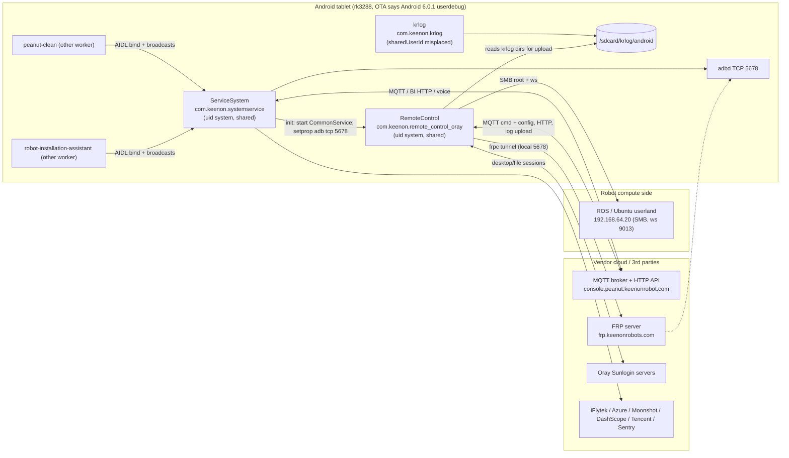
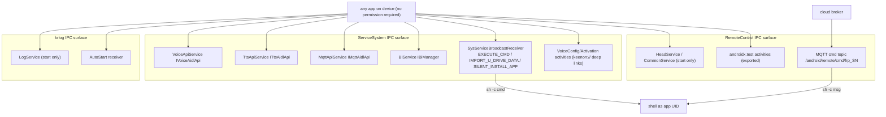

# Keenon C40 V246 - Platform system apps (static analysis)

Scope: three rk3288 platform-signed tablet-side APKs from release V246.

| # | APK file | Package | versionName / code | Size |
|---|----------|---------|--------------------|------|
| 1 | `ServiceSystem-v2.0.11-0-g94566e5-prod-release-p-rk3288-signed.apk` | `com.keenon.systemservice` | v2.0.11-0-g94566e5 / 200100 | 58,089,610 B |
| 2 | `RemoteControl-v3.3.1-0-gfe68b6d-prod-release-p-rk3288-signed.apk` | `com.keenon.remote_control_oray` | v3.3.1-0-gfe68b6d / 310 | 24,560,747 B |
| 3 | `krlog-v1.2.6-0-g18a40d0-prod-release-p-rk3288-signed.apk` | `com.keenon.krlog` | v1.2.6-0-g18a40d0 / 38 | 3,670,196 B |

All paths are relative to `D:\Sakar Robotics Projects\C40 S-LS-M014C00-RW-F00-V246\`. MD5s were pre-verified against the vendor `upgradeConfig.json` by the coordinator (not re-checked here).

Status labels: CONFIRMED, STRONGLY_SUPPORTED, INFERRED, HISTORICAL, UNKNOWN, NOT_ANALYZED, BLOCKED. Confidence: HIGH / MEDIUM / LOW. Everything below is static analysis of the packaged files; nothing was run, installed, or contacted. A static reference is not a live observation.

## 0. Method, tooling and limits

- **Manifests**: decoded with the coordinator's `axml.py`. Targets declare `targetSdkVersion=22`, so a component with an `<intent-filter>` and no `android:exported` is exported by default (counted below as "exported (default)").
- **DEX evidence**: I wrote read-only helpers (scratchpad `scripts\sys\`): `dexscan.py` (per-method index of const-strings, invoked methods, fields), `dexdis.py` (mini Dalvik disassembler), `certinfo.py` (v1 signature certificate summary), `soinv.py` (ELF inventory), `secretscan.py` (locates secret-like constants without printing values).
- **JADX / REA**: the JADX engine became available mid-task (`tools\JADX_READY`). REA (`rea-agents@6.7.0`, JADX 0.7.1) was used one call at a time to decompile selected high-value methods: `SysServiceBroadcastReceiver.onReceive`, `BaseBroadcastReceiver.onReceive`, `SystemInitializer.init`, `FrpClientHelper.receiveMqttMsg/startFrpClient/handleNginxFile`, `RemoteControlSdk` launch lambdas, `LogService.onStartCommand`, `LogcatHelper.start/init`. JADX decompilation was achieved for those only; **all other classes were analysed at DEX/bytecode level** (not decompiled). `rea inspect-signature` is macOS-only and unavailable, so signing data came from `certinfo.py`.
- **Not done**: no dynamic analysis, no on-device property/UID checks, no reverse engineering of native code beyond ELF headers, symbols and strings, no decryption of vendor secret stores, no network contact.
- **Secrets policy**: credential values were deliberately not reproduced. Where a secret exists, only type and location are given.
- Assets that are opaque binaries (voice models `.jet/.bin/.nn`, RAR payload) are NOT_ANALYZED beyond header magic.

## 1. Executive summary

1. **ServiceSystem** is the on-tablet "base service" (voice/ASR/NLP/TTS, MQTT gateway, BI telemetry). It exposes four unauthenticated AIDL services and one broadcast receiver that runs shell commands, copies files and starts the package installer on request from **any** app. Sibling APKs `peanut-clean` and `robot-installation-assistant` embed the same AIDL stubs and `KeenonServiceUtil` (strings found); they are the intended callers.
2. **RemoteControl** is the vendor remote-maintenance agent: Oray/Sunlogin remote desktop with input injection, a cloud-triggered FRP reverse tunnel (config pushed over MQTT; local port 5678 = adbd), an MQTT remote shell, cloud log collection (including SMB pulls from the ROS side at 192.168.64.20 using hard-coded root credentials), and an embedded Android OTA package.
3. **krlog** is a small local logcat/dmesg collector (no INTERNET permission) with USB-stick export. Its `sharedUserId` is declared on the wrong XML element.
4. All three are signed with one generic "Android" platform certificate (not vendor-specific); see section 5.1.
5. Highest-risk static findings: exported `EXECUTE_CMD`/`IMPORT_U_DRIVE_DATA` receiver (SYS-001/002), MQTT-delivered remote shell (SYS-005), adb-over-TCP port 5678 enabled at init (SYS-006), hard-coded SMB root passwords (SYS-007), hard-coded third-party API keys (SYS-008..010), trust-all TLS and substring-based MQTT trust checks (SYS-011/012). Full list in `system_apps_findings.json` (SYS-001..).

---

## 2. ServiceSystem (`com.keenon.systemservice`)

### 2.1 Identity, signing, platform privileges
- Manifest: `sharedUserId="android.uid.system"` on `<manifest>` (CONFIRMED, AndroidManifest.xml); `minSdk 21`, `targetSdk 22`, compileSdk 30; `allowBackup=true`, `usesCleartextTraffic=true`; no `android:debuggable` (release). v1 JAR signature only (no APK Signing Block: CONFIRMED by scan for "APK Sig Block 42").
- Effect of `sharedUserId=android.uid.system`: when installed with the matching platform certificate the app runs in UID 1000 and shares it with other system-UID packages; signature|privileged permissions (INSTALL_PACKAGES, DELETE_PACKAGES, MOUNT_UNMOUNT_FILESYSTEMS, READ_PRIVILEGED_PHONE_STATE, WRITE_SETTINGS) can be granted (INFERRED from Android framework behavior; not verified on device).
- Shell commands run through `ShellUtil.exeCmdSync(cmd, useSu)`: the `exeCmdSync(String)` overload passes `useSu=false`, so commands run through `sh` as the app UID, not `su` (CONFIRMED from disassembly `ShellUtil.exeCmdSync(String,Z)`: `"su"`/`"sh"` selected by flag).

### 2.2 Permissions (manifest) and risk comments
| Permission | Risk comment |
|---|---|
| INTERNET, ACCESS_NETWORK_STATE, ACCESS_WIFI_STATE | cloud MQTT/HTTP, voice clouds, BI upload |
| RECORD_AUDIO | microphone for ASR/wake word |
| INSTALL_PACKAGES, DELETE_PACKAGES | package install/removal (used by `AppInstallerUtil`; reachable through exported receiver) |
| WRITE_SETTINGS, DUMP, MOUNT_UNMOUNT_FILESYSTEMS | system tweaks (`setprop`, settings) |
| READ_PHONE_STATE, READ_PRIVILEGED_PHONE_STATE | device identifiers |
| ACCESS_FINE/COARSE_LOCATION | iFlytek location call (`iflybot.com.cn/.../getLocation`) INFERRED from string |
| READ/WRITE_EXTERNAL_STORAGE | voice models/logs in `/sdcard` |
| RECEIVE_BOOT_COMPLETED, WAKE_LOCK, FOREGROUND_SERVICE | start services at boot |

### 2.3 Components
| Component | Type | Exported | Notes (evidence) |
|---|---|---|---|
| `SysServiceBroadcastReceiver` | receiver | yes (default; filters) | actions BOOT_COMPLETED, PACKAGE_ADDED(package), `com.keenon.action.IMPORT_U_DRIVE_DATA`, `.SILENT_INSTALL_APP`, `.EXECUTE_CMD`; no permission (manifest) |
| `SystemStubActivity` | activity | yes (default; MAIN/LAUNCHER) | stub UI; links to DeveloperOptionsActivity; contains a runnable that sets `sys.secure.re enable` / `sys.usb.config adb` |
| `DeveloperOptionsActivity` | activity | no | opens test/config screens |
| `voice.VoiceApiService` | service | yes (explicit, no permission) | `IVoiceAidlApi` binder (`VoiceAidlApiImpl`) |
| `tts.TtsApiService` | service | yes (explicit) | `ITtsAidlApi` binder |
| `mqtt.MqttApiService` | service | yes (explicit) | `IMqttAidlApi` binder (`MqttAidlApiImpl`) |
| `bi.BiService` | service | yes (explicit; action `com.keenon.systemservice.bi.action_Message`) | `IBiManager` binder (`BiImpManager`) |
| `voice.config.VoiceConfigActivity` | activity | yes (explicit; VIEW/BROWSABLE `keenon://solution.scene.voice/config`) | voice settings UI, deep-linkable |
| `voice.config.VoiceActivationActivity` | activity | yes (default; `keenon://solution.scene.voice/activation`) | activation UI |
| VoiceFuncTestActivity, VoiceCheckActivity, VoiceConfigItemSelectActivity, iflytek VideoPlayActivity/OpenWebActivity | activities | no | internal |
| `org.eclipse.paho.android.service.MqttService` | service | no | Paho Android service declared |
| androidx.work SystemJobService (exported, BIND_JOB_SERVICE), DiagnosticsReceiver (exported, DUMP permission), others not exported | library | - | standard |
| providers (therouter, MS Speech InternalContentProvider, SentryInit/Performance, lifecycle, workmanager-init) | provider | no | |

Boot path: `SysServiceBroadcastReceiver.onReceive` on BOOT_COMPLETED starts `BiService`, `MqttApiService`, `VoiceApiService` (CONFIRMED, JADX). `BaseBroadcastReceiver.onReceive(Context,Intent)` only logs the action and dispatches; **no sender or permission check** (CONFIRMED, JADX).

### 2.4 IPC contract (AIDL files shipped inside the APK, CONFIRMED)
Package `com.keenon.*.aidl`; the files are present as `.aidl` text in the APK root.

- `com.keenon.voice.aidl.IVoiceAidlApi` (service `com.keenon.systemservice/.voice.VoiceApiService`): `Map execCmd(String cmd, Map params)`; oneway `setDynamicHotwords(List)`, `setDynamicDict(String, Map)`, `startTts(String, boolean hold, OnTtsAidlListener)`, `addOnVoiceListener/removeOnVoiceListener(appFlag, OnVoiceAidlListener)`, `setSpecialConfig(SpecialConfig)`, v2: `execCmdAsync(String cmd, String data, OnCmdResultCallback)`, `addOnVoiceV2Listener/remove...`, v3: `startTtsOnline(...)`. Callback events: `onVoiceEvent(String, Map)`, `onNlpSkill(NlpSkillEntity | String json)`.
- `com.keenon.tts.aidl.ITtsAidlApi` (`TtsApiService`): oneway `startTts(String tts, String provider, boolean hold, OnTtsAidlListener)`, `execCmdAsync(String cmd, String params, OnCmdResultCallback)`.
- `com.keenon.aidl.mqtt.IMqttAidlApi` (`MqttApiService`): oneway `addOnMqttAidlConnectListener(appFlag, listener)`, `subscribe(appFlag, topic, qos, listener)`, `unSubscribe`, `observer`, `removeObserver`, `publish(appFlag, topic, qos, byte[] payload)`. `appFlag` is caller-chosen.
- `com.keenon.bi.aidl.IBiManager` (`BiService`): oneway `send(String event, Map properties, String ap, String versionName)`.
- Broadcast contract (receiver): `com.keenon.action.EXECUTE_CMD` (extra `keenon_data` = command string; result broadcast `com.keenon.action.EXECUTE_CMD_RESULT` extra `keenon_data` = JSON of `CmdResult`); `com.keenon.action.IMPORT_U_DRIVE_DATA` (extras `formPath` [sic], `toPath`); `com.keenon.action.SILENT_INSTALL_APP` (extra `formPath` = APK path).
- Voice command surface (strings in `VoiceCmdV1/V2Executor`, `BaseCmdExecutor`): `cmd_set_voice_mode`, `cmd_set_awakeword`, `cmd_set_tts_timbre`, `cmd_set_audio_switch`, `cmd_stop_tts`, `cmd_wakeup`, `cmd_sleep`, `cmd_start_nlp/stop_nlp`, `cmd_set_dynamic_hot_words`, `cmd_gpt_*` (system role, global/biz function list, function callback), `cmd_security_check`, etc. These control voice behavior; no robot motion command was found in this surface (robot linkage UNKNOWN).
- **Expected callers** (STRONGLY_SUPPORTED): `peanut-clean` and `robot-installation-assistant` contain `com.keenon.serviceSdk.{voice,tts,mqtt,bi}.*Client` classes whose `getServiceClass()` return these service classes, `BaseAidlClient.getServicePackage()` returns `com.keenon.systemservice`, and `KeenonServiceUtil.exeCmd / silentInstallApp / copyDataToUDriveVLLL` use the three broadcast actions. The same `com/keenon/serviceSdk` package (87 classes) is in ServiceSystem itself.

### 2.5 Architecture / module map
- `com.keenon.systemservice.*` (517 classes): application (`SystemServiceApplication` extends `SystemCommonApplication` extends `BaseApplication`), initializers (`init.SystemInitializer`, `ModuelIInitializer`), `voice.*` (config UI, ctrl: audio/asr/nlp/tts, cmdExecutor, stub test UI), `mqtt.*` (AIDL impl), `bi.*` (event engine, greenDAO DB, work manager), `tts.*`.
- `com.keenon.component.core.*` (shared platform framework, also in peanut-clean): http, mqtt (`MqttManager`, `DynamicMqttServer`, `PeanutMqttServer`, `MqttServerHelper`), config/domain, robot, status, proxy, registry, module services, serviceloader, monitor.
- `com.keenon.peanut.core.*` (utility library): log, mqtt (`MqttService`), net, security (`SSLSocketFactoryCreator`), storage (MMKV), utils (`ShellUtil`, `AppInstallerUtil`, `FileUtil`, `PatchUtil` bspatch), cipher (`CipherUtil.get` JNI).
- Vendor SDK trees: `com.iflytek.{cloud,speech,aiui,aiuiability,south.robot.sdk}`, `com.microsoft.cognitiveservices.speech`, `com.tencent.liteav/live2`, `io.sentry`, `com.voice.bothlent`, greenDAO, fastjson, gson, rxjava3, okhttp3, retrofit (strings), `com.therouter`, Paho MQTT.
- Third-party libs (evidence = META-INF `.version` files and class trees): androidx appcompat 1.3.0, core 1.5.0, fragment 1.3.4, lifecycle 2.3.1, room-runtime 2.2.5, work-runtime (version file present), databinding 3.6.3/4.1.2, kotlin stdlib, BRVAH, freemarker and Apache Ant classes (build-tool classes bundled; unused at runtime INFERRED). Other library versions UNKNOWN.

### 2.6 Voice / ASR / NLP / TTS
Configuration assets `assets/voiceConfig/voice_config.json` (domestic) and `voice_config_oversea.json`:
- Domestic: audio provider `rokid` (hardware mic array via `libK18SttyCommInterface.so`, JNI `com.rokid.k18stty.K18SttyCommAPI`), wake word text "你好花生", ASR `iflytek_robot`, NLP `llm_cn` with local NLP (`useLocalNlp:true`) and actuator names (fooddelivery/hotel/basic/global), TTS `iflytek_offline`.
- Overseas: ASR `micro`, TTS `micro` (Microsoft Azure Cognitive Services Speech SDK + Azure OpenAI), NLP `llm_cn`.
- Cloud endpoints found: iFlytek robot platform (`service.iflybot.com.cn`, `robot.iflybot.com.cn` WebSocket, `iflybot.com.cn/service/sit/manager/v1/device/getLocation`, `openapi.openspeech.cn`, `open.xf-yun.com/msp.do`, `log.iflytek.com`, `logconf.iflytek.com`), Keenon NLP (`robotnlp.keenonrobot.com:80`, `corrector.keenonrobot.com:80`, test hosts `t-robotnlp.ikeenon.com`, `t-corrector.ikeenon.com`), LLM providers (`api.moonshot.cn` Kimi, `dashscope.aliyuncs.com/compatible-mode/v1/chat/completions` model string `deepseek-v3`, Azure OpenAI `https://%s/openai/deployments/%s/chat/completions` with eight regional resources in `micro_resource.json`), Tencent (`applog.iotcloud.tencentiotcloud.com`, TRTC `room://` URIs), plus `ws://10.40.53.203/robot/engine` (private-address dev default, STRONGLY_SUPPORTED stale config).
- Local engines: iFlytek MSC (`libmsc.so`, `assets/tts/*.jet` voices xiaoyan/xiaofeng/xiaofang + common), AIUI (`libaiui.so`), VTN/AEC front-end (`libvtn.so`, `assets/vtn`), HLW wake word (`libhlw.so`, `assets/hlw*`), VAD (`libvadLib.so`, `libydvad.so`, `meta_vad_16k.jet`), Microsoft Speech SDK native stack, Tencent LiteAV audio (`libliteavsdk.so`). Model files NOT_ANALYZED.
- LLM prompt asset: `assets/llm/basic_llm_system_role.txt` (persona prompt describing "Keenon"). Local ASR command matching: `assets/asr/asr_local_functions.json` (regex for close_chat, stop_talent_show, talent_show dance/playCartoon): voice commands are tied to chat/entertainment features, not navigation (robot link UNKNOWN).
- Voice-driven function actuators come from `actuators.json` -> `VoiceActuatorFactory` (volume control, language switch); voice results are delivered to callers via `onVoiceEvent/onNlpSkill`.

### 2.7 MQTT
- Two client variants (`MqttManager.init`): an AIDL client (`MqttClient` in serviceSdk, used when another process hosts the real MQTT) and a real client (`DynamicMqttServer`, `PeanutMqttServer`).
- `DynamicMqttServer` (CONFIRMED, disassembly): URL `ssl://host:8883` for prod flavor; non-prod `ssl` ports 18883 (region JP) or 21884; plain `tcp://host:port` form also built. SSL is selected when the domain region is **not** CN (`DefaultMqttSslSupportStrategy.isSupportMqttSsl = !"CN".equalsIgnoreCase(iso2)`). So the China region path uses plain TCP (INFERRED from default strategy; actual region chosen at runtime). Hostname comes from `assets/domain/domain*.json` (prod CN `console.peanut.keenonrobot.com`; ES `es-cloud.robotkeenon.com`; other `cloud.robotkeenon.com`; eng/pre/dev hosts under `ikeenon.com`) or from server-pushed config (`MqttPwdApi`, `/api/app/mqtt/secret/v1`).
- Credentials: username/password are looked up through `CipherUtil.get(Context, "peanut_mqtt_u"/"peanut_mqtt_p")` (native `libcipher_pack.so`), SSL key/trust passwords via the same call (`ssl_key_pwd_prod/test`, `ssl_trust_pwd_*`). Values not extracted. Client/CA keystores are embedded as `res/raw/{client,ca,eng_client,eng_ca}.bks`.
- Custom TrustManager (`DynamicMqttServer$2`): accepts a chain if every certificate's `getSubjectDN().toString()` **contains** `keenon.com`; no signature, expiry or issuer validation (CONFIRMED, disassembly of `checkTrusted`).
- Topic examples (strings): `/device/%s/ioe_mqtt_conn/v1/cloud_client` (server-driven reconnect/host change, `MqttConnChange` action). Other topics are caller-supplied via AIDL.
- Logging weakness: `DynamicMqttServer.getKeyPwd/getTrustPwd` log "getKeyPwd %s => %s" at debug (CONFIRMED) which writes the resolved password into logcat (krlog collects logcat; see 4).

### 2.8 BI / telemetry
- `BiImpManager.send(event, props, ap, version)` -> `EventEngine` -> instant queue or SQLite queue; greenDAO database `biEvent.db`, table `LocalEvent(AP, APP_VN, TIMESTAMP, EVENT, PROPERTIES, ROBOT_SN, ROB_VC, ROB_TYPE, PRIORITY)` (CONFIRMED strings), unencrypted (SQLCipher hint string is library text). `assets/bi_config.gson`: upload every 30 s, 50 events per batch, DB cap 1000 / purge 50%.
- Upload endpoints: `/api/appservice/device/app/log_report/v1`, `/log_report_config/v1` on the selected domain; fault broadcast `com.keenon.action.BI_REPORT_FAULT`.
- Crash/telemetry: Sentry DSN in manifest meta-data (`http://<key>@sentry.keenonrobot.com/12`, cleartext; key redacted), `traces.sample-rate=1.0`; Sentry NDK libs present. Tencent LiteAV logging to `/log/liteav`.

### 2.9 Local storage
MMKV (`libmmkv.so`, `/mmkv`), SharedPreferences (SDK libraries), greenDAO `biEvent.db`, files under `/sdcard/iflytek_south/tts`, `/sdcard/msc/msc.log`, `/sdcard/peanut/voice/gptSystemDesc.txt` (optional system-prompt override file read from external storage: any app with storage access could alter the LLM persona; INFERRED from path string), `/sdcard/system/core/*` (iFlytek robot SDK).

### 2.10 Native libraries (30; all ARM 32-bit, armeabi-v7a only; inventory in artifacts JSON)
Vendor markers by evidence: Microsoft Speech SDK (core, kws, lu, codec, silk, java bindings with 445 JNI exports), iFlytek (msc, aiui, vtn, hlw, vad, cae/alsa jni, robotdevice, native-lib), Rokid (`libK18SttyCommInterface`), Tencent (LiteAV + txffmpeg + soundtouch, MMKV, GVoice `libGVoiceUtils/libmygvoice`), Sentry (`libsentry`, `libsentry-android`), liblzma, `libpatchutils` (bspatch JNI `PatchUtil.bspatch`), `libcipher_pack` (`CipherUtil.get`), `librobotdevice` (`RobotDeviceNative.getDeviceId`, contains AES helper symbols). `libcipher_pack` exports data symbols named `BUGLY_APPID/APPKEY_*`, `UMENG_APPKEY`, and carries a per-package key map (strings include `aes_dev_key/iv`, `ssl_*_pwd_*`, `md5_secret_key`, `amap_appkey`, `peanut_mqtt_u/p[_prod]` and short plaintext literals next to them) keyed by the caller's package name (`getPkgNameByContext`; allowed list includes solutionfooddelivery/hotel/disinfect/medicaldelivery). The role of the literals is INFERRED (default credentials); values withheld.

### 2.11 Assets
Voice models (`assets/tts/*.jet`, `hlw*/`, `ivw/ivw.jet`, `vad/`, `vtn/one_ivw.3.13.1.bin`, `dse_v1_239-119-oneref-e.nn` 3.2 MB), config JSON (`domain*`, `robot*.json`, `voiceConfig/*`, `bi_config.gson`, `record.json`, `actuators.json`, `sensors.json`), `assets/vtn/privateKey.pem` (RSA private key, 1,700 B) and `publicKey.pem`, `assets/voice_asr_white_words.config` (wake/keyword white list), pinyin tables, `res/raw/*.bks` (4 keystores) and `res/xml/network_security_config.xml` (cleartext permitted, user CAs trusted; **not referenced from the manifest**, and API 24+ only, so ineffective on Android 6 targets; INFERRED).

### 2.12 Workflows
**WF-S1 TTS request.** Entry: client binds `TtsApiService` (or `VoiceApiService`) and calls `startTts(text, provider, hold, listener)`. Components: `TtsApiService` binder -> voice/tts controller (`voice.ctrl.tts.*`) selecting provider (iflytek_offline local MSC voices, or micro/Azure online). Data change: audio played on tablet; listener gets `onAidlTtsEvent(int)`. Robot interaction: none found. Error behavior: callbacks only (not traced). Evidence: AIDL files, `VoiceAidlApiImpl`, `voice_config*.json`. Confidence MEDIUM.

**WF-S2 Voice interaction.** Wake word (Rokid/VTN/HLW) -> VAD/record -> ASR (iFlytek robot WebSocket or Azure) -> NLP (`llm_cn` -> Kimi / DeepSeek via DashScope / Azure OpenAI, plus local regex matcher) -> actuator/skill -> `onVoiceEvent/onNlpSkill` to listeners registered with `appFlag` (the launcher/solution apps). Evidence: provider strings, `LlmNlp` classes, config JSON. Robot actions are executed by the **listening app**, not here (INFERRED). Confidence MEDIUM.

**WF-S3 MQTT via AIDL.** Entry: client calls `IMqttAidlApi.subscribe/publish`. `MqttAidlApiImpl` forwards to `MqttManager.mqtt()` (device-credentialed connection), keeps per-`appFlag` observer maps, replays cached messages on (re)registration, delivers `onMessageArrived(tag, topic, id, payload)`. Data change: messages published to cloud broker under the robot's identity. No topic allow-list or caller check found (STRONGLY_SUPPORTED). Confidence HIGH on forwarding, MEDIUM on absence of filters.

**WF-S4 BI event.** `IBiManager.send` -> EventEngine -> instant or SQLite queue -> periodic HTTP upload to `log_report` API; DB capped. Confidence MEDIUM.

**WF-S5 EXECUTE_CMD broadcast.** Entry: broadcast `com.keenon.action.EXECUTE_CMD` with `keenon_data`. `SysServiceBroadcastReceiver.exeCmd` runs `ShellUtil.exeCmdSync(cmd)` on a pool thread and broadcasts `EXECUTE_CMD_RESULT`. Success/error reported only through the result broadcast (JSON). Confidence HIGH (CONFIRMED, JADX).

**WF-S6 Init.** `SystemInitializer.init`: on "fusion board" in release builds, `setprop sys.secure.re disable`, `setprop sys.usb.config none`, starts RemoteControl's `CommonService`; then on all builds `setprop service.adb.tcp.port 5678; stop adbd; start adbd` (CONFIRMED, JADX). Confidence HIGH.

---

## 3. RemoteControl (`com.keenon.remote_control_oray`)

### 3.1 Identity and privileges
`sharedUserId=android.uid.system` on `<manifest>` (CONFIRMED); `allowBackup=true`, `usesCleartextTraffic=true`; v1 signature only. Permissions of note: INSTALL_PACKAGES, DELETE_PACKAGES, **INJECT_EVENTS** (synthetic input), INTERACT_ACROSS_USERS_FULL, SYSTEM_ALERT_WINDOW, REORDER_TASKS, MOUNT_UNMOUNT_FILESYSTEMS, WRITE_SETTINGS, CHANGE_WIFI/NETWORK_STATE, READ_PRIVILEGED_PHONE_STATE, plus Samsung MDM/Knox permissions (no effect on rk3288; Knox classes are Oray SDK baggage, INFERRED).

### 3.2 Components
| Component | Type | Exported | Notes |
|---|---|---|---|
| `remote_control.activity.RemoteHomeActivity` | activity | yes (default; LAUNCHER) | status/home UI |
| `AboutActivity`, `remotectrl.PermissionActivity`, `ssh.SshInfoActivity` | activity | no | PermissionActivity triggers MediaProjection consent |
| `daemon.RobotBootReceiver` | receiver | yes (default; BOOT_COMPLETED prio 1000) | starts services |
| `daemon.HeadService` | service | yes (explicit) | `onBind` returns null (RAW `12011101`); `onStartCommand` only logs: keep-alive |
| `com.keenon.common.base.CommonService` | service | yes (explicit) | `onBind` null; started by ServiceSystem at init to bring the app up |
| `daemon.Service1/Receiver1` (`:process1`), `Service2/Receiver2` (`:process2`) | service/receiver | no | marsdaemon multi-process keep-alive |
| `oray.sunlogin.service.AdbSimpleIME` | service (IME) | protected by BIND_INPUT_METHOD | virtual keyboard for remote typing |
| `oray.sunlogin.receiver.KnoxAdminReceiver` | receiver | protected by BIND_DEVICE_ADMIN | device-admin stub |
| `oray.sunlogin.receiver.KnoxLicenseReceiver` | receiver | yes (default; Knox license actions) | harmless on non-Samsung |
| `androidx.test.core.app.InstrumentationActivityInvoker$BootstrapActivity / $EmptyActivity / $EmptyFloatingActivity` | activities | **yes (explicit, MAIN filter)** | test-support classes shipped in release |
| androidx.work (SystemJobService, DiagnosticsReceiver) | library | as in 2.3 | |
Classes present but **not declared** in the manifest (so inert unless started by code): `MediaProjectionAndKeepAliveService`, `PermissionAccessibilityService`, `RemoteConnectService` (STRONGLY_SUPPORTED by manifest vs class tree).

### 3.3 Architecture / module map
Application `RemoteApplication` (extends `DaemonApplication`) registers **module services** with `ModuleServiceManager`: `RemoteCtrlModuleService` (Oray remote control), `ssh.SshModuleService` (FRP/remote shell, only if `com.keenon.ssh` flavor installed check), `peanut.uploadlog.UploadLogModuleService` (log upload). It also starts `PeanutHttpServer` / `DynamicHttpsServer` domain handling, `CheckMapAPPManager`, `CheckSlogManager`/`UpgradeManager` (skipped for flavor "eng" strings), clears caches, installs a `CrashHandler`, and `RuntimeUtil.setSambaEnable()`.
Packages: `com.keenon.common.*` (http + app-level encryption, MQTT, network auto-switch, beans, protobuf `PushOuter`/`NetworkStatusOutter`), `com.keenon.remotectrl.*` (Oray glue), `com.oray.sunlogin.*` + `liboray*.so` (vendor SDK), `com.keenon.ssh.*`, `com.keenon.peanut.uploadlog.*`, `com.keenon.remote_control.*` (UI, OTA manager), `com.marswin89.marsdaemon` (process keep-alive via native fork), SMB client (`com.hierynomus.smbj`), BouncyCastle (full provider tree), SnakeYAML, java-websocket, protobuf, Paho, Samsung Knox SDK stubs, Room/androidx.

### 3.4 Network and endpoints (strings; STRONGLY_SUPPORTED)
- HTTP(S) base: `http://console.peanut.keenonrobot.com:80` default (`RemoteControlSdk$5`), `https://`-or-`http://` + domain:port from `RemoteCtrlHttpServer` (hosts per flavor: prod `console.peanut.keenonrobot.com`, pre `p-cloud.ikeenon.com`, eng `t-cloud.ikeenon.com`, dev `d-cloud.ikeenon.com`).
- REST paths: `/api/app/token/getSingleToken`, `/api/app/encrypt/v1`, `/encrypt/random/v1`, `/encrypt/aes/safe/v1`, `/api/app/mqtt/secret/v1`, `/api/app/robot/info/v2`, `/robot/checkNewSoftware/v2`, `/robot/software/package/info[/v2]`, `/robot/version/status/v2`, `/robot/log/types/v2`, `/robot/remote_log/v1/{file_list,upload,upload_status}`, `/api/remote/sunlogin/device/session/v2`, `/device/status/v2`, `/service/secret/v2`, `/device/speed/test_url`, `/api/hotel_app/cloud/config/v1`.
- MQTT topics: `/android/remote/cmd/frp_<SN>` (cloud->robot command), `/android/remote/cmd_resp/frp_<SN>`, `robot/%s/dev_config/ros/remote-ssh/v1/{cloud_msg,dev_msg}`, `/dev_config/cloud_config/hotel/v1/cloud_msg`, `/remote-maintenance/network_tunnel/{cloud_msg,dev_msg}`, `/dev_data/sys_log/notify/v1/server`, `/dev_data/sys_log/notify_upload/v1/server`, `/devops_common/v1/{cloud_client,dev_client}`, `/device/%s/ioe_mqtt_conn/v1/cloud_client`, `/robot/`, `/common/server/`, `/server/push/`, `/client/push/`.
- FRP server host string: `frp.keenonrobots.com` (used for latency ping; the actual server address/port/token arrive in the pushed config).
- Local/internal: `192.168.64.20` (SMB share host, ping target, rosbridge-style WebSocket `ws://192.168.64.20:9013`), `ws://192.168.64.20:9013` (`WebClientManager`), `/oem/etc/ros/runtime/remotemap`, `/oem/etc/nginx/conf.d`, `/system/bin/ubuntu1604` wrapper (an Ubuntu 16.04 userland on the device; INFERRED).
- App-layer HTTP security: `SecurityEncryptInterceptor`; RSA (`RSA/ECB/PKCS1Padding`, `SHA1WithRSA`) key exchange, `AES/CTR/NoPadding` payload encryption, MD5/SHA1-style signing (`SignUtils`), token interceptor (`ACCESS_TOKEN`). RSA private key and AES key/IV are cached in MMKV.
- Transport: `AllowX509TrustManager.allowAllSSL()` (called from `SecurityKeyManager.init`) installs a process-wide trust-all `SSLSocketFactory` and always-true hostname verifier on `HttpsURLConnection` (CONFIRMED).

### 3.5 Remote desktop (Oray / Sunlogin)
`RemoteControlSdk` (glue) + `liborayservice_sdk.so` (25 JNI exports) + `liborayinput_agent(5).so` (input injection) + `liborayscreen_agentn.so` (screen capture, links libgui/libskia/libbinder). Flow (STRONGLY_SUPPORTED from method strings, not traced end to end): `deviceLogin` against the vendor cloud -> `requestToken` -> `requestServerConfig` (`serverAddress`, `serverLicense`, cached) -> `loginLicense` -> `createSessionAll` creates two sessions, `desktop` and `file` (file root `/sdcard/download/`), session info uploaded via `/api/remote/sunlogin/device/session/v2`; screen capture via MediaProjection (PermissionActivity `remote.ctrl.isStartMediaProjection`) or the native screen agent; input via the native agent launched from `/data/local/tmp/` with `ClientSdkManager.LaunchExternalProcess(...)` (CONFIRMED JADX of `lambda$runTaskWithSystem$*`) or injected events (INJECT_EVENTS). Status uploaded with `robotSn`+`status`. Operator authentication/authorization is performed by the Oray/Keenon cloud (the app has no local prompt beyond MediaProjection consent; INFERRED). 3DES JNI (`lib3Des.so`, `CtrlDesUtil.encrypt`) is present.

### 3.6 SSH/FRP maintenance tunnel and remote shell
Entry: MQTT message on the per-SN `.../remote-ssh/v1/cloud_msg` topic (and `/android/remote/cmd/frp_<SN>`). `SshMqttProxy` -> `FrpClientHelper.receiveMqttMsg` parses JSON `{action, data}`:
- `frpConfig` -> `startFrpClient`: runs `setprop sys.secure.re enable` and `setprop sys.usb.config adb`, writes `frpc.ini` (`server_addr`, `server_port`, `token`, `type=tcp`, `local_ip=127.0.0.1`, `local_port=5678`, `remote_port`), then launches `frpc -c <file>` via `sh` (CONFIRMED, JADX). Local port 5678 is the adb TCP port set by ServiceSystem (WF-S6), so the tunnel exposes adbd to the vendor FRP server (INFERRED link between the two constants).
- `frpMapConfig` -> `startMapFrpClient` (ros_/ssh_ proxies, subdomain, bandwidth limits) and variant with `nginxConfig`: Base64 file + certificate zip written to disk then deployed to `/oem/etc/ros/runtime/remotemap` and `/oem/etc/nginx/conf.d` using `KNNativeTool.nativeCmd` (JNI `libnativetool.so`, UDP socket to a local command proxy `KeenonShell::proxyCmd`, INFERRED), ending with `/system/bin/ubuntu1604 xargs nginx -s reload` (CONFIRMED, JADX).
- `frpDisconnect` -> `stopFrpClient` (`setprop sys.secure.re disable`, `setprop sys.usb.config none`).
- `SshMqttProxy$2.onMessageArrived`: payload on `getCmdTopic()` -> `APPCmdHelper.inputCmd` parses JSON `msg` and runs it with `ShellUtil.exeCmd(msg, callback)` (shell `sh`), replying on `cmd_resp` (CONFIRMED, disassembly).
- MQTT connection for this feature (`SshMqttServer`, clientId `frp_<SN>`): URL from preference `local_mqtt_url` or default `tcp://console.peanut.keenonrobot.com` (prod) / `tcp://t-cloud.ikeenon.com` (eng) with **no port in the string** (Paho default for `tcp://` is 1883; INFERRED); credentials via `CipherUtil.get("peanut_mqtt_u"/"peanut_mqtt_p")`. Feature gated by `SshMqttProxy.isShowFrpSsh` (region CN).
- Second MQTT connection (`RemotePeanutServer`, tag `mqtt-tools`, clientId `tools-<SN>`): host/port/user/password fetched from the cloud (`MQTTConnectManager`, `/api/app/mqtt/secret/v1`) for `tcp://`; a third "stats" client (`mqtt-frp`) uses `ssl://` with `ClientSSLSocketFactory` and the same substring-based trust check (CONFIRMED, disassembly) and hard-coded keystore passwords for the eng flavor (CONFIRMED literal constants in `ClientSSLSocketFactory.create`).

### 3.7 Log collection / upload (cloud)
Trigger `/dev_data/sys_log/notify[_upload]/v1/server` (protobuf `RemoteLogNotify[Upload]`) -> `RemoteMsgManager` -> `AlgorithmLogManager`: builds a file list from robot directories (`AlgorithmLogPath`: ROS logs, bags, `/keenon/{log,console,schedule,fdl_data,bag,idlebag}`, `/database`, `peanut.db`, `/monitor_script/{ARM,X86}/log`, `/system_monitor_nmon/`, and **`krlog`, `krlog/android`, `krlog/robot`, `krlog/database`, `krlog/others/system_monitor/cpu`**), optionally pulls files from the ROS side via SMB (`SMBManager`, host 192.168.64.20, user `root`, password list `SMBInterface.PASS_LIST` of two hard-coded entries: CONFIRMED), zips (`UploadFileUtil`) and uploads multipart to the cloud upload address (`/api/app/robot/remote_log/v1/upload`, status `/upload_status`). Also `NetWorkTestManager` upload speed test using `assets/speedTest.zip` (actually a RAR archive, 10.1 MB), `AppStateManager` (CPU/memory/storage, FRP latency ping, `RobotSunloginTaskReconnect`, `getRobotInfoState`).

### 3.8 System update and app management
- `UpdateSystemManager`: copies assets `RKUpdateService_v1.8.2.apk` (Rockchip OTA service, package `android.rockchip.update.service`, exported service) and `update.zip` (2.6 MB OTA) and triggers `RKUpdateService` with extras `command`/`delay` when version suffix `-b/-c` checks require. OTA metadata (read): target `Android/rk3288/rk3288:6.0.1/MXC89K/...:userdebug/test-keys`, timestamp 1749524886, device guard `rk3288`; it deletes `/system/bin/save_log.sh`, installs scripts `set_video_perm.sh` (loops, `chmod 666 /dev/video*`), `rm_slog.sh` (`rm -rf /data/keenon/`), replaces `SystemUI.apk`, edits `build.prop` display id suffix to `-c`, patches `user_service.sh`. The update is signed with the OTA cert inside the zip (`otacert`). This documents the base OS: **Android 6.0.1 userdebug/test-keys** (CONFIRMED from the packaged metadata, for the OTA target; the installed OS itself is UNKNOWN).
- `CheckMapAPPManager`: compares the installed version of `com.keenon.peanut.peanutservice` with a compiled-in string (`v3.2.11-0-g189e078`) and, on mismatch, uninstalls it with `pm uninstall` (STRONGLY_SUPPORTED).
- `APPInstallUtils`: `pm install -r` silent install and `ACTION_VIEW` installer helpers.
- `CheckSDCardWork`: deletes oversized `slog` directories.

### 3.9 Native libraries and assets
Libs: `liborayservice_sdk.so`, `liborayinput_agent.so`, `liborayinput_agent5.so`, `liborayscreen_agentn.so`, `libnativetool.so`, `lib3Des.so`, `libcipher_pack.so`, `libmmkv.so`, `libpatchutils.so`, `libdaemon_api20/21.so` (+ assets `daemon` ELF for armeabi-v7a/armeabi/x86), a 1.8 KB `liblog.so` stub. Assets: `domain/domain{,-dev,-eng}.json`, `update.zip`, `RKUpdateService_v1.8.2.apk`, `speedTest.zip` (RAR), `daemon` ELFs, `res/raw/{client,ca,eng_*,dev_*}.bks` keystores. Protobuf descriptors/license files (junit, google protobuf `.proto`) bundled as library baggage.

### 3.10 Workflows
**WF-R1 Remote-control session setup** - entry: device boot (ServiceSystem starts `CommonService`; `RobotBootReceiver`) -> `RemoteControlSdk.onCreate` -> network available -> `deviceLogin`/`requestToken`/`requestServerConfig` -> agent processes launched -> `createSessionAll` (desktop+file) -> session address posted to cloud. Data changes: cached `serverAddress/serverLicense`, `/data/local/tmp` agent files. Robot interaction: only tablet screen/input; **no direct robot-control API was found**; effect on the robot is whatever the visible UI does. Errors: logged ("deviceLogin onError", "requestToken onError"), retry on connectivity change. Confidence MEDIUM.

**WF-R2 Cloud-triggered FRP/adb tunnel** - as 3.6 `frpConfig`. Success: `sendConnectStatus` publishes `connectionStatus`/`frpState` to MQTT. Confidence HIGH on code path, LOW on the server side.

**WF-R3 MQTT remote command** - as 3.6; response with `isSuccess` and `data` on the response topic. Confidence HIGH.

**WF-R4 Cloud log upload** - as 3.7. Confidence MEDIUM.

**WF-R5 OTA/system update** - as 3.8. Confidence MEDIUM.

---

## 4. krlog (`com.keenon.krlog`)

### 4.1 Identity and permissions
`package com.keenon.krlog`, v1.2.6-0-g18a40d0 (code 38), targetSdk 22. **`android:sharedUserId="android.uid.system"` appears on `<application>`** (CONFIRMED in the decoded binary XML; attribute order consistent with resource-ID sorting), not on `<manifest>`. Android reads `sharedUserId` only from `<manifest>`, so this app most probably runs in its **own** UID although platform-signed (INFERRED; not verified on device). `allowBackup=true`. Permissions: READ_LOGS, READ/WRITE_EXTERNAL_STORAGE, WRITE_MEDIA_STORAGE, MOUNT_UNMOUNT_FILESYSTEMS, INSTALL_PACKAGES, DELETE_PACKAGES, READ_PHONE_STATE, READ_PRIVILEGED_PHONE_STATE, WRITE_SETTINGS, RECEIVE_BOOT_COMPLETED, ACCESS_NETWORK_STATE. **No INTERNET permission** (CONFIRMED): nothing is uploaded by this app.

### 4.2 Components
`view.MainActivity` (exported default, LAUNCHER), `receiver.AutoStartBroadcastReceiver` (exported default, BOOT_COMPLETED: delayed `startService(LogService, IF_AUTO_START=true)`), `service.LogService` (exported=true, no filter, no permission; `onBind` returns null, RAW `12011101`), `service.DaemonService` (not exported; thread that restarts LogService if not running), utilcode `UtilsTransActivity*`, `UtilsFileProvider` (not exported), `MessengerUtils$ServerService` (not exported). IPC: only `startService` with boolean extras `IF_AUTO_START`, `IF_CLEAR_FILE`; `onStartCommand` stores both and calls `LogcatHelper.start()` (CONFIRMED, JADX). `IF_CLEAR_FILE` is stored but not acted on in that path; clearing is triggered only by `MainActivity.chooseClick -> LogService.clearCache` in the UI (STRONGLY_SUPPORTED). So any app can only (re)start capture.

### 4.3 What is collected and where it goes
- `LogcatHelper$LogDumper` executes `Runtime.exec("logcat")` (command string is exactly `logcat`; extra flags not present as constants) and streams all lines to `<log dir>/log_yyyyMMdd/log_yyyyMMddHHmmss.txt` via a FileChannel with `force()`; rotates at `LOG_SWITCH_SIZE` (default 50 MB, preference `LOG_SWITCH_SIZE`). `LogDmesg` runs `dmesg` into `dmesg_yyyyMMddHHmmss.txt`. Daily folders `log_yyyyMMdd`, keep `LOG_FOLDER_COUNT` (default 30) and trim by free-space (`checkStorage`, `Util.queryStorageWithMb`). Older text files are zipped (`ZipUtil.compressFile`).
- Log directory: `<getExternalStorageDirectory()>/<Constants.APP_LOG_DIR_FUSION_BOARD>` when `getprop robot.keenbot.ver` equals `2` ("fusion board"), else `Constants.APP_LOG_DIR`; the fusion-board constant is built from the strings `krlog` + separator + `android` (STRONGLY_SUPPORTED: `/sdcard/krlog/android`). RemoteControl's `AlgorithmLogPath` also lists `krlog/android` (corroboration).
- READ_LOGS use: capturing device-wide logcat (all apps) is the app's purpose; as a non-system-UID (see 4.1) it needs READ_LOGS as a granted signature|privileged permission. Content includes anything other apps log (see SYS finding on logged passwords).
- UI: `MainActivity` shows version, log size/count settings (`SimpleDialog`), export to a USB stick under `/storage/*` (excluding `emulated`/`self`, `getUsbFiles`), "export all" or "export by day", delete; prompts "请插入优盘" if no stick. Settings in SharedPreferences `krlog` (`PreferencesUtil`).
- Library baggage: `com.keenon.peanut.core.utils.*` (ShellUtil, AppInstallerUtil, DownloadHelper, vendor board managers incl. SMDT `android.app.smdt.*`), only `ShellUtil.exeCmdSync("getprop robot.keenbot.ver")` is reachable from app code. The install/uninstall/download helpers are present but not referenced by krlog code (STRONGLY_SUPPORTED by invoke search).
- Native: `libpatchutils.so` (bspatch) for 4 ABIs; unused by app code.

### 4.4 Workflow WF-K1 log collection
Boot -> `AutoStartBroadcastReceiver` -> delayed `startService(LogService)` -> `LogcatHelper.init/start` -> two threads (`logcat`, `dmesg`) -> files in `/sdcard/krlog/...` -> rotation/trim -> user exports to USB via `MainActivity`; `RemoteControl` uploads selected `krlog` paths to the vendor cloud on cloud request. Data change: external-storage files only. No robot interaction. Confidence HIGH on capture path, MEDIUM on the RemoteControl corroboration.

---

## 5. Cross-app analysis

### 5.1 Signing
All three: v1 (JAR) signature only, algorithm sha256WithRSA, 2048-bit RSA, single certificate `C=US, ST=California, L=Mountain View, O=Android, OU=Android, CN=Android, E=android@android.com`, serial `00ff0641323cf95512`, validity 2014-12-23 to 2042-05-10, cert SHA-256 `2d370c21...3522` (CONFIRMED, `certinfo.py`). `peanut-clean` carries the same cert; `robot-installation-assistant` uses a different one (`CN=keenon`, v2 block present). The subject is the generic AOSP-style "Android" name, not a Keenon identity; this is consistent with the Rockchip SDK platform key (INFERRED; whether the private key is publicly known is UNKNOWN). The OTA metadata shows `test-keys`.

### 5.2 Component map

### 5.3 IPC / relationship diagram

### 5.4 Robot relationship
No ROS topic names, serial-port access, or navigation commands were found in these three APKs. Robot-side links found: the ROS/Ubuntu environment (SMB share root access at 192.168.64.20, WebSocket 9013 bridged to MQTT `mqtt-tools`, files under `/oem/etc/ros/runtime/remotemap`, nginx reload inside `ubuntu1604`, log paths for ROS bags/logs) and board properties (`robot.keenbot.ver`, `sys.usb.config`). These are labelled STRONGLY_SUPPORTED (strings + code paths) but the topology (separate ROS board vs. Ubuntu userland on the same SoC) is INFERRED. `system_apps_ros_refs.json` lists them as STATIC_REFERENCE.

### 5.5 Security review summary
Severity is for the static design weakness; exploitability depends on runtime state (effective UID, adbd authentication, region, server-side checks) that was not observed. Details and remediation per ID in `system_apps_findings.json`.

| ID | Sev | Title |
|---|---|---|
| SYS-001 | Critical | Exported receiver executes arbitrary shell commands (`EXECUTE_CMD`) |
| SYS-002 | High | Exported receiver copies arbitrary files/directories (`IMPORT_U_DRIVE_DATA`) |
| SYS-003 | Medium | Exported receiver triggers APK install flow for any path (`SILENT_INSTALL_APP`) |
| SYS-004 | High | Unauthenticated exported AIDL services (voice/TTS/MQTT/BI), arbitrary MQTT publish |
| SYS-005 | High | MQTT-delivered remote shell (`APPCmdHelper.inputCmd`) over plain TCP broker connection |
| SYS-006 | High | adb over TCP 5678 enabled unconditionally; cloud config toggles USB adb and tunnels 5678 |
| SYS-007 | High | Hard-coded SMB root passwords for ROS host |
| SYS-008 | High | Hard-coded LLM provider bearer keys in code (Moonshot, DashScope/DeepSeek) |
| SYS-009 | High | Hard-coded Azure OpenAI/Speech keys (8 regions) in assets |
| SYS-010 | Medium | iFlytek app credentials and an RSA private key shipped in assets |
| SYS-011 | High | Process-wide trust-all TLS and hostname verifier |
| SYS-012 | High | MQTT TLS trust check is a substring test on certificate subject |
| SYS-013 | Medium | Cleartext transports (HTTP, TCP MQTT, Sentry DSN, cleartext allowed) |
| SYS-014 | Medium | Generic platform signing identity shared by system apps |
| SYS-015 | Medium | krlog `sharedUserId` on wrong element |
| SYS-016 | Medium | androidx.test activities exported in release RemoteControl |
| SYS-017 | Medium | Hard-coded AES material/keystore passwords; native key map with plaintext literals; secrets in unencrypted MMKV |
| SYS-018 | Low | `allowBackup=true` on all three |
| SYS-019 | Medium | Passwords written to logcat, which krlog stores on shared storage |
| SYS-020 | Medium | Remote desktop with input injection; agents executed from `/data/local/tmp` |
| SYS-021 | Medium | Cloud-controlled file write/nginx deploy with unvalidated names (path traversal risk INFERRED) |
| SYS-022 | Low | Exported voice deep-link activities and boot receivers |
| SYS-023 | Low | krlog stores device-wide logcat on shared storage, no retention of access control |
| SYS-024 | Low | Writable external-storage override of LLM system prompt |
Remaining IDs (SYS-025 onward) are architecture/inventory records in the same JSON.

### 5.6 Gaps and next steps
- Effective UID of krlog and of the system-shared apps on a live image; adbd auth settings (`ro.adb.secure`) - UNKNOWN.
- Native-code behavior (`libcipher_pack` secret decoding, `libnativetool` UDP proxy target, Oray SDK protocols) - NOT_ANALYZED.
- Server-side authorization of remote sessions/commands, broker ACLs - UNKNOWN (outside static scope).
- Most ServiceSystem/RemoteControl classes were reviewed at bytecode/string level only; full decompilation of remaining classes is NOT_ANALYZED.
- Voice model/binary assets: NOT_ANALYZED.
